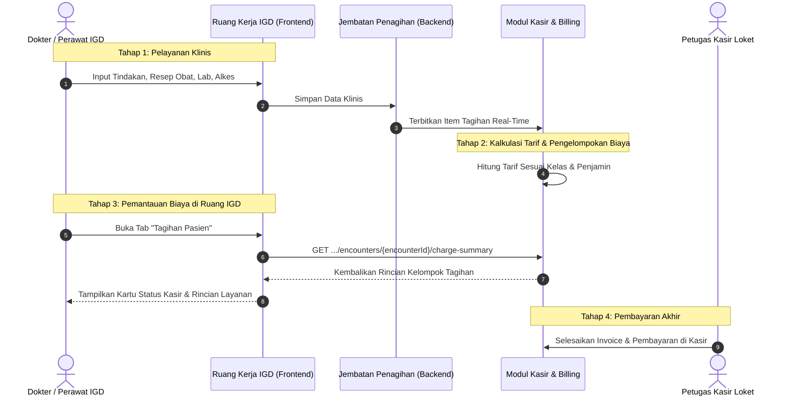

# Blueprint: Integrasi Layar Tagihan Pasien IGD

| Parameter | Nilai |
| :--- | :--- |
| **Nomor Dokumen** | `BP-IGD-BILLING-001` |
| **Tanggal Terbit** | 23 Oktober 2026 |
| **Modul Pemilik** | Instalasi Gawat Darurat (`EmergencyInstallationManagement`) & Kasir/Billing (`BillingManagement`) |
| **Tipe Dokumen** | Blueprint Arsitektur Modul Bisnis (*Business Module Blueprint*) |
| **Status Persetujuan** | `Approved by User` (Penyelarasan Wawancara 23 Oktober 2026) |
| **Batas Rekayasa** | Zero Database Migration (Memanfaatkan Endpoint Billing Aktif) |

---

## 1. Latar Belakang & Masalah Bisnis

Pada antarmuka **Ruang Kerja Pemeriksaan IGD** (`EmergencyAssessmentDetailView`), menu samping kiri memuat tab **"Tagihan Pasien"**. Saat ini, tab tersebut masih ditandai dengan status `available: false` sehingga menampilkan lencana *"Belum tersambung"* dan pesan bahwa endpoint backend belum tersedia.

Di sisi lain, seluruh transaksi pelayanan medis di IGD (tindakan medis perawat/dokter, peresepan obat di farmasi, pemeriksaan penunjang laboratorium/radiologi, dan pemakaian alat kesehatan) **sebenarnya sudah terhubung otomatis ke modul Billing** melalui backend service `BillingClinicalChargeBridgeService`. 

### Masalah yang Dihadapi Pengguna:
1. **Ketidaktahuan Status Penagihan**: Tenaga perawat dan dokter IGD tidak dapat memverifikasi apakah tindakan atau obat yang mereka berikan sudah berhasil masuk ke dalam invoice kasir atau masih tertunda di antrean rekonsiliasi tarif.
2. **Ketiadaan Estimasi Biaya di Ruang IGD**: Keluarga pasien gawat darurat sering kali menanyakan perkiraan akumulasi biaya sebelum pasien dipindahkan ke ruang rawat inap atau dirujuk. Ketiadaan layar ringkasan biaya di ruang IGD memaksa perawat menelepon kasir secara manual.
3. **Menu Menggantung (*Dead Navigation*)**: Adanya tombol menu yang menyatakan *"Belum tersambung"* menimbulkan kesan bahwa sistem IGD belum selesai dikembangkan.

---

## 2. Batas Kewenangan & Kebijakan Bisnis

Berdasarkan kesepakatan keputusan bisnis bersama pemilik sistem (23 Oktober 2026):

1. **Peran Layar: Monitoring Baca-Saja (*Read-Only Clinical Estimation*)**:
   - Layar ini berfungsi murni sebagai sarana pemantauan rincian pelayanan yang tertagih dan perkiraan total biaya pelayanan IGD.
   - Layar ini **bukan** layar kasir operasional; proses pembayaran, penagihan klaim penjamin, penerimaan uang tunai/kartu/QRIS, serta pencetakan kuitansi resmi tetap dilakukan secara tersentralisasi oleh staf kasir di loket Kasir IGD (`BillingManagement / BillingInvoices`).
2. **Kebijakan Visibilitas Rupiah (*Clinical Privacy Protection*)**:
   - **Seluruh Staf Medis/Perawat**: Berhak melihat daftar rincian tindakan, obat, dan penunjang yang tertagih beserta kuantitas dan waktu pencatatannya.
   - **Nominal Rupiah (Harga & Total Biaya)**: Hanya ditampilkan kepada pengguna yang memegang izin otorisasi finansial (izin `BillingInvoice : Read` atau `PatientBillingSummary : ViewAmount`). Apabila pengguna tidak memiliki izin ini, kolom nominal rupiah disamarkan dengan status *"Tercatat"*.
3. **Prinsip Nol Migrasi Database (*Zero DB Migration*)**:
   - Tidak ada pembuatan tabel baru di database. Sistem memanfaatkan endpoint rekapitulasi tagihan per kunjungan yang sudah ada di modul Billing:
     `GET /api/v1/health-services/billing-management/billing/invoices/encounters/{encounterId}/charge-summary`.

---

## 3. Alur Proses Bisnis End-to-End



### Tahapan Alur Terperinci:
1. **Trigger / Pemicu**: Pasien menjalani observasi dan tindakan medis di IGD.
2. **Pencatatan Pelayanan**: Staf IGD mencatat asuhan keperawatan, tindakan dokter/perawat, resep obat farmasi, permintaan lab/radiologi, dan pemakaian alat.
3. **Penerbitan Tagihan Otomatis**: Secara otomatis, `BillingClinicalChargeBridgeService` mencatat baris tagihan ke dalam invoice berjalan pasien di modul Billing.
4. **Pembukaan Tab Tagihan Pasien**: Perawat atau dokter mengklik tab *Tagihan Pasien* pada bilah menu Ruang Kerja IGD.
5. **Kompilasi Real-Time**: Backend Billing mengagregasikan biaya per kelompok (Tindakan, Obat, Penunjang, Alat, Administrasi) dan mengembalikan respons ringkasan tagihan.
6. **Penyajian Informasi**: Layar menampilkan kartu status kasir (apakah invoice masih berjalan atau sudah lunas), status penjamin (Umum / BPJS / Asuransi), serta rincian item per kelompok layanan.
7. **Penyelesaian Pembayaran**: Saat pasien dipulangkan atau ditransfer, kasir loket memproses pembayaran resmi di modul Kasir.

---

## 4. Contoh Konkret Skenario Rumah Sakit

> **Skenario Pasien Ny. Siti (Kunjungan Gawat Darurat Kasus Dispepsia Berat)**:
> 1. Ny. Siti tiba di IGD pukul 08.00 dengan keluhan nyeri ulu hati dan mual hebat.
> 2. Pukul 08.15, perawat memasang infus RL dan memberikan injeksi Ranitidine (dicatat pada tab *Tindakan*).
> 3. Pukul 08.30, dokter DPJP memeriksa pasien dan meresepkan tambahan obat injeksi Ondansetron (dicatat pada tab *Resep*).
> 4. Pukul 09.00, keluarga pasien datang ke ruang perawat menanyakan perkiraan biaya sementara karena berencana pulang atas permintaan sendiri.
> 5. Perawat membuka tab **Tagihan Pasien** di layar pemeriksaan IGD:
>    - **Status Kasir**: *Invoice Berjalan (Belum Ditagihkan ke Kasir)*.
>    - **Penjamin**: *Umum (Mandiri)*.
>    - **Rincian Pelayanan**:
>      - *Jasa Kunjungan & Pemeriksaan Dokter IGD*: 1 x Rp150.000
>      - *Tindakan Keperawatan (Pemasangan Infus & Injeksi)*: 2 x Rp45.000 = Rp90.000
>      - *Farmasi & Obat-obatan (Infus RL, Ranitidine, Ondansetron)*: Rp125.000
>      - *Biaya Administrasi IGD*: Rp25.000
>    - **Total Estimasi Biaya Pelayanan**: Rp390.000.
> 6. Perawat dapat menginformasikan estimasi biaya tersebut kepada keluarga secara akurat tanpa harus meninggalkan ruang perawatan atau menelepon bagian kasir.

---

## 5. Spesifikasi Antarmuka Pengguna (UI / UX)

Komponen baru: `EmergencyAssessmentBillingTab.jsx`

### Tata Letak Layar (3 Bagian Utama):
1. **Bagian 1: Kartu Ringkasan Status Finansial (*Billing Status Header Card*)**:
   - Menampilkan nomor invoice running (jika sudah terbentuk), nama penjamin (Tunai / BPJS / Asuransi Perusahaan), dan status penagihan (*Belum Ditagih / Siap Bayar / Sudah Lunas*).
   - Menampilkan total estimasi biaya dengan format mata uang baku Rupiah (misal: `Rp 390.000,00`). Bila pengguna tidak memiliki hak akses nominal, angka rupiah digantikan lencana info *"Terproteksi"*.
   - Tombol **"Segarkan Data"** (*Refresh*) untuk memperbarui rincian jika ada tindakan atau resep baru yang baru saja ditambahkan.
2. **Bagian 2: Tabel Rincian per Kelompok Layanan (*Categorized Charge Table*)**:
   - Mengelompokkan item ke dalam kategori resmi:
     - 🩺 **Jasa Kunjungan & Konsultasi Dokter**
     - 💉 **Tindakan Medis & Keperawatan**
     - 💊 **Farmasi, Obat & BMHP**
     - 🔬 **Pemeriksaan Penunjang (Laboratorium & Radiologi)**
     - ⚙️ **Pemakaian Alat Kesehatan**
     - 📋 **Administrasi Pelayanan IGD**
   - Kolom tabel: No, Nama Layanan/Item, Kuantitas, Unit, Tanggal/Waktu Layanan, Tarif Satuan, Total Biaya, Status Tagih.
3. **Bagian 3: Kotak Informasi Regulasi (*Information Alert*)**:
   - Pesan informasi baku:
     > *"Catatan: Rincian ini merupakan estimasi biaya pelayanan IGD yang dicatat secara real-time. Finalisasi pembayaran, diskon penjamin, dan kuitansi resmi dilakukan di loket Kasir IGD."*

---

## 6. Spesifikasi Teknis Endpoint API (Bergaya Swagger)

Dokumentasi endpoint penunjang yang dipanggil oleh antarmuka ini:

### `GET /api/v1/health-services/billing-management/billing/invoices/encounters/{encounterId}/charge-summary`

- **Tags**: `[Tags("Health Services / Billing Management / Billing Invoices")]`
- **Method**: `GET`
- **Path**: `/api/v1/health-services/billing-management/billing/invoices/encounters/{encounterId}/charge-summary`
- **Deskripsi**: Mengambil rekapitulasi ringkasan dan rincian kelompok biaya pelayanan untuk satu kunjungan (*encounter*) pasien gawat darurat.
- **Otorisasi**: Wajib login (*Bearer Token*), Akses Action: `BillingInvoice : Read`
- **Parameter URL**:
  - `encounterId` (UUID, Wajib) — Pengenal unik kunjungan pasien (*Encounter ID*).

#### Spesifikasi Parameter & Respons:

| Parameter | Tipe | Lokasi | Keterangan |
| :--- | :--- | :--- | :--- |
| `encounterId` | `Guid` | Path | Identifier kunjungan pasien yang sedang aktif |

#### Format Respons Berhasil (HTTP 200 OK):
```json
{
  "statusCode": 200,
  "message": "Rekap tagihan kunjungan berhasil diambil.",
  "data": {
    "encounterId": "7dab5614-25bf-40db-a142-b7bce0374e50",
    "patientId": "e229e62c-da48-4cb9-994b-4c28df776bc3",
    "patientName": "Aldo Barbeto",
    "medicalRecordNumber": "00-00-02-80",
    "registrationNumber": "REG-20261023-0001",
    "totalGrossAmount": 390000.00,
    "totalDiscountAmount": 0.00,
    "totalNetAmount": 390000.00,
    "totalPaidAmount": 0.00,
    "outstandingBalance": 390000.00,
    "invoiceStatus": "Draft",
    "paymentStatus": "Unpaid",
    "payerName": "Umum (Mandiri)",
    "chargeGroups": [
      {
        "groupCode": "VISIT_FEE",
        "groupName": "Jasa Kunjungan & Pemeriksaan Dokter IGD",
        "subtotal": 150000.00,
        "items": [
          {
            "itemName": "Jasa Pemeriksaan Dokter Jaga IGD",
            "quantity": 1,
            "unit": "Kunjungan",
            "unitPrice": 150000.00,
            "totalPrice": 150000.00,
            "serviceDateTime": "2026-10-23T10:56:00Z"
          }
        ]
      },
      {
        "groupCode": "PROCEDURE",
        "groupName": "Tindakan Medis & Keperawatan",
        "subtotal": 90000.00,
        "items": [
          {
            "itemName": "Pemasangan Infus Dewasa",
            "quantity": 1,
            "unit": "Tindakan",
            "unitPrice": 50000.00,
            "totalPrice": 50000.00,
            "serviceDateTime": "2026-10-23T11:05:00Z"
          },
          {
            "itemName": "Injeksi Intravena (IV)",
            "quantity": 2,
            "unit": "Kali",
            "unitPrice": 20000.00,
            "totalPrice": 40000.00,
            "serviceDateTime": "2026-10-23T11:10:00Z"
          }
        ]
      }
    ]
  }
}
```

#### Kemungkinan Kode Respons:
- `200 OK`: Data tagihan kunjungan berhasil diambil dan disajikan.
- `403 Forbidden`: Pengguna tidak memiliki izin `BillingInvoice : Read`.
- `404 Not Found`: Data kunjungan atau tagihan dengan `encounterId` tersebut tidak ditemukan.
- `422 Unprocessable Entity`: Data kunjungan mengalami inkonsistensi validasi pada mesin kalkulasi billing.

---

## 7. Rencana Tahapan Eksekusi Delivery (*Task Breakdown*)

Pekerjaan implementasi dibagi ke dalam langkah vertical slice kecil:

1. **Task FE-IGD-BILLING-01: Service Client Integrasi Billing**:
   - Memastikan fungsi `getEncounterChargeSummary(encounterId)` tersedia pada layer service frontend (`src/lib/services/health-services/billing-management/`).
2. **Task FE-IGD-BILLING-02: Komponen Antarmuka Tab Tagihan Pasien**:
   - Membuat komponen `src/components/view/health-services/emergency-installation-management/emergency-assessment-view/components/emergency-assessment-billing-tab.jsx`.
   - Mengimplementasikan kartu ringkasan status kasir, tabel berkelompok per kategori layanan, filter visibilitas rupiah, penanganan status loading, error, serta tombol *Refresh*.
3. **Task FE-IGD-BILLING-03: Pendaftaran Navigasi & Penyambungan Tab**:
   - Memperbarui `src/components/view/health-services/emergency-installation-management/emergency-assessment-view/emergency-assessment-detail-view.jsx` untuk merender tab billing saat `activeNav === "billing"`.
   - Mengubah status `available: true` pada `key: "billing"` di `src/lib/constants/health-services/emergency-installation-management/emergency-assessment-constant.jsx`.
4. **Task FE-IGD-BILLING-04: Verifikasi Uji Kesiapan & Build**:
   - Melakukan pengujian browser dengan akun dokter/perawat pada pasien IGD yang memiliki tindakan dan resep.
   - Menjalankan `npm run build` untuk memvalidasi nihil kesalahan tipe dan kompilasi.
