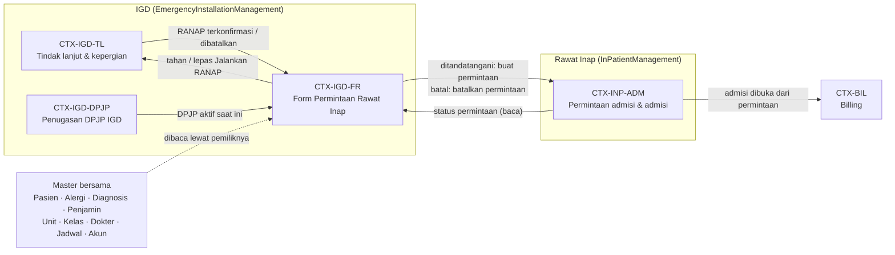
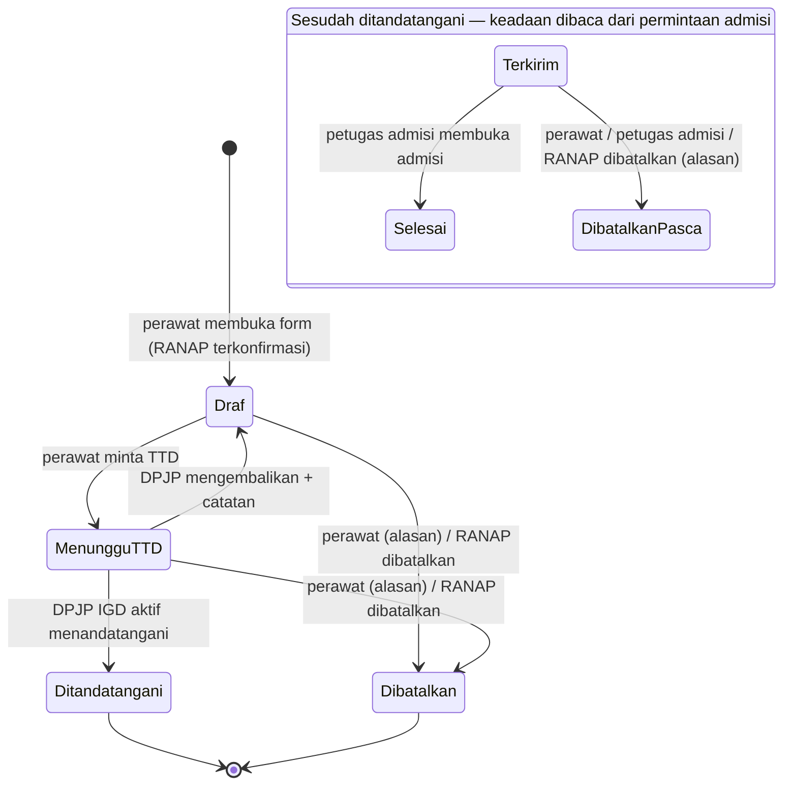

# IGD — Arsitektur Domain: Form Permintaan Rawat Inap dari IGD

## A. Identitas arsitektur

| Field | Value |
| --- | --- |
| Blueprint ID | `IGD-BP-001` |
| Revision arsitektur | `1` — **disahkan pemilik** lewat `IGD-DEC-292` (`ARC-RI-01`, `ARC-RI-02`); perilaku S3 sementara `IGD-DEC-293` |
| Scope | Sub-slice S1 (form di IGD), S1.b (Perawatan Intensif ↔ unit), S2 (permintaan admisi bersumber IGD); S3 (tagihan ikut invoice rawat inap) hanya sebagai titik sentuh terbuka |
| Kesiapan requirement | `PARTIALLY_READY` — [gate 12 Oktober 2026](2026-10-12-gate-form-permintaan-rawat-inap.md) |
| Keputusan yang dipakai | `IGD-DEC-267`…`291` (kecuali `269` yang `superseded`), `BKC-DEC-117`, `RWI-DEC-073`, `RWI-RULE-029` |
| Blocker yang dibawa | `IGD-OQ-127` (arti Unit Layanan), `IGD-OQ-129` (penautan Billing bila invoice IGD sudah dibayar), `IGD-OQ-128` (persetujuan titik sentuh) |
| Bukti keadaan saat ini | `01-existing-capability-map.md` suplemen 3.7 — backend `6a1c6cf9`, frontend `03b057c03` |
| Baseline rujukan | Tidak dipakai |
| Kesiapan arsitektur | **`DOMAIN_ARCHITECTURE_PARTIAL`** (bagian N) |

Dokumen ini menggambarkan **makna bisnis, kepemilikan, dan siklus hidup**, bukan tabel atau endpoint. Nama teknis yang
muncul (misalnya `InpAdmissionReferral`) hanya menunjuk bukti keadaan saat ini.

## B. Ubiquitous language

| Istilah | Arti satu-satunya di slice ini | Bukan |
| --- | --- | --- |
| **Tindak lanjut `RANAP`** | Keputusan dokter IGD bahwa pasien dirawat inap; dibuat dan dikonfirmasi dokter | Bukan form permintaan; bukan admisi |
| **Form Permintaan Rawat Inap** (singkat: *form*) | Permintaan tertulis dari IGD kepada petugas admisi, diisi perawat dan ditandatangani DPJP IGD aktif | Bukan Surat Rujukan dokter rawat jalan; bukan dokumen admisi PPRI |
| **Permintaan admisi** | Antrean milik Rawat Inap yang harus diselesaikan petugas admisi dengan membuka admisi atau membatalkannya | Bukan episode rawat inap |
| **Admisi** | Tindakan petugas admisi membuka episode rawat inap (unit, kelas, DPJP final) | Bukan kepergian fisik pasien |
| **Kepergian** | Perpindahan fisik pasien dari IGD sampai tiba di unit tujuan, beserta serah terima SBAR | Bukan admisi; bukan form |
| **DPJP IGD aktif** | Dokter penanggung jawab pasien di IGD saat ini (riwayat penugasan IGD) | Bukan DPJP rawat inap |
| **DPJP rawat inap usulan** | Dokter yang diusulkan IGD untuk menjadi DPJP di rawat inap; ditetapkan final oleh petugas admisi | Bukan DPJP IGD |
| **Atestasi** | Tanda tangan elektronik berupa catatan server: akun dokter yang masuk, nama dan jabatan beku, waktu server, perangkat, IP | Bukan gambar tanda tangan; bukan TTE tersertifikasi |
| **Salinan beku** | Isi form tepat saat ditandatangani; tidak pernah berubah | Bukan data terkini pasien |
| **Kebutuhan khusus** | Daftar tetap: Perawatan Intensif, Ruang Isolasi, Dukungan Oksigen, Monitoring Khusus; boleh lebih dari satu | — |
| **Tingkat perawatan** | Biasa atau ICU; "Perawatan Intensif" berarti ICU | Bukan kelas perawatan |
| **Kelas perawatan** | Kelas kamar yang diminta (master kelas pasien rawat inap) | Bukan hak kelas penjamin |

Dua kata yang berbeda arti di dua departemen dan **tidak** disatukan: "DPJP" (IGD vs rawat inap) dan "kelas" (kelas
perawatan diminta vs hak kelas penjamin).

## C. Peta context

| ID | Nama | Tanggung jawab | Konsep yang dimiliki | Hubungan |
| --- | --- | --- | --- | --- |
| `CTX-IGD-TL` | IGD — tindak lanjut dan kepergian | Keputusan `RANAP` dokter, *Jalankan*, kepergian, penutupan kunjungan | Tindak lanjut, kepergian (Existing) | Hulu bagi `CTX-IGD-FR`; *Jalankan* `RANAP` membaca keadaan form |
| `CTX-IGD-FR` | IGD — Form Permintaan Rawat Inap | Mengisi, meminta TTD, menandatangani, mengembalikan, membatalkan sebelum terkirim, mencetak | Form, salinan beku, atestasi, riwayat keadaan form (New) | Hilir dari `CTX-IGD-TL` dan `CTX-IGD-DPJP`; hulu bagi `CTX-INP-ADM` |
| `CTX-IGD-DPJP` | IGD — penugasan DPJP | Siapa DPJP IGD aktif | Penugasan DPJP (Existing) | Hulu bagi `CTX-IGD-FR` (siapa boleh menandatangani) |
| `CTX-INP-ADM` | Rawat Inap — permintaan admisi dan admisi | Antrean petugas admisi, admisi wajib dari permintaan, selesai/batal | Permintaan admisi (Extend), episode (Existing) | Hilir dari `CTX-IGD-FR`; hulu bagi Billing |
| `CTX-BIL` | Billing | Penautan kunjungan asal ke invoice rawat inap | Tautan invoice (Existing) | Hilir dari `CTX-INP-ADM`; perilaku untuk IGD terbuka (`IGD-OQ-129`) |

## D. Katalog konsep domain

| ID | Nama | Klasifikasi | Pemilik | Ownership | Identitas | Peran lifecycle | Invariant penting | Bukti |
| --- | --- | --- | --- | --- | --- | --- | --- | --- |
| `DOM-RI-01` | Form Permintaan Rawat Inap | `AGGREGATE_ROOT` | `CTX-IGD-FR` | **New** | Satu per tindak lanjut `RANAP`; paling banyak satu yang aktif per kunjungan IGD | *Draf* → *Menunggu TTD* → *Ditandatangani*; *Dibatalkan* sebelum terkirim | `INV-RI-01`…`06` | `IGD-DEC-268`, `271`, `273`, `278`, `285` |
| `DOM-RI-02` | Salinan beku isi form | `VALUE_OBJECT` | `DOM-RI-01` | New | Melekat pada form yang ditandatangani | Lahir saat TTD; tidak berubah | `INV-RI-03` | `IGD-DEC-281`, `282`, `283` |
| `DOM-RI-03` | Atestasi tanda tangan | `VALUE_OBJECT` | `DOM-RI-01` | New (pola Existing Rawat Inap/Rekam Medis) | Satu per form yang ditandatangani | Lahir saat TTD | `INV-RI-04` | `IGD-DEC-272`, `291` |
| `DOM-RI-04` | Kejadian keadaan form (minta TTD, dikembalikan + catatan, ditandatangani, dibatalkan + alasan) | `ENTITY` (riwayat tambah-saja) | `DOM-RI-01` | New | Berurutan per form | Satu baris per perpindahan | Tidak pernah diubah atau dihapus | `IGD-DEC-285`, gate G-06 |
| `DOM-RI-05` | Kebutuhan khusus | `REFERENCE_DATA` (daftar tetap empat nilai) | `CTX-IGD-FR` | New | Kode tetap | — | "Perawatan Intensif" ⇒ tingkat perawatan ICU | `IGD-DEC-284` |
| `DOM-RI-06` | Permintaan admisi | `AGGREGATE_ROOT` | `CTX-INP-ADM` | **Extend** | Satu per form yang ditandatangani; satu `Pending` per pasien (sudah ada) | `Pending` → `Completed` / `Cancelled` (sudah ada) | `INV-RI-07`…`09` | `IGD-DEC-275`, `276`, `279`; `IGD-CAP-120`, `121` |
| `DOM-RI-07` | Sumber permintaan | `VALUE_OBJECT` | `DOM-RI-06` | Extend | Kamar Pulih atau IGD | Ditetapkan saat lahir | Sumber IGD wajib menunjuk form IGD-nya; sumber kamar pulih wajib menunjuk kasus OK | `IGD-DEC-275` |
| `DOM-RI-08` | Tindak lanjut `RANAP` | `AGGREGATE_ROOT` | `CTX-IGD-TL` | Existing | Satu per keputusan | *Draft* → *Confirmed* → *Executed*; *Cancelled* | *Executed* hanya bila form sudah terkirim (`INV-RI-05`) | `IGD-DEC-223`, `277` |
| `DOM-RI-09` | Penugasan DPJP IGD | `AGGREGATE_ROOT` | `CTX-IGD-DPJP` | Existing | Riwayat penugasan per kunjungan | Berjalan / berakhir | Satu DPJP aktif | `MVP-5`, `MVP-10` |
| `DOM-RI-10` | Episode rawat inap | `AGGREGATE_ROOT` | `CTX-INP-ADM` | Existing | Satu per kunjungan rawat inap | Dibuka petugas admisi | Admisi pasien ber-permintaan `Pending` wajib dari permintaan itu | `IGD-CAP-121`, `122` |
| `DOM-RI-11` | Pasien, alergi, diagnosis ICD-10, penjamin kunjungan | `EXTERNAL_CONTRACT` (dibaca) | PatientManagement, ClinicalManagement, Registrasi | Adapter/View | Milik pemiliknya | Dibaca saat form dibuka; dibekukan saat TTD | Form tidak menulis ke data ini | `IGD-DEC-282`, `283` |
| `DOM-RI-12` | Unit layanan rawat inap, kelas perawatan, dokter, jadwal dokter per unit, akun → dokter | `REFERENCE_DATA` (dibaca) | Master Data, HR, Identity | Adapter/View | Milik pemiliknya | Dipilih/dibaca saat mengisi | Unit wajib rawat inap (tertahan `IGD-OQ-127`); kelas wajib berlaku rawat inap | `IGD-DEC-286`, `287`, `291` |
| `DOM-RI-13` | Tautan kunjungan IGD ke invoice rawat inap | `EXTERNAL_CONTRACT` | `CTX-BIL` | Existing | Satu per (invoice rawat inap, kunjungan asal) | Lahir saat admisi dari permintaan | Perilaku untuk invoice IGD lunas terbuka | `BKC-DEC-117`, `IGD-OQ-129` |

**Domain event** (di dalam satu aplikasi; diwujudkan sebagai panggilan service dalam transaksi yang sama, pola yang sudah
dipakai Kamar Operasi → Rawat Inap):

| ID | Kejadian | Penerbit | Penerima | Akibat |
| --- | --- | --- | --- | --- |
| `DE-RI-01` | Form ditandatangani | `CTX-IGD-FR` | `CTX-INP-ADM` | Permintaan admisi `Pending` bersumber IGD lahir |
| `DE-RI-02` | Form dibatalkan sesudah terkirim (oleh perawat) | `CTX-IGD-FR` | `CTX-INP-ADM` | Permintaan dibatalkan dengan alasan perawat |
| `DE-RI-03` | Tindak lanjut `RANAP` dibatalkan | `CTX-IGD-TL` | `CTX-IGD-FR`, lalu `CTX-INP-ADM` | Form aktif dan permintaan `Pending` ikut batal |
| `DE-RI-04` | Permintaan dibatalkan petugas admisi | `CTX-INP-ADM` | `CTX-IGD-FR` (dibaca) | Form tampil *Dibatalkan admisi — alasan*; *Jalankan* tertahan lagi |
| `DE-RI-05` | Admisi dibuka dari permintaan | `CTX-INP-ADM` | `CTX-IGD-FR` (dibaca), `CTX-BIL` | Form *Selesai*; tautan invoice (terbuka untuk IGD) |

## E. Model aggregate

### E.1 Form Permintaan Rawat Inap (`DOM-RI-01`) — **usulan arsitektur**

**Batas.** Form, salinan beku, atestasi, dan riwayat keadaannya. Tidak memuat data pasien, alergi, diagnosis, atau penjamin
sebagai milik sendiri — hanya membacanya dan membekukan salinannya saat TTD.

**Mengapa aggregate sendiri di IGD, bukan status tambahan pada permintaan admisi Rawat Inap.** Keadaan *Draf* dan
*Menunggu TTD* adalah pekerjaan IGD: diisi perawat IGD, ditandatangani DPJP IGD, dikembalikan dengan catatan klinis IGD.
Petugas admisi tidak boleh melihatnya (gate, catatan desain). Bila disimpan sebagai status tambahan pada permintaan admisi,
Rawat Inap akan memiliki alur kerja IGD dan setiap daftar admisi harus menyaring keadaan yang bukan miliknya. Dengan dua
aggregate, kepemilikan sejalan dengan siapa yang bekerja: **IGD memiliki form sampai ditandatangani; Rawat Inap memiliki
permintaan sejak terkirim** — persis bunyi `IGD-DEC-275`.

**Perintah:** buka form (dari tindak lanjut `RANAP` terkonfirmasi), simpan draf, minta TTD, kembalikan (dokter), tandatangani
(dokter), batalkan, cetak.

**Invariant:**

| ID | Invariant | Contoh pelanggaran yang ditolak |
| --- | --- | --- |
| `INV-RI-01` | Form hanya lahir dari tindak lanjut `RANAP` yang terkonfirmasi dan belum dibatalkan | Perawat membuka form ketika `RANAP` masih *Draft* |
| `INV-RI-02` | Paling banyak satu form aktif (*Draf*, *Menunggu TTD*, atau ditandatangani dengan permintaan `Pending`) per kunjungan IGD | Dua perawat membuat dua form untuk Tn. Budi |
| `INV-RI-03` | Isi yang ditandatangani tidak pernah berubah; perubahan = batal lalu form baru | Mengubah kelas sesudah TTD |
| `INV-RI-04` | Penanda tangan = akun yang dokternya adalah DPJP IGD aktif **pada saat menandatangani** | dr. Rina menandatangani padahal DPJP aktif dr. Andi |
| `INV-RI-05` | Lama rawat 1–90 hari; kebutuhan khusus subset dari daftar tetap; "Perawatan Intensif" ⇒ tingkat ICU | Lama rawat 0 atau 120 |
| `INV-RI-06` | Indikasi klinis dan rencana perawatan terisi dari tindak lanjut lalu boleh dilengkapi; tindak lanjut dokter tidak ikut berubah | — |

*Daftar Perlu TTD* tidak menyimpan "dokter tujuan": ia **dihitung** dari DPJP IGD aktif saat ini. Karena itu pengalihan DPJP
otomatis memindahkan permintaan TTD (`IGD-DEC-274`) tanpa memindahkan data apa pun.

### E.2 Permintaan admisi (`DOM-RI-06`) — Extend

**Batas.** Antrean admisi dan penyelesaiannya. Untuk sumber IGD, permintaan membawa rujukan ke form IGD dan butir yang
dibutuhkan petugas admisi untuk mengurutkan dan mengisi awal admisi: tingkat perawatan, CITO, unit dan kelas yang diminta,
DPJP rawat inap usulan. Isi lain (diagnosis, alergi, indikasi, rencana, kebutuhan khusus, lama rawat) dibaca dari form IGD
lewat layanan baca IGD — satu sumber, tanpa salinan kedua.

**Mengapa ada butir yang tersalin.** Unit, kelas, DPJP usulan, tingkat perawatan, dan CITO dipakai Rawat Inap untuk
mengurutkan dan mengisi awal admisi; pola yang sama sudah dipakai sumber kamar pulih (dokter bedah sebagai usulan DPJP,
tingkat perawatan). Karena isi form yang ditandatangani tidak pernah berubah (`INV-RI-03`), salinan ini tidak dapat
menyimpang.

**Invariant tambahan:**

| ID | Invariant |
| --- | --- |
| `INV-RI-07` | Sumber IGD wajib menunjuk tepat satu form IGD yang ditandatangani dan kunjungan IGD-nya; sumber kamar pulih tetap wajib menunjuk kasus OK |
| `INV-RI-08` | Satu `Pending` per pasien (sudah ada) berlaku untuk kedua sumber |
| `INV-RI-09` | Pembatalan selalu beralasan dan mencatat pihak yang membatalkan: perawat IGD, petugas admisi, atau otomatis karena `RANAP` dibatalkan |

## F. Model relasi

| Dari | Ke | Makna | Kardinalitas | Wajib | Ketergantungan lifecycle |
| --- | --- | --- | --- | --- | --- |
| Form | Tindak lanjut `RANAP` | Form melengkapi keputusan dokter | N form : 1 tindak lanjut (satu aktif) | Wajib | `RANAP` batal ⇒ form aktif batal |
| Form | Kunjungan IGD | Form milik satu kunjungan | N : 1 | Wajib | — |
| Form | DPJP IGD aktif | Penanda tangan yang sah | Dihitung saat TTD | Wajib saat TTD | Pengalihan memindahkan hak tanda tangan |
| Form | Permintaan admisi | Form yang ditandatangani menjadi permintaan | 1 : 0..1 | Wajib sesudah TTD | Status pasca-kirim dibaca dari permintaan |
| Permintaan admisi | Episode rawat inap | Admisi yang menyelesaikan permintaan | 1 : 0..1 | Saat `Completed` | Sudah ada |
| Permintaan admisi | Kunjungan IGD (kunjungan asal) | Asal pasien | N : 1 | Wajib | Dasar tautan invoice dan rangkaian kedatangan (`IGD-DEC-276`) |
| Form | Unit, kelas, dokter usulan | Rencana penempatan | N : 1 masing-masing | Unit dan kelas wajib; DPJP usulan wajib | Unit tertahan `IGD-OQ-127` |

Tidak ada penghapusan fisik: form dan permintaan hanya dibatalkan.

## G. Model lifecycle/status

| Perpindahan | Aktor | Prasyarat | Pemeriksaan | Kejadian audit |
| --- | --- | --- | --- | --- |
| → *Draf* | Perawat IGD | `RANAP` terkonfirmasi; tidak ada form aktif lain | `INV-RI-01`, `02` | Form dibuka |
| *Draf* → *Menunggu TTD* | Perawat IGD | Isian wajib lengkap; ada DPJP IGD aktif yang punya akun | `INV-RI-05` | Minta TTD |
| *Menunggu TTD* → *Draf* | DPJP IGD aktif | — | `INV-RI-04` | Dikembalikan + catatan |
| *Menunggu TTD* → *Ditandatangani* | DPJP IGD aktif | `RANAP` masih terkonfirmasi | `INV-RI-04`; salinan beku dibentuk; permintaan admisi lahir dalam transaksi yang sama | Atestasi |
| *Terkirim* → *Selesai* | Petugas admisi | Admisi dibuka dari permintaan | Sudah ada | Sudah ada |
| *Terkirim* → *Dibatalkan* | Perawat IGD, petugas admisi, atau otomatis | Permintaan masih `Pending` | `INV-RI-09` | Pembatalan + alasan + pihak |
| Penahanan *Jalankan* `RANAP` | — | Form tindak lanjut itu sudah ditandatangani dan permintaannya `Pending` atau `Completed` | `IGD-DEC-277`, `279` | — |

Status terminal: *Selesai*, *Dibatalkan*. Pembalikan sesudah *Selesai* tidak ada di slice ini — admisi yang salah ditangani
Rawat Inap (pembatalan admisi miliknya).

## H. Tanggung jawab authorization

| Tindakan | Pemegang wewenang (dari keputusan) | Diperiksa di |
| --- | --- | --- |
| Membuka, mengisi, meminta TTD, membatalkan form, mencetak | Peran Perawat IGD — aksi baru diberikan pengurus Akses Role (`IGD-DEC-291`) | Izin peran |
| Melihat daftar *Perlu TTD*, menandatangani, mengembalikan | Akun dokter; **plus** pemeriksaan server bahwa dokter akun = DPJP IGD aktif (`IGD-DEC-291`) | Izin peran dan aturan data |
| Melihat permintaan admisi bersumber IGD, membuka admisi | Petugas admisi (izin yang sudah ada) | Sudah ada |
| Membatalkan permintaan | Petugas admisi — aksi baru di Rawat Inap (`IGD-DEC-279`, titik sentuh) | Izin peran Rawat Inap |
| Membatalkan tindak lanjut `RANAP` | Dokter (sudah ada) | Sudah ada |

Peran mana yang menerima aksi baru di tiap lingkungan diatur pengurus Akses Role; arsitektur ini tidak menetapkannya.

## I. Model audit/histori

| Kejadian | Yang dicatat |
| --- | --- |
| Setiap perpindahan keadaan form | Pelaku (akun), waktu server, keadaan sebelum dan sesudah, catatan/alasan bila ada |
| Atestasi | Akun, dokter, nama dan jabatan beku, waktu server, perangkat dan IP dibaca server |
| Pembatalan permintaan | Pihak (perawat IGD, petugas admisi, otomatis), alasan, waktu |
| Salinan beku | Isi lengkap saat TTD, termasuk "belum ada data alergi" vs "tidak ada alergi" |
| Lama tunggu IGD → admisi | Diturunkan dari waktu TTD dan waktu admisi; tanpa laporan khusus (gate G-08) |

Cetak ulang tidak diminta untuk dicatat (`IGD-DEC-281` tidak menyebutnya); dibiarkan sebagai gap tidak memblokir.

## J. Model integrasi

| Arah | Produsen → konsumen | Tujuan | Sinkron | Gagal / ulang |
| --- | --- | --- | --- | --- |
| IGD → Rawat Inap | Form ditandatangani → permintaan admisi | Masuk antrean admisi | Sinkron, satu transaksi dengan TTD | Gagal = TTD gagal; form tetap *Menunggu TTD*; klik ganda tidak melahirkan dua permintaan (satu `Pending` per pasien + konkurensi baris form + kunci idempoten) |
| IGD → Rawat Inap | Batal (perawat atau `RANAP` batal) → batal permintaan | Antrean bersih | Sinkron, satu transaksi | Permintaan sudah `Completed` ⇒ pembatalan ditolak |
| Rawat Inap → IGD | Keadaan permintaan dibaca IGD | Status form pasca-kirim; penahanan *Jalankan* | Baca | — |
| Rawat Inap → IGD | Rincian form dibaca layar admisi | Diagnosis, alergi, indikasi, rencana, kebutuhan khusus, lama rawat | Baca lewat layanan baca IGD | — |
| IGD ← pemilik data | Pasien, alergi, diagnosis, penjamin, unit, kelas, dokter, jadwal, akun | Isi form | Baca lewat pemiliknya | Bacaan gagal ⇒ form tidak dapat dikirim (gagal tertutup) |
| Rawat Inap → Billing | Admisi dari permintaan → tautan invoice | Konsolidasi tagihan IGD | Sudah ada | Perilaku untuk invoice IGD lunas: `IGD-OQ-129` |

Tanpa integrasi eksternal.

## K. Dampak billing

**Dependency billing belum terselesaikan** untuk S3. Form sendiri tidak membuat tagihan. Admisi dari permintaan bersumber IGD
akan **otomatis** menautkan kunjungan IGD ke invoice rawat inap karena kode Billing hari ini menautkan setiap permintaan
yang selesai. Jalur utamanya sejalan dengan `BKC-DEC-117`; perilaku ketika invoice IGD sudah dibayar atau ditutup belum
diputuskan (`IGD-OQ-129`). Desain wajib memilih secara terang salah satu: membiarkan penautan berjalan untuk sumber IGD
sejak rilis pertama, atau menahannya sampai owner Billing menjawab — pilihan itu **bukan** wewenang agent.

## L. Dampak keselamatan klinis

**Relevan terhadap keselamatan.** Batas yang dibuat eksplisit:

| Risiko | Pengaman dari keputusan |
| --- | --- |
| Pasien berangkat ke bangsal tanpa permintaan admisi | *Jalankan* `RANAP` tertahan (`IGD-DEC-277`) |
| Permintaan atas nama dokter yang tidak bertanggung jawab | TTD hanya DPJP IGD aktif, dicek server (`IGD-DEC-291`) |
| Alergi/diagnosis hilang di jalan | Dibaca dari pemiliknya, dibekukan saat TTD, diagnosis lengkap (`IGD-DEC-282`, `283`) |
| Isi bertanda tangan berubah diam-diam | Tidak dapat diubah (`INV-RI-03`) |
| Pasien isolasi tidak tertangkap bangsal | Kebutuhan khusus boleh lebih dari satu (`IGD-DEC-284`) |
| Permintaan basi sesudah keputusan berubah | Batal otomatis bila `RANAP` dibatalkan (`IGD-DEC-280`) |

Wewenang klinis tidak dikarang: siapa yang memutuskan rawat inap tetap dokter (`IGD-DEC-223`).

## M. Gap arsitektur

| ID | Isu | Status | Memblokir |
| --- | --- | --- | --- |
| `IGD-OQ-127` | Arti Unit Layanan; tujuan tindak lanjut `RANAP` hari ini boleh unit tipe apa pun, sedangkan admisi hanya menerima unit rawat inap | `OPEN` | Arti dan validation isian Unit Layanan |
| `IGD-OQ-129` | Penautan Billing untuk invoice IGD yang sudah dibayar | `OPEN` | S3 |
| `IGD-OQ-128` | Persetujuan pemilik Rawat Inap dan owner Billing | `OPEN` | Approval desain |
| `IGD-UNK-25` | Tipe unit ICU; aturan silang tingkat ICU ↔ unit | Usulan gate G-02: tanpa aturan silang | Tidak |
| `ARC-RI-01` | Dua aggregate (form IGD + permintaan admisi Rawat Inap) — usulan arsitektur ini, bukan keputusan pemilik | Menunggu persetujuan pemilik pada titik henti ini | Desain S1/S2 |
| `ARC-RI-02` | Butir yang tersalin ke permintaan admisi (unit, kelas, DPJP usulan, tingkat perawatan, CITO) vs dibaca dari IGD — usulan | Menunggu persetujuan pemilik Rawat Inap lewat `IGD-OQ-128` | Desain S2 |
| `ARC-RI-03` | Log cetak ulang | Tidak diminta | Tidak |

## N. Kesiapan arsitektur

**`DOMAIN_ARCHITECTURE_PARTIAL`.**

| Slice | Kesiapan | Boleh ke `design-business-module`? |
| --- | --- | --- |
| S1 — form di IGD (kecuali arti Unit Layanan) | Siap, dengan `ARC-RI-01` disetujui pemilik | Ya |
| S1.b — Perawatan Intensif ↔ unit | Siap dengan usulan tanpa aturan silang | Ya |
| S2 — permintaan admisi bersumber IGD | Siap, ditandai butuh persetujuan pemilik Rawat Inap (`IGD-OQ-128`, `ARC-RI-02`) | Ya |
| S1.a — arti Unit Layanan | Terblokir `IGD-OQ-127` | Tidak — isian dirancang sebagai butir terbuka |
| S3 — perilaku Billing untuk invoice IGD lunas | Terblokir `IGD-OQ-129` | Tidak — desain hanya menyatakan pilihan yang menunggu owner Billing |

Jejak requirement → domain: setiap invariant dan perpindahan di atas menyebut keputusan sumbernya; tidak ada aturan yang
ditambahkan tanpa keputusan, kecuali yang ditandai *usulan* (`ARC-RI-01`, `02`; gate G-02, G-04…G-08).
