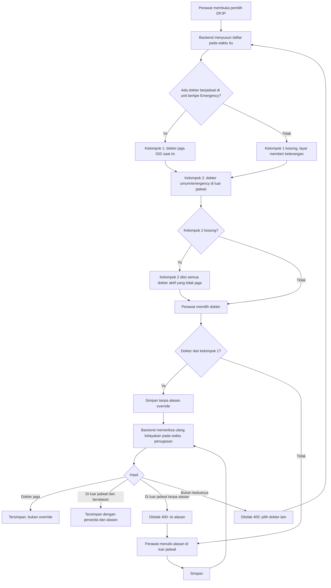

# Alur Proses — Menetapkan Dokter Penanggung Jawab IGD

| Field | Nilai |
| --- | --- |
| Status | `approved` (`IGD-DEC-240`, Rizki Gunawan, 11 Oktober 2026) — Rencana (belum tersedia) |
| Sumber | `IGD-DEC-141`, `237`…`239` |
| Pelaku | Perawat triage / perawat IGD; backend IGD |

Alur ini berlaku pada penetapan DPJP pertama sesudah triage tersimpan dan pada pengalihan DPJP. Aturan rincinya ada di
validation §13.

| No | Langkah | Pelaku | Masukan | Keluaran |
| ---: | --- | --- | --- | --- |
| 1 | Buka pemilih DPJP | Perawat | Kunjungan IGD | Daftar dua kelompok dari backend |
| 2 | Pilih dokter | Perawat | Daftar | Dokter terpilih; isian alasan muncul bila di luar jadwal |
| 3 | Simpan | Perawat | Dokter; alasan bila di luar jadwal; alasan pengalihan bila mengalihkan | Permintaan ke backend |
| 4 | Periksa ulang | Backend | Dokter, waktu penugasan | Diterima, atau ditolak `400` |
| 5 | Catat | Backend | — | Baris riwayat penugasan, dengan penanda override bila di luar jadwal |

*Contoh jalur tidak normal:* daftar dibuka pukul 13.58 dan dr. Sari masih berlabel shift pagi (07.00–14.00). Perawat
menyimpan pukul 14.01 tanpa alasan. Backend menghitung ulang — dr. Sari sudah di luar jadwal — dan menolak karena alasan
kosong. Daftar dimuat ulang, dan dr. Sari kini berada di kelompok kedua.
