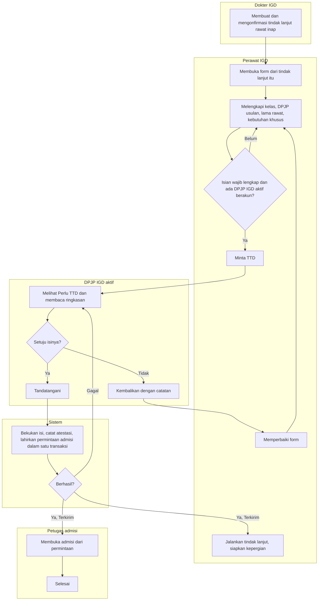
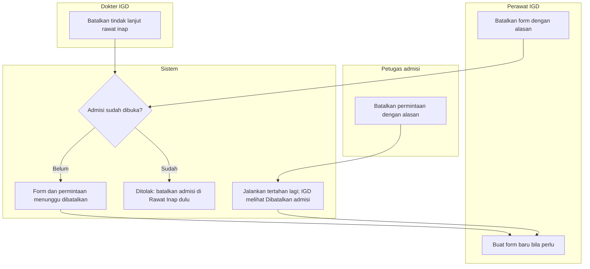

# Alur Proses — Form Permintaan Rawat Inap dari IGD

| Field | Nilai |
| --- | --- |
| Status | `approved` (`IGD-DEC-294`, Rizki Gunawan, 12 Oktober 2026) — Rencana (belum tersedia) |
| Sumber | `IGD-DEC-267`…`293` |
| Pelaku | Dokter IGD, Perawat IGD, DPJP IGD aktif, petugas admisi Rawat Inap, sistem |

Alur berlaku untuk tindak lanjut yang jenisnya mewajibkan Form Permintaan Rawat Inap (rawat inap). Nama keadaan sama dengan
state §11: *Draf*, *Menunggu TTD*, *Ditandatangani* (tampil *Terkirim*), *Selesai*, *Dibatalkan*. Aturan rinci di validation
§14.

## 1. Jalur utama dan jalur pengembalian

| No | Langkah | Pelaku | Masukan | Keluaran | Bila gagal |
| ---: | --- | --- | --- | --- | --- |
| 1 | Konfirmasi tindak lanjut rawat inap | Dokter IGD | Diagnosis tercatat | Tindak lanjut terkonfirmasi | Konfirmasi tertahan diagnosis — dokter menulis catatan dokter dulu |
| 2 | Buka form | Perawat | Tindak lanjut terkonfirmasi | Form *Draf* terisi unit, indikasi, instruksi | Sudah ada form aktif → buka form yang ada |
| 3 | Lengkapi | Perawat | Kelas, DPJP usulan, lama rawat, CITO, kebutuhan khusus | Draf tersimpan | Isian tidak sah → perbaiki sesuai pesan |
| 4 | Minta TTD | Perawat | Draf lengkap | *Menunggu TTD* di daftar DPJP aktif | Tanpa DPJP / DPJP tanpa akun → tetapkan atau alihkan DPJP dulu |
| 5 | Baca dan putuskan | DPJP IGD aktif | Ringkasan | TTD atau dikembalikan | Bukan DPJP aktif → tombol tidak tersedia |
| 6 | Bekukan dan kirim | Sistem | Isi form, data pasien terkini | *Terkirim*; permintaan admisi menunggu | Data pasien tak terbaca / permintaan lain masih menunggu → TTD ditolak, form tetap *Menunggu TTD* |
| 7 | Jalankan | Perawat | Form terkirim | Kepergian fisik dimulai (alur kepergian yang sudah ada) | Form belum terkirim → *Jalankan* tertahan |
| 8 | Buka admisi | Petugas admisi | Permintaan | Episode rawat inap; permintaan *Selesai* | Lihat jalur 2 |

*Contoh:* dr. Andi mengonfirmasi rawat inap Tn. Budi 10.05. Dimas membuka form 10.10, memilih kelas 2 dan dr. Sinta, lalu
meminta TTD 10.12. dr. Andi mengembalikan 10.14 dengan catatan *"Minta ICU"*; Dimas mencentang Perawatan Intensif dan
meminta TTD lagi 10.16. dr. Andi menandatangani 10.18; Sari melihat permintaan CITO di urutan teratas dan membuka admisi
10.40.

## 2. Jalur pembatalan

| No | Kejadian | Pelaku | Akibat | Bila ditolak |
| ---: | --- | --- | --- | --- |
| 1 | Perawat membatalkan form (salah isi) | Perawat | Form dan permintaan menunggu batal; form baru boleh dibuat | Admisi sudah dibuka → tidak dapat dibatalkan dari IGD |
| 2 | Dokter membatalkan tindak lanjut rawat inap | Dokter | Form dan permintaan menunggu ikut batal dengan alasan yang sama | Admisi sudah dibuka → batalkan admisi di Rawat Inap dulu |
| 3 | Petugas admisi membatalkan permintaan | Petugas admisi | IGD melihat *Dibatalkan admisi — alasan*; *Jalankan* tertahan lagi | — |

*Contoh jalur tidak normal:* Sari membatalkan permintaan Tn. Budi 10.50 karena kelas 2 Bangsal Melati penuh. Di layar
Dimas, form tampil *Dibatalkan admisi — Kelas 2 Bangsal Melati penuh* dan *Jalankan* kembali nonaktif. Dimas membuat form
baru untuk Bangsal Mawar kelas 2 dan meminta TTD ulang.
