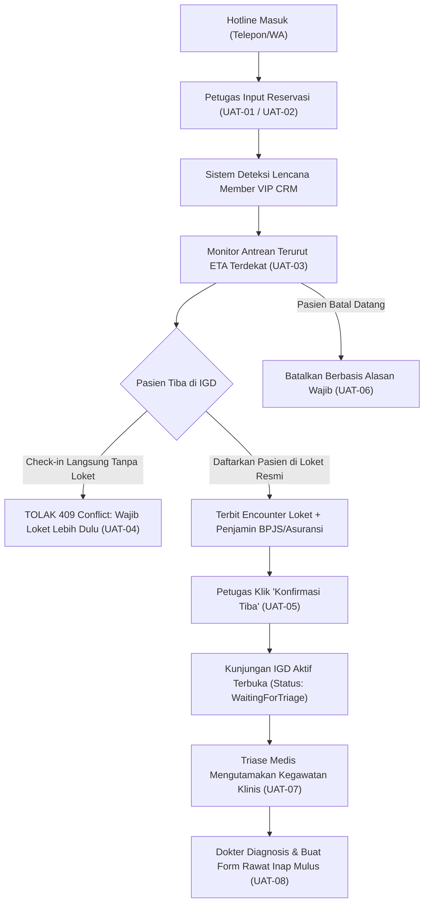

# Panduan Pengujian Penerimaan Pengguna (UAT)
## Modul Instalasi Gawat Darurat (IGD) — Layanan Reservasi Pra-Kedatangan Pasien Prioritas & Integrasi Check-in IGD

| Parameter | Keterangan Dokumen |
| :--- | :--- |
| **Modul Sistem** | Instalasi Gawat Darurat (`EmergencyInstallationManagement`) & Pendaftaran Admisi |
| **Sub-Fitur / Layanan** | Layanan Hotline Reservasi Pra-Kedatangan, Deteksi CRM VIP/Executive, Order Ambulans RS, dan Check-in Terintegrasi Encounter |
| **Dasar Hukum & Blueprint** | `IGD-DEC-314`, `IGD-DEC-315`, `IGD-DEC-325`, `IGD-DEC-327`, `IGD-DEC-329`, `BE-IGD-085`, `FE-IGD-067`, `FR-IGD-122`, `FR-IGD-123`, `AT-IGD-242`, `AT-IGD-243` |
| **Versi Kontrak Terkunci** | API Contract `0.20.0` §13, Validation Matrix `0.20.0` §15, Integration Contract `0.11.0` §10 |
| **Sasaran Pengguna (Aktor)** | Tim UAT Rumah Sakit, Petugas Hotline/Admisi IGD, Petugas Loket Pendaftaran, Perawat Triase IGD, Dokter DPJP IGD |
| **Tanggal Terbit & Efektif** | 19 Oktober 2026 |
| **Status Dokumen** | Panduan Resmi Pelaksanaan UAT (*User Acceptance Test Official Guide*) |

---

## 1. Pendahuluan & Filosofi Perancangan Sistem

Layanan **Reservasi Pra-Kedatangan Pasien Prioritas IGD** adalah inovasi alur pelayanan rumah sakit modern yang menghubungkan penanganan pra-rumah sakit (*pre-hospital care*) dengan kesiapan instalasi gawat darurat rumah sakit.

Pada operasional rumah sakit rujukan atau bertaraf internasional, banyak pasien gawat darurat atau keluarganya yang menghubungi saluran *hotline* darurat (telepon/WhatsApp) atau membutuhkan layanan armada ambulans jemputan sebelum tiba secara fisik di IGD. Sistem Quilvian merancang modul ini agar rumah sakit dapat menyiapkan tempat tidur resusitasi, memobilisasi ambulans, menugaskan staf *Guest Relations Officer* (GRO), serta mempersiapkan tim medis triage secara proaktif mendahului kedatangan fisik pasien.

### Tiga Pilar Filosofi Desain Sistem Berdasarkan Blueprint:

1. **Keselamatan Pasien Terdepan (*Patient Safety First*):**
   Informasi keluhan awal, estimasi waktu kedatangan (ETA), dan kebutuhan khusus sudah diketahui oleh tim perawat dan dokter IGD saat pasien masih dalam perjalanan.
2. **Integritas Transaksi & Anti-Kunjungan Yatim Piatu (`BE-IGD-085` / `IGD-DEC-325`):**
   Setiap kedatangan pasien wajib memiliki *Encounter* resmi dari Loket Pendaftaran lengkap dengan penjamin biaya (BPJS Kesehatan, Asuransi Swasta, atau Umum/Pribadi). Hal ini mencegah kekacauan data klinis dan penagihan kasir.
3. **Pemisahan Mutlak Antara Etika Medis vs Fasilitas Keramahan (*Hospitality Privilege*) (`IGD-DEC-315`):**
   Status keanggotaan komersial (VIP/Platinum Member) memberikan hak keistimewaan non-klinis (seperti pendampingan petugas khusus dan bilik periksa privat), namun **TIDAK PERNAH** boleh mengesampingkan atau melangkahi urgensi kegawatan medis triase (kategori Merah selalu ditangani terlebih dahulu).

---

## 2. Matriks Peran Pengguna (Aktor) & Tanggung Jawab

| Peran / Aktor | Akun Uji Rekomendasi | Menu / Halaman Aplikasi | Tanggung Jawab Utama dalam Alur UAT |
| :--- | :--- | :--- | :--- |
| **Petugas Hotline / Admisi IGD** | `rendy.saputra@rsmmc.local` | IGD -> *Reservasi Pra-Kedatangan* | Menerima panggilan hotline, menginput reservasi, memeriksa keanggotaan CRM, mendispatch ambulans, memantau ETA, dan mengeksekusi *Konfirmasi Tiba* (Check-in). |
| **Petugas Loket Pendaftaran** | `rendy.saputra@rsmmc.local` | Pendaftaran -> *Pendaftaran Loket IGD* | Mendaftarkan pasien di loket resmi IGD, memilih jenis penjamin (BPJS/Asuransi/Tunai), dan menerbitkan Encounter IGD aktif. |
| **Perawat Triase & Jaga IGD** | `dimas.kurniawan@rsmmc.local` | IGD -> *Pengkajian & Triase IGD* | Melakukan triase klinis (Merah/Kuning/Hijau), menetapkan dokter DPJP, mengisi asesmen keperawatan, dan membuat Form Permintaan Rawat Inap. |
| **Dokter DPJP / Jaga IGD** | `ranger.biru@admin.com` | IGD -> *Ruang Kerja Dokter IGD* | Menegakkan diagnosis kerja ICD-10, mengisi lembar medis, menetapkan disposisi Rawat Inap, dan menandatangani digital form SPRI. |

---

## 3. Penjelasan Fitur & Alasan Desain Berdasarkan Blueprint

Berikut adalah penjelasan fungsional per fitur dan **alasan mengapa fitur tersebut dibangun sedemikian rupa sesuai blueprint resmi**:

### Fitur 1: Hotline Panggilan Darurat & Pencatatan Reservasi Baru
* **Deskripsi Fungsional:**
  Formulir interaktif untuk mencatat kontak pemesan (nama & telepon), mencari data pasien master (jika sudah memiliki No. RM) atau mencatat calon pasien luar, menginput keluhan utama, serta menetapkan perkiraan waktu kedatangan (ETA).
* **Dasar Blueprint:** `IGD-DEC-314` (Layanan Hotline Reservasi Pra-Kedatangan) & `FR-IGD-122`.
* **Mengapa Dibuat Seperti Ini Menurut Blueprint?**
  1. *Responsif & Bebas Hambatan Birokrasi Kedaruratan:* Petugas hotline tidak boleh dipaksa membuat berkas rekam medis lengkap di saat keluarga pasien sedang panik di telepon. Sistem membolehkan pencatatan calon pasien tanpa No. RM awal agar armada ambulans dapat segera meluncur demi keselamatan nyawa (*life-saving principle*).
  2. *Integrasi Penugasan Staf Pendamping (GRO):* Kolom "Petugas Pendamping" memungkinkan admisi menugaskan *Guest Relations Officer* atau perawat khusus untuk menyambut pasien di pintu dropzone, meminimalkan kebingungan keluarga saat tiba di rumah sakit.

---

### Fitur 2: Deteksi Otomatis Keanggotaan CRM & Master Pasien Satu Pintu
* **Deskripsi Fungsional:**
  Saat petugas mencari pasien di form reservasi berdasarkan Nama atau No. Rekam Medis, sistem secara *real-time* memeriksa keanggotaan aktif pasien di subsistem CRM Membership.
* **Dasar Blueprint:** `IGD-DEC-314`, `IGD-DEC-315`, & `AT-IGD-242`.
* **Mengapa Dibuat Seperti Ini Menurut Blueprint?**
  1. *Pencegahan Duplikasi Pasien (`trace-existing-capabilities`):* Menggunakan satu master pasien bersama rumah sakit, tidak membuat entitas master pasien duplikat khusus IGD.
  2. *Penyematan Lencana Visual VIP Otomatis:* Jika pasien memiliki keanggotaan aktif (Tier Platinum, Gold, Executive, atau Silver), sistem langsung menampilkan lencana mahkota VIP dan nomor keanggotaan. Hal ini memandu petugas untuk menyiapkan fasilitas keramahan eksklusif (seperti bilik periksa privat atau ruang transit eksekutif).

---

### Fitur 3: Integrasi Pemesanan Armada Ambulans & Titik Penjemputan Pra-Faskes
* **Deskripsi Fungsional:**
  Checkbox "Perlu Ambulans RS" yang bila dicentang akan membuka formulir khusus untuk memilih moda kedatangan ambulans (Ambulans Transport, Ambulans Gawat Darurat Medis / ICU) serta alamat penjemputan lengkap.
* **Dasar Blueprint:** `IGD-DEC-314` butir B & `FR-IGD-122`.
* **Mengapa Dibuat Seperti Ini Menurut Blueprint?**
  1. *Mobilisasi Armada Terkoordinasi:* Menghubungkan admisi IGD dengan pool armada ambulans rumah sakit sehingga sopir dan perawat ambulans langsung menerima instruksi penjemputan lengkap dengan koordinat/alamat dan keluhan pasien.
  2. *Kesiapan Dropzone IGD:* Petugas IGD mengetahui bahwa pasien akan tiba menggunakan ambulans dan dapat mengosongkan jalur brankar di dropzone darurat.

---

### Fitur 4: Dasbor Monitoring Antrean Pra-Kedatangan Terurut Estimasi Tiba (ETA)
* **Deskripsi Fungsional:**
  Tabel utama reservasi yang menyajikan seluruh daftar pasien yang sedang dalam perjalanan menuju IGD, dilengkapi kartu statistik ringkasan, pencarian multi-parameter, serta penyaringan status.
* **Dasar Blueprint:** `IGD-DEC-314` & Prinsip Manajemen Aliran Pasien Gawat Darurat.
* **Mengapa Dibuat Seperti Ini Menurut Blueprint?**
  1. *Pengurutan Berdasarkan Waktu Tiba (ETA Terdekat), Bukan Waktu Telepon:* Sistem sengaja mengurutkan pasien berdasarkan siapa yang akan tiba paling cepat. Pasien yang diperkirakan tiba 10 menit lagi akan selalu berada di baris teratas dibanding pasien yang baru tiba 1 jam lagi, sehingga dokter dan perawat triage dapat memprioritaskan kesiapan alat dan bed.
  2. *Penyaring Status Komprehensif:* Menyediakan filter untuk memantau pasien yang "Menunggu Kedatangan", "Sudah Tiba", atau "Dibatalkan" guna keperluan evaluasi respon harian.

---

### Fitur 5: Mekanisme Pembatalan Reservasi Berbasis Alasan Wajib (Audit Trail)
* **Deskripsi Fungsional:**
  Tombol pembatalan berikon silang merah yang memicu modal konfirmasi dengan kewajiban mengisi alasan pembatalan secara rinci sebelum status reservasi berubah menjadi Dibatalkan (*Cancelled*).
* **Dasar Blueprint:** `IGD-DEC-314`, `IGD-DEC-329` (Perbaikan Destrukturisasi Modal), & `BE-IGD-080`.
* **Mengapa Dibuat Seperti Ini Menurut Blueprint?**
  1. *Prinsip Anti-Penghapusan Fisik (Zero Data Loss):* Panggilan gawat darurat tidak boleh dihapus secara fisik dari database. Semua data telepon darurat merupakan dokumen medikolegal rumah sakit.
  2. *Kewajiban Alasan Medis/Operasional:* Rumah sakit wajib mengaudit alasan pembatalan (misal: "Keluarga membatalkan karena kondisi membaik", "Pasien dialihkan ke RS lain", atau "Panggilan darurat keliru") guna mengevaluasi indikator mutu respon ambulans.
  3. *Arsip Terkunci:* Baris reservasi yang dibatalkan langsung mengunci tombol aksi agar tidak dapat dimanipulasi di kemudian hari.

---

### Fitur 6: Gerbang Loket Pendaftaran & Check-in Terintegrasi Encounter (`BE-IGD-085`)
* **Deskripsi Fungsional:**
  Proses konfirmasi tiba (*Check-in*) yang mewajibkan pasien telah didaftarkan di loket admisi IGD terlebih dahulu sebelum tombol "Konfirmasi Tiba" dapat dieksekusi dengan sukses.
* **Dasar Blueprint:** `IGD-DEC-325`, `BE-IGD-085` (Perbaikan Check-in Encounter), & `IGD-FACT-137`/`138`.
* **Mengapa Dibuat Seperti Ini Menurut Blueprint?**
  1. *Pencegahan Fatal Kunjungan Yatim Piatu:* Sebelum adanya perbaikan `BE-IGD-085`, check-in langsung membuat kunjungan tanpa encounter dan tanpa penjamin. Akibatnya, dokter tidak bisa mengisi diagnosis ICD-10, form rawat inap ditolak, klaim asuransi/BPJS gagal total, dan pasien tidak memiliki tagihan.
  2. *Solusi Arsitektur Dua Langkah yang Kokoh:* Petugas loket mendaftarkan pasien secara resmi (menentukan penjamin BPJS/Asuransi/Tunai), lalu tombol "Konfirmasi Tiba" menautkan encounter loket tersebut ke kunjungan IGD aktif secara atomik di bawah kunci episode pasien (`LockPatientEpisodeAsync`).
  3. *Otomatisasi Status Triage:* Begitu check-in berhasil, status reservasi berubah menjadi "Sudah Tiba", nomor kunjungan resmi diterbitkan (`IGD-XXXXXX`), status kunjungan langsung menjadi "Menunggu Triage", dan pasien seketika tampil di layar perawat triage.

---

### Fitur 7: Independensi Kegawatan Triase Medis vs Status Keanggotaan Prioritas
* **Deskripsi Fungsional:**
  Tampilan antrean pemeriksaan klinis IGD (`/emergency-assessment`) yang mengurutkan pasien murni berdasarkan kategori triase kegawatan medis (Merah -> Kuning -> Hijau).
* **Dasar Blueprint:** `IGD-DEC-315` & `AT-IGD-243` (Kepatuhan Etika Triase & Akreditasi STARKES/JCI).
* **Mengapa Dibuat Seperti Ini Menurut Blueprint?**
  1. *Etika Kedokteran & Kepatuhan Hukum Medis:* Pasien kategori Merah (ancaman henti jantung/napas) dari pasien reguler/non-member HARUS SELALU ditangani lebih dulu daripada pasien kategori Kuning/Hijau meskipun pasien tersebut memegang kartu membership Platinum VIP.
  2. *Hospitality Privilege Dibatasi pada Non-Klinis:* Keistimewaan member VIP diberikan dalam bentuk pendampingan petugas GRO, ruang tunggu privat, dan penyelesaian administrasi di tempat tidur pasien (*bedside registration*), BUKAN melompati antrean gawat darurat medis.

---

### Fitur 8: Kesinambungan Layanan Hilir & Form Permintaan Rawat Inap (SPRI)
* **Deskripsi Fungsional:**
  Pemeriksaan medis oleh dokter DPJP, penegakan diagnosis ICD-10, konfirmasi disposisi Rawat Inap, hingga pembukaan Form Permintaan Rawat Inap tanpa kendala data.
* **Dasar Blueprint:** `IGD-DEC-304`, `BE-IGD-074`, & Panduan UAT Transfer IGD.
* **Mengapa Dibuat Seperti Ini Menurut Blueprint?**
  1. *Validasi Terbukti Lintas Modul:* Karena check-in telah mengonsumsi encounter loket dan penjamin sah (`BE-IGD-085`), tombol "Buat Form" pada tab *Tindak Lanjut* dapat dibuka dengan mulus tanpa muncul pesan penolakan lama *"Kunjungan ini belum punya pasien dan encounter..."*.
  2. *Data Mengalir Otomatis:* Identitas pasien, nomor RM, penjamin BPJS/Asuransi, diagnosis ICD-10, dan DPJP terisi otomatis pada form surat pengantar rawat inap.

---

## 4. Spesifikasi Endpoint API Backend (Bergaya Swagger)

`[Tags("Health Services / Emergency Installation Management / Emergency Pre-Arrival Reservation")]`

| Method | Path | Deskripsi & Validasi Kritis | Auth / Role | Request Body | Response Sukses |
| :--- | :--- | :--- | :--- | :--- | :--- |
| `GET` | `/api/v1/health-services/emergency-installation-management/pre-arrival-reservations` | Mengambil daftar reservasi pra-kedatangan berpaginasi dengan filter pencarian dan status | Bearer Token / Petugas Admisi | Query Params: • `search` • `status` • `pageNumber`, `pageSize` | `200 OK` `{ data: [...], totalData, totalPage }` |
| `POST` | `/api/v1/health-services/emergency-installation-management/pre-arrival-reservations` | Mencatat data reservasi baru dari panggilan hotline | Bearer Token / Petugas Admisi | `CreateEmergencyPreArrivalReservationRequest` • `callerName` (req) • `callerPhoneNumber` (req) • `estimatedArrivalDateTime` • `chiefComplaint` • `requiresAmbulance` | `201 Created` `{ reservationNumber, status: 1 }` |
| `PUT` | `/api/v1/health-services/emergency-installation-management/pre-arrival-reservations/{id}` | Mengubah data estimasi kedatangan, keluhan, atau ambulans | Bearer Token / Petugas Admisi | `UpdateEmergencyPreArrivalReservationRequest` | `200 OK` `{ message: "Updated" }` |
| `POST` | `/api/v1/health-services/emergency-installation-management/pre-arrival-reservations/{id}/check-in` | Konfirmasi ketibaan pasien & otomatis membuka kunjungan IGD aktif. **Guard: Wajib ada encounter loket aktif.** | Bearer Token / Petugas Admisi | `CheckInEmergencyPreArrivalReservationRequest` • `arrivalDateTime` • `arrivalLocation` • `arrivalModeId` • `caseTypeId` | `200 OK` `{ status: 2, resultEmergencyVisitId, emergencyVisitNumber }` *(409 jika belum daftar loket)* |
| `POST` | `/api/v1/health-services/emergency-installation-management/pre-arrival-reservations/{id}/cancel` | Membatalkan reservasi secara medikolegal dengan mencatat alasan wajib | Bearer Token / Petugas Admisi | `CancelEmergencyPreArrivalReservationRequest` • `cancellationReason` (wajib diisi, min 5 karakter) | `200 OK` `{ status: 3, cancellationReason, cancelledAt }` |

---

## 5. Matriks Langkah-Langkah Pengujian UAT (Test Cases)

---

### Skenario UAT-01: Pencatatan Reservasi Pasien Prioritas CRM (Member VIP + Ambulans)
* **Tipe Pengujian:** Uji Positif Fungsional
* **Aktor:** Petugas Admisi / Hotline IGD (`rendy.saputra@rsmmc.local`)
* **Prasyarat:** Master ambulans aktif, master tier Platinum aktif di sistem.
* **Langkah-Langkah:**
  1. Buka menu **Instalasi Gawat Darurat** -> **Reservasi Pra-Kedatangan**.
  2. Klik tombol **"+ Catat Reservasi Baru"** pada bilah tindakan hero header.
  3. Ketikkan nama pasien member (misal: "Bapak Sastro") pada kotak pencarian pasien master.
  4. Amati bahwa sistem mendeteksi keanggotaan aktif dan memunculkan badge mahkota **Platinum Member** beserta nomor kartu member.
  5. Masukkan data pemesan: Nama *"Bapak Hendra"*, Kontak *"081234567890"*.
  6. Atur Estimasi Tiba (ETA): 25 menit dari jam sekarang.
  7. Masukkan Keluhan Awal: *"Nyeri dada kiri menjalar ke belikat dan sesak napas berat"*.
  8. Centang kotak **"Perlu Ambulans RS"**. Pilih moda *"Ambulans IGD / Gawat Darurat"*.
  9. Masukkan Alamat Penjemputan: *"Jl. Teuku Umar No. 12, Menteng, Jakarta Pusat"*.
  10. Masukkan Petugas Pendamping: *"Sdr. Dimas (GRO IGD)"*.
  11. Klik tombol **"Simpan Reservasi"**.
* **Hasil yang Diharapkan:**
  - Muncul notifikasi toast hijau: *"Reservasi pra-kedatangan berhasil disimpan"*.
  - Terbit nomor reservasi resmi (contoh: `RES-EMG-261019...`).
  - Baris reservasi tampil di tabel dengan status **Menunggu Kedatangan** (kuning), lencana ambulans aktif, dan lencana Platinum Member.

---

### Skenario UAT-02: Pencatatan Reservasi Pasien Reguler Mandiri (Non-Member)
* **Tipe Pengujian:** Uji Positif Fungsional
* **Aktor:** Petugas Admisi / Hotline IGD (`rendy.saputra@rsmmc.local`)
* **Langkah-Langkah:**
  1. Klik tombol **"+ Catat Reservasi Baru"**.
  2. Jangan memilih pasien master (biarkan kosong untuk mencatat calon pasien luar/non-RM).
  3. Masukkan data pemesan: Nama *"Ibu Siti Rahma"*, Kontak *"081987654321"*.
  4. Atur Estimasi Tiba (ETA): 45 menit dari jam sekarang (lebih lama dibanding UAT-01).
  5. Masukkan Keluhan Awal: *"Luka robek pada telapak kaki kanan akibat pecahan kaca"*.
  6. Biarkan checkbox ambulans tidak tercentang (kedatangan mandiri).
  7. Klik tombol **"Simpan Reservasi"**.
* **Hasil yang Diharapkan:**
  - Reservasi tersimpan dengan nomor baru. Kolom pasien bertuliskan *"Belum Terdaftar / Calon Pasien"*. Kolom ambulans bertuliskan *"Mandiri / Datang Sendiri"*.

---

### Skenario UAT-03: Verifikasi Urutan Antrean ETA Terdekat & Filter Pencarian
* **Tipe Pengujian:** Uji Logika Operasional
* **Aktor:** Petugas Admisi IGD
* **Prasyarat:** Reservasi UAT-01 (ETA +25m) dan UAT-02 (ETA +45m) telah tersimpan.
* **Langkah-Langkah:**
  1. Amati urutan baris pada tabel Reservasi Pra-Kedatangan.
  2. Pastikan pasien UAT-01 (ETA lebih cepat) berada di posisi **paling atas** dibanding UAT-02.
  3. Ketikkan nomor reservasi UAT-01 pada kotak pencarian dan verifikasi tabel tersaring otomatis.
  4. Pilih filter status *"Menunggu Kedatangan"*.
  5. Klik tombol **"Segarkan"** dan **"Reset"**.
* **Hasil yang Diharapkan:**
  - Pengurutan tabel konsisten berdasarkan waktu tiba terdekat (ETA).
  - Fitur filter dan reset bekerja secara responsif.

---

### Skenario UAT-04: Uji Guard Loket: Konfirmasi Tiba SEBELUM Pendaftaran Loket
* **Tipe Pengujian:** Uji Negatif / Boundary Guard (`BE-IGD-085` / `IGD-DEC-325`)
* **Aktor:** Petugas Admisi IGD
* **Prasyarat:** Reservasi UAT-01 berstatus *Menunggu Kedatangan*. Pasien **BELUM** didaftarkan di loket IGD.
* **Langkah-Langkah:**
  1. Klik tombol hijau **"Konfirmasi Tiba"** pada baris reservasi UAT-01.
  2. Pada modal Check-in, pilih Lokasi Kedatangan *"Dropzone Ambulans IGD"*.
  3. Klik tombol **"Konfirmasi Tiba & Buka Kunjungan IGD"**.
* **Hasil yang Diharapkan:**
  - Sistem **MENOLAK** tindakan dengan kode **HTTP 409 Conflict**.
  - Muncul toast peringatan merah: *"Pasien belum didaftarkan di loket IGD. Daftarkan di loket lebih dulu, lalu ulangi Konfirmasi Tiba."*.
  - Status reservasi tetap bertahan pada status 1 (*Menunggu Kedatangan*). Tidak ada kunjungan yatim piatu yang tercipta.

---

### Skenario UAT-05: Pendaftaran Loket & Konfirmasi Tiba Berhasil (Check-in Integrasi)
* **Tipe Pengujian:** Uji Positif Integrasi (`BE-IGD-085`)
* **Aktor:** Petugas Loket Pendaftaran, dilanjutkan Petugas Admisi IGD
* **Langkah-Langkah:**
  1. Buka menu **Pendaftaran Admisi IGD** (dapat menggunakan tombol navigasi cepat di hero header).
  2. Daftarkan pasien UAT-01 dengan penjamin **BPJS Kesehatan** (atau Asuransi Swasta), lalu simpan pendaftaran loket hingga terbit nomor *Encounter*.
  3. Kembali ke menu **Reservasi Pra-Kedatangan Pasien IGD**.
  4. Klik tombol **"Konfirmasi Tiba"** pada reservasi UAT-01.
  5. Klik tombol **"Konfirmasi Tiba & Buka Kunjungan IGD"** pada modal.
* **Hasil yang Diharapkan:**
  - Permintaan berhasil dengan **HTTP 200 OK**.
  - Muncul toast hijau: *"Check-in Berhasil. Check-in reservasi berhasil. Kunjungan IGD aktif telah dibuat."*.
  - Status reservasi berubah menjadi **Sudah Tiba** (hijau), dan nomor kunjungan resmi IGD terbit (misal: `IGD-261019-XXXXXX`).
  - Kunjungan IGD langsung berstatus `WaitingForTriage` (2), menautkan encounter loket dan penjamin BPJS secara otomatis. Pasien seketika muncul di antrean triase perawat.

---

### Skenario UAT-06: Pembatalan Reservasi Berbasis Alasan Wajib (Audit Trail)
* **Tipe Pengujian:** Uji Pembatalan Antarmuka Layar (`FE-IGD-067` / `IGD-DEC-329`)
* **Aktor:** Petugas Admisi IGD
* **Prasyarat:** Reservasi UAT-02 berstatus *Menunggu Kedatangan*.
* **Langkah-Langkah:**
  1. Klik tombol merah berikon silang **"Batalkan Reservasi"** pada baris UAT-02.
  2. Pada modal yang muncul, biarkan alasan kosong dan klik konfirmasi -> Sistem menolak dan mewajibkan pengisian alasan.
  3. Ketikkan alasan pembatalan: *"Pasien membatalkan kedatangan karena kondisi membaik dan memilih berobat jalan besok pagi"*.
  4. Klik tombol **"Ya, Batalkan Reservasi"**.
* **Hasil yang Diharapkan:**
  - Respons **HTTP 200 OK**. Muncul toast: *"Reservasi pra-kedatangan IGD berhasil dibatalkan."*.
  - Status reservasi berubah menjadi **Dibatalkan** (merah), alasan pembatalan tampil pada kolom status, dan tombol aksi terkunci menjadi teks *"Dibatalkan"*.
  - Jejak audit (`cancelledByUserId`, `cancelledAt`, dan `cancellationReason`) tersimpan presisi di database.

---

### Skenario UAT-07: Independensi Kegawatan Triase Medis vs Status Keanggotaan Prioritas
* **Tipe Pengujian:** Uji Etika Klinis & Kepatuhan Akreditasi (`IGD-DEC-315` / `AT-IGD-243`)
* **Aktor:** Perawat Triase IGD (`dimas.kurniawan@rsmmc.local`)
* **Prasyarat:** Pasien UAT-01 (Member Platinum VIP) telah check-in. Satu pasien reguler (Pasien C) didaftarkan di loket.
* **Langkah-Langkah:**
  1. Perawat membuka antrean triase di menu **Pengkajian & Triase IGD** (`/emergency-assessment`).
  2. Lakukan triase pada Pasien UAT-01 (Member Platinum): tetapkan kategori **Kuning** (Prioritas 2 / Urgen).
  3. Lakukan triase pada Pasien C (Reguler Non-Member): tetapkan kategori **Merah** (Prioritas 1 / Gawat Darurat Resusitasi Akut).
  4. Amati urutan daftar pasien pada Antrean Penanganan Pasien IGD.
* **Hasil yang Diharapkan:**
  - Pasien C (Kategori **Merah**, Pasien Reguler Non-Member) **SECARA MUTLAK berada di posisi antrean PALING ATAS (Indeks 0)**.
  - Pasien UAT-01 (Kategori **Kuning**, Member Platinum VIP) berada di bawah Pasien C.
  - Terbukti secara konsisten bahwa status keanggotaan bisnis/VIP CRM tidak pernah melangkahi kegawatan klinis triase (patuh pada standar Kemenkes, STARKES, dan JCI).

---

### Skenario UAT-08: Kesinambungan Layanan Hilir & Form Permintaan Rawat Inap (SPRI)
* **Tipe Pengujian:** Uji Alur Hilir Klinis
* **Aktor:** Dokter DPJP IGD (`ranger.biru@admin.com`) & Perawat IGD
* **Langkah-Langkah:**
  1. Dokter memeriksa pasien UAT-01 dan menegakkan diagnosis ICD-10 (misal: `I20.0 Unstable Angina`).
  2. Pada tab **Tindak Lanjut**, dokter memilih tindak lanjut **Rawat Inap** dan mengklik **"Konfirmasi Tindak Lanjut"**.
  3. Perawat membuka tab **Tindak Lanjut** dan mengklik tombol **"Buat Form"** pada panel Form Permintaan Rawat Inap.
* **Hasil yang Diharapkan:**
  - Form Permintaan Rawat Inap **TERBUKA DENGAN SUKSES**.
  - **TIDAK MUNCUL** pesan penolakan lama: *"Kunjungan ini belum punya pasien dan encounter..."*.
  - Data identitas pasien, No. RM, penjamin BPJS Kesehatan, dan diagnosis ICD-10 terisi otomatis.
  - Membuktikan bahwa perbaikan `BE-IGD-085` menjamin kontinuitas data pasien hingga ke rawat inap.

---

## 6. Batasan Operasional & Perilaku yang Dikenal (*Known Behaviors*)

Tim UAT diharapkan memperhatikan hal-hal berikut selama pelaksanaan pengujian:
1. **Urutan Pendaftaran Loket Adalah Mutlak:**
   Pasien wajib didaftarkan di loket pendaftaran IGD sebelum admisi menekan *Konfirmasi Tiba*. Penolakan HTTP 409 bila urutan dibalik adalah guard pengaman yang sah untuk mencegah data rusak, bukan galat sistem.
2. **Pengurutan Antrean Rawat Inap Berdasarkan CRM Masih Bertahap:**
   Pengurutan antrean transfer rawat inap saat ini masih diurutkan berdasarkan waktu keputusan klinis. Integrasi pengurutan CITO -> Member VIP -> Reguler pada modul Rawat Inap (`IGD-DEC-327` / `IGD-REQ-004`) sedang dikerjakan oleh tim pengembang modul Rawat Inap.
3. **Validasi Waktu Kedatangan:**
   Input jam kedatangan aktual pada modal check-in yang melewati jam server sekarang akan ditolak oleh sistem dengan HTTP 400.

---

## 7. Lembar Pengesahan Pelaksanaan UAT

| Perwakilan Penguji UAT | Perwakilan Staf Medis (Dokter / Perawat IGD) | Product / Domain Owner Modul IGD |
| :---: | :---: | :---: |
|    ___________________________ Nama:  Tanggal: |    ___________________________ Nama:  Tanggal: |    ___________________________ Nama: Rizki Gunawan Tanggal: |

---
*Dokumen ini diterbitkan secara otomatis dan resmi oleh Tim Rekayasa Perangkat Lunak Quilvian Hospital System.*
