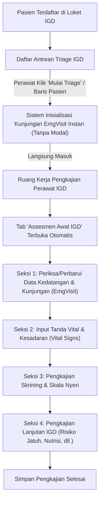

# Laporan Pemindahan Form Kedatangan Pasien IGD (Tabel EmgVisit) ke Ruang Pengkajian Perawat

- **Tanggal Pelaksanaan:** 13 Oktober 2026
- **Modul:** Pelayanan Medis IGD (*Emergency Installation Management*)
- **Target Komponen:** 
  - `EmergencyTriagePatientListView.jsx` (Daftar Antrean Triage IGD)
  - `EmergencyAssessmentDetailView.jsx` (Ruang Kerja Pengkajian Perawat IGD)
  - `EmergencyAssessmentInitialTab.jsx` (Tab Assesmen Awal IGD)
- **Tabel Database Terkait:** `EmgVisit` (`TrxEmergencyVisit` / Kunjungan IGD)
- **Status Integrasi:** Selesai (100% Implementasi Opsi A)

---

## 1. Latar Belakang & Masalah Bisnis

Sebelum pembaruan ini, alur kerja perawat IGD saat memilih pasien dari antrean pendaftaran terhambat oleh dialog pop-up **"Mulai Triage"** (`EmergencyTriageStartDialog`).

Setelah dilakukan review mendalam dan audit skema basis data bersama pengguna:
1. **Konfirmasi Tabel:** Form pada dialog tersebut bukan form penilaian triase klinis (`EmgTriage`), melainkan murni **Data Kunjungan IGD (`EmgVisit`)** yang mencakup:
   - Waktu Tiba (`ArrivalDateTime`)
   - Cara Datang (`ArrivalModeId`)
   - Lokasi Kedatangan (`ArrivalLocation`) & Lokasi Ditemukan (`FoundLocation`)
   - Pasien Tanpa Identitas (`IsUnknownPatient` & `TemporaryPatientAlias`)
   - Jenis Kasus (`CaseTypeId`)
   - Keluhan Utama (`ChiefComplaint`) & Catatan Kunjungan (`Notes`)
   - Data Kasus Trauma (`TraumaLocation` & `TraumaDateTime`)
2. **Kelemahan Alur Lama:** Mengharuskan pengisian data administratif kunjungan di dalam modal dialog kecil di layar antrean memutus alur kerja perawat dan memperlambat respons pelayanan gawat darurat.

---

## 2. Solusi yang Diterapkan (Opsi A)

Sesuai persetujuan pengguna terhadap **Opsi A**:
1. **Peniadaan Modal Dialog di Antrean:**
   - Modal pop-up `EmergencyTriageStartDialog` dihapus dari layar antrean triage (`EmergencyTriagePatientListView.jsx`).
   - Saat perawat menekan tombol **"Mulai Triage"** atau memilih baris pasien di antrean, sistem langsung menginisialisasi kunjungan IGD secara instan (mengisi waktu tiba sekarang dan keluhan bawaan loket) dan langsung membawa perawat masuk ke Ruang Kerja Pengkajian Pasien IGD.
2. **Penempatan Form di Ruang Kerja Pengkajian Perawat IGD:**
   - Form Data Kedatangan & Kunjungan IGD ditempatkan sebagai **Card Seksi 1: "1. Data Kedatangan & Kunjungan Pasien IGD"** di bagian paling atas pada tab **"Assesmen Awal IGD"** (`EmergencyAssessmentInitialTab.jsx`), tepat sebelum Tanda Vital dan Pengkajian Nyeri.
   - Komponen input menggunakan pustaka kanonikal Quilvian:
     - `FilterDatePicker` & `FilterTimePicker` (atau `BaseDateTimeField`) untuk waktu tiba dan waktu trauma.
     - `FilterSelect` untuk Cara Datang dan Jenis Kasus.
     - `BaseTextField` dan `BaseTextAreaField` untuk lokasi kedatangan, lokasi ditemukan, keluhan utama, dan catatan kunjungan.
     - `BaseSimpleCheckbox` untuk status pasien tanpa identitas (*Mr./Mrs. X*).
   - Menyediakan tombol mandiri **"Perbarui Data Kedatangan"** sehingga perawat dapat memperbarui informasi kedatangan sewaktu-waktu tanpa harus menunggu mengisi seluruh formulir skrining keperawatan. Sekaligus, saat tombol "Simpan Pengkajian" ditekan, data kunjungan juga otomatis tersimpan/tersinkronisasi.

---

## 3. Alur Proses Bisnis Baru

### Skenario Nyata di Rumah Sakit:
1. Pasien kecelakaan diantar warga ke IGD pada pukul 14.15 WIB. Petugas loket mendaftarkan nama/alias pasien.
2. Perawat di Nurse Station IGD melihat antrean dan mengklik nama pasien.
3. Layar langsung membuka **Ruang Pengkajian Perawat IGD** tanpa terhalang pop-up dialog.
4. Pada Seksi 1, perawat melengkapi data:
   - **Cara Datang:** Kendaraan Umum / Pribadi
   - **Lokasi Kedatangan:** Drop Zone Pintu Depan IGD
   - **Lokasi Ditemukan:** Perempatan Jl. Sudirman
   - **Jenis Kasus:** Kasus Trauma / Bedah
   - **Keluhan Utama:** Nyeri luka robek tungkai kanan
   - **Data Trauma:** Lokasi Jalan Raya, Waktu 13.50 WIB
5. Perawat dapat menekan **"Perbarui Data Kedatangan"** atau langsung melanjutkan pengukuran Tanda Vital (Tekanan Darah, Nadi, Suhu, Saturasi O₂).

---

## 4. Spesifikasi Kontrak Endpoint API

### `[Tags("Emergency Visit")]`

| Method | Endpoint Path | Deskripsi | Hak Akses (Auth) | Request Body / Query | Respons Sukses |
| :--- | :--- | :--- | :--- | :--- | :--- |
| `POST` | `/v1/health-services/emergency-installation-management/emergency-visits/start-triage` | Inisialisasi awal kunjungan IGD dari pendaftaran loket | `EmergencyVisit: Create` | `StartEmergencyVisitRequest` (`encounterId`, `mode`, `arrivalDateTime`, `chiefComplaint`) | `201 Created` / `200 OK` (`EmergencyVisitResponse`) |
| `PATCH` | `/v1/health-services/emergency-installation-management/emergency-visits/{id}/arrival-time` | Memperbarui / mengonfirmasi waktu tiba pasien | `EmergencyVisit: Update` | `UpdateEmergencyArrivalTimeRequest` (`arrivalDateTime`) | `200 OK` (`EmergencyVisitResponse`) |
| `PUT` | `/v1/health-services/emergency-installation-management/emergency-visits/{id}` | Mengubah detail data kedatangan & skrining kunjungan | `EmergencyVisit: Update` | `UpdateEmergencyVisitRequest` (cara datang, lokasi, jenis kasus, keluhan, catatan trauma) | `200 OK` (`EmergencyVisitResponse`) |
| `GET` | `/v1/health-services/emergency-installation-management/emergency-visits/{id}` | Mengambil detail utuh kunjungan IGD | `EmergencyVisit: Read` | Path Parameter `id: Guid` | `200 OK` (`EmergencyVisitResponse`) |

---

## 5. Ringkasan Berkas yang Diperbarui

| Nama Berkas | Lokasi | Ringkasan Perubahan |
| :--- | :--- | :--- |
| `emergency-triage-patient-list-view.jsx` | `QuilvianSystemFrontendDev/src/components/view/health-services/emergency-installation-management/emergency-management-triage-view/` | Menghilangkan pemanggilan modal `EmergencyTriageStartDialog`, mengalirkan aksi "Mulai Triage" langsung membuat kunjungan dan membuka Ruang Pengkajian. |
| `emergency-assessment-detail-view.jsx` | `QuilvianSystemFrontendDev/src/components/view/health-services/emergency-installation-management/emergency-assessment-view/` | Meneruskan props `visit` dan `onVisitUpdated` (`refreshVisit`) ke komponen `EmergencyAssessmentInitialTab`. |
| `emergency-assessment-initial-tab.jsx` | `QuilvianSystemFrontendDev/src/components/view/health-services/emergency-installation-management/emergency-assessment-view/components/` | Menambahkan form Seksi 1: "Data Kedatangan & Kunjungan Pasien IGD" lengkap dengan komponen `FilterDatePicker`, `FilterTimePicker`, `FilterSelect`, `BaseTextField`, dan tombol "Perbarui Data Kedatangan" yang terhubung ke API backend. |
