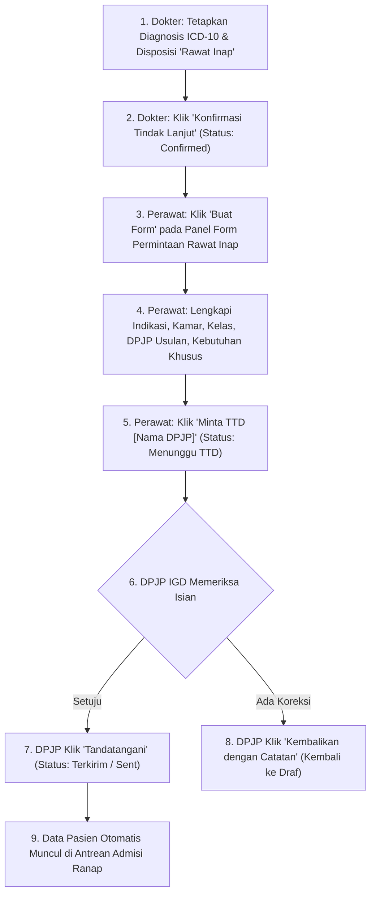
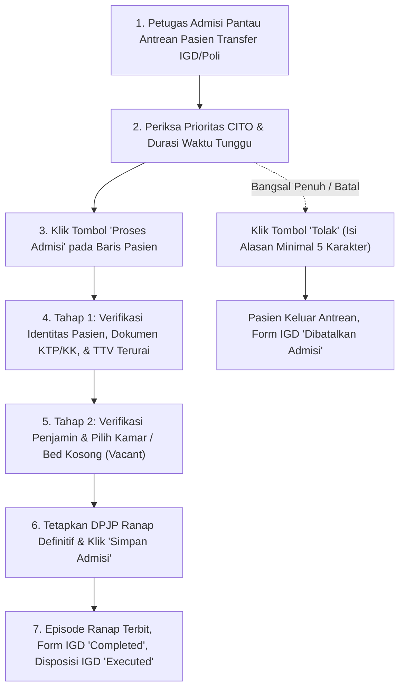
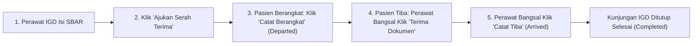

# Panduan UAT: Alur Transfer Pasien IGD ke Rawat Inap (Inpatient)

| Field | Nilai |
| :--- | :--- |
| **Modul Terkait** | `Instalasi Gawat Darurat (EmergencyInstallationManagement)` & `Manajemen Rawat Inap (InpatientManagement)` |
| **Dasar Keputusan** | `IGD-DEC-294` (Desain Form SPRI), `IGD-DEC-304`…`307` (Integrasi Antrean Transfer Admisi), `IGD-DEC-308` (Penutupan Dua Arah), `IGD-DEC-309` (Penolakan Admisi) |
| **Status Dokumen** | Panduan Resmi Pengujian Penerimaan Pengguna (*User Acceptance Test*) |
| **Sasaran Pengguna** | Tim UAT, Dokter IGD, Perawat IGD, Petugas Admisi Rawat Inap, Perawat Ruangan Rawat Inap (Bangsal/ICU) |
| **Tanggal Pembaruan** | 19 Oktober 2026 |

---

## 1. Pendahuluan & Peran Pengguna (Aktor)

Alur Transfer Pasien IGD ke Rawat Inap adalah proses kolaboratif kritis yang menghubungkan keputusan klinis gawat darurat dengan ketersediaan tempat tidur (*bed management*) dan kesinambungan asuhan medis di ruang perawatan rawat inap.

Sistem Quilvian menjamin proses ini berjalan:
1. **Aman secara Klinis (*Patient Safety*):** Kondisi pasien dan rencana perawatan terkomunikasi secara terstruktur tanpa ada informasi yang tercecer.
2. **Akuntabel secara Hukum:** Dokumen pengantar rawat inap (SPRI) diverifikasi dan disahkan dengan tanda tangan digital oleh DPJP IGD yang aktif bertugas.
3. **Efisien secara Administratif:** Tidak ada pengisian ulang data pasien berulang kali (data identitas, penjamin, diagnosis, dan TTV mengalir otomatis secara *real-time*).

### Tabel Peran dan Tanggung Jawab Aktor

| Peran / Aktor | Menu / Layar Aplikasi | Tanggung Jawab Utama dalam Alur |
| :--- | :--- | :--- |
| **Dokter IGD (DPJP)** | Ruang Kerja Dokter / Pengkajian IGD -> Tab *Tindak Lanjut* | Menetapkan diagnosis ICD-10, mengonfirmasi jenis disposisi *Rawat Inap*, dan menandatangani digital Form Permintaan Rawat Inap (SPRI). |
| **Perawat IGD** | Pengkajian IGD -> Tab *Tindak Lanjut* & Tab *Transfer* | Melengkapi rincian form permintaan kamar (kelas, indikasi, CITO, kebutuhan khusus), meminta TTD dokter, mengisi dokumen serah terima SBAR, dan mengantar pasien. |
| **Petugas Admisi Ranap** | Rawat Inap -> *Antrean Pasien Transfer IGD/Poli* | Memantau pasien transfer yang masuk, memverifikasi identitas & TTV, mengalokasikan kamar dan tempat tidur (*bed*), atau menolak jika kamar penuh. |
| **Perawat Ruangan Ranap** | Ruang Perawatan Bangsal / Serah Terima Pasien | Memeriksa kelengkapan fisik dan dokumen SBAR, menyetujui penerimaan dokumen serah terima, dan mencatat kedatangan fisik pasien di bangsal (*Catat Tiba*). |

---

## 2. Panduan Penting Arsitektur: Mengapa Form Permintaan Rawat Inap di Tab "Tindak Lanjut", Bukan di Tab "Transfer"?

Salah satu pemahaman mendasar yang wajib dipahami oleh Tim UAT adalah pemisahan peran antara **Tab "Tindak Lanjut" (Disposisi)** dengan **Tab "Transfer"**.

> [!IMPORTANT]
> **Prinsip Pemisahan Tugas (*Separation of Concerns*):**
> * **Tab "Tindak Lanjut" = KEPUTUSAN MEDIS & PEMESANAN KAMAR.** Dokumen ditujukan untuk **Petugas Admisi / Kasir Rawat Inap** untuk mencarikan kamar dan tempat tidur (*bed*). Pasien saat ini **masih berada di IGD**.
> * **Tab "Transfer" = PEMINDAHAN FISIK & SERAH TERIMA ASUHAN.** Dokumen ditujukan untuk **Perawat Ruangan Rawat Inap** saat brankar pasien siap didorong meninggalkan IGD menuju bangsal.

### 2.1 Tabel Perbandingan 5 Dimensi Operasional

| Dimensi Pembeda | Tab Tindak Lanjut (Form Permintaan Rawat Inap / SPRI) | Tab Transfer (Serah Terima Klinis SBAR) |
| :--- | :--- | :--- |
| **Tujuan Utama Dokumen** | Pemesanan kamar & tempat tidur (*bed management*), verifikasi hak kelas penjamin, dan legalitas rujukan internal rawat inap (SPRI). | Keselamatan pasien (*patient safety*) saat perpindahan fisik antar-ruangan dan kesinambungan asuhan keperawatan. |
| **Pihak Penerima (*Target*)** | **Petugas Admisi / Kasir Rawat Inap** (Kantor Pendaftaran). | **Perawat Ruangan Rawat Inap** (Bangsal Melati, Mawar, ICU, dll). |
| **Kapan Dibuat & Diisi?** | **Segera setelah dokter selesai memeriksa** dan menegakkan diagnosis kerja. | **Sesaat sebelum pasien didorong/diantar** keluar dari ruang IGD. |
| **Kondisi Fisik Pasien** | Pasien masih terbaring di ruang tindakan/triage IGD dalam masa observasi atau stabilisasi. | Pasien sudah siap di atas brankar/kursi roda untuk diberangkatkan. |
| **Muatan Informasi Dokumen** | Alasan rawat inap, hak kelas, usulan DPJP spesialis, estimasi lama rawat, kebutuhan ruang intensif/isolasi. | Kondisi tanda vital terkini sebelum jalan, jalur infus yang menempel, kateter, sisa obat yang dibawa, dan jam keberangkatan/ketibaan. |

### 2.2 Simulasi Kronologis Nyata di Rumah Sakit

Untuk memperjelas mengapa pemisahan ini mutlak, amati studi kasus pasien **Tn. Budi (65 tahun)** dengan diagnosis *Pneumonia Berat*:

1. **Pukul 09.00 WIB (Di Tab Tindak Lanjut):**
   * Dokter IGD memeriksa Tn. Budi, menetapkan diagnosis ICD-10, dan memilih tindak lanjut **Rawat Inap**.
   * Perawat membuka **Tab Tindak Lanjut**, mengklik tombol **"Buat Form"** pada panel *Form Permintaan Rawat Inap*:
     * Kelas: Kelas 1
     * Kebutuhan Khusus: Mencentang *Bantuan Oksigen* & *Ruang Isolasi*
     * DPJP Usulan: dr. Hendra, Sp.P (Spesialis Paru)
   * DPJP IGD menandatangani form tersebut.
   * **Hasil:** Detik itu juga, nama Tn. Budi mengalir ke layar **Petugas Admisi Rawat Inap** untuk dicarikan kamar isolasi di Bangsal Melati.
2. **Pukul 09.15 – 11.30 WIB (Masa Tunggu Kamar di IGD):**
   * Kamar isolasi di bangsal sedang dibersihkan dan disterilisasi (*cleaning*).
   * Selama lebih dari 2 jam, Tn. Budi **tetap berada di IGD**, terus diobservasi tanda vitalnya, dan diberikan terapi nebulizer. Pasien sama sekali belum ditransfer secara fisik.
   * *Jika form ini dipaksakan di Tab Transfer, sistem akan salah mengira pasien sedang dalam perjalanan fisik, mengacaukan sensus IGD.*
3. **Pukul 11.30 WIB (Di Tab Transfer):**
   * Petugas Admisi mengabari IGD bahwa Kamar 204 Bed 1 sudah siap.
   * Barulah Perawat IGD membuka **Tab "Transfer"**:
     * Mengisi kondisi SBAR terkini (TD 130/80, SpO2 96%, infus RL terpasang di tangan kiri).
     * Mengklik **"Ajukan Serah Terima"**, lalu mengklik **"Catat Berangkat"** saat brankar mulai didorong ke bangsal.
   * Di bangsal, perawat bangsal mencocokkan kondisi fisik Tn. Budi, lalu mengklik **"Terima Dokumen"** dan **"Catat Tiba"**.

---

## 3. Bagian I: Alur dari Menu Tindak Lanjut IGD (Dokter & Perawat)

### Fitur 1.1: Penetapan Disposisi Rawat Inap oleh Dokter IGD
* **Prasyarat:** Pasien memiliki diagnosis ICD-10 pada tab Pengkajian Klinis.
* **Langkah-Langkah:**
  1. Dokter membuka rekam medis pasien di Ruang Kerja Dokter atau Pengkajian IGD.
  2. Buka tab **Tindak Lanjut (Disposisi)**.
  3. Pilih Jenis Tindak Lanjut: **"Rawat Inap"** (*Admit*).
  4. Pilih **Unit Layanan Tujuan** (misal: *Bangsal Penyakit Dalam / Melati*).
  5. Isi field **Alasan Rawat Inap** (uraian medis singkat).
  6. Klik **"Konfirmasi Tindak Lanjut"**.
* **Hasil:** Status disposisi menjadi `Confirmed`. Blok panel **Form Permintaan Rawat Inap** di bawahnya otomatis aktif dengan tombol **"Buat Form"**.

---

### Fitur 1.2: Pembuatan & Pengisian Form Permintaan Rawat Inap (SPRI)
* **Langkah-Langkah:**
  1. Klik tombol **"Buat Form"** pada panel Form Permintaan Rawat Inap.
  2. **Identitas Pasien & Diagnosis (Read-Only dari Sistem):**
     * Nama Pasien, No. RM, Jenis Kelamin, Umur Pasien, Riwayat Alergi, Jenis Penjamin (BPJS/Tunai/Asuransi), Asal Permintaan (*selalu Instalasi Gawat Darurat*), dan Diagnosis ICD-10.
  3. **Informasi Klinis:**
     * **Indikasi Klinis (Wajib):** Tuliskan alasan medis mengapa pasien memerlukan rawat inap.
     * **Checkbox CITO:** Centang kotak ini jika pasien membutuhkan penanganan dan alokasi kamar segera tanpa penundaan.
  4. **Rencana Penempatan:**
     * **Unit Layanan:** Dropdown pilihan unit/bangsal tujuan.
     * **Kelas Perawatan:** Dropdown pilihan kelas kamar (Kelas 1, 2, 3, VIP, VVIP).
     * **Usulan DPJP Rawat Inap:** Dropdown pencarian dokter spesialis penerima.
     * **Tingkat Ketergantungan:** Dropdown pilihan (*Mandiri*, *Ketergantungan Sebagian*, *Ketergantungan Total*).
     * **Estimasi Lama Rawat:** Input angka hari rawat (*default 3 hari, dapat disesuaikan*).
     * **Kebutuhan Khusus (Centang yang sesuai):**
       - [ ] *Perawatan Intensif (ICU)*
       - [ ] *Ruang Isolasi*
       - [ ] *Bantuan Oksigen*
       - [ ] *Pengawasan Khusus*
  5. **Rencana Perawatan:** Input instruksi perawatan awal untuk perawat bangsal.
  6. Klik **"Simpan Draf"** jika ingin menyimpan sementara.

---

### Fitur 1.3: Permintaan Tanda Tangan & Pengesahan DPJP IGD
* **Langkah-Langkah:**
  1. Perawat IGD mengklik tombol **"Minta TTD [Nama DPJP]"**.
     * Sistem memvalidasi kelengkapan field wajib. Jika lengkap, status form berubah menjadi **Menunggu TTD (Awaiting Signature)**.
  2. Dokter DPJP IGD membuka form di layarnya:
     * **Opsi A (Setuju):** Dokter mengklik **"Tandatangani"**. Status form berubah menjadi **Ditandatangani (Terkirim / Sent)**. Seluruh isian form dibekukan (*locked/read-only*).
     * **Opsi B (Koreksi):** Dokter mengklik **"Kembalikan dengan Catatan"** dan menuliskan catatan revisi. Form kembali ke status **Draf** dengan peringatan kuning untuk diperbaiki perawat.
  3. **Cetak Form:** Saat berstatus *Terkirim*, tombol **"Cetak Form Permintaan Rawat Inap"** aktif untuk mencetak fisik dokumen SPRI bila diperlukan.

---

## 4. Bagian II: Alur dari Menu Antrean Transfer Pasien (Petugas Admisi)

Layar: *Rawat Inap -> Antrean Pasien Transfer IGD & Rawat Jalan* (`/health-services/inpatient-management/admission-transfers`).

### Fitur 2.1: Pemantauan Daftar Antrean Transfer
* **Kolom Pasien:** Nama Lengkap, Nomor RM, dan Jenis Kelamin.
* **Kolom Asal Kunjungan:** Lencana merah **IGD** atau lencana biru **POLI**, beserta nomor kunjungan.
* **Waktu & Lama Tunggu:** Menghitung durasi menit tunggu sejak form ditandatangani dokter. Jika > 60 menit, muncul tanda peringatan kuning *"Melebihi 60 menit"*.
* **Prioritas CITO:** Pasien yang dicentang CITO memiliki lencana merah menyala **CITO** dan diprioritaskan di urutan teratas antrean.
* **DPJP & Alasan:** Nama dokter perujuk IGD dan alasan rawat inap.
* **Unit Tujuan:** Bangsal yang diusulkan IGD.

### Fitur 2.2: Eksekusi "Proses Admisi"
1. Petugas Admisi mengklik tombol **"Proses Admisi"**.
2. **Langkah 1 — Verifikasi Data Pasien (Review Step):**
   * *Sisi Kiri:* Kartu Verifikasi Pasien (*BasePatientVerificationCard*) menampilkan identitas lengkap pasien, NIK, alamat, dan pratinjau dokumen KTP/KK resmi.
   * *Sisi Kanan:* Rincian Klinis menampilkan instruksi dokter IGD dan **Tanda-Tanda Vital (TTV)** terkini yang terurai otomatis (Tekanan Darah, Nadi, Laju Nafas, Suhu, SpO2, dan GCS).
   * Klik tombol **"Lanjutkan ke Pemilihan Kamar"**.
3. **Langkah 2 — Administrasi Kamar & Tempat Tidur:**
   * **Verifikasi Penjamin:** Memastikan penjamin (BPJS / Asuransi / Umum) telah valid.
   * **Pemilihan Kamar & Bed:** Unit dan kelas usulan IGD otomatis terisi awal (*prefilled*). Petugas memilih kamar dan nomor tempat tidur (*bed*) yang berstatus **Kosong (Vacant)**.
   * **Penetapan DPJP Rawat Inap:** Memilih DPJP rawat inap definitif.
4. Klik tombol **"Simpan Admisi"**.
5. **Dampak Sistemik:** Episode Rawat Inap baru terbit, status Form IGD menjadi **Completed**, dan status Disposisi IGD menjadi **Executed**.

### Fitur 2.3: Fitur Penolakan Admisi (Bila Kamar Penuh)
1. Petugas Admisi mengklik tombol **"Tolak"** pada baris antrean transfer pasien.
2. Modal dialog penolakan muncul, mewajibkan pengisian **Alasan Penolakan** (minimal 5 karakter, misal: *"Bangsal Melati penuh, tempat tidur isolasi tidak tersedia"*).
3. Klik tombol **"Konfirmasi Tolak"**.
4. Pasien keluar dari antrean transfer. Di sisi IGD, form berubah menjadi **Dibatalkan Admisi** dengan catatan alasan penolakan, dan tombol **"Buat Form Baru"** otomatis aktif kembali di IGD.

---

## 5. Bagian III: Alur Serah Terima Klinis (SBAR) & Kepergian Fisik

Layar: *IGD -> Pengkajian Pasien -> Tab 'Transfer' (atau Drawer Transfer Handover)*.

### Fitur 3.1: Pengisian Serah Terima Klinis (SBAR)
1. Pilih **Unit Layanan Tujuan** dan isi **Alasan Kepergian**.
2. **Pengisian 4 Kuadran SBAR (Wajib Lengkap):**
   * **S (Situation):** Keluhan utama saat akan dipindahkan dan diagnosis kerja terkini.
   * **B (Background):** Riwayat alergi, penyakit penyerta, dan terapi/tindakan medis yang telah dilakukan di IGD.
   * **A (Assessment):** Tanda vital saat transfer, kesadaran, serta alat medis yang terpasang (infus line, kateter, oksigen).
   * **R (Recommendation):** Rencana pemantauan ketat di ruangan dan instruksi obat lanjutan.
3. Klik tombol **"Ajukan Serah Terima"** (*Submit Handover*).

### Fitur 3.2: Sikap terhadap Pesanan Penunjang (Order Items)
* Jika ada pesanan laboratorium/radiologi IGD yang hasilnya belum keluar saat pasien akan dipindahkan:
  * **Opsi Lanjutkan:** Pesanan tetap berjalan dan hasilnya otomatis tertaut ke episode rawat inap.
  * **Opsi Batalkan:** Membatalkan pesanan yang belum diproses disertai alasan pembatalan.

### Fitur 3.3: Pencatatan Keberangkatan & Kedatangan Fisik
1. **Saat Pasien Keluar Pintu IGD:** Perawat IGD mengklik tombol **"Catat Berangkat"** (*Depart*). Status fisik menjadi **Berangkat (Departed)**.
2. **Saat Pasien Tiba di Bangsal:**
   * Perawat ruangan rawat inap membuka dokumen serah terima transfer pasien di komputernya.
   * Perawat ruangan mengklik **"Terima Dokumen"** (*Accept Handover*).
   * Perawat ruangan mengklik **"Catat Tiba"** (*Arrive*). Status fisik menjadi **Tiba (Arrived)**.
   * *(Jika ada ketidaksesuaian data medis, perawat ruangan dapat mengklik "Tolak Dokumen" dengan catatan revisi untuk diperbaiki perawat IGD).*

---

## 6. Bagian IV: Penutupan Otomatis Kunjungan IGD (Dua Arah)

Sistem Quilvian menerapkan **Evaluasi Penutupan Kunjungan Dua Arah** (`IGD-DEC-308` & `IGD-DEC-324`). Kedua skenario operasional berikut didukung penuh:

| Skenario Operasional | Urutan Kejadian di Lapangan | Kapan Kunjungan IGD Ditutup Menjadi Selesai (*Completed*)? |
| :--- | :--- | :--- |
| **Skenario 1 (Alur Normal / Jalur Administrasi Dulu)** | 1. Admisi rawat inap selesai diproses di loket. 2. Pasien diantar fisik ke ruangan rawat inap. 3. Perawat ruangan mencatat tiba. | Kunjungan IGD otomatis ditutup **Selesai (*Completed*)** tepat saat **Perawat Ruangan mengklik 'Catat Tiba'** di bangsal. |
| **Skenario 2 (Alur CITO / Jalur Fisik Duluan)** | 1. Pasien darurat diantar fisik dulu ke ICU/bangsal. 2. Perawat ruangan menerima serah terima & mencatat tiba. 3. Keluarga menyusul mengurus kamar di admisi. | Kunjungan IGD otomatis ditutup **Selesai (*Completed*)** tepat saat **Petugas Admisi mengklik 'Simpan Admisi'** (evaluasi penutupan susulan dipicu). |

**Syarat Penjaga Penutupan (*Guards*):**  
Kunjungan IGD dinyatakan *Completed* hanya jika:
1. Disposisi rawat inap berstatus `Executed` (admisi rawat inap telah sukses dibuka).
2. Seluruh pesanan penunjang IGD (lab/radiologi) sudah selesai atau bersikap.
3. Observasi IGD (jika ada) telah selesai.
4. Dokumen serah terima SBAR diterima (`Accepted`) dan kedatangan fisik dicatat (`Arrived`).

---

## 7. Bagian V: Matriks Skenario Uji Coba UAT (Test Case Matrix)

| Kode Uji | Skenario Pengujian | Peran Pelaku | Langkah Pengujian | Hasil yang Diharapkan (*Expected Result*) | Status Uji |
| :---: | :--- | :--- | :--- | :--- | :---: |
| **TC-01** | Konfirmasi Disposisi Rawat Inap | Dokter IGD | Input diagnosis ICD-10, pilih Rawat Inap & unit bangsal, klik *Konfirmasi Tindak Lanjut*. | Disposisi berstatus *Confirmed*, panel Form Permintaan Rawat Inap aktif. | `[  ]` |
| **TC-02** | Pengisian Form SPRI | Perawat IGD | Klik *Buat Form*, lengkapi indikasi klinis, rencana penempatan, klik *Simpan Draf*. | Form draf tersimpan, data tidak hilang saat halaman dimuat ulang. | `[  ]` |
| **TC-03** | Minta TTD & Pengesahan DPJP | Perawat & Dokter IGD | Perawat klik *Minta TTD DPJP*. Dokter buka form dan klik *Tandatangani*. | Form berstatus *Terkirim (Sent)*, seluruh isian form terkunci (*read-only*). | `[  ]` |
| **TC-04** | Pengembalian Form oleh DPJP | Dokter IGD | Dokter klik *Kembalikan dengan Catatan*, isi alasan revisi. | Form kembali ke status *Draf* disertai alert kuning catatan revisi. | `[  ]` |
| **TC-05** | Antrean Transfer Ranap & CITO | Petugas Admisi | Buka menu *Antrean Pasien Transfer IGD/Poli*. Amati pasien CITO. | Pasien tampil di antrean, durasi tunggu terhitung, lencana CITO menyala merah di urutan atas. | `[  ]` |
| **TC-06** | Proses Admisi & Alokasi Bed | Petugas Admisi | Klik *Proses Admisi*, review identitas & TTV, pilih kamar/bed kosong, klik *Simpan Admisi*. | Episode rawat inap terbit, form IGD berstatus *Completed*, disposisi IGD *Executed*. | `[  ]` |
| **TC-07** | Penolakan Admisi (Kamar Penuh) | Petugas Admisi | Klik opsi *Tolak* di antrean transfer, isi alasan minimal 5 karakter, konfirmasi. | Pasien keluar dari antrean transfer ranap, form di IGD berubah *Dibatalkan Admisi*. | `[  ]` |
| **TC-08** | Serah Terima SBAR & Catat Tiba | Perawat IGD & Bangsal | Perawat IGD isi SBAR & klik *Catat Berangkat*. Perawat bangsal klik *Terima Dokumen* & *Catat Tiba*. | Dokumen SBAR diterima, status fisik *Arrived*, kunjungan IGD otomatis berstatus *Completed*. | `[  ]` |

---

## 8. Bagian VI: Panduan Pemecahan Masalah (FAQ & Troubleshooting)

1. **T: Mengapa tombol "Buat Form" tidak muncul pada panel Form Permintaan Rawat Inap?**  
   *J:* Pastikan Dokter IGD telah menekan tombol *"Konfirmasi Tindak Lanjut"*. Form SPRI hanya dapat dibuat jika status disposisi dokter sudah *Confirmed*.
2. **T: Mengapa tombol "Minta TTD Dokter" berwarna abu-abu / disabled?**  
   *J:* Periksa apakah:
   - Ada field wajib (Indikasi Klinis, Unit Layanan, atau Kelas Perawatan) yang belum diisi.
   - Belum ada Dokter DPJP IGD aktif yang bertugas pada kunjungan pasien tersebut.
   - Dokter DPJP yang bertugas belum memiliki akun sistem yang aktif.
3. **T: Pasien sudah ditandatangani form-nya di IGD, mengapa belum muncul di menu Antrean Transfer Ranap?**  
   *J:* Pastikan status form di IGD sudah berstatus *"Ditandatangani"* (menampilkan lencana hijau *"Terkirim"*). Jika status masih *"Menunggu TTD"*, pasien belum dikirimkan ke antrean admisi.
4. **T: Apa yang harus dilakukan jika dokter salah memilih bangsal tujuan setelah form ditandatangani?**  
   *J:* Sebelum admisi diproses: Perawat IGD dapat mengklik *"Batalkan Form"*, atau Petugas Admisi dapat menekan *"Tolak"* di antrean transfer. Setelah itu, perawat IGD dapat langsung mengklik *"Buat Form Baru"* dengan bangsal yang benar.
5. **T: Mengapa kunjungan IGD masih berstatus "Menunggu Penutupan" (Awaiting Closure)?**  
   *J:* Periksa 3 hal:
   - Pasien belum selesai di-admit di rawat inap (disposisi masih *Confirmed*, belum *Executed*).
   - Masih ada pesanan lab atau radiologi IGD yang belum bersikap (belum selesai atau belum dibatalkan).
   - Perawat ruangan rawat inap belum mengklik *"Terima Dokumen"* dan *"Catat Tiba"*.
