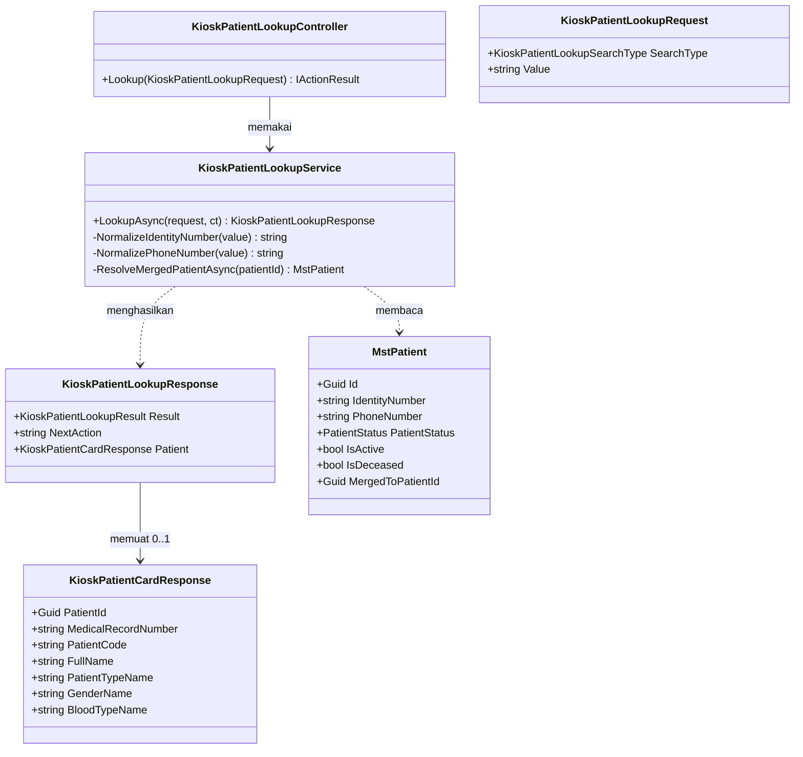
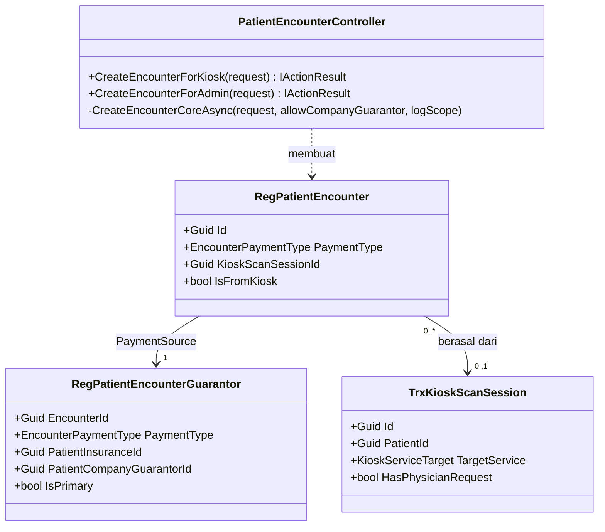
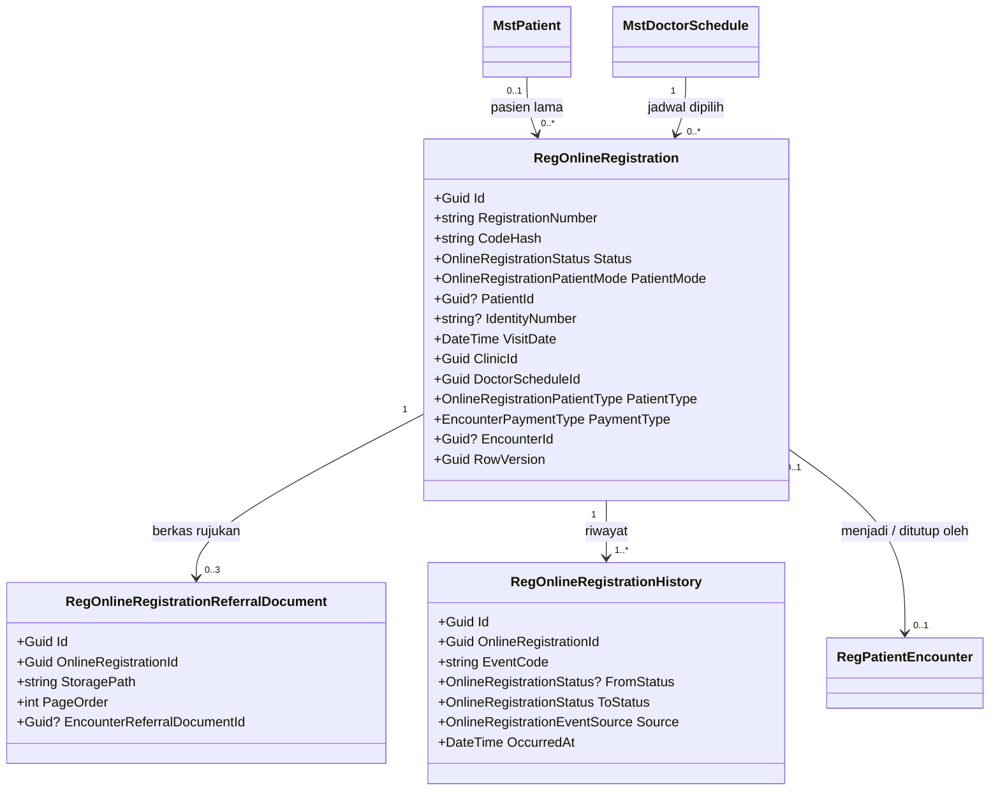
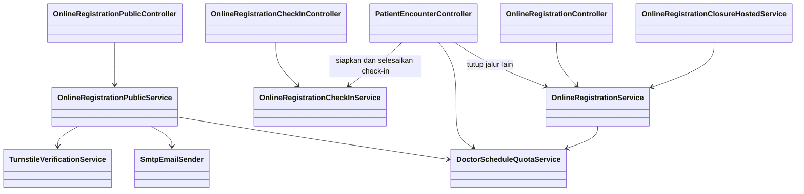

# Kiosk — Arsitektur Backend

| Field | Nilai |
| --- | --- |
| Blueprint ID | `KSK-BP-001` |
| Revision | `1` |
| Status | `approved` — Sukma Giri Pratama, 30 Sep 2026 |
| Owner | Sukma Giri Pratama (`KSK-DEC-005`) |
| `input_revision` | `00-interview-decisions.md` r2; `01-existing-capability-map.md` r1; `02-requirement-completeness-assessment.md` (`KSK-RCG-001`) r1 |
| SHA acuan | BE `419b910f`, FE `4ec51b0b` |
| `domain_architecture_readiness` | `DOMAIN_ARCHITECTURE_NOT_RUN` — alasan di `KSK-RCG-001` §9 |
| Kontrak | `KSK-CONTRACT-v1` (lihat `contracts/`) |

> **Ringkasan untuk pembaca umum.** Revisi Kiosk **tidak menambah satu tabel pun**. Backend hanya mendapat:
> 1. satu layanan pencarian pasien baru (Cek No. RM) yang membaca data pasien yang sudah ada;
> 2. pembatas jumlah pencarian per perangkat (rate limit), agar orang tidak bisa menebak-nebak nomor KTP/HP;
> 3. satu pelonggaran aturan: pendaftaran dari Kiosk boleh memakai **Penjamin Perusahaan** (`KSK-DEC-013`).
>
> Karena tidak ada tabel baru atau kolom baru, **tidak ada migration**.

## 1. Bounded context dan ownership

| Hal | Isi |
| --- | --- |
| Bounded context | `RegistrationManagement` — Kiosk (prefix entity `Reg`, registry baris 23) |
| Aggregate root yang disentuh | `RegPatientEncounter` (sudah ada) — hanya aturan validasi tipe pembayaran di route kiosk |
| Data yang dibaca, bukan dimiliki | `MstPatient`, `MstPatientIdentityDocument`, `MstPatientInsurance`, `MstPatientMembership` — milik PatientManagement |
| Invariant | `KSK-INV-001` (keputusan dari backend), `KSK-INV-003` (kartu hanya untuk tepat satu pasien), `KSK-INV-005` (satu kunjungan satu penanggung), `KSK-INV-006` (KTP/HP tidak lengkap di log), `KSK-INV-009` (status non-aktif tidak dibocorkan) |
| Transaction boundary | Lookup: **tanpa transaksi tulis** (baca saja, `AsNoTracking`). Create encounter: tetap transaksi existing di `CreateEncounterCoreAsync` |
| Rollback | Lookup tidak menulis apa pun. Create encounter mengikuti rollback existing (encounter + sumber pembayaran tersimpan bersama atau tidak sama sekali) |

## 2. Tabel kepemilikan data

| Kelompok data | Modul pemilik | Dipakai modul ini | Dibuat ulang di modul ini |
| --- | --- | :---: | --- |
| Identitas pasien (nama, No. RM, KTP, HP, status) | PatientManagement (`Mst`/`Pat`) | Ya — baca saja | **Tidak** |
| Dokumen identitas tambahan pasien | PatientManagement | Ya — baca saja (pencocokan KTP) | Tidak |
| Kartu asuransi pasien | PatientManagement | Ya — baca saja (pengenalan kartu Step 1; daftar penjamin) | Tidak |
| Keanggotaan (member) pasien | PatientManagement | Ya — baca saja (pengenalan kartu Step 1) | Tidak |
| Relasi pasien–perusahaan penjamin | PatientManagement | Ya — baca saja | Tidak |
| Kunjungan dan sumber pembayarannya | RegistrationManagement | Ya — dibuat lewat endpoint existing | Tidak |
| Sesi kiosk (hasil pindai, tujuan layanan) | RegistrationManagement | Ya — dibuat lewat endpoint existing | Tidak |
| Hasil pencarian Cek No. RM | — | Tidak disimpan | **Tidak** — hasil hanya hidup di respons dan log tersamar (`KSK-GAP-001`) |

## 3. Class diagram

### 3.1 Lookup No. RM



### 3.2 Pendaftaran kunjungan dari Kiosk (perubahan aturan)



## 4. Penjelasan setiap class

### `KioskPatientLookupController`

| Aspek | Penjelasan |
| --- | --- |
| **Status** | `Baru` |
| **Lokasi file** | `Areas/HealthServices/RegistrationManagement/Controllers/KioskPatientLookupController.cs` |
| Kategori | Controller |
| Tanggung jawab utama | Menerima permintaan Cek No. RM dari Kiosk, meneruskannya ke service, lalu mengembalikan hasil. Controller tidak menyentuh `ApplicationDbContext` (`QBE-SVC-001`). |
| Service yang dipakai | `KioskPatientLookupService`, `LoggerService` |
| Endpoint yang diurus | `POST api/v1/health-services/registration-management/kiosk-patient-lookups` |
| Atribut akses | Kelas: `[ApiController]`, `[Authorize]`, `[Route("api/v1/health-services/registration-management/kiosk-patient-lookups")]`, `[AccessController(moduleCode: "HEALTH_SERVICE_REGISTRATION_MANAGEMENT", moduleName: "Health Service Registration Management", displayName: "Kiosk Patient Lookup", AreaName = "HealthServices", ControllerName = "KioskPatientLookup", ...)]`, `[Tags("Health Services / Registration Management / Kiosk Patient Lookup")]`. Endpoint: `[HttpPost]`, `[Authorize(Policy = AuthorizationPolicies.KioskRead)]`, `[EnableRateLimiting("KioskPatientLookup")]`. **Tanpa `[AccessAction]` dan tanpa `[AccessPermission]`** (`KSK-DSN-006`). |
| Pemakaian dalam alur bisnis | Dipanggil layar Cek No. RM dan Step 1 Identifikasi ketika pasien mengetik KTP/HP atau memindai kartu asuransi/member |
| Catatan desain | Endpoint ini **POST** walaupun hanya membaca, agar KTP/HP berada di body, bukan URL (PRIV-3, `KSK-DEC-016`). Pengaksesnya akun perangkat, jadi `[AccessPermission]` tidak dipakai. `KioskRead` terdaftar di `Constants/AuthorizationPolicies.cs#ApprovedAlternativeAuthorization`, sehingga `PermissionRegistryDescriptor` tidak menganggapnya naked endpoint. `[AccessAction]` **sengaja tidak** dipasang: `[AccessAction]` tanpa `[AccessPermission]` masuk himpunan fallback kompatibilitas (`tools/authorization-verifier/approved-compatibility-fallback.txt`), dan menambah baris ke himpunan itu adalah keputusan governance yang membuat invarian 2 verifier gagal. |
| Ekuivalen model lama | — (fungsi yang mirip, `GET patients/kiosk?search=`, tidak diganti; tetap dipakai untuk pencarian nama/No. RM) |

### `KioskPatientLookupService`

| Aspek | Penjelasan |
| --- | --- |
| **Status** | `Baru` |
| **Lokasi file** | `Areas/HealthServices/RegistrationManagement/Services/KioskPatientLookupService.cs` |
| Kategori | Service |
| Tanggung jawab utama | Menormalkan masukan, mencari pasien yang cocok **persis**, mengikuti pasien yang sudah digabung, lalu menyimpulkan satu dari empat hasil: ditemukan, tidak ditemukan, cocok ganda, atau hubungi petugas. |
| Dipanggil oleh | `KioskPatientLookupController` |
| Membuka transaksi database | **Tidak** — seluruh query `AsNoTracking` |
| Didaftarkan | `builder.Services.AddScoped<KioskPatientLookupService>();` di `Program.cs`, dekat `AddScoped<EncounterIntakeService>()` |
| Aturan pencocokan | Lihat §4.1 |
| Catatan desain | Query **wajib** berparameter (SEC-KSK-003). Nilai KTP/HP **tidak boleh** masuk log utuh; yang boleh dicatat hanya 4 digit terakhir (`KSK-GAP-001`). Nama `Regex`/`regexp_replace` dipakai hanya di sisi kolom tersimpan, sedangkan nilai input dinormalkan di C# lalu dikirim sebagai parameter. |

#### 4.1 Aturan pencocokan

| Jenis pencarian | Normalisasi input | Kolom yang dicocokkan | Catatan |
| --- | --- | --- | --- |
| `IdentityNumber` (1) | Buang spasi; wajib `^[0-9]{16}$` | `MstPatient.IdentityNumber` **atau** `MstPatientIdentityDocument.IdentityNumber` aktif | Sama dengan urutan `KioskScanSessionController.FindPatientAsync` |
| `PhoneNumber` (2) | Buang semua selain digit; awalan `0` → `62`; wajib diawali `62`; panjang 9–15 digit | `MstPatient.PhoneNumber` yang dinormalkan dengan aturan yang sama di sisi database | Contoh: input `0812-3456-7890` → `6281234567890`; tersimpan `+6281234567890` → `6281234567890` → cocok |
| `InsuranceCardNumber` (3) | Trim; huruf kecil | `MstPatientInsurance.CardNumber` aktif | Hanya untuk Step 1 saat kartu asuransi dipindai (`KSK-DSN-004`); layar Cek No. RM **tidak** menawarkan jenis ini |
| `MemberNumber` (4) | Trim; huruf kecil | `MstPatientMembership.MemberNumber` aktif | Sama dengan jenis 3 |

Langkah penyimpulan hasil:

1. Kumpulkan `Id` pasien yang cocok dan belum dihapus (`IsDelete = false`).
2. Untuk setiap pasien berstatus `Merged` atau yang punya `MergedToPatientId`, ganti dengan pasien tujuannya. Ikuti rantainya paling banyak 3 langkah dan hentikan bila berputar (`KSK-DEC-017`).
3. Buang duplikat.
4. Tentukan hasilnya:

| Jumlah pasien unik | Syarat | Hasil |
| --- | --- | --- |
| 0 | — | `NotFound` |
| 1 | `PatientStatus = Active`, `IsActive = true`, `IsDeceased = false` | `Found` + kartu pasien |
| 1 | Selain syarat di atas | `ContactStaff`, tanpa data pasien |
| ≥ 2 | — | `MultipleMatch`, tanpa data pasien (`KSK-DEC-006/007`) |

Contoh: No. HP `0812-1111-2222` dipakai ibu (Aktif) dan anak (Aktif), sehingga hasilnya `MultipleMatch`. Kartu tidak ditampilkan, walaupun keduanya Aktif.

### `KioskPatientLookupRequest`, `KioskPatientLookupResponse`, `KioskPatientCardResponse`

| Aspek | Penjelasan |
| --- | --- |
| **Status** | `Baru` |
| **Lokasi file** | `Areas/HealthServices/RegistrationManagement/DTOS/KioskPatientLookupDtos.cs` (folder `DTOS` huruf besar mengikuti folder existing; penyimpangan penamaan folder dicatat §5, jangan dirapikan diam-diam) |
| Kategori | DTO — Request / Response |
| Field | Lihat `contracts/api-contract.md` |
| Catatan desain | `KioskPatientCardResponse` hanya memuat field Kartu Pasien existing (`KSK-FACT-005`) ditambah `PatientId`. **Tidak ada** KTP, HP, alamat, tanggal lahir, atau data medis lain (SEC-KSK-004). |

### `KioskPatientLookupSearchType` dan `KioskPatientLookupResult`

| Aspek | Penjelasan |
| --- | --- |
| **Status** | `Baru` |
| **Lokasi file** | `Areas/HealthServices/RegistrationManagement/Enums/KioskPatientLookupSearchType.cs`, `.../Enums/KioskPatientLookupResult.cs` |
| Nilai | `KioskPatientLookupSearchType`: `IdentityNumber = 1`, `PhoneNumber = 2`, `InsuranceCardNumber = 3`, `MemberNumber = 4`. `KioskPatientLookupResult`: `Found = 1`, `NotFound = 2`, `MultipleMatch = 3`, `ContactStaff = 4` |
| Nilai bawaan | Tidak ada; `SearchType` wajib dikirim |
| Catatan desain | Dikirim sebagai **angka** di JSON, karena backend tidak memasang `JsonStringEnumConverter` (fakta di `kiosk-service-target-rules.js`). |

### `PatientEncounterController`

| Aspek | Penjelasan |
| --- | --- |
| **Status** | `Diperbarui` |
| **Lokasi file** | `Areas/HealthServices/RegistrationManagement/Controllers/PatientEncounterController.cs` |
| Perubahan | `CreateEncounterForKiosk` memanggil `CreateEncounterCoreAsync(request, allowCompanyGuarantor: true, ...)`. Komentar "Kiosk tetap terbatas pada Tunai dan Asuransi" diganti dengan rujukan `KSK-DEC-013` / `RWI-ENC-PAYER-001` v1.1.0. Validasi kelayakan perusahaan (`LoadValidPatientCompanyGuarantorAsync`) dipakai apa adanya. |
| Service yang dipakai | Tidak berubah |
| Prasyarat | `KSK-OQ-005`: amendment `RWI-ENC-PAYER-001` v1.1.0 tercatat di blueprint rawat-inap sebelum baris ini diubah |
| Catatan desain | Jangan mengubah route `/admin`. Jangan menambah tipe pembayaran baru. |

### `RegPatientEncounter`, `RegPatientEncounterGuarantor`, `TrxKioskScanSession`, `MstPatient`

| Aspek | Penjelasan |
| --- | --- |
| **Status** | `Sudah ada` — tidak berubah |
| **Lokasi file** | `Areas/HealthServices/RegistrationManagement/Models/RegPatientEncounter.cs`; `.../Models/RegPatientEncounterGuarantor.cs`; `.../Models/TrxKioskScanSession.cs`; `Areas/HealthServices/PatientManagement/MasterData/Models/MstPatient.cs` |
| Pemakaian | Encounter + penanggung dibuat lewat route kiosk existing. Sesi kiosk dibuat lewat `scan-result` existing, kini **dari Step 3** (`KSK-DEC-014`). `MstPatient` hanya dibaca. |
| Catatan | `TrxKioskScanSession` memakai prefix legacy `Trx*` — utang teknis, jangan ditiru, jangan dirapikan dalam revisi ini. |

### `Program.cs` — rate limiter

| Aspek | Penjelasan |
| --- | --- |
| **Status** | `Diperbarui` |
| **Lokasi file** | `Program.cs` |
| Perubahan | (1) `builder.Services.AddRateLimiter(...)` dengan satu policy bernama `KioskPatientLookup`: fixed window, `PermitLimit` = `KioskPatientLookup:PermitPerMinute` (bawaan `10`), `Window` = 1 menit, `QueueLimit` = 0, partisi per klaim `ClaimTypes.NameIdentifier` (user id akun perangkat Kiosk; bila kosong, alamat IP). (2) `OnRejected` menulis status `429` dan body `ApiResponse<object>.Fail(429, "Terlalu banyak percobaan. Silakan coba lagi sebentar.")`. (3) `app.UseRateLimiter()` **setelah** `app.UseAuthentication()` dan `app.UseAuthorization()`, sebelum `app.MapControllers()`. |
| Catatan desain | Tanpa `GlobalLimiter`: endpoint lain tidak terkena (`KSK-GAP-003`). Framework `net9.0` sudah memuat middleware ini, jadi tidak ada package baru. Setiap perangkat punya akun login sendiri (`KioskDeviceController` generate login), sehingga partisi per user id = partisi per perangkat (`KSK-GAP-004` tertutup). |

### `appsettings.json`

| Aspek | Penjelasan |
| --- | --- |
| **Status** | `Diperbarui` |
| Perubahan | Tambah seksi `"KioskPatientLookup": { "PermitPerMinute": 10 }`. Bila kunci tidak ada, kode memakai `10`. |

## 5. Arsitektur folder

```text
NewQuilvianSystemBackend/
├── Program.cs                                                     # Diperbarui — AddScoped service, AddRateLimiter, UseRateLimiter
├── appsettings.json                                               # Diperbarui — seksi KioskPatientLookup
└── Areas/HealthServices/RegistrationManagement/
    ├── Controllers/
    │   ├── KioskPatientLookupController.cs                        # Baru
    │   ├── KioskScanSessionController.cs                          # Sudah ada — tidak berubah (pakai DbContext langsung: utang teknis, jangan ditiru)
    │   └── PatientEncounterController.cs                          # Diperbarui — kiosk menerima Penjamin Perusahaan
    ├── DTOS/                                                      # nama folder huruf besar menyimpang dari pola "DTOs" — utang teknis, jangan dirapikan diam-diam
    │   └── KioskPatientLookupDtos.cs                              # Baru
    ├── Enums/
    │   ├── KioskPatientLookupSearchType.cs                        # Baru
    │   └── KioskPatientLookupResult.cs                            # Baru
    ├── Models/                                                    # Tidak berubah (TrxKioskScanSession = legacy Trx*)
    └── Services/
        └── KioskPatientLookupService.cs                           # Baru
```

`Repositories/Configurations/**`: **tidak ada perubahan**.

## 6. Status model

| Entity | Status | Kolom berubah | Dampak migration |
| --- | --- | --- | --- |
| `MstPatient` | Sudah ada | — | Tidak ada |
| `MstPatientIdentityDocument`, `MstPatientInsurance`, `MstPatientMembership` | Sudah ada | — | Tidak ada |
| `RegPatientEncounter`, `RegPatientEncounterGuarantor` | Sudah ada | — | Tidak ada |
| `TrxKioskScanSession` | Sudah ada | — | Tidak ada |

## 7. Rencana migration

**Tidak ada migration.** Revisi ini tidak menambah atau mengubah tabel, kolom, maupun index. `dotnet ef migrations has-pending-model-changes` harus tetap menjawab tidak ada perubahan.

Pertimbangan index untuk pencarian HP ada di §9 (ditolak untuk MVP).

## 8. Rencana data master awal

Tidak ada tabel master baru. Satu-satunya nilai awal adalah konfigurasi `KioskPatientLookup:PermitPerMinute = 10` (`KSK-DEC-011`).

## 9. Yang sengaja tidak dibuat

| Yang ditolak | Alasan |
| --- | --- |
| Tabel log pencarian (`RegKioskPatientLookupLog`) | Tidak diminta PRD; log terstruktur dengan nilai tersamar sudah cukup (`KSK-GAP-001`); tabel baru akan menyimpan jejak pencarian KTP/HP yang justru menambah risiko privasi |
| Kolom `MstPatient.PhoneNumberNormalized` / index ekspresi | Mengubah master pasien = di luar scope PRD §46. Beban MVP rendah (maks. 10 pencarian/menit/perangkat). Ditinjau ulang bila pengukuran di produksi menunjukkan pencarian HP > 500 ms (`NFR-002`) |
| Normalisasi massal (backfill) `MstPatient.PhoneNumber` | Mengubah data master milik modul lain tanpa wewenang |
| Mencocokkan `WhatsAppNumber` | PRD hanya menyebut No. HP; menambah kolom pencocokan menambah peluang cocok ganda |
| Mencari lewat `GET patients/kiosk?search=` | Free-text di 15+ kolom, nilai di URL, respons lengkap — melanggar KSK-RM-002, PRIV-3, SEC-KSK-004 (`KSK-CAP-003`) |
| Endpoint untuk mengubah `TargetService` sesi kiosk | `KSK-DEC-002`: kontrak `scan-result` tidak berubah; sesi cukup dibentuk sekali di Step 3 |
| Menutup `PATCH …/kiosk/{id}/primary` | Konsumen lain belum diaudit; Kiosk cukup berhenti memanggilnya (`KSK-GAP-011`) |
| Mengirim `TargetService = OutpatientClinic (1)` untuk sesi poliklinik | Hari ini sesi poliklinik tidak membawa target. `KioskEncounterClosureService` menyaring berdasarkan target, dan mengisi nilai baru dapat membuat kunjungan poliklinik ikut tersaring. Sesi poliklinik tetap tanpa target. |

## 10. Keputusan desain

Keputusan teknis yang diambil desain ini dari bukti source. Statusnya `draft` dan ikut disetujui bersama blueprint; pemilik boleh menolaknya satu per satu.

| ID | Keputusan | Alasan / bukti | Menutup |
| --- | --- | --- | --- |
| `KSK-DSN-001` | Cek No. RM memakai endpoint **baru** `POST .../kiosk-patient-lookups`, bukan perluasan `GET patients/kiosk` | Endpoint lama free-text, nilai di URL, respons lengkap (`KSK-CAP-003`, `KSK-CAP-009`) | KSK-RM-002, SEC-KSK-004, PRIV-3 |
| `KSK-DSN-002` | HP dinormalkan di sisi query (kolom tersimpan) dan di C# (input); tanpa kolom atau index baru | Tidak mengubah master pasien (PRD §46); beban maks. 10/menit/perangkat | `KSK-DEC-018` |
| `KSK-DSN-003` | "Tidak ditemukan", "cocok ganda", dan "hubungi petugas" dijawab `200` dengan `result`, **bukan** `404` | `404` juga muncul saat route salah atau proxy bermasalah; memakainya untuk "belum terdaftar" dapat membuat gagal teknis terbaca sebagai pasien baru | `KSK-INV-002`, KSK-UX-003 |
| `KSK-DSN-004` | `SearchType` 3 (kartu asuransi) dan 4 (nomor member) tersedia untuk Step 1; layar Cek No. RM hanya menawarkan 1 dan 2 | Step 1 kehilangan pengenalan kartu asuransi/member bila sesi tidak lagi dibentuk saat scan (`KSK-DEC-014`); aturannya disalin dari `FindPatientAsync` | `KSK-GAP-006` |
| `KSK-DSN-005` | Rate limit: policy bernama `KioskPatientLookup`, fixed window 10/menit, partisi per user id akun perangkat, hanya pada endpoint lookup | Klaim `NameIdentifier`/`user_id` ada di token (`AuthController`); tiap perangkat punya akun sendiri | `KSK-DEC-011`, `KSK-GAP-002/003/004` |
| `KSK-DSN-006` | Endpoint lookup: `[Authorize(Policy = KioskRead)]` tanpa `[AccessAction]`/`[AccessPermission]` | `AuthorizationPolicies.ApprovedAlternativeAuthorization`; menjaga himpunan fallback verifier tetap | Invarian 1–2 `tools/authorization-verifier` |
| `KSK-DSN-007` | Sesi kiosk poliklinik tetap dikirim **tanpa** `targetService` (perilaku hari ini); hanya Laboratorium yang membawa `targetService = 2` | Penyaring `KioskEncounterClosureService` membaca target; mengubahnya berisiko menutup kunjungan poliklinik | `KSK-DEC-014`, `KSK-INV-008` |
| `KSK-DSN-008` | Rantai pasien digabung diikuti paling banyak 3 langkah dengan penjaga putaran | Mencegah loop pada data `MergedToPatientId` yang rusak | `KSK-DEC-017` |
| `KSK-DSN-009` | Pembeda input Step 1: 16 digit → KTP; diawali `0`/`62`/`+62` dengan 9–15 digit → HP; pola `99-99-99-99` atau tepat 8 digit → No. RM; selain itu → nama | Format No. RM dari `PatientController.GenerateMedicalRecordNumberAsync` (maks. `99-99-99-99`) tidak bertabrakan dengan HP ≥ 9 digit | `KSK-GAP-007` |


---

# Amendment PO — Pendaftaran Pasien Online dan Check-in Kiosk

| Field | Nilai |
| --- | --- |
| Revisi blueprint | `2` — `approved` — Sukma Giri Pratama, 19 Nov 2026 (`KSK-DEC-054`). Bagian di atas (revisi 1) tetap `approved` dan tidak berubah |
| Owner | Sukma Giri Pratama (`KSK-DEC-026`) |
| `input_revision` | `00-interview-decisions.md` §13 (`KSK-DEC-026` s.d. `053`; `049` `superseded`); `01-capability-impact-scan-pendaftaran-online.md` (`CAP-PO-01` s.d. `37`); `02-requirement-completeness-assessment-pendaftaran-online.md` (`KSK-RCG-002` r2, `READY_FOR_DOMAIN_DESIGN` 8/8) |
| SHA acuan | BE `5e777833` (`sukmagp`), FE `5f18e9f04` (`sukmagpV2`) |
| `domain_architecture_readiness` | `DOMAIN_ARCHITECTURE_NOT_RUN` — alasan di `KSK-RCG-002` §8 dan §9.7 |
| Kontrak | `KSK-CONTRACT-v2` (`approved`) — bagian *Amendment PO* pada kelima berkas `contracts/` |

> **Ringkasan untuk pembaca umum.** Pasien kini dapat mendaftar Rawat Jalan sendiri dari HP tanpa login, untuk besok sampai 30 hari ke depan. Pendaftaran itu **belum menjadi kunjungan**; ia disimpan sebagai *pendaftaran online* berstatus Menunggu Check-in dan langsung memakai satu kuota appointment dokter. Saat pasien datang pada hari kunjungan, kiosk memeriksa kode dan tanggal lahirnya, lalu kunjungan, nomor antrean, dan tiket terbit lewat jalur pembuatan kunjungan yang sudah ada. Pendaftaran yang tidak dipakai ditutup otomatis. Petugas admisi mendapat satu layar untuk melihat, mengubah jadwal atau kontak, dan membatalkan.
>
> Backend mendapat **tiga tabel baru** (pendaftaran online, berkas rujukannya, dan riwayatnya), tiga layanan baru, tiga controller baru, pengirim email, pemeriksa captcha, dan satu layanan penutupan harian. Jalur pembuatan kunjungan dan hitungan kuota yang dipakai bersama petugas, kiosk, dan IGD diperluas, tidak ditulis ulang.

## PO.1 Tujuan dan batas

| Masuk desain | Keputusan |
| --- | --- |
| Halaman publik: pengenalan pasien, langkah pendaftaran seperti menu RJ, kode, email, tombol WhatsApp, captcha, batas laju | `KSK-DEC-029` s.d. `035`, `038`, `041` s.d. `044`, `047` |
| Check-in kiosk: kode + tanggal lahir, Lupa Kode, pasien baru dengan KTP/KIA, kunjungan appointment, tiket | `KSK-DEC-033`, `036`, `039`, `040`, `046`, `048`, `053` |
| Penutupan otomatis: Tidak Datang dan Didaftarkan lewat Jalur Lain | `KSK-DEC-037`, `045` |
| Layar petugas: daftar, ubah tanggal/jadwal/kontak, batal | `KSK-DEC-050`, `051`, `052` |

Di luar desain: billing (tagihan lahir dari kunjungan seperti biasa), cek kepesertaan BPJS, WA gateway otomatis, pembatalan oleh pasien sendiri, dan laporan rekap (`KSK-DEC-027`, §13.2).

## PO.2 Bounded context, aggregate, invariant, dan transaksi

**Bounded context:** Registration (`entity_prefix: Reg`, `KSK-DEC-026` syarat 3). Pendaftaran online tidak membuat konteks baru. Titik sentuh ke Patient Management (master pasien, kartu asuransi) dan Master Data (poli, jadwal dokter, penyedia asuransi, faskes perujuk) hanya membaca, kecuali pembuatan master pasien dan kartu asuransi saat check-in yang tetap memakai endpoint Patient Management yang sudah ada.

**Aggregate root:** `RegOnlineRegistration`. Anaknya `RegOnlineRegistrationReferralDocument` (berkas surat rujukan) dan `RegOnlineRegistrationHistory` (riwayat). Seluruh perubahan status lewat `OnlineRegistrationService`/`OnlineRegistrationCheckInService`; controller tidak menyentuh `ApplicationDbContext`.

| ID | Invariant | Dasar |
| --- | --- | --- |
| `INV-PO-01` | Pendaftaran online tidak pernah muncul sebagai kunjungan, antrean, nurse station, atau tagihan sebelum check-in | `KSK-DEC-030`, AC 3 |
| `INV-PO-02` | Setiap pendaftaran berstatus Menunggu Check-in memakai tepat satu kuota appointment pada jadwal dan tanggalnya. Status lain tidak memakai kuota | `KSK-DEC-030`, `037`, `045`, `052`, AC 3 |
| `INV-PO-03` | Paling banyak satu pendaftaran Menunggu Check-in per pasien per tanggal kunjungan. Pasien lama dikenali dari `PatientId`, pasien baru dari NIK | `KSK-DEC-038`, `GATE-PO-04` |
| `INV-PO-04` | Tanggal kunjungan selalu H+1 s.d. H+30 dihitung dari hari pendaftaran atau perubahan (WIB) | `KSK-DEC-047`, `051` |
| `INV-PO-05` | Kode hanya disimpan sebagai hash dan hanya ditampilkan sekali, di respons pendaftaran. Kode tidak berubah ketika petugas mengubah pendaftaran | `KSK-DEC-033`, `KSK-PO-AS-003` |
| `INV-PO-06` | Data diri pasien baru dari internet tidak pernah masuk master pasien. Master dibuat dari hasil pindai KTP/KIA saat check-in, dan NIK-nya wajib sama | `KSK-DEC-032`, `048`, `053` |
| `INV-PO-07` | Status akhir (Menjadi Kunjungan, Didaftarkan lewat Jalur Lain, Tidak Datang, Dibatalkan) tidak pernah berubah lagi | §13.6 |
| `INV-PO-08` | Riwayat tidak pernah dihapus atau diubah | `KSK-DEC-037`, `051`, `052` |

**Batas transaksi:**

| Kejadian | Isi satu transaksi | Kunci yang diambil |
| --- | --- | --- |
| Pendaftaran publik disimpan | Baris pendaftaran, berkas rujukan, riwayat `SUBMITTED` | Kunci pasien `REG_ONLINE_PATIENT_{PatientId atau NIK}` lalu kunci kuota `REG_SCHEDULE_QUOTA_{DoctorScheduleId}_{yyyyMMdd}` |
| Check-in | Kunjungan beserta seluruh isi bawaan jalur kunjungan, status pendaftaran Menjadi Kunjungan, consent pasien, baris dokumen rujukan kunjungan, riwayat `CHECKED_IN` | Kunci pasien kunjungan yang sudah ada (`REG_ENCOUNTER_ACTIVE_{PatientId}`), lalu kunci kuota |
| Kunjungan lewat jalur lain | Kunjungan dan penutupan pendaftaran online pasien itu pada tanggal yang sama | Sama dengan check-in |
| Ubah jadwal atau tanggal oleh petugas | Pendaftaran dan riwayat `SCHEDULE_CHANGED` | Kunci kuota jadwal **baru** |
| Batal, Tidak Datang | Pendaftaran dan riwayat | Tidak perlu kunci kuota, karena hanya melepas |

Email dikirim **sesudah** transaksi pendaftaran selesai. Kegagalannya tidak membatalkan apa pun (`KSK-DEC-042`).

**Rollback:** kegagalan apa pun di dalam transaksi check-in membatalkan seluruhnya, termasuk kunjungan. Master pasien dan kartu asuransi yang dibuat frontend sebelum memanggil pembuatan kunjungan tetap ada, sama seperti alur kiosk Pasien Baru hari ini, dan dipakai ulang bila pasien mencoba lagi (`KSK-DEC-039`).

## PO.3 Tabel kepemilikan data

| Kelompok data | Modul pemilik | Dipakai Amendment PO | Dibuat ulang di sini |
| --- | --- | :---: | --- |
| Pendaftaran online, berkas rujukannya, riwayatnya | **Registration (`Reg`)** | Ya | **Ya, baru** — tidak ada wadah sejenis (`CAP-PO-01`) |
| Kunjungan, antrean, guarantor kunjungan | Registration | Ya | Tidak. Dibuat lewat `PatientEncounterController` yang sudah ada |
| General consent kunjungan (`RegPatientGeneralConsent`) | Registration | Ya | Tidak. Isian online ditampung di pendaftaran, lalu ditulis ke tabel ini saat check-in |
| Rujukan kunjungan dan dokumennya (`RegEncounterReferral`, `RegEncounterReferralDocument`) | Registration | Ya | Tidak. Berkas yang sama ditautkan saat check-in, tanpa disalin |
| Master pasien, No. RM, dokumen identitas | Patient Management | Ya | Tidak. Dibuat lewat endpoint kiosk yang sudah ada |
| Kartu asuransi dan penjamin perusahaan pasien | Patient Management | Ya | Tidak. Kartu baru ditampung lalu dibuat lewat endpoint kiosk yang sudah ada |
| Poli, jadwal dokter, penyedia asuransi, faskes perujuk | Master Data | Ya | Tidak. Dibaca lewat endpoint publik yang sempit |
| Reservasi Prioritas | Registration (`rawat-jalan` Amendment RP) | Tidak | Tidak. Hanya polanya yang ditiru |
| Kontak WA/email pasien di master | Patient Management | Tidak | Tidak. Kontak pendaftaran online disimpan di pendaftaran, tidak menimpa master |

## PO.4 Aturan inti

### PO.4.1 Kode pendaftaran online (`KSK-DEC-033`, `CAP-PO-07`)

- Delapan karakter dari 31 huruf dan angka yang tidak mirip satu sama lain: `ABCDEFGHJKMNPQRSTUVWXYZ23456789` (tanpa `0`, `O`, `1`, `I`, `L`). Ditampilkan berkelompok `XXXX-XXXX`, contoh `K7QM-4TRZ`.
- Dibuat dengan `RandomNumberGenerator`. Ruang kemungkinannya sekitar 852 miliar.
- Disimpan sebagai SHA-256 dari kode yang dinormalkan (huruf besar, tanpa tanda hubung dan spasi), memakai helper hash yang sama dengan Reservasi Prioritas.
- Unik di antara pendaftaran Menunggu Check-in (indeks unik bersyarat). Bila bentrok, kode dibuat ulang, paling banyak lima kali.
- Keamanan kode pendek ditopang tiga lapis: tanggal lahir, hanya pada hari kunjungan, dan batas laju per akun kiosk.

### PO.4.2 Nomor pendaftaran (`CAP-PO-08`)

`PO-yyMMdd-nnnn`, reset harian, dialokasikan `NumberSeriesAllocator` (`QBE-CODE-002`). Nomor ini bukan rahasia. Ia dipakai petugas saat berbicara dengan pasien dan dipakai di log, karena kode tidak boleh masuk log.

### PO.4.3 Kuota (`KSK-DEC-030`, `047`, `CAP-PO-10`, `CAP-PO-34`, `GATE-PO-17`)

- `DoctorScheduleQuotaService.GetUsageAsync(scheduleId, date)` menambahkan jumlah pendaftaran online Menunggu Check-in pada jadwal dan tanggal itu ke `Appointment` dan `Total`. Bentuk keluaran tidak berubah, jadi layar kuota petugas dan kiosk ikut melihat angka yang benar tanpa perubahan frontend.
- Saat check-in, status pendaftaran diubah lebih dulu menjadi Menjadi Kunjungan di dalam transaksi yang sama, **sebelum** pemeriksaan kuota kunjungan. Kunjungan yang terbit (`IsAppointment = true`) lalu menggantikan hitungan pendaftaran itu, sehingga kuota tidak terhitung dua kali.
- Kunci `pg_advisory_xact_lock(hashtext('REG_SCHEDULE_QUOTA_{scheduleId}_{yyyyMMdd}'))` diambil di tiga jalur pendaftaran online **dan** di `CreateEncounterCoreAsync` setiap kali kunjungan memakai jadwal dokter. Kunci dipasang di jalur bersama karena check-in memang lewat jalur itu, dan tanpa kunci yang sama pada jalur petugas, satu slot terakhir tetap dapat diperebutkan petugas dan halaman publik. Dampaknya hanya mengantrekan dua permintaan yang berebut jadwal yang sama; urutan kunci (pasien lalu kuota) dibuat sama di semua jalur agar tidak terjadi deadlock. Titik sentuh ini dicatat ke blueprint `rawat-jalan` (`GATE-PO-06`).

### PO.4.4 Pengenalan pasien di halaman publik (`KSK-DEC-031`, `CAP-PO-11`)

- Masukan: jenis identitas (NIK atau No. RM), nilainya, tanggal lahir, dan token captcha.
- Logika normalisasi, pasien gabungan, dan pasien non-aktif dipakai ulang dari `KioskPatientLookupService`, tetapi kontraknya baru dan hanya menjawab cocok atau tidak.
- Cocok: nama tersamar (`PatientNameMasker`, dipindah dari `QueueDisplayRuntimeController:538`) dan daftar kartu asuransi/penjamin milik pasien dengan nomor tersamar.
- Tidak cocok, pasien gabungan tanpa tujuan, pasien non-aktif, atau tanggal lahir salah: satu jawaban `404` yang sama.
- **Tanpa sesi** (`KSK-DSN-PO-005`). Pengiriman pendaftaran mengirim ulang pasangan identitas dan tanggal lahir, dan server mencocokkan ulang. Tidak ada token yang dapat dicuri atau dipakai ulang.

### PO.4.5 Langkah pendaftaran (`KSK-DEC-029`, `034`, `035`, `KSK-PO-FE-001`)

| Langkah menu RJ | Di halaman online | Catatan |
| --- | --- | --- |
| Cari / Input Pasien | Pasien lama: NIK/No. RM + tanggal lahir. Pasien baru: NIK, nama lengkap, tanggal lahir, jenis kelamin (`KSK-DSN-PO-004`). Ditambah kolom No. WA atau email | Pencarian bebas diganti (`F-PO-3`) |
| Jenis Pasien | Pribadi, Asuransi, Rujukan | Sama dengan menu RJ |
| Penjamin | Kartu milik pasien (asuransi/perusahaan, tersamar) atau kartu asuransi baru (penyedia, nomor polis, nama pemegang, hubungan). Penjamin perusahaan baru dan Benefit Karyawan tidak tersedia online (`KSK-DSN-PO-012`) | Tunai untuk Pribadi |
| Data Kunjungan | Tanggal H+1 s.d. H+30, poli, jadwal dokter yang mengizinkan appointment **dan** pendaftaran kiosk, sisa kuota appointment (`KSK-DSN-PO-013`) | Check-in terjadi di kiosk, sehingga jadwal yang menolak kiosk tidak ditawarkan |
| Data Rujukan | Hanya rujukan eksternal: faskes perujuk (wajib), tanggal surat, nomor rujukan, nama dokter perujuk, catatan diagnosa, alasan, dan 1–3 berkas PDF/JPG/PNG maks. 5 MB (`KSK-DSN-PO-011`) | Rujukan internal memang ditolak untuk kanal kiosk (`EncounterReferralService` `Pm21`) |
| General Consent | Hanya pasien baru, sama dengan menu RJ (`requiresConsent = patientMode NEW`). Isi klausul dan penanda tangan memakai komponen consent RJ | `KSK-DEC-034` |
| Verifikasi & Konfirmasi | Ringkasan dan captcha | — |
| Selesai | Nomor pendaftaran, kode, tanggal, poli, dokter, jam, status email, tombol WhatsApp | `KSK-DEC-042`, `KSK-PO-FE-003` |

**Faskes perujuk mitra (`v2.1`, `KSK-DEC-057`, `KSK-DSN-PO-018`, disetujui `KSK-DEC-058`).** Langkah Data Rujukan datang sesudah Data Kunjungan, sehingga tanggal kunjungan sudah diketahui saat faskes dicari. `GetReferralInstitutionOptionsAsync` menerima `visitDate` dan menambahkan saringan `ReferralPartnerEligibility.IsEligibleOn(visitDate)` (kelas `MasterData` yang sudah ada, dipakai jalur kunjungan RJ). Validasi kirim (`POST /public`) memeriksa faskes yang dikirim dengan aturan yang sama pada tanggal kunjungan pendaftaran dan menolak `400` `KSK-VAL-PO-073`. Check-in tidak berubah: `EncounterReferralService.ValidateForCreateAsync` tetap memeriksa `RJ-VAL-PM-17` pada hari H. Perubahan jadwal oleh petugas (`PUT {id}/schedule`) tidak memeriksa ulang faskes; bila perjanjian tidak berlaku pada tanggal baru, check-in ditolak `RJ-VAL-PM-17` dan pasien diarahkan ke loket. Tidak ada tabel, kolom, migration, atau endpoint baru.

### PO.4.6 Check-in di kiosk (`KSK-DEC-033`, `036`, `040`, `046`, `048`, `053`, `CAP-PO-15`, `CAP-PO-36`, `CAP-PO-37`)

Check-in dua langkah, mengikuti pola Reservasi Prioritas yang sudah terhubung ke jalur kunjungan (`PatientEncounterController.cs:966-990`, `:1181-1200`):

1. **Verifikasi.** Kiosk mengirim kode + tanggal lahir, atau NIK/No. RM + tanggal lahir untuk Lupa Kode. Bila cocok, statusnya Menunggu Check-in, dan tanggal kunjungannya hari ini (WIB), backend mengembalikan paket check-in serta **token check-in** acak 256 bit. Hash token disimpan di pendaftaran dan berlaku 15 menit.
2. **Pembuatan kunjungan.** Kiosk menyusun permintaan kunjungan dari paket itu, lalu memanggil `POST patient-encounters/kiosk` yang sudah ada dengan dua field baru: `onlineRegistrationId` dan `onlineRegistrationCheckInToken`. Pasien baru lebih dulu memindai KTP/KIA dengan NIK terkunci. Bila NIK sudah ada di master, kiosk memakai pasien itu; bila belum, kiosk membuat master lewat endpoint kiosk Pasien Baru yang sudah ada. Kartu asuransi baru dibuat dengan cara yang sama.

Di dalam `CreateEncounterCoreAsync`, sebelum transaksi, `OnlineRegistrationCheckInService.PrepareCheckInAsync` memeriksa hal berikut. Kegagalan salah satunya menolak permintaan:

| Pemeriksaan | Alasan |
| --- | --- |
| Hanya kanal kiosk. Jalur petugas dengan `onlineRegistrationId` ditolak | Petugas mendaftarkan lewat jalur biasa, lalu pendaftaran online tertutup sebagai Jalur Lain (`KSK-DEC-046`) |
| Token cocok, belum kedaluwarsa, status Menunggu Check-in, tanggal kunjungan hari ini | `KSK-DEC-033` |
| Poli, jadwal, dan dokter sama dengan pendaftaran; `IsAppointment = true`; jenis kunjungan Rawat Jalan | Kiosk tidak dapat mengganti pilihan pasien |
| Pasien lama: `PatientId` sama. Pasien baru: NIK master pasien yang dikirim sama dengan NIK pendaftaran | `KSK-DEC-048` sisi server |
| Jenis pembayaran sama. Kartu milik pasien: id sama. Kartu baru: penyedia dan nomor polis sama | Kiosk tidak dapat mengganti penjamin |
| Rujukan: faskes perujuk sama | `KSK-DEC-035` |

Validasi jadwal, hari praktik, masa berlaku, izin appointment, izin kiosk, dan kuota tetap dijalankan jalur kunjungan seperti biasa. Inilah yang menolak jadwal yang batal atau berubah (`KSK-DEC-046`, `CAP-PO-15`).

Di dalam transaksi, `CompleteCheckInInTransactionAsync` mengubah status menjadi Menjadi Kunjungan, menautkan kunjungan, menulis `RegPatientGeneralConsent` dari consent yang ditampung (pasien baru), membuat baris `RegEncounterReferralDocument` yang menunjuk `StoragePath` berkas yang sama, menghapus hash token, lalu menulis riwayat `CHECKED_IN`. `RegistrationSource` kunjungan = `OnlineRegistration`, dan `CaptureSource` rujukan = `OnlineRegistration`.

### PO.4.7 Penutupan otomatis (`KSK-DEC-037`, `045`, `CAP-PO-16`, `CAP-PO-17`)

- **Jalur lain.** Pada titik yang sama dengan `CloseForEncounterAsync` Reservasi Prioritas, setiap kunjungan Rawat Jalan berpoli yang **tidak** membawa `onlineRegistrationId` menutup pendaftaran Menunggu Check-in milik pasien itu pada tanggal kunjungan yang sama. Pendaftaran pasien lama dicari lewat `PatientId`, pasien baru lewat NIK master pasien (`GATE-PO-04`). Status menjadi Didaftarkan lewat Jalur Lain, kunjungan ditautkan, dan kuota otomatis lepas karena statusnya bukan lagi Menunggu Check-in.
- **Tidak Datang.** `OnlineRegistrationClosureHostedService` berjalan setiap hari pukul 00:05 WIB (`Registration:OnlineRegistration:Closure:RunAtLocalTime`). Ia menutup semua pendaftaran Menunggu Check-in dengan tanggal kunjungan sebelum hari ini, termasuk hari yang tertinggal saat server mati. Proses ini idempoten: pendaftaran yang sudah berstatus akhir tidak disentuh dan tidak mendapat riwayat tambahan.

### PO.4.8 Layar petugas (`KSK-DEC-050`, `051`, `052`, `GATE-PO-13`, `GATE-PO-16`)

- Daftar dengan rentang tanggal kunjungan, status, dan pencarian minimal 3 karakter. Kode dicocokkan lewat hash secara persis, nomor pendaftaran/nama/No. RM/NIK dicocokkan sebagian.
- **Ubah jadwal**: tanggal baru H+1 s.d. H+30, jadwal baru di **poli yang sama** (`KSK-DSN-PO-016`), mengizinkan appointment dan kiosk, kuota masih ada, dan aturan satu pendaftaran per pasien per tanggal tetap berlaku. Kode tetap.
- **Ubah kontak**: No. WA atau email baru dengan validasi `KSK-DEC-043`. Kode tidak dikirim ulang (`KSK-PO-AS-003`).
- **Batal**: alasan wajib, 5–500 karakter.
- Ketiganya memakai `expectedRowVersion`. Perubahan yang bertabrakan, misalnya petugas membatalkan saat pasien sedang check-in, ditolak `409`.

### PO.4.9 Perlindungan halaman publik (`KSK-DEC-038`, `044`, `CAP-PO-02` s.d. `04`)

| Lapis | Rancangan |
| --- | --- |
| Endpoint | `[AllowAnonymous]`, tanpa `[AccessController]`, `MarkNoStore()`, pesan seragam, path disamarkan di log, seperti `PriorityReservationArrivalController` |
| Batas laju per IP | `OnlineRegistrationPublicOptions` 60/menit, `OnlineRegistrationPublicMatch` 20/jam, `OnlineRegistrationPublicSubmit` 10/jam. Semua angka di konfigurasi |
| Captcha | Turnstile diverifikasi pada pencocokan pasien dan pada pengiriman pendaftaran. Batas waktu 5 detik. Bila Cloudflare tidak terjangkau, permintaan ditolak (`Turnstile:FailOpen = false`, `GATE-PO-07`) |
| Batas aturan | `INV-PO-03`, `INV-PO-04`, kunjungan aktif pada tanggal itu ditolak (`Registration:BlockActiveEncounter`) |
| Data yang keluar | Hanya nama tersamar dan nomor kartu tersamar (`KSK-PO-FE-002`). Endpoint opsi hanya mengembalikan field minimum (`CAP-PO-09`) |

## PO.5 Class diagram

### PO.5.1 Pendaftaran online



### PO.5.2 Layanan dan controller



## PO.6 Penjelasan class

### `RegOnlineRegistration`

| Aspek | Penjelasan |
| --- | --- |
| **Status** | `Baru` |
| **Lokasi file** | `Areas/HealthServices/RegistrationManagement/Models/RegOnlineRegistration.cs`; configuration `Repositories/Configurations/HealthServices/RegistrationManagement/RegOnlineRegistrationConfiguration.cs` |
| Kategori | Transaksi Registration (aggregate root) |
| Tanggung jawab utama | Menyimpan satu pendaftaran online dari pengisian di HP sampai status akhirnya. Menampung data yang belum boleh masuk tabel kunjungan atau master: data diri pasien baru, kontak, pilihan penjamin, kartu baru, rujukan, dan consent |
| Field penting | Lihat kamus data. Kelompok: identitas (`RegistrationNumber`, `CodeHash`, `Status`), pasien (`PatientMode`, `PatientId`, `IdentityNumber`, `FullName`, `BirthDate`, `Gender`), kunjungan (`VisitDate`, `ClinicId`, `DoctorScheduleId`), penjamin (`PatientType`, `PaymentType`, `PatientInsuranceId`, `PatientCompanyGuarantorId`, `NewInsurance*`), rujukan (`IsReferral`, `Referral*`), consent (`Consent*`), kontak (`ContactWhatsAppNumber`, `ContactEmail`, `EmailDeliveryStatus`), check-in (`CheckInTokenHash`, `CheckInTokenExpiresAt`, `EncounterId`, `CheckedInAt`), penutupan (`ClosedAt`, `CancelReason`), `RowVersion` |
| Navigation property dan relasi | `Patient` (`MstPatient`, opsional), `Clinic`, `DoctorSchedule`, `PatientInsurance`, `PatientCompanyGuarantor`, `NewInsuranceProvider`, `ReferralInstitution`, `Encounter` (`RegPatientEncounter`, opsional); koleksi `ReferralDocuments` dan `Histories`. Semua `Restrict` |
| Pemakaian dalam alur bisnis | Dibuat saat pasien menekan Kirim di halaman online. Dibaca kiosk saat check-in dan petugas di layar Pendaftaran Online. Ditutup sistem atau petugas |
| Catatan desain | Kode asli tidak pernah disimpan. Data diri pasien baru tidak disalin ke master (`INV-PO-06`). Jangan menambah `PatientIGD`-style salinan pasien |
| Ekuivalen model lama | — (pola dari `RegPriorityReservation`) |

### `RegOnlineRegistrationReferralDocument`

| Aspek | Penjelasan |
| --- | --- |
| **Status** | `Baru` |
| **Lokasi file** | `.../RegistrationManagement/Models/RegOnlineRegistrationReferralDocument.cs`; configuration di folder yang sama dengan di atas |
| Kategori | Transaksi Registration (anak aggregate) |
| Tanggung jawab utama | Mencatat satu berkas surat rujukan yang diunggah pasien. Berkas fisik tersimpan di `online-registration-referrals/{id}/` pada root penyimpanan privat yang sama dengan `ReferralDocumentStorageService` |
| Field penting | `OnlineRegistrationId`, `OriginalFileName`, `ContentType`, `SizeBytes`, `StoragePath`, `PageOrder`, `EncounterReferralDocumentId` |
| Navigation property dan relasi | Milik `RegOnlineRegistration`; setelah check-in menunjuk `RegEncounterReferralDocument` yang dibuat untuk berkas yang sama |
| Pemakaian dalam alur bisnis | Dibuat bersama pendaftaran. Saat check-in, satu `RegEncounterReferralDocument` dibuat dengan `StoragePath` yang sama, sehingga petugas dan dokter membuka berkas lewat endpoint rujukan kunjungan yang sudah ada |
| Catatan desain | Berkas tidak disalin dan tidak dipindah saat check-in, sehingga tidak ada langkah berkas yang dapat gagal di tengah transaksi |
| Ekuivalen model lama | `RegEncounterReferralDocument` (bentuk kolom sama) |

### `RegOnlineRegistrationHistory`

| Aspek | Penjelasan |
| --- | --- |
| **Status** | `Baru` |
| **Lokasi file** | `.../RegistrationManagement/Models/RegOnlineRegistrationHistory.cs` |
| Kategori | Riwayat Registration (hanya tambah) |
| Tanggung jawab utama | Mencatat setiap kejadian: `SUBMITTED`, `CHECKED_IN`, `REGISTERED_ELSEWHERE`, `NO_SHOW`, `CANCELLED`, `SCHEDULE_CHANGED`, `CONTACT_CHANGED` |
| Field penting | `EventCode`, `FromStatus`, `ToStatus`, `Source`, `ActorUserId`, `Reason`, `EncounterId`, `FromVisitDate`, `ToVisitDate`, `FromDoctorScheduleId`, `ToDoctorScheduleId`, `FromContact`, `ToContact`, `OccurredAt` |
| Navigation property dan relasi | Milik `RegOnlineRegistration` |
| Pemakaian dalam alur bisnis | Ditampilkan sebagai linimasa di detail petugas |
| Catatan desain | Percobaan yang gagal (kode salah, captcha gagal) **tidak** dicatat di sini, hanya di log tanpa data pribadi (`GATE-PO-09`). Alamat IP tidak disimpan |
| Ekuivalen model lama | `RegPriorityReservationHistory` (diperluas dengan jadwal dan kontak, `CAP-PO-32`) |

### Enum baru dan yang diperbarui

| Enum | Status | Lokasi | Nilai | Bawaan |
| --- | --- | --- | --- | --- |
| `OnlineRegistrationStatus` | `Baru` | `.../RegistrationManagement/Enums/` | `AwaitingCheckIn = 1` (Menunggu Check-in), `CheckedIn = 2` (Menjadi Kunjungan), `RegisteredElsewhere = 3` (Didaftarkan lewat Jalur Lain), `NoShow = 4` (Tidak Datang), `Cancelled = 5` (Dibatalkan) | `AwaitingCheckIn` |
| `OnlineRegistrationPatientMode` | `Baru` | idem | `Existing = 1`, `New = 2` | — |
| `OnlineRegistrationPatientType` | `Baru` | idem | `Personal = 1` (Pribadi), `Insurance = 2` (Asuransi), `Referral = 3` (Rujukan) | — |
| `OnlineRegistrationEventSource` | `Baru` | idem | `PublicPage = 1`, `Kiosk = 2`, `Staff = 3`, `System = 4` | — |
| `OnlineRegistrationEmailStatus` | `Baru` | idem | `NotRequested = 0`, `Sent = 1`, `Failed = 2` | `NotRequested` |
| `EncounterRegistrationSource` | `Diperbarui` | `.../RegistrationManagement/Enums/EncounterRegistrationSource.cs` | tambah `OnlineRegistration = 7` | — |
| `ReferralCaptureSource` | `Diperbarui` | `.../RegistrationManagement/Enums/ReferralCaptureSource.cs` | tambah `OnlineRegistration = 3` | — |

Enum disimpan sebagai integer, sehingga penambahan nilai tidak memerlukan perubahan kolom.

### `OnlineRegistrationPublicService`

| Aspek | Penjelasan |
| --- | --- |
| **Status** | `Baru` |
| **Lokasi file** | `.../RegistrationManagement/Services/OnlineRegistrationPublicService.cs` |
| Kategori | Service |
| Tanggung jawab utama | Opsi publik (poli, jadwal + sisa kuota, penyedia asuransi, faskes perujuk), pencocokan pasien lama, pengiriman pendaftaran (validasi, kode, nomor, simpan berkas, riwayat), lalu kirim email |
| Dipanggil oleh | `OnlineRegistrationPublicController` |
| Membuka transaksi database | Ya, pada pengiriman pendaftaran (kunci pasien lalu kunci kuota) |
| Catatan desain | Memakai ulang normalisasi pencocokan dari `KioskPatientLookupService`, bukan menyalinnya. Berkas ditulis ke disk sebelum transaksi; bila transaksi gagal, berkas yang sudah ditulis dihapus kembali |

### `OnlineRegistrationCheckInService`

| Aspek | Penjelasan |
| --- | --- |
| **Status** | `Baru` |
| **Lokasi file** | `.../RegistrationManagement/Services/OnlineRegistrationCheckInService.cs` |
| Kategori | Service |
| Tanggung jawab utama | `VerifyAsync` (kode atau Lupa Kode + tanggal lahir, menerbitkan token), `PrepareCheckInAsync` (pemeriksaan sebelum transaksi, PO.4.6), `CompleteCheckInInTransactionAsync` (status, consent, dokumen rujukan, riwayat) |
| Dipanggil oleh | `OnlineRegistrationCheckInController` (verifikasi) dan `PatientEncounterController` (persiapan dan penyelesaian) |
| Membuka transaksi database | `VerifyAsync` ya, transaksi pendek untuk menyimpan hash token. Dua method lainnya ikut transaksi milik `CreateEncounterCoreAsync` |

### `OnlineRegistrationService`

| Aspek | Penjelasan |
| --- | --- |
| **Status** | `Baru` |
| **Lokasi file** | `.../RegistrationManagement/Services/OnlineRegistrationService.cs` |
| Kategori | Service |
| Tanggung jawab utama | Daftar, ringkasan, detail beserta riwayat, buka berkas rujukan, ubah jadwal, ubah kontak, batal, `CloseForEncounterAsync` (jalur lain), `CloseExpiredAsync` (Tidak Datang) |
| Dipanggil oleh | `OnlineRegistrationController`, `PatientEncounterController`, `OnlineRegistrationClosureHostedService` |
| Membuka transaksi database | Ya untuk ubah, batal, dan penutupan harian. `CloseForEncounterAsync` ikut transaksi kunjungan |

### `OnlineRegistrationClosureHostedService`

| Aspek | Penjelasan |
| --- | --- |
| **Status** | `Baru` |
| **Lokasi file** | `.../RegistrationManagement/Services/OnlineRegistrationClosureHostedService.cs` (beserta `OnlineRegistrationClosureOptions`) |
| Tanggung jawab utama | Menjalankan `CloseExpiredAsync` setiap hari pukul `RunAtLocalTime` WIB, dan sekali saat aplikasi menyala untuk mengejar hari yang tertinggal |
| Catatan desain | Disalin polanya dari `OutpatientPriorityReservationClosureHostedService`, bukan dengan memperluas layanan itu, supaya kedua penutupan dapat dimatikan sendiri-sendiri |

### `TurnstileVerificationService`

| Aspek | Penjelasan |
| --- | --- |
| **Status** | `Baru` |
| **Lokasi file** | `Services/Security/TurnstileVerificationService.cs` |
| Tanggung jawab utama | Mengirim token captcha dan IP pengunjung ke `https://challenges.cloudflare.com/turnstile/v0/siteverify`, lalu menjawab lolos atau tidak |
| Dipanggil oleh | `OnlineRegistrationPublicService` |
| Membuka transaksi database | Tidak |
| Catatan desain | Panggilan HTTP keluar pertama di backend (`CAP-PO-04`). Memakai `IHttpClientFactory` dengan klien bernama `Turnstile`, batas waktu 5 detik, tanpa retry. Bila `Turnstile:Enabled = false` (lingkungan dev), selalu lolos dan mencatat peringatan saat aplikasi menyala |

### `SmtpEmailSender`

| Aspek | Penjelasan |
| --- | --- |
| **Status** | `Baru` |
| **Lokasi file** | `Services/Notification/SmtpEmailSender.cs` (folder baru) |
| Tanggung jawab utama | Mengirim satu email teks lewat akun SMTP rumah sakit memakai fasilitas bawaan .NET (`System.Net.Mail`), tanpa paket baru |
| Dipanggil oleh | `OnlineRegistrationPublicService` |
| Membuka transaksi database | Tidak |
| Catatan desain | Satu percobaan, batas waktu 10 detik (`GATE-PO-10`). Sandi dari konfigurasi rahasia, tidak pernah dari `appsettings.json` yang di-commit. Kelak dapat diambil alih `platform-notification` tanpa mengubah pemanggil |

### `OnlineRegistrationPublicController`

| Aspek | Penjelasan |
| --- | --- |
| **Status** | `Baru` |
| **Lokasi file** | `.../RegistrationManagement/Controllers/OnlineRegistrationPublicController.cs` |
| Service yang dipakai | `OnlineRegistrationPublicService` |
| Atribut akses | `[AllowAnonymous]`, **tanpa** `[AccessController]` (pola `PriorityReservationArrivalController`), `[EnableRateLimiting]` per endpoint |
| Endpoint yang diurus | Opsi publik, pencocokan pasien, kirim pendaftaran (lihat `contracts/api-contract.md` *Amendment PO*) |

### `OnlineRegistrationCheckInController`

| Aspek | Penjelasan |
| --- | --- |
| **Status** | `Baru` |
| **Lokasi file** | `.../RegistrationManagement/Controllers/OnlineRegistrationCheckInController.cs` |
| Service yang dipakai | `OnlineRegistrationCheckInService` |
| Atribut akses | `[Authorize(Policy = KioskRead)]`, rate limit `OnlineRegistrationCheckIn` per akun kiosk |
| Endpoint yang diurus | Verifikasi check-in |

### `OnlineRegistrationController`

| Aspek | Penjelasan |
| --- | --- |
| **Status** | `Baru` |
| **Lokasi file** | `.../RegistrationManagement/Controllers/OnlineRegistrationController.cs` |
| Service yang dipakai | `OnlineRegistrationService` |
| Atribut akses | `[AccessController(moduleCode: "HEALTH_SERVICE_REGISTRATION_MANAGEMENT", displayName: "Online Registration", ControllerName = "OnlineRegistration", SortOrder = 10)]`; `[AccessPermission("OnlineRegistration", "Read" / "Update" / "Cancel")]` |
| Endpoint yang diurus | Daftar, ringkasan, detail, berkas rujukan, ubah jadwal, ubah kontak, batal |

### Class yang diperbarui

| Class | Status | Lokasi | Perubahan |
| --- | --- | --- | --- |
| `PatientEncounterController` | `Diperbarui` | `.../RegistrationManagement/Controllers/PatientEncounterController.cs` | (1) normalisasi dan tolak `onlineRegistrationId` dari kanal petugas; (2) `PrepareCheckInAsync` sebelum transaksi; (3) kunci kuota per jadwal dan tanggal di dalam transaksi bila ada `DoctorScheduleId`; (4) `CompleteCheckInInTransactionAsync` atau `OnlineRegistrationService.CloseForEncounterAsync`, bersebelahan dengan hook Reservasi Prioritas; (5) `RegistrationSource = OnlineRegistration` untuk check-in |
| `PatientEncounterCreateRequest` | `Diperbarui` | `.../RegistrationManagement/Dtos/PatientEncounterDtos.cs` | tambah `Guid? OnlineRegistrationId`, `string? OnlineRegistrationCheckInToken` (maks. 64) |
| `DoctorScheduleQuotaService` | `Diperbarui` | `.../RegistrationManagement/Services/DoctorScheduleQuotaService.cs` | `GetUsageAsync` menambah hitungan pendaftaran online Menunggu Check-in; method baru `AcquireQuotaLockAsync(scheduleId, date)` |
| `QueueDisplayRuntimeController` | `Diperbarui` | `.../RegistrationManagement/Controllers/QueueDisplayRuntimeController.cs` | `MaskPatientName` privat diganti pemanggilan `PatientNameMasker.Mask`, perilaku sama persis |
| `PatientNameMasker` | `Baru` | `Helpers/PatientNameMasker.cs` | Helper statis penyamar nama, dipakai display antrean dan halaman publik |
| `ApplicationDbContext` | `Diperbarui` | `Repositories/ApplicationDbContext.cs` | `DbSet<RegOnlineRegistration> RegOnlineRegistrations`, `DbSet<RegOnlineRegistrationReferralDocument> RegOnlineRegistrationReferralDocuments`, `DbSet<RegOnlineRegistrationHistory> RegOnlineRegistrationHistories` |
| `Program.cs` | `Diperbarui` | `Program.cs` | DI tiga service + dua service platform + hosted service; `AddHttpClient("Turnstile")`; empat policy rate limit; binding opsi |
| `appsettings.json` | `Diperbarui` | `appsettings.json` | Bagian `Registration:OnlineRegistration`, `Turnstile`, `Email:Smtp` tanpa nilai rahasia (PO.11) |

### DTO baru

Lokasi: `.../RegistrationManagement/Dtos/OnlineRegistrationDtos.cs`.

| DTO | Jenis | Field utama |
| --- | --- | --- |
| `OnlineRegistrationClinicOption`, `OnlineRegistrationScheduleOption`, `OnlineRegistrationInsuranceProviderOption`, `OnlineRegistrationReferralInstitutionOption` | Option | `id`, `name`; jadwal: `doctorName`, `startTime`, `endTime`, `sessionName`, `remainingAppointmentQuota`, `isFull` |
| `OnlineRegistrationPatientMatchRequest` | Create | `identityType` (`Nik`/`MedicalRecordNumber`), `identityValue`, `birthDate`, `turnstileToken` |
| `OnlineRegistrationPatientMatchResponse` | Response | `maskedName`, `payers[]` (`id`, `payerKind` asuransi/perusahaan, `providerName`, `maskedNumber`) |
| `OnlineRegistrationSubmitRequest` | Create (bagian JSON multipart) | `patientMode`, identitas lama atau data diri baru, `contact`, `patientType`, `paymentType`, `patientInsuranceId`, `patientCompanyGuarantorId`, `newInsurance`, `visitDate`, `clinicId`, `doctorScheduleId`, `referral`, `consent`, `turnstileToken` |
| `OnlineRegistrationSubmitResponse` | Response | `registrationNumber`, `code`, `visitDate`, `clinicName`, `doctorName`, `startTime`, `endTime`, `emailStatus`, `whatsAppNumber` |
| `OnlineRegistrationCheckInVerifyRequest` | Status | `mode` (`Code`/`Identity`), `code`, `identityType`, `identityValue`, `birthDate` |
| `OnlineRegistrationCheckInPackage` | Response | `onlineRegistrationId`, `checkInToken`, `expiresAt`, `patientMode`, `patientId`, `maskedName`, `identityNumberForScan` (pasien baru, untuk pembanding layar), kunjungan (`serviceUnitId`, `clinicId`, `doctorId`, `doctorScheduleId`, nama-nama, jam), penjamin, rujukan, `hasConsent` |
| `OnlineRegistrationListQuery` | PagedQuery | `visitDateFrom`, `visitDateTo`, `status`, `search`, `pageNumber`, `pageSize` |
| `OnlineRegistrationListItemResponse`, `OnlineRegistrationDetailResponse`, `OnlineRegistrationSummaryResponse` | Response | Lihat `contracts/api-contract.md` |
| `OnlineRegistrationScheduleChangeRequest` | Update | `visitDate`, `doctorScheduleId`, `expectedRowVersion` |
| `OnlineRegistrationContactChangeRequest` | Update | `contact`, `expectedRowVersion` |
| `OnlineRegistrationCancelRequest` | Status | `reason`, `expectedRowVersion` |

## PO.7 Arsitektur folder

```text
NewQuilvianSystemBackend/
├── Areas/HealthServices/RegistrationManagement/
│   ├── Controllers/
│   │   ├── OnlineRegistrationPublicController.cs        # Baru
│   │   ├── OnlineRegistrationCheckInController.cs       # Baru
│   │   ├── OnlineRegistrationController.cs              # Baru
│   │   ├── PatientEncounterController.cs                # Diperbarui (hook check-in, kunci kuota, jalur lain)
│   │   └── QueueDisplayRuntimeController.cs             # Diperbarui (pakai PatientNameMasker)
│   ├── Dtos/
│   │   ├── OnlineRegistrationDtos.cs                    # Baru
│   │   └── PatientEncounterDtos.cs                      # Diperbarui (dua field)
│   ├── Enums/
│   │   ├── OnlineRegistrationStatus.cs                  # Baru
│   │   ├── OnlineRegistrationPatientMode.cs             # Baru
│   │   ├── OnlineRegistrationPatientType.cs             # Baru
│   │   ├── OnlineRegistrationEventSource.cs             # Baru
│   │   ├── OnlineRegistrationEmailStatus.cs             # Baru
│   │   ├── EncounterRegistrationSource.cs               # Diperbarui (+7)
│   │   └── ReferralCaptureSource.cs                     # Diperbarui (+3)
│   ├── Models/
│   │   ├── RegOnlineRegistration.cs                     # Baru
│   │   ├── RegOnlineRegistrationReferralDocument.cs     # Baru
│   │   └── RegOnlineRegistrationHistory.cs              # Baru
│   └── Services/
│       ├── OnlineRegistrationPublicService.cs           # Baru
│       ├── OnlineRegistrationCheckInService.cs          # Baru
│       ├── OnlineRegistrationService.cs                 # Baru
│       ├── OnlineRegistrationClosureHostedService.cs    # Baru
│       ├── OnlineRegistrationClosureOptions.cs          # Baru
│       └── DoctorScheduleQuotaService.cs                # Diperbarui
├── Repositories/Configurations/HealthServices/RegistrationManagement/
│   ├── RegOnlineRegistrationConfiguration.cs            # Baru
│   ├── RegOnlineRegistrationReferralDocumentConfiguration.cs  # Baru
│   └── RegOnlineRegistrationHistoryConfiguration.cs     # Baru
├── Services/
│   ├── Security/TurnstileVerificationService.cs         # Baru
│   └── Notification/SmtpEmailSender.cs                  # Baru (folder baru)
├── Helpers/PatientNameMasker.cs                         # Baru
├── Repositories/ApplicationDbContext.cs                 # Diperbarui (3 DbSet)
├── Migrations/<timestamp>_AddRegOnlineRegistration.cs   # Baru — dibuat hanya dengan persetujuan terpisah
├── Program.cs                                           # Diperbarui
└── appsettings.json                                     # Diperbarui (tanpa rahasia)
```

Tidak ada penyimpangan pola baru. `PatientEncounterController` masih memuat logika pembuatan kunjungan di controller (utang teknis lama); Amendment PO menempel hook di sana seperti Reservasi Prioritas, **tanpa** memindahkan logika itu ke service. Pemindahan adalah task tersendiri bila kelak disetujui.

## PO.8 Endpoint (ringkas)

Rincian ada di `contracts/api-contract.md` bagian *Amendment PO*.

| Grup | Endpoint | Hak akses |
| --- | --- | --- |
| Online Registration Public | `GET options/clinics`, `GET options/doctor-schedules`, `GET options/insurance-providers`, `GET options/referral-institutions`, `POST patient-match`, `POST` (kirim) | Tanpa login + batas laju per IP + captcha pada dua `POST` |
| Online Registration Check-In | `POST kiosk/check-in/verify` | `KioskRead` |
| Online Registration | `GET`, `GET summary`, `GET {id}`, `GET {id}/referral-documents/{documentId}`, `PUT {id}/schedule`, `PUT {id}/contact`, `POST {id}/cancel` | `OnlineRegistration : Read/Update/Cancel` |
| Patient Encounter (diperluas) | `POST patient-encounters/kiosk` menerima `onlineRegistrationId` + token | `KioskRead` (tidak berubah) |

## PO.9 Status model dan dampak migration

| Tabel | Status | Dampak |
| --- | --- | --- |
| `RegOnlineRegistration` | Baru | Tabel baru |
| `RegOnlineRegistrationReferralDocument` | Baru | Tabel baru |
| `RegOnlineRegistrationHistory` | Baru | Tabel baru |
| `RegPatientEncounter` | Sudah ada | Tidak ada kolom baru. `RegistrationSource` menerima nilai `7` |
| `RegEncounterReferral`, `RegEncounterReferralDocument` | Sudah ada | Tidak ada kolom baru. `CaptureSource` menerima nilai `3` |
| `RegPatientGeneralConsent` | Sudah ada | Tidak berubah |
| `MstDoctorSchedule`, `MstPatient`, `MstPatientInsurance` | Sudah ada | Tidak berubah |

## PO.10 Rencana migration

| Urutan | Migration | Isi | Tanpa downtime | Data lama | Mundur |
| ---: | --- | --- | :---: | --- | --- |
| 1 | `AddRegOnlineRegistration` | Tiga tabel baru beserta index, unique bersyarat, FK `Restrict` | Ya. Hanya membuat tabel | Tidak ada pengisian | `Down` menghapus ketiga tabel. Aman selama fitur belum dipakai; bila sudah berisi, matikan fitur (`Enabled = false`) alih-alih mundur |

Sesuai `CLAUDE.md`, migration **dibuat dan dijalankan hanya** dengan persetujuan eksplisit terpisah dari pemilik untuk masing-masing tindakan.

## PO.11 Rencana data master dan konfigurasi awal

Tidak ada master baru. Pemakaian bergantung pada data master yang sudah ada:

| Master/konfigurasi | Isi minimum | Sumber nilai |
| --- | --- | --- |
| `MstDoctorSchedule` | Jadwal yang akan ditawarkan online harus `IsAllowAppointment = true`, `IsAllowKioskRegistration = true`, dan `MaxAppointmentQuota` > 0 | Admin jadwal dokter |
| `MstInsuranceProvider` dan faskes perujuk | Sudah dipakai menu RJ dan kiosk | Master yang ada |
| Number series `PO` | Dibuat otomatis oleh `NumberSeriesAllocator` saat dipakai pertama | — |
| `Registration:OnlineRegistration` | `Enabled`, `MinDaysAhead = 1`, `MaxDaysAhead = 30`, `RegistrationPermitPerHour = 10`, `MatchPermitPerHour = 20`, `OptionsPermitPerMinute = 60`, `CheckInPermitPerMinute = 10`, `CheckInTokenMinutes = 15`, `MaxReferralDocuments = 3`, `MaxSignatureKb = 300`, `PublicPageBaseUrl`, `Closure:Enabled`, `Closure:RunAtLocalTime = "00:05"` | `KSK-DEC-038`, `047`; batas berkas dari `FileStorage:MaxReferralDocumentSizeMb = 5` |
| `Turnstile` | `Enabled`, `SiteKey`, `SecretKey` (**rahasia**), `TimeoutSeconds = 5`, `FailOpen = false` | `KSK-PO-OQ-016` (IT) |
| `Email:Smtp` | `Enabled`, `Host`, `Port`, `EnableSsl`, `UserName`, `Password` (**rahasia**), `FromAddress`, `FromName`, `TimeoutSeconds = 10` | `KSK-PO-OQ-015` (IT) |

Nilai rahasia diisi lewat user-secrets atau variabel lingkungan server, tidak pernah ditulis di berkas yang di-commit.

## PO.12 Otorisasi, privasi, audit

| Hal | Rancangan |
| --- | --- |
| Resource baru | `OnlineRegistration` dengan aksi `Read`, `Update`, `Cancel` (`KSK-PO-AS-002`). Didaftarkan otomatis dari atribut controller (`CAP-PO-30`), tanpa migration |
| Endpoint publik | Tanpa login. Hanya menulis pendaftaran baru, tidak pernah membaca pendaftaran yang sudah ada |
| Kiosk | `KioskRead`. Hanya pendaftaran untuk hari ini, dengan kode atau identitas + tanggal lahir |
| Log | Create/Update/status dicatat dengan `RegistrationNumber`, controller, action, dan status. **Tidak pernah** memuat kode, token, NIK, nama, tanggal lahir, kontak, isi consent, atau isi rujukan. Path publik disamarkan |
| Masa simpan | Mengikuti catatan pendaftaran lain. Kebijakan penghapusan menunggu aturan retensi RS (`GATE-PO-03`) |

## PO.13 Strategi verifikasi (pola Bank Darah)

Tanpa folder `Tests/` baru. Bukti per task: `dotnet build`, `dotnet ef migrations` (dengan persetujuan), uji HTTP runtime ke basis data `QuilvianNewDevSukma` untuk jalur berhasil dan gagal pada `testing/acceptance-test-matrix.md` *Amendment PO*, serta uji tabrakan dua permintaan kuota terakhir (`R-PO-17`).

## PO.14 Yang sengaja tidak dibuat

| Yang ditolak | Alasan |
| --- | --- |
| Tabel draf atau sesi halaman publik | Pencocokan ulang saat kirim sudah cukup (`KSK-DSN-PO-005`); tabel sesi menambah data pribadi tanpa manfaat |
| HMAC dengan kunci rahasia untuk hash kode | Kode saja tidak cukup untuk check-in (perlu tanggal lahir, hari H, dan kiosk fisik). Basis data yang bocor sudah memuat seluruh data; kunci tambahan hanya menambah rahasia yang harus dikelola IT |
| Tabel consent atau rujukan terpisah untuk pendaftaran online | Satu pendaftaran hanya punya satu consent dan satu rujukan; kolom di aggregate lebih sederhana dan tetap satu transaksi |
| Menyalin atau memindah berkas rujukan saat check-in | Baris dokumen kunjungan cukup menunjuk `StoragePath` yang sama |
| Endpoint check-in yang membuat kunjungan sendiri | Logika kunjungan tinggal di `CreateEncounterCoreAsync`; menyalinnya membuat dua aturan kuota dan jadwal yang akan menyimpang. Pola hook Reservasi Prioritas sudah terbukti |
| Antrean kirim ulang email | Lupa Kode sudah menjadi jalan keluar (`KSK-DEC-042`, `GATE-PO-10`) |
| Pembatalan oleh pasien di halaman publik | Tidak diminta (`KSK-DEC-050` hanya petugas) |
| Diagnosa dari master pada rujukan online | Diagnosa bukan isian wajib rujukan RJ (`EncounterReferralService`, RJ-REF-REV-002). Membuka master diagnosa ke internet tidak sebanding manfaatnya; diganti catatan teks opsional |
| Penjamin perusahaan baru dan Benefit Karyawan online | Memerlukan verifikasi petugas; pasien memakai Tunai atau mendaftar di loket |

## PO.15 Keputusan desain (disetujui `KSK-DEC-054`)

| ID | Keputusan | Dasar |
| --- | --- | --- |
| `KSK-DSN-PO-001` | Tiga tabel baru: `RegOnlineRegistration`, `RegOnlineRegistrationReferralDocument`, `RegOnlineRegistrationHistory` | `CAP-PO-01`, PO.3 |
| `KSK-DSN-PO-002` | Kode 8 karakter dari 31 karakter yang tidak mirip, tampil `XXXX-XXXX`, hash SHA-256, unik di antara Menunggu Check-in | `CAP-PO-07` |
| `KSK-DSN-PO-003` | Nomor pendaftaran `PO-yyMMdd-nnnn` sebagai rujukan bukan rahasia | `CAP-PO-08` |
| `KSK-DSN-PO-004` | Data diri pasien baru online hanya NIK, nama lengkap, tanggal lahir, jenis kelamin. Mempersempit usulan `GATE-PO-02`, karena master dibuat dari hasil pindai (`KSK-DEC-048`) dan data yang tidak dipakai tidak perlu dikumpulkan | `KSK-DEC-048`, UU PDP (minimisasi data) |
| `KSK-DSN-PO-005` | Halaman publik tanpa sesi: pencocokan diulang saat kirim | PO.4.4 |
| `KSK-DSN-PO-006` | Captcha pada pencocokan dan pengiriman; fail-closed | `KSK-DEC-044`, `GATE-PO-07` |
| `KSK-DSN-PO-007` | Email dikirim langsung sesudah transaksi, satu percobaan, 10 detik | `GATE-PO-10` |
| `KSK-DSN-PO-008` | Check-in dua langkah: verifikasi menerbitkan token 15 menit, kunjungan dibuat lewat `POST patient-encounters/kiosk` dengan hook | PO.4.6 |
| `KSK-DSN-PO-009` | Kunci kuota per jadwal dan tanggal di jalur pendaftaran online **dan** di `CreateEncounterCoreAsync` untuk semua kanal | `GATE-PO-17`, `CAP-PO-34` |
| `KSK-DSN-PO-010` | Berkas rujukan online ditautkan ke kunjungan tanpa disalin | PO.6 |
| `KSK-DSN-PO-011` | Rujukan online hanya eksternal; 1–3 berkas PDF/JPG/PNG maks. 5 MB; tanpa master diagnosa | `KSK-DEC-035`, `EncounterReferralService` `Pm21` |
| `KSK-DSN-PO-012` | Penjamin online: Tunai, kartu milik pasien, atau kartu asuransi baru. Tanpa penjamin perusahaan baru dan Benefit Karyawan | `KSK-DEC-035` |
| `KSK-DSN-PO-013` | Jadwal yang ditawarkan: `IsAllowAppointment` **dan** `IsAllowKioskRegistration` | `PatientEncounterController.cs:2838` |
| `KSK-DSN-PO-014` | `RegistrationSource = OnlineRegistration (7)`, `CaptureSource = OnlineRegistration (3)`, kunjungan `IsAppointment = true`, `IsFromKiosk = true` | `CAP-PO-15`, `CAP-PO-36` |
| `KSK-DSN-PO-015` | Layanan penutupan harian tersendiri | `CAP-PO-17` |
| `KSK-DSN-PO-016` | Ubah jadwal hanya di poli yang sama; kode tetap | `GATE-PO-13`, `KSK-PO-AS-003` |
| `KSK-DSN-PO-017` | Resource `OnlineRegistration` (`Read`, `Update`, `Cancel`) | `KSK-PO-AS-002` |
| `KSK-DSN-PO-018` | **`v2.1`, disetujui `KSK-DEC-058`** — Opsi faskes publik dan validasi kirim memakai `ReferralPartnerEligibility.IsEligibleOn(visitDate)` yang sudah ada; `visitDate` wajib pada opsi faskes; check-in tetap `RJ-VAL-PM-17` (fail-closed); tanpa perubahan skema | `KSK-DEC-057`, laporan `BE-KSK-PO-007` §3.5 |
