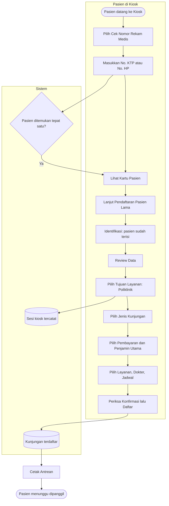
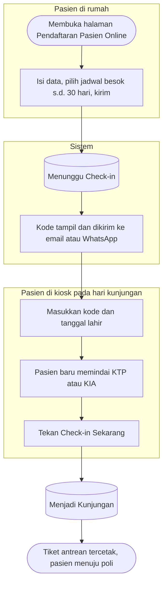

# Kiosk — Alur Utama

Jalur normal dari pasien datang ke Kiosk sampai memegang nomor antrean. Percabangan dan jalur gagal ada di berkas proses masing-masing:

- [cek-nomor-rekam-medis.md](cek-nomor-rekam-medis.md)
- [pendaftaran-pasien-lama.md](pendaftaran-pasien-lama.md)
- [penjamin-utama.md](penjamin-utama.md)

| Langkah | Pelaku | Masukan | Keluaran | Bila gagal |
| --- | --- | --- | --- | --- |
| Cek Nomor Rekam Medis | Pasien | No. KTP atau No. HP | Kartu Pasien | Lihat `cek-nomor-rekam-medis.md` |
| Identifikasi | Pasien | Pasien hasil pencarian | Pasien terpilih | Cari ulang |
| Review Data | Pasien | Data pasien | Data dinyatakan benar | Pasien menemui petugas bila datanya salah |
| Tujuan Layanan | Pasien | Poliklinik / Laboratorium | Sesi kiosk tercatat | Coba lagi atau hubungi petugas |
| Jenis Kunjungan → Layanan & Dokter | Pasien | Pilihan | Draf pendaftaran lengkap | Pesan di step itu |
| Konfirmasi | Pasien | Draf lengkap | Kunjungan terdaftar | Tetap di Konfirmasi dengan pesan |
| Cetak Antrean | Sistem | Kunjungan | Nomor antrean | Pasien menemui petugas |

---

## Amendment PO — Pendaftaran Pasien Online sampai tiket (jalur normal)

Revisi blueprint `2` (`approved` — Sukma Giri Pratama, 19 Nov 2026 (`KSK-DEC-054`)). Jalur pengecualian ada di [pendaftaran-pasien-online.md](pendaftaran-pasien-online.md), [check-in-pasien-online.md](check-in-pasien-online.md), dan [pendaftaran-online-petugas-dan-penutupan.md](pendaftaran-online-petugas-dan-penutupan.md).

| Langkah | Pelaku | Masukan yang dibutuhkan | Keluaran | Bila gagal |
| --- | --- | --- | --- | --- |
| Daftar online | Pasien | Data pasien, kontak, jadwal, penjamin, rujukan, consent (pasien baru) | Menunggu Check-in, kode | Lihat flowchart pendaftaran |
| Terima kode | Sistem | Email atau No. WA | Email otomatis atau tombol WhatsApp | Kode tetap tampil di layar; Lupa Kode di kiosk |
| Check-in | Pasien | Kode atau identitas, tanggal lahir, KTP/KIA (pasien baru) | Menjadi Kunjungan, nomor antrean, tiket | Lihat flowchart check-in; pasien diarahkan ke loket |
