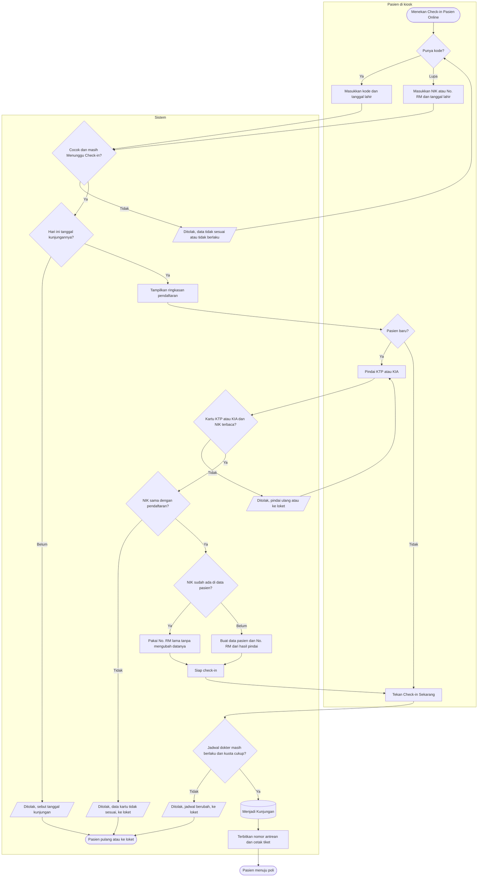

# Flowchart — Check-in Pasien Online di Kiosk (Amendment PO)

| Field | Nilai |
| --- | --- |
| Revisi blueprint | `2` (`approved` — Sukma Giri Pratama, 19 Nov 2026 (`KSK-DEC-054`)) |
| Keputusan | `KSK-DEC-033`, `036`, `039`, `040`, `046`, `048`, `053` |
| Status yang dipakai | Sama persis dengan `contracts/state-transition-matrix.md` *Amendment PO* |

Pelaku: pasien di kiosk, dan sistem.

| Langkah | Pelaku | Masukan yang dibutuhkan | Keluaran | Bila gagal |
| --- | --- | --- | --- | --- |
| Masukkan kode | Pasien | Kode 8 karakter, tanggal lahir | Ringkasan pendaftaran | Pesan umum; pasien memeriksa ulang atau memakai Lupa Kode |
| Lupa Kode | Pasien | NIK/No. RM, tanggal lahir | Ringkasan pendaftaran hari ini | Pesan umum; pasien ke petugas |
| Cek hari kunjungan | Sistem | Tanggal kunjungan | — | Pesan menyebut tanggal; pasien datang lagi pada hari itu |
| Pindai kartu (pasien baru) | Pasien | KTP atau KIA | NIK terbaca dan terkunci | Pindai ulang; bila tetap gagal atau membawa SIM, ke loket |
| Cocokkan NIK | Sistem | NIK hasil pindai, NIK pendaftaran | No. RM lama atau No. RM baru | Ke loket; pendaftaran online tertutup otomatis saat petugas mendaftarkan |
| Check-in | Pasien | — | Status Menjadi Kunjungan, nomor antrean, tiket | Jadwal berubah: ke loket. Waktu check-in habis: ulangi dari awal |
| Cetak tiket | Sistem | Nomor antrean | Tiket | Tiket tampil di layar; cetak ulang lewat Cetak Antrean |
