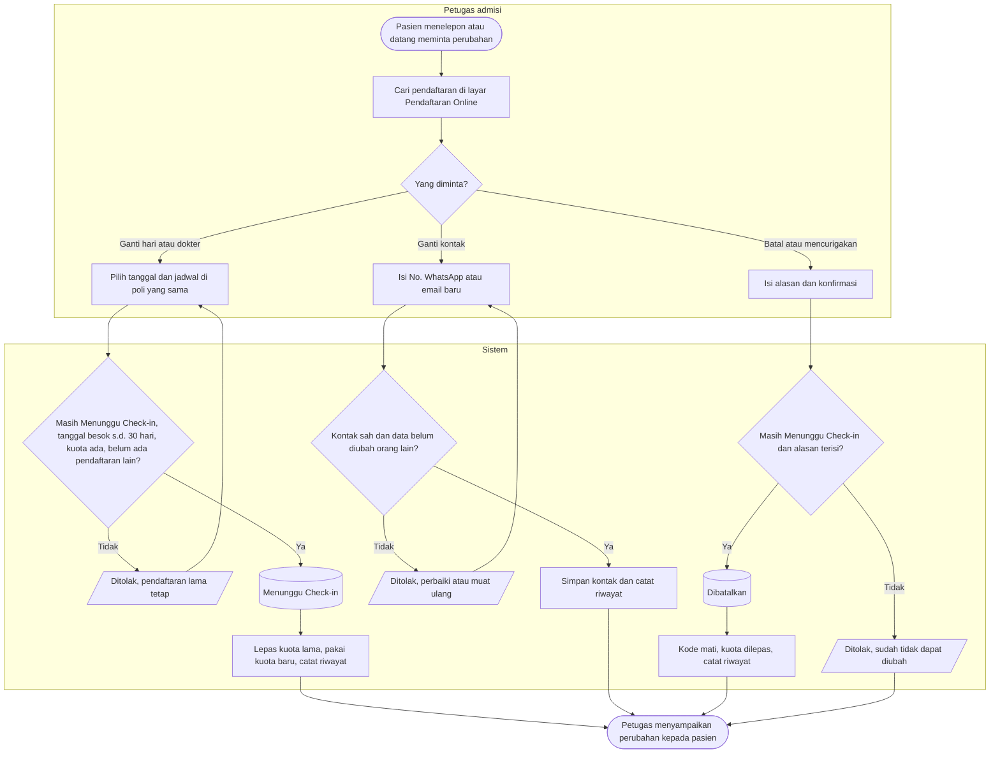
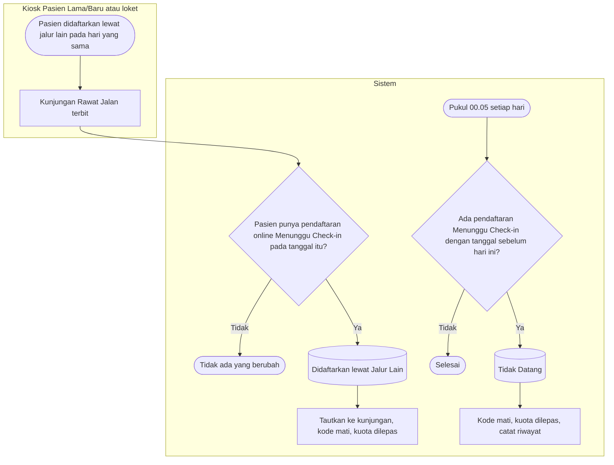

# Flowchart — Pendaftaran Online di Layar Petugas dan Penutupan Otomatis (Amendment PO)

| Field | Nilai |
| --- | --- |
| Revisi blueprint | `2` (`approved` — Sukma Giri Pratama, 19 Nov 2026 (`KSK-DEC-054`)) |
| Keputusan | `KSK-DEC-037`, `045`, `050`, `051`, `052`; `GATE-PO-13` |
| Status yang dipakai | Sama persis dengan `contracts/state-transition-matrix.md` *Amendment PO* |

## 1. Ubah dan batal oleh petugas

| Langkah | Pelaku | Masukan yang dibutuhkan | Keluaran | Bila gagal |
| --- | --- | --- | --- | --- |
| Cari pendaftaran | Petugas | Kode, nomor pendaftaran, nama, No. RM, atau NIK | Detail pendaftaran | Tidak ditemukan: periksa kata kunci dan rentang tanggal |
| Ganti jadwal | Petugas | Tanggal baru, jadwal di poli yang sama | Jadwal baru, kode tetap | Kuota penuh atau sudah ada pendaftaran: pilih jadwal lain. Pindah poli: batalkan lalu minta pasien mendaftar ulang |
| Ganti kontak | Petugas | Kontak baru | Kontak tersimpan, kode tidak dikirim ulang | Muat ulang bila data diubah orang lain |
| Batal | Petugas | Alasan 5–500 karakter | Status Dibatalkan | Pendaftaran yang sudah berstatus akhir tidak dapat dibatalkan |

## 2. Penutupan otomatis

| Langkah | Pelaku | Masukan yang dibutuhkan | Keluaran | Bila gagal |
| --- | --- | --- | --- | --- |
| Tutup lewat jalur lain | Sistem, di dalam pembuatan kunjungan | Pasien dan tanggal kunjungan; pasien baru dicari lewat NIK | Didaftarkan lewat Jalur Lain | Seluruh pembuatan kunjungan batal bersama; petugas mengulang |
| Tutup Tidak Datang | Sistem terjadwal | Tanggal hari ini (WIB) | Tidak Datang | Dijalankan lagi saat aplikasi menyala; hari yang tertinggal ikut diproses |
