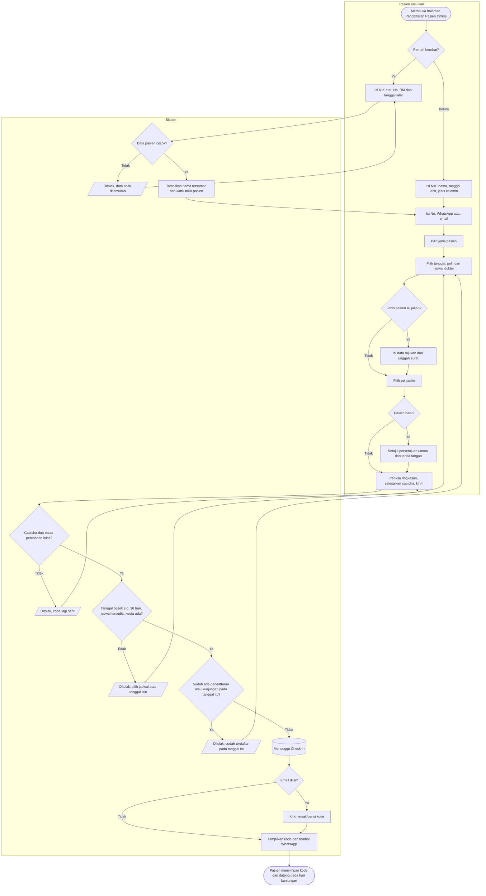

# Flowchart — Pendaftaran Pasien Online (Amendment PO)

| Field | Nilai |
| --- | --- |
| Revisi blueprint | `2` (`approved` — Sukma Giri Pratama, 19 Nov 2026 (`KSK-DEC-054`)) |
| Keputusan | `KSK-DEC-029` s.d. `035`, `038`, `041` s.d. `044`, `047` |
| Status yang dipakai | Sama persis dengan `contracts/state-transition-matrix.md` *Amendment PO* |

Pelaku: pasien atau wali di HP/laptop tanpa login, dan sistem.

| Langkah | Pelaku | Masukan yang dibutuhkan | Keluaran | Bila gagal |
| --- | --- | --- | --- | --- |
| Isi data pasien lama | Pasien | NIK atau No. RM, tanggal lahir, captcha | Nama tersamar dan kartu milik pasien | Pesan umum; pasien memeriksa isian atau mendaftar di loket |
| Isi data pasien baru | Pasien | NIK, nama, tanggal lahir, jenis kelamin | — | Pesan per kolom |
| Isi kontak | Pasien | No. WA atau email | — | Kolom wajib diisi salah satu |
| Pilih jadwal | Pasien | Tanggal H+1 s.d. H+30, poli, jadwal | Jadwal dengan sisa kuota | Jadwal penuh tidak dapat dipilih; pasien memilih yang lain |
| Data rujukan | Pasien | Faskes perujuk (hanya faskes mitra pada tanggal kunjungan, `KSK-DEC-057`), surat rujukan maks. 5 MB | — | Berkas terlalu besar ditolak; pasien memilih berkas lain. Faskes perujuk tidak ada di daftar → pasien daftar di loket |
| Persetujuan umum | Pasien baru atau walinya | Klausul dan tanda tangan | — | Tombol lanjut tetap terkunci |
| Kirim | Pasien | Ringkasan dan captcha | Pendaftaran berstatus Menunggu Check-in, kode, email | Kuota habis atau sudah terdaftar: kembali ke langkah jadwal. Captcha atau batas percobaan: coba lagi nanti |
| Email | Sistem | Alamat email | Email berisi kode | Pendaftaran tetap tersimpan; kode tetap tampil; Lupa Kode tersedia di kiosk |
