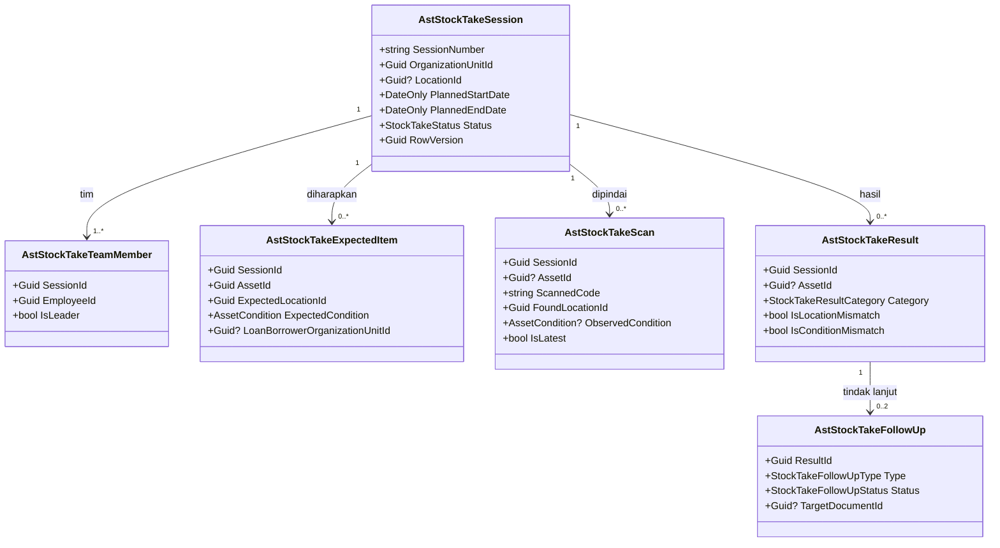
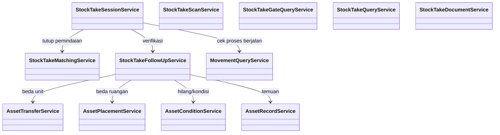

# Inventarisasi Fisik — Arsitektur Backend

| Field | Value |
|---|---|
| Sub-modul | `inventarisasi` dari `AST-BP-001` revision `1` |
| Contract set | `AST-INV-1.0.0` — `draft` |
| Owner | Rizki · `approved_by`: — · `approved_at`: — |
| Masukan | `AST-DEC-018`, `019`, `031`, `046`; `AST-RCG-G10`, `G11`, `G22`; `02-module-map.md` |
| `domain_architecture_readiness` | `DOMAIN_ARCHITECTURE_NOT_RUN` |
| Backend / Frontend SHA | `1f54a175` / `e49e8a81` |

Seluruh isi adalah **rencana**.

## 1. Bounded context dan ownership

**Konteks:** Inventarisasi Fisik — sesi opname per unit yang membandingkan kenyataan di lapangan dengan
catatan register, lalu menghasilkan **usulan** tindak lanjut. Konteks ini tidak pernah mengubah data aset
secara langsung (`AST-DEC-019`).

| Aggregate root | Isi | Invariant | Batas transaksi |
|---|---|---|---|
| `AstStockTakeSession` | Tim, snapshot aset yang diharapkan, hasil pindai, hasil pencocokan, tindak lanjut | Snapshot dibekukan saat sesi dimulai; selama `Berjalan`/`Pencocokan`/`MenungguVerifikasi` unit ditahan; tindak lanjut hanya lahir saat `Diverifikasi`; verifikator bukan anggota tim | Mulai (snapshot), tutup pemindaian (hitung hasil), verifikasi (buat usulan) masing-masing satu transaksi |

## 2. Kelompok data milik sub-modul ini

`AstStockTakeSession`, `AstStockTakeTeamMember`, `AstStockTakeExpectedItem`, `AstStockTakeScan`,
`AstStockTakeResult`, `AstStockTakeFollowUp` — lihat [`../02-module-map.md`](../02-module-map.md) bagian 2.

## 3. Keputusan desain (`draft`)

| ID | Keputusan | Dasar |
|---|---|---|
| `AST-DES-007` | Tindak lanjut beda lokasi: **beda unit** → mutasi `KoreksiOpname` (`pergerakan`); **beda ruangan dalam unit yang sama** → penyerahan `KoreksiOpname` (`register`) | Mutasi = antar unit |
| `AST-DES-008` | Sesi tidak dapat dimulai selama unit punya penyerahan, mutasi, atau pinjaman yang belum selesai | Snapshot tidak bergeser |
| `AST-DES-027` | Aset yang sedang dipinjam keluar diharapkan ada di unit peminjam; tim memindainya di sana (hasil `SesuaiSedangDipinjam`). Bila tidak dipindai → `TidakDitemukan` | Pemeriksaan fisik, bukan percaya catatan |
| `AST-DES-028` | Aset milik unit lain yang ditemukan di unit sesi dicatat sebagai `BedaLokasi` pada sesi ini dan menghasilkan usulan mutasi dari unit pemiliknya | `AST-RCG-G10` analog |
| `AST-DES-029` | Pindai ulang aset yang sama menggantikan hasil sebelumnya (pindaian lama tetap tersimpan, `IsLatest=false`) | Koreksi salah pindai |
| `AST-DES-030` | Status tindak lanjut `Usulan` → `Diproses` (dokumen tujuan dibuat) atau `Diabaikan` (dengan alasan, Kepala Bagian Aset). Kemajuan sesudahnya dibaca dari status dokumen tujuan | Tidak ada status ganda |
| `AST-DES-031` | `StockTakeGateQueryService.IsUnitUnderStockTake` dipasang task sub-modul ini ke `AssetTransferService`, `AssetLoanService`, dan `AssetPlacementService` | `AST-DES-026` |

## 4. Class diagram





## 5. Penjelasan class

### 5.1 Model

| Class | Status | Lokasi | Tanggung jawab | Catatan |
|---|---|---|---|---|
| `AstStockTakeSession` | Baru | `Areas/Corporate/AssetManagement/PhysicalInventory/Models/AstStockTakeSession.cs` | Jadwal dan sesi opname satu unit (opsional satu ruangan) | Nomor `AST-OPN-######` |
| `AstStockTakeTeamMember` | Baru | `.../PhysicalInventory/Models/AstStockTakeTeamMember.cs` | Anggota tim; satu ketua | Unik `(SessionId, EmployeeId)` |
| `AstStockTakeExpectedItem` | Baru | `.../Models/AstStockTakeExpectedItem.cs` | Snapshot aset yang diharapkan saat dimulai | Tidak berubah sesudah `Berjalan` |
| `AstStockTakeScan` | Baru | `.../Models/AstStockTakeScan.cs` | Satu pindaian/temuan | Foto lewat `AstAttachment` |
| `AstStockTakeResult` | Baru | `.../Models/AstStockTakeResult.cs` | Hasil pencocokan per aset/temuan | Dihitung ulang setiap tutup pemindaian |
| `AstStockTakeFollowUp` | Baru | `.../Models/AstStockTakeFollowUp.cs` | Usulan tindak lanjut | Satu hasil maksimal dua usulan (lokasi + kondisi) |

### 5.2 Service

| Service | Status | Lokasi | Fungsi | Dipanggil oleh | Transaksi |
|---|---|---|---|---|---|
| `StockTakeSessionService` | Baru | `.../PhysicalInventory/Services/StockTakeSessionService.cs` | Jadwal, mulai (snapshot), tutup/buka ulang pemindaian, ajukan, verifikasi, kembalikan, batalkan | Controller | Ya |
| `StockTakeScanService` | Baru | `.../Services/StockTakeScanService.cs` | Catat pindaian; cari aset dari nomor; temuan tidak terdaftar | Controller | Ya |
| `StockTakeMatchingService` | Baru | `.../Services/StockTakeMatchingService.cs` | Hitung kategori hasil dari snapshot + pindaian terakhir | `StockTakeSessionService` | Ikut pemanggil |
| `StockTakeFollowUpService` | Baru | `.../Services/StockTakeFollowUpService.cs` | Buat usulan saat diverifikasi; proses usulan menjadi dokumen sub-modul lain; abaikan | `StockTakeSessionService`, controller | Ya |
| `StockTakeGateQueryService` | Baru | `.../Services/StockTakeGateQueryService.cs` | `IsUnitUnderStockTake(unitId)` | `pergerakan`, `register` | Tidak |
| `StockTakeQueryService` | Baru | `.../Services/StockTakeQueryService.cs` | Daftar, dashboard 1.5, laporan 11.4 | Controller | Tidak |
| `StockTakeDocumentService` | Baru | `.../Services/StockTakeDocumentService.cs` | PDF Berita Acara Inventarisasi | Controller | Tidak |

### 5.3 Controller

| Controller | Status | Lokasi | Endpoint |
|---|---|---|---|
| `AssetStockTakesController` | Baru | `.../PhysicalInventory/Controllers/AssetStockTakesController.cs` | `contracts/api-contract.md` 2.1 |
| `AssetStockTakeFollowUpsController` | Baru | `.../Controllers/AssetStockTakeFollowUpsController.cs` | 2.2 |
| `AssetStockTakeDashboardController` | Baru | `.../Controllers/AssetStockTakeDashboardController.cs` | 2.3, 2.4 |

### 5.4 Enum

| Enum | Nilai | Bawaan |
|---|---|---|
| `StockTakeStatus` | `Dijadwalkan=1`, `Berjalan=2`, `Pencocokan=3`, `MenungguVerifikasi=4`, `Diverifikasi=5`, `Dibatalkan=6` | `Dijadwalkan` |
| `StockTakeResultCategory` | `Sesuai=1`, `SesuaiSedangDipinjam=2`, `TidakDitemukan=3`, `BedaLokasi=4`, `BedaKondisi=5`, `TidakTerdaftar=6` | — |
| `StockTakeFollowUpType` | `KoreksiLokasi=1`, `UsulanHilang=2`, `PerubahanKondisi=3`, `PendaftaranTemuan=4` | — |
| `StockTakeFollowUpStatus` | `Usulan=1`, `Diproses=2`, `Diabaikan=3` | `Usulan` |

Kategori utama satu per hasil; aset yang beda lokasi **dan** beda kondisi berkategori `BedaLokasi` dengan
kedua penanda `true`, sehingga menghasilkan dua usulan.

### 5.5 DTO — `.../PhysicalInventory/DTOs/AssetStockTakeDtos.cs`

`StockTakeScheduleRequest` (Create/Update: unit, ruangan opsional, tanggal rencana, tim), `StockTakeScanRequest`
(multipart: kode, ruangan ditemukan, kondisi, foto, catatan, `IsManualEntry`), `StockTakeUnregisteredFindingRequest`,
`StockTakeResultNoteRequest`, `StockTakeDecisionRequest`, `StockTakeSessionResponse`, `StockTakeScanResponse`,
`StockTakeResultResponse`, `StockTakeFollowUpResponse`, `StockTakeFollowUpProcessRequest`, `StockTakePagedQuery`,
`StockTakeSummaryResponse`.

### 5.6 Configuration

`Repositories/Configurations/Corporate/AssetManagement/PhysicalInventory/` — enam berkas; FK `Restrict`.

## 6. Arsitektur folder

```text
Areas/Corporate/AssetManagement/PhysicalInventory/       # Baru
├── Controllers/ 3   ├── DTOs/ 1   ├── Enums/ 4   ├── Models/ 6   └── Services/ 7
Repositories/Configurations/Corporate/AssetManagement/PhysicalInventory/  # Baru, 6
Repositories/ApplicationDbContext.cs                     # Diperbarui: 6 DbSet
Program.cs                                               # Diperbarui: AddScoped 7 service
Areas/Corporate/AssetManagement/Movement/Services/AssetTransferService.cs, AssetLoanService.cs  # Diperbarui: panggilan gerbang opname (AST-DES-031)
Areas/Corporate/AssetManagement/Register/Services/AssetPlacementService.cs                    # Diperbarui: panggilan gerbang opname
```

## 7. Status model dan dampak migration

| Status | Tabel | Dampak |
|---|---|---|
| Baru | 6 tabel | `AddAssetPhysicalInventory` (urutan 3) |
| Sudah ada | `AstAsset`, `MstAssetLocation`, `AstAttachment` (`register`); `MstOrganizationUnit`, `MstEmployee` | FK `Restrict` |

## 8. Rencana migration

`AddAssetPhysicalInventory`: aditif; tanpa downtime; mundur `Down()`. Bergantung urutan 1.

## 9. Rencana data master awal

Tidak ada master. Deret `AST_STOCKTAKE` (`AST-OPN`) terbentuk otomatis.

## 10. Yang sengaja tidak dibuat

| Yang ditolak | Alasan |
|---|---|
| Mengubah lokasi/kondisi aset langsung dari hasil opname | `AST-DEC-019` |
| Aplikasi pemindai terpisah (mobile native) | Kamera browser cukup (`AST-FE-003`); input nomor manual sebagai cadangan |
| Opname tanpa daring (offline) | Tidak diputuskan; dicatat sebagai risiko bila sinyal di ruangan tertentu buruk |
| Tabel jadwal tahunan terpisah | Jadwal = sesi berstatus `Dijadwalkan` |
