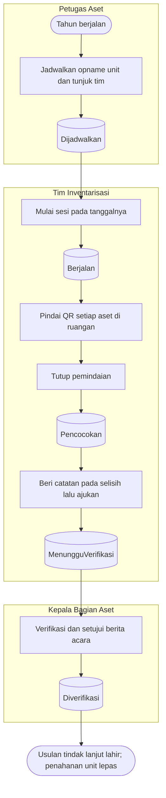

# Inventarisasi Fisik — Alur Utama

| Langkah | Pelaku | Masukan | Keluaran | Bila gagal |
|---|---|---|---|---|
| Jadwalkan | Petugas Aset | Unit, ruangan opsional, tanggal, tim | `Dijadwalkan` | — |
| Mulai | Ketua tim | — | Snapshot aset; unit ditahan | Proses berjalan di unit → selesaikan dulu |
| Pindai | Anggota tim | QR atau nomor diketik, ruangan, kondisi | Pindaian | Nomor tak dikenal → catat sebagai temuan |
| Tutup | Ketua tim | — | Hasil per kategori | Buka kembali bila ada yang terlewat |
| Ajukan | Ketua tim | Catatan per selisih | `MenungguVerifikasi` | Lengkapi catatan |
| Verifikasi | Kepala Bagian Aset bukan anggota tim | — | Berita acara disetujui, usulan dibuat | Dikembalikan ke `Pencocokan` dengan alasan |
