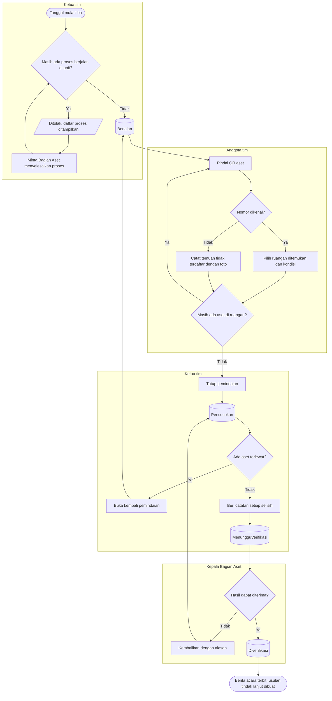

# Pemeriksaan Fisik dan Pencocokan

**Tujuan:** setiap aset unit diperiksa fisiknya dan dibandingkan dengan catatan.
**Pemicu:** tanggal mulai sesi tiba. **Prasyarat:** tidak ada penyerahan/mutasi/pinjaman yang belum selesai di
unit; tidak ada sesi aktif lain di unit itu. **Hasil akhir:** hasil pencocokan per aset dan berita acara.

| Langkah | Pelaku | Masukan | Keluaran | Bila gagal |
|---|---|---|---|---|
| Mulai | Ketua tim | — | Snapshot dibekukan | Selesaikan proses yang disebut |
| Pindai | Anggota tim | QR (kamera) atau nomor diketik | Pindaian; pindai ulang menggantikan yang lama | Kamera tidak bisa dipakai → ketik nomor |
| Temuan | Anggota tim | Keterangan + foto | Temuan `TidakTerdaftar` | Lengkapi keterangan dan foto |
| Tutup | Ketua tim | — | Hasil terhitung | — |
| Verifikasi | Kepala Bagian Aset | — | `Diverifikasi` | Bila ia anggota tim → tunjuk verifikator lain |

**Contoh.** IGD punya 312 aset diharapkan. Tim memindai 310 dan mencatat 1 temuan. Hasil: 303 `Sesuai`,
1 `SesuaiSedangDipinjam` (pompa di ICU, dipindai di ICU), 2 `TidakDitemukan`, 1 `BedaLokasi`
(monitor di ruang observasi, tercatat di resusitasi), 5 `BedaKondisi`, 1 `TidakTerdaftar`.
