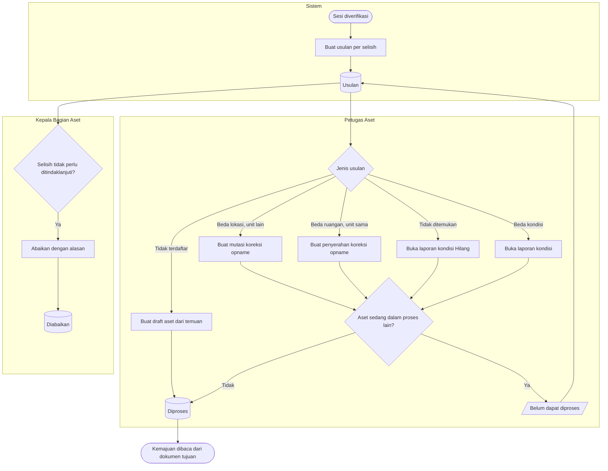

# Tindak Lanjut Selisih

**Tujuan:** setiap selisih yang sudah diverifikasi diselesaikan lewat alur pemiliknya, tanpa mengubah data
aset diam-diam (`AST-DEC-019`). **Pemicu:** sesi `Diverifikasi`. **Hasil akhir:** setiap usulan `Diproses`
(dokumen tujuan dibuat) atau `Diabaikan` dengan alasan.

| Langkah | Pelaku | Masukan | Keluaran | Bila gagal |
|---|---|---|---|---|
| Proses beda unit | Petugas Aset | Usulan | Mutasi `Diajukan` beralasan koreksi opname | Aset terkunci → selesaikan proses itu, lalu proses ulang |
| Proses beda ruangan | Petugas Aset | Usulan | Penyerahan `Diserahkan` | sama |
| Proses tidak ditemukan | Petugas Aset | Usulan | Laporan kondisi Hilang; tetap butuh berita acara kehilangan sebelum disetujui | — |
| Proses temuan | Petugas Aset | Usulan + foto | Draft aset | — |
| Abaikan | Kepala Bagian Aset | Alasan | `Diabaikan` | — |

**Contoh.** Dua kursi tidak ditemukan → dua laporan kondisi Hilang. Satu kursi ternyata ditemukan di gudang
sebelum disetujui; Petugas Aset menolak laporan itu dan aset tetap `Aktif`. Kursi kedua disetujui Hilang
setelah berita acara kehilangan dilampirkan.
