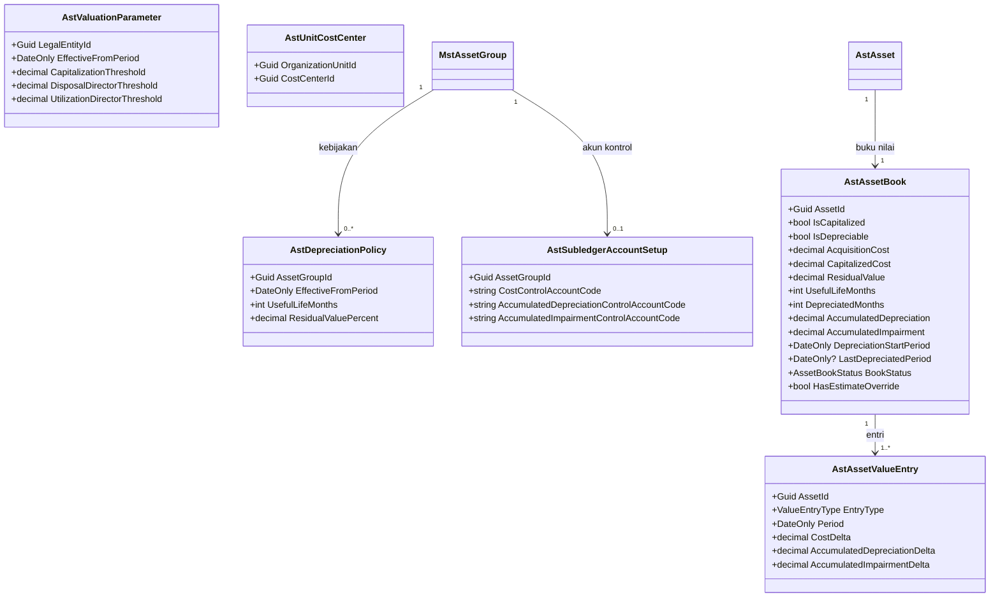
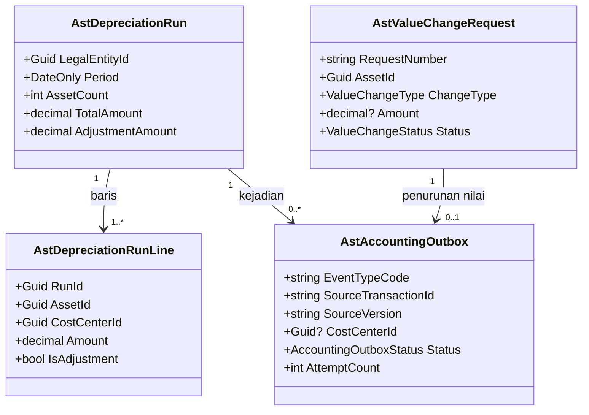
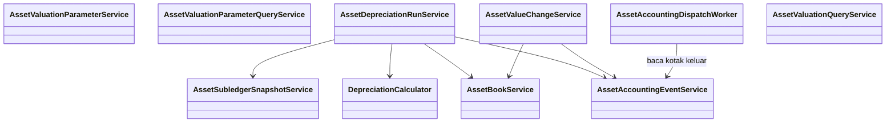

# Nilai Aset — Arsitektur Backend

| Field | Value |
|---|---|
| Sub-modul | `nilai` dari `AST-BP-001` revision `1` |
| Contract set | `AST-NLI-1.0.0` — `draft` |
| Owner | Rizki (Aset + Akuntansi) · `approved_by`: — · `approved_at`: — |
| Masukan | `AST-DEC-013..016`, `027`, `030`, `032`, `036`, `038..042`, `047`; `AST-RCG-G16..G20`; `TS-08..TS-13`; `02-module-map.md` |
| `domain_architecture_readiness` | `DOMAIN_ARCHITECTURE_NOT_RUN` |
| Backend / Frontend SHA | `1f54a175` / `e49e8a81` |

Seluruh isi adalah **rencana**.

## 1. Bounded context dan ownership

**Konteks:** Nilai Aset — buku nilai per aset (subledger aset tetap), parameter nilai, proses penyusutan
bulanan, perubahan nilai, dan pengiriman akibat keuangannya ke Akuntansi. Konteks ini **tidak** membuat
jurnal; jurnal tetap milik Akuntansi (`ACC-OOS-007`, `TS-08`).

| Aggregate root | Isi | Invariant | Batas transaksi |
|---|---|---|---|
| `AstAssetBook` | Entri nilai (`AstAssetValueEntry`) | Nilai buku = biaya tercatat − akumulasi penyusutan − akumulasi penurunan nilai, tidak pernah < nilai residu; entri tidak pernah diubah | Setiap perubahan buku + entri satu transaksi |
| `AstDepreciationRun` | Baris penyusutan | Satu proses per periode per badan hukum; berurutan; periode yang sudah diproses tidak dihitung ulang | Seluruh proses (baris, entri, buku, kotak keluar) satu transaksi |
| `AstValueChangeRequest` | — | Disetujui Kepala Akuntansi bukan pengaju (`AST-DEC-030`) | Persetujuan + penerapan ke buku satu transaksi |
| `AstValuationParameter`, `AstDepreciationPolicy` | — | Bertanggal berlaku; berlaku mulai bulan berikutnya (`AST-RULE-042`); tidak diubah sesudah dibuat | Per baris |
| `AstAccountingOutbox` | — | Satu `(SourceTransactionId, SourceVersion)` sekali; pengiriman bawaan mati | Ditulis di dalam transaksi pemicunya |

## 2. Kelompok data milik sub-modul ini

Sepuluh tabel — lihat [`../02-module-map.md`](../02-module-map.md) bagian 2. Lima di antaranya dibuat pada
migration pertama (`AST-DES-003`).

## 3. Keputusan desain (`draft`)

| ID | Keputusan | Dasar |
|---|---|---|
| `AST-DES-009` | Penyusutan per bulan = (nilai buku − residu) ÷ sisa umur bulan, dibulatkan ke rupiah penuh; bulan terakhir menyerap sisa. Tanpa perubahan apa pun, hasilnya sama dengan garis lurus (harga − residu) ÷ umur | `AST-DEC-013` |
| `AST-DES-010` | Aset yang terlambat dicatat atau dipulihkan: penyusutan bulan yang terlewat dikejar sebagai baris penyesuaian pada proses berikutnya, bertanggal akuntansi periode proses itu | `AST-RULE-041`, `ACC-DEC-047` |
| `AST-DES-011` | Pusat biaya pembebanan: pemetaan `AstUnitCostCenter` bila ada; bila tidak, satu-satunya `MstCostCenter` aktif milik unit; bila nol atau lebih dari satu, pratinjau menolak proses | `AST-DEC-036` |
| `AST-DES-012` | Kode jenis kejadian usulan, `SourceModule = AssetManagement`: `AST-PENYUSUTAN`, `AST-PENURUNAN-NILAI`, `AST-PEROLEHAN-HIBAH`, `AST-PENGHAPUSAN`, `AST-PEMULIHAN`, `AST-SALDO-SUBLEDGER`. Kode final dan aturan posting = `AST-OQ-009` | `TS-08` |
| `AST-DES-032` | Baris parameter nilai **pertama** boleh berlaku bulan berjalan agar go-live tidak tertunda satu bulan; baris berikutnya mulai bulan sesudah ditetapkan | `AST-RULE-042` |
| `AST-DES-033` | Kebijakan kelompok baru berlaku ke depan untuk **seluruh** aset kelompok itu, kecuali aset yang punya perubahan estimasi sendiri: sisa umur baru = umur baru − bulan yang sudah disusutkan | Contoh laptop pada `AST-DEC-027` |
| `AST-DES-034` | Pengiriman memakai kotak keluar + `AssetAccountingDispatchWorker` (pola `FinanceAccountingDispatchWorker`): bawaan mati; kode `AST-PENYUSUTAN` dan `AST-SALDO-SUBLEDGER` tetap `Held` sampai dinyalakan per kode (`AST-DEC-038`) | `TS-08` |
| `AST-DES-035` | Saldo subledger dikirim per akun kontrol setiap proses penyusutan selesai; pemetaan kelompok → kode akun kontrol di `AstSubledgerAccountSetup` (pola subledger setup Finance) | `TS-09`, `ACC-DEC-061` |
| `AST-DES-036` | Proses penyusutan dijalankan Petugas Aset (`AST-DEC-039`); Kepala Akuntansi melihat dan dapat menjalankannya juga | — |

## 4. Class diagram

### 4.1 Parameter dan buku



### 4.2 Proses, perubahan, kotak keluar



### 4.3 Service



## 5. Penjelasan class

### 5.1 Model

| Class | Status | Lokasi | Tanggung jawab | Catatan |
|---|---|---|---|---|
| `AstValuationParameter` | Baru | `Areas/Corporate/AssetManagement/Valuation/Models/AstValuationParameter.cs` | Batas kapitalisasi, batas Direktur penghapusan dan pemanfaatan, bertanggal berlaku | `AST-DEC-027`, `AST-DES-032` |
| `AstDepreciationPolicy` | Baru | `.../Valuation/Models/AstDepreciationPolicy.cs` | Umur dan residu per kelompok, bertanggal berlaku | `AST-DES-033` |
| `AstSubledgerAccountSetup` | Baru | `.../Valuation/Models/AstSubledgerAccountSetup.cs` | Kode akun kontrol Akuntansi per kelompok | Hanya kode; tidak menyalin daftar akun |
| `AstUnitCostCenter` | Baru | `.../Valuation/Models/AstUnitCostCenter.cs` | Pemetaan unit → pusat biaya bila otomatis tidak cukup | `AST-DES-011` |
| `AstAssetBook` | Baru | `.../Valuation/Models/AstAssetBook.cs` | Buku nilai satu aset | `RowVersion`; dibuat saat aset disetujui/diimpor |
| `AstAssetValueEntry` | Baru | `.../Valuation/Models/AstAssetValueEntry.cs` | Riwayat perubahan nilai (menu 9.3) | Tidak diubah/dihapus |
| `AstDepreciationRun` | Baru | `.../Valuation/Models/AstDepreciationRun.cs` | Satu proses penyusutan bulanan | Unik `(LegalEntityId, Period)` |
| `AstDepreciationRunLine` | Baru | `.../Valuation/Models/AstDepreciationRunLine.cs` | Penyusutan satu aset dalam satu proses (menu 9.4) | — |
| `AstValueChangeRequest` | Baru | `.../Valuation/Models/AstValueChangeRequest.cs` | Pengajuan perbaikan besar, koreksi harga, penurunan nilai, perubahan estimasi | Nomor `AST-NLI-######` |
| `AstAccountingOutbox` | Baru | `.../Valuation/Models/AstAccountingOutbox.cs` | Kotak keluar kejadian ke Akuntansi untuk seluruh modul | Pola `FinAccountingEventOutbox` |

### 5.2 Service

| Service | Status | Lokasi | Fungsi | Dipanggil oleh | Transaksi |
|---|---|---|---|---|---|
| `AssetValuationParameterService` | Baru | `.../Valuation/Services/AssetValuationParameterService.cs` | Menetapkan parameter, kebijakan kelompok, akun kontrol, pemetaan pusat biaya | Controller | Ya |
| `AssetValuationParameterQueryService` | Baru | `.../Services/AssetValuationParameterQueryService.cs` | Parameter/kebijakan yang berlaku pada tanggal tertentu | `register`, `penghapusan`, service sini | Tidak |
| `AssetBookService` | Baru | `.../Services/AssetBookService.cs` | Membuat buku (aset disetujui, saldo awal), menerapkan entri, menghentikan dan memulihkan buku | `register`, `penghapusan`, service sini | Ikut pemanggil |
| `DepreciationCalculator` | Baru | `.../Services/DepreciationCalculator.cs` | Fungsi murni: jumlah bulanan, penyesuaian, sisa umur | Run service, uji unit | Tidak |
| `AssetDepreciationRunService` | Baru | `.../Services/AssetDepreciationRunService.cs` | Pratinjau dan proses penyusutan | Controller | Ya (satu transaksi per proses) |
| `AssetValueChangeService` | Baru | `.../Services/AssetValueChangeService.cs` | Ajukan, setujui, tolak, batalkan perubahan nilai | Controller | Ya |
| `AssetAccountingEventService` | Baru | `.../Services/AssetAccountingEventService.cs` | Menulis baris kotak keluar (penyusutan, penurunan nilai, hibah, penghapusan, pemulihan, saldo); coba ulang manual | Service modul | Ikut pemanggil |
| `AssetSubledgerSnapshotService` | Baru | `.../Services/AssetSubledgerSnapshotService.cs` | Menghitung saldo per akun kontrol per periode | Run service, controller rekonsiliasi | Ikut pemanggil |
| `AssetAccountingDispatchWorker` | Baru | `.../Services/AssetAccountingDispatchWorker.cs` | `BackgroundService` pengirim HTTP ke `POST api/v1/corporate/accounting/accounting-events`; bawaan mati; kredensial dari konfigurasi; per kode dapat ditahan | Host | Ya, satu baris satu transaksi |
| `AssetValuationQueryService` | Baru | `.../Services/AssetValuationQueryService.cs` | Daftar nilai buku, harga perolehan, riwayat nilai, laporan 11.6 | Controller | Tidak |

### 5.3 Controller

| Controller | Status | Lokasi | Endpoint |
|---|---|---|---|
| `AssetValuationParametersController` | Baru | `.../Valuation/Controllers/` | `contracts/api-contract.md` 2.1–2.4 |
| `AssetBooksController` | Baru | `.../Valuation/Controllers/` | 2.5 |
| `AssetDepreciationRunsController` | Baru | `.../Valuation/Controllers/` | 2.6 |
| `AssetValueChangesController` | Baru | `.../Valuation/Controllers/` | 2.7 |
| `AssetAccountingOutboxController` | Baru | `.../Valuation/Controllers/` | 2.8 |
| `AssetReconciliationController` | Baru | `.../Valuation/Controllers/` | 2.9 |
| `AssetValuationReportsController` | Baru | `.../Valuation/Controllers/` | 2.10 |

### 5.4 Enum

| Enum | Nilai | Bawaan |
|---|---|---|
| `AssetBookStatus` | `Aktif=1`, `Dihentikan=2` | `Aktif` |
| `ValueEntryType` | `Perolehan=1`, `SaldoAwal=2`, `Penyusutan=3`, `PenyesuaianPenyusutan=4`, `PerbaikanBesar=5`, `KoreksiHargaPerolehan=6`, `PenurunanNilai=7`, `PerubahanEstimasi=8`, `Penghapusan=9`, `Pemulihan=10` | — |
| `ValueChangeType` | `PerbaikanBesar=1`, `KoreksiHargaPerolehan=2`, `PenurunanNilai=3`, `PerubahanEstimasi=4` | — |
| `ValueChangeStatus` | `Diajukan=1`, `Disetujui=2`, `Ditolak=3`, `Dibatalkan=4` | `Diajukan` |
| `DepreciationAdjustmentReason` | `Tidak=0`, `KoreksiHarga=1`, `TerlambatDicatat=2`, `Pemulihan=3` | `Tidak` |
| `AccountingOutboxStatus` | `Pending=1`, `Held=2`, `Acknowledged=3`, `Failed=4` | `Pending` |

### 5.5 DTO — `.../Valuation/DTOs/AssetValuationDtos.cs`

`ValuationParameterSetRequest`, `ValuationParameterResponse`, `DepreciationPolicySetRequest`,
`DepreciationPolicyResponse`, `SubledgerAccountSetupRequest`/`Response`, `UnitCostCenterRequest`/`Response`,
`AssetBookListItemResponse`, `AssetBookDetailResponse`, `AssetValueEntryResponse`, `DepreciationPreviewResponse`
(ringkasan per kelompok × pusat biaya, daftar galat, daftar peringatan), `DepreciationRunCreateRequest`,
`DepreciationRunResponse`, `DepreciationRunLineResponse`, `ValueChangeCreateRequest` (multipart),
`ValueChangeDecisionRequest`, `ValueChangeResponse`, `AccountingOutboxItemResponse`,
`SubledgerBalanceResponse`, `ValuationPagedQuery`, `ValuationReportQuery`.

### 5.6 Configuration

`Repositories/Configurations/Corporate/AssetManagement/Valuation/` — sepuluh berkas; uang `HasPrecision(18,2)`;
FK `Restrict`; `RowVersion` token konkurensi pada buku dan pengajuan. Opsi `AssetManagement:AccountingDispatch`
(`Enabled`, `PollIntervalSeconds`, `MaxAttempts`, `EnabledEventCodes`, `BaseUrl`, kredensial) di
`appsettings*` — nilainya tidak dicetak di dokumen mana pun.

## 6. Arsitektur folder

```text
Areas/Corporate/AssetManagement/Valuation/            # Baru
├── Controllers/ 7   ├── DTOs/ 1   ├── Enums/ 6   ├── Models/ 10   └── Services/ 10
Repositories/Configurations/Corporate/AssetManagement/Valuation/  # Baru, 10
Repositories/ApplicationDbContext.cs                  # Diperbarui: 10 DbSet
Program.cs                                            # Diperbarui: AddScoped, AddHostedService, opsi
```

Perubahan di luar modul (bukan bagian sub-modul ini, task modul Akuntansi `DEP-AST-01`):
`Areas/Corporate/AccountingManagement/AccountingEvent/Models/AccAccountingEvent.cs` kolom pusat biaya,
DTO penerimaan, dan aturan pemakaian pusat biaya pada `AccAccountingEventService`.

## 7. Status model dan dampak migration

| Status | Tabel | Dampak |
|---|---|---|
| Baru | `AstValuationParameter`, `AstDepreciationPolicy`, `AstAssetBook`, `AstAssetValueEntry`, `AstAccountingOutbox` | Urutan 1 `AddAssetManagementFoundation` |
| Baru | `AstDepreciationRun`, `AstDepreciationRunLine`, `AstValueChangeRequest`, `AstSubledgerAccountSetup`, `AstUnitCostCenter` | Urutan 4 `AddAssetValuationProcessing` |
| Sudah ada | `MstCostCenter`, `MstLegalEntity` (HR); `AstAsset`, `MstAssetGroup` (`register`) | FK `Restrict` |
| Diperbarui (modul lain) | `AccAccountingEvent` | Migration Akuntansi `DEP-AST-01` |

## 8. Rencana migration

Dua migration aditif (urutan 1 dan 4), tanpa downtime, tanpa pengisian data lama; mundur `Down()`.

## 9. Rencana data master awal

| Data | Isi minimum | Sumber |
|---|---|---|
| `AstValuationParameter` | Satu baris: batas kapitalisasi, batas Direktur penghapusan, batas Direktur pemanfaatan | Kepala Akuntansi (`AST-OQ-001`, `003`, `004`) — tanpa baris ini persetujuan aset pertama ditolak |
| `AstDepreciationPolicy` | Satu baris per kelompok yang dapat disusutkan | Kepala Akuntansi (`AST-OQ-002`) |
| `AstSubledgerAccountSetup` | Kode akun kontrol per kelompok | Kepala Akuntansi; kode harus ada di daftar akun Akuntansi |
| Jenis kejadian dan aturan posting di Akuntansi | Enam kode `AST-DES-012` | Kepala Akuntansi di modul Akuntansi (`AST-OQ-009`) |

## 10. Yang sengaja tidak dibuat

| Yang ditolak | Alasan |
|---|---|
| Jurnal di modul Aset | Milik Akuntansi |
| Nilai `Revaluasi` pada enum | Revaluasi `DEFERRED` (`AST-DEC-032`); ditambahkan bersama desainnya |
| Metode saldo menurun | `AST-DEC-013` |
| Kejadian perolehan pembelian, kapitalisasi perbaikan besar, koreksi harga, saldo awal | `AST-DEC-015`, `023`, `041` |
| Membaca tabel Akuntansi untuk rekonsiliasi | Arah sebaliknya: Aset mengirim saldo (`ACC-DEC-061`) |
| Pembatalan proses penyusutan | Kesalahan dikoreksi lewat perubahan nilai; jurnal yang sudah terbentuk dikoreksi Akuntansi |
