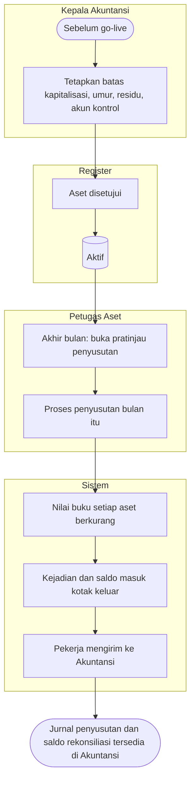

# Nilai Aset — Alur Utama

| Langkah | Pelaku | Masukan | Keluaran | Bila gagal |
|---|---|---|---|---|
| Tetapkan parameter | Kepala Akuntansi | Angka batas, umur, residu, kode akun | Parameter berlaku | Tanpa parameter, aset tidak dapat disetujui |
| Aset disetujui | `register` | — | Buku nilai `Aktif` | — |
| Pratinjau | Petugas Aset | Periode | Ringkasan dan galat | Selesaikan galat (pusat biaya, kebijakan) |
| Proses | Petugas Aset | Pratinjau bersih | Proses tersimpan, buku diperbarui | Periode sebelumnya belum diproses → proses dulu |
| Kirim | Pekerja | Kotak keluar | `Acknowledged` | `Failed` → Kepala Akuntansi mencoba ulang |
