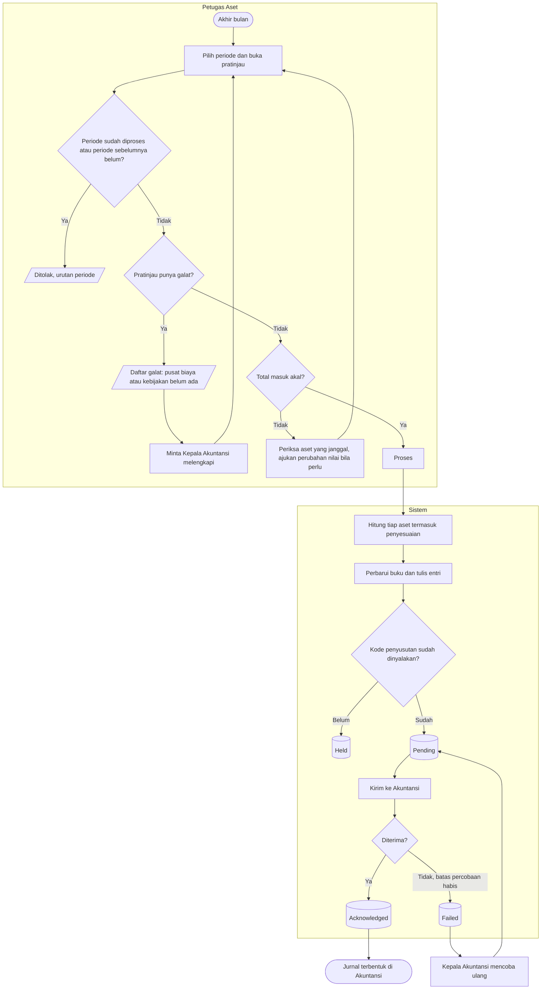

# Proses Penyusutan Bulanan

**Tujuan:** nilai buku setiap aset dikapitalisasi berkurang tepat satu kali per bulan, dibebankan ke pusat
biaya unit pada akhir bulan, dan sampai ke Akuntansi. **Pemicu:** akhir bulan. **Prasyarat:** periode
sebelumnya sudah diproses; parameter dan kebijakan lengkap. **Hasil akhir:** satu proses per periode,
baris per aset, kejadian `AST-PENYUSUTAN` per kelompok × pusat biaya, saldo subledger per akun kontrol.

| Langkah | Pelaku | Masukan | Keluaran | Bila gagal |
|---|---|---|---|---|
| Pratinjau | Petugas Aset | Periode | Jumlah aset, total per kelompok × pusat biaya, galat, peringatan | Galat pusat biaya → Kepala Akuntansi memetakan unit; galat kebijakan → menetapkan umur kelompok |
| Proses | Petugas Aset atau Kepala Akuntansi | Pratinjau bersih | Satu transaksi: baris, entri, buku, kotak keluar, saldo | Seluruh proses batal bila satu bagian gagal; ulangi |
| Kirim | Pekerja | Baris `Pending` | `Acknowledged` | Akuntansi menolak karena pemetaan akun → baris ada di daftar gagal Akuntansi; lengkapi aturan posting lalu coba ulang |

**Rumus dan contoh (`AST-DES-009`).** Monitor Rp 85.000.000, residu 0, 60 bulan, siap pakai 20 Maret 2026:
penyusutan pertama April 2026 = (85.000.000 − 0) ÷ 60 = 1.416.666,67 → **Rp 1.416.667**. Mei:
(85.000.000 − 1.416.667) ÷ 59 = 1.416.666,66 → Rp 1.416.667. Bulan ke-60 menyerap sisa pembulatan sehingga
akumulasi tepat Rp 85.000.000.

**Contoh pusat biaya (`AST-RULE-046`).** Monitor dimutasi IGD → ICU pada 15 April → seluruh Rp 1.416.667
April dibebankan ke pusat biaya ICU.

**Contoh terlambat dicatat (`AST-DES-010`).** Kursi roda siap pakai 10 Februari, baru disetujui 3 Mei;
proses Maret dan April sudah dijalankan. Proses Mei memuat dua baris penyesuaian (Maret, April) ditambah
baris normal Mei, seluruhnya bertanggal akuntansi Mei.
