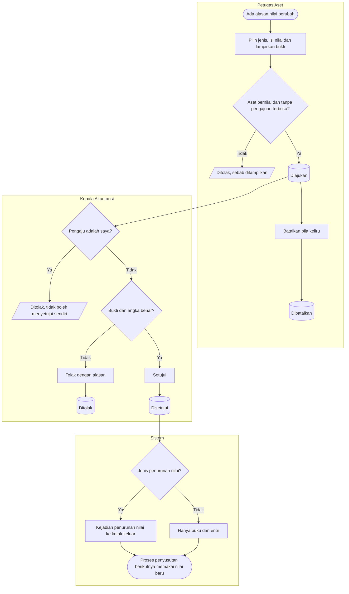

# Perubahan Nilai Aset

**Tujuan:** nilai buku mengikuti kenyataan (perbaikan besar, salah input, penurunan nilai, perubahan
estimasi) dengan persetujuan Akuntansi. **Pemicu:** faktur perbaikan besar, temuan salah ketik, aset rusak
atau usang sebelum waktunya, perubahan umur. **Prasyarat:** buku `Aktif` dan dikapitalisasi; tidak ada
pengajuan lain yang terbuka. **Hasil akhir:** entri nilai baru; penurunan nilai sampai ke Akuntansi.

| Langkah | Pelaku | Masukan | Keluaran | Bila gagal |
|---|---|---|---|---|
| Ajukan | Petugas Aset | Jenis, nilai/umur/residu, bukti (perbaikan besar: nomor faktur) | `Diajukan` | Lengkapi bukti |
| Setujui | Kepala Akuntansi bukan pengaju | — | Buku diperbarui; entri | Menolak dengan alasan |

**Contoh per jenis.**

| Jenis | Keadaan awal | Pengajuan | Hasil |
|---|---|---|---|
| Perbaikan besar | Genset biaya Rp 400 jt, sisa umur 24 bulan | Overhaul Rp 40 jt, faktur `INV-2027-0912`, tambah 24 bulan | Biaya Rp 440 jt; sisa umur 48 bulan; tanpa kejadian (faktur dijurnal Finance ke akun aset, `AST-DEC-041`) |
| Koreksi harga | Tercatat Rp 58 jt, 6 bulan × Rp 966.667 = Rp 5.800.002 | Harga benar Rp 85 jt | Seharusnya 6 × Rp 1.416.667 = Rp 8.500.002 → penyesuaian Rp 2.700.000 pada proses berikutnya; selanjutnya Rp 1.416.667 per bulan |
| Penurunan nilai | Nilai buku Rp 30 jt | Rusak berat sebagian, turun Rp 12 jt | Nilai buku Rp 18 jt; kejadian `AST-PENURUNAN-NILAI` Rp 12 jt |
| Perubahan estimasi | Nilai buku Rp 51 jt sesudah 24 bulan, umur 60 | Umur menjadi 72 | Rp 51.000.000 ÷ 48 = Rp 1.062.500 per bulan mulai proses berikutnya |
