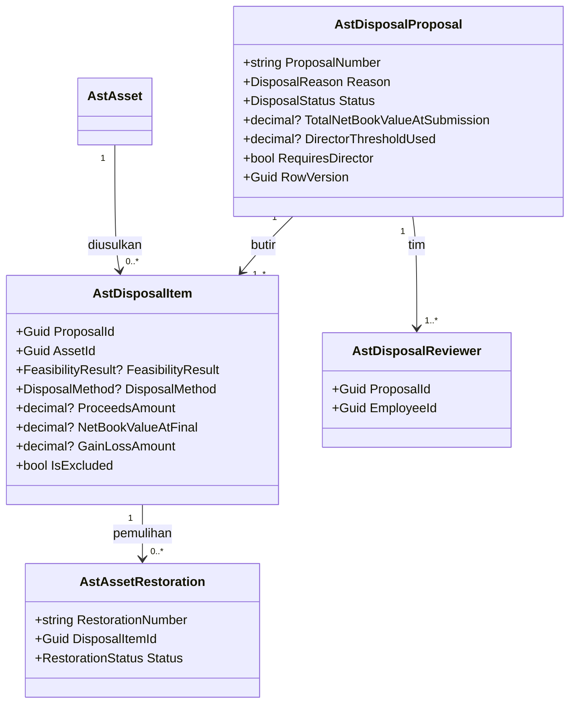
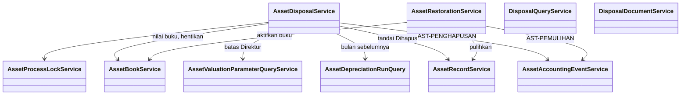

# Penghapusan & Pelepasan Aset — Arsitektur Backend

| Field | Value |
|---|---|
| Sub-modul | `penghapusan` dari `AST-BP-001` revision `1` |
| Contract set | `AST-HPS-1.0.0` — `draft` |
| Owner | Rizki · `approved_by`: — · `approved_at`: — |
| Masukan | `AST-DEC-020`, `022`, `028`, `045`, `046`, `049`; `AST-RULE-050..052`, `061`; `AST-RCG-G23`, `G24`; `02-module-map.md` |
| `domain_architecture_readiness` | `DOMAIN_ARCHITECTURE_NOT_RUN` |
| Backend / Frontend SHA | `1f54a175` / `e49e8a81` |

Seluruh isi adalah **rencana**.

## 1. Bounded context dan ownership

**Konteks:** Penghapusan & Pelepasan — keputusan final mengeluarkan aset dari register, beserta pelaksanaan
pelepasannya dan pemulihannya bila keliru. Konteks ini memerintahkan `register` (status `Dihapus`) dan
`nilai` (buku `Dihentikan`, kejadian penghapusan) lewat service milik keduanya.

| Aggregate root | Isi | Invariant | Batas transaksi |
|---|---|---|---|
| `AstDisposalProposal` | Butir, tim pemeriksa | Persetujuan berjenjang menurut **total** nilai buku (`AST-DEC-049`); final hanya sesudah penyusutan bulan sebelumnya diproses (`AST-DES-013`); aset terkunci sejak diusulkan | Finalisasi: status aset + buku + entri + kotak keluar + linimasa untuk seluruh butir dalam satu transaksi |
| `AstAssetRestoration` | — | Hanya dari butir `Final`; disetujui Kepala Bagian Aset bukan pengaju | Pemulihan: aset + buku + kejadian balik satu transaksi |

## 2. Kelompok data milik sub-modul ini

`AstDisposalProposal`, `AstDisposalItem`, `AstDisposalReviewer`, `AstAssetRestoration` — lihat
[`../02-module-map.md`](../02-module-map.md) bagian 2.

## 3. Keputusan desain (`draft`)

| ID | Keputusan | Dasar |
|---|---|---|
| `AST-DES-013` | Finalisasi ditolak bila penyusutan bulan sebelum tanggal final belum diproses | Nilai buku saat final harus mutakhir |
| `AST-DES-019` | Butir yang dinilai Tidak Layak dikeluarkan dari usulan (kunci lepas); bila semua Tidak Layak, usulan `Ditolak` | `AST-RCG-G23` |
| `AST-DES-037` | Pemulihan diizinkan untuk alasan Hilang (aset ditemukan) atau penghapusan yang terbukti keliru; untuk butir yang sudah dijual, dihibahkan, atau ditukar, pemulihan wajib melampirkan berita acara pembatalan pemindahtanganan | `AST-DEC-028` |
| `AST-DES-038` | Syarat alasan: `RusakBerat` mensyaratkan kondisi aset `RusakBerat`; `Hilang` mensyaratkan kondisi `Hilang` (berita acara kehilangan sudah ada di laporan kondisi); `Usang` untuk kondisi apa pun kecuali `Hilang` | `AST-DEC-045` |
| `AST-DES-039` | Penyetuju Kepala Bagian Aset bukan pengusul dan bukan anggota tim pemeriksa | `AST-ASM-003` |
| `AST-DES-040` | Batas Direktur yang dipakai adalah batas berlaku saat usulan diajukan ke persetujuan, dan total nilai buku dibekukan pada saat itu | Angka tidak bergeser selama antre |
| `AST-DES-041` | Pembatalan oleh Kepala Bagian Aset diizinkan sampai sebelum pemindahtanganan dicatat; sesudahnya aset dianggap sudah keluar fisik | — |

## 4. Class diagram





## 5. Penjelasan class

### 5.1 Model

| Class | Status | Lokasi | Tanggung jawab | Catatan |
|---|---|---|---|---|
| `AstDisposalProposal` | Baru | `Areas/Corporate/AssetManagement/Disposal/Models/AstDisposalProposal.cs` | Satu usulan penghapusan | Nomor `AST-HPS-######` |
| `AstDisposalItem` | Baru | `.../Disposal/Models/AstDisposalItem.cs` | Aset dalam usulan, hasil kelayakan, pemindahtanganan, nilai saat final | Angka final dibekukan |
| `AstDisposalReviewer` | Baru | `.../Disposal/Models/AstDisposalReviewer.cs` | Anggota tim pemeriksa kelayakan | — |
| `AstAssetRestoration` | Baru | `.../Disposal/Models/AstAssetRestoration.cs` | Pemulihan Aset | Nomor `AST-PLH-######` |

### 5.2 Service

| Service | Status | Lokasi | Fungsi | Dipanggil oleh | Transaksi |
|---|---|---|---|---|---|
| `AssetDisposalService` | Baru | `.../Disposal/Services/AssetDisposalService.cs` | Usulkan, tunjuk tim, catat kelayakan, setujui (Kepala Bagian Aset/Direktur), catat pemindahtanganan, finalisasi, batalkan | Controller | Ya |
| `AssetRestorationService` | Baru | `.../Disposal/Services/AssetRestorationService.cs` | Ajukan dan putuskan pemulihan | Controller | Ya |
| `DisposalQueryService` | Baru | `.../Disposal/Services/DisposalQueryService.cs` | Daftar, riwayat aset dihapus, laporan 11.5 | Controller | Tidak |
| `DisposalDocumentService` | Baru | `.../Disposal/Services/DisposalDocumentService.cs` | PDF Berita Acara Penghapusan dan Berita Acara Pemeriksaan Kelayakan | Controller | Tidak |

`AssetDepreciationRunQuery` adalah metode baca pada `AssetValuationQueryService` milik `nilai`
("apakah periode X sudah diproses").

### 5.3 Controller

| Controller | Status | Lokasi | Endpoint |
|---|---|---|---|
| `AssetDisposalProposalsController` | Baru | `.../Disposal/Controllers/` | `contracts/api-contract.md` 2.1, 2.3 |
| `AssetRestorationsController` | Baru | `.../Disposal/Controllers/` | 2.2 |
| `AssetDisposalReportsController` | Baru | `.../Disposal/Controllers/` | 2.4 |

### 5.4 Enum

| Enum | Nilai | Bawaan |
|---|---|---|
| `DisposalReason` | `RusakBerat=1`, `Usang=2`, `Hilang=3` | — |
| `DisposalStatus` | `Diusulkan=1`, `DalamPemeriksaan=2`, `MenungguPersetujuan=3`, `MenungguPersetujuanDirektur=4`, `Disetujui=5`, `Dipindahtangankan=6`, `Final=7`, `Ditolak=8`, `Dibatalkan=9` | `Diusulkan` |
| `FeasibilityResult` | `Layak=1`, `TidakLayak=2` | — |
| `DisposalMethod` | `Penjualan=1`, `HibahKeluar=2`, `TukarTambah=3`, `Pemusnahan=4` | — |
| `RestorationStatus` | `Diajukan=1`, `Disetujui=2`, `Ditolak=3` | `Diajukan` |

### 5.5 DTO — `.../Disposal/DTOs/AssetDisposalDtos.cs`

`DisposalProposalCreateRequest`, `DisposalReviewerAssignRequest`, `DisposalFeasibilityRequest` (hasil per
butir), `DisposalDecisionRequest`, `DisposalTransferRecordRequest` (multipart: metode, tanggal, pihak,
nilai, rujukan), `DisposalProposalResponse`, `DisposalAmountResponse`, `DisposedAssetResponse`,
`RestorationCreateRequest` (multipart), `RestorationDecisionRequest`, `RestorationResponse`,
`DisposalPagedQuery`.

### 5.6 Configuration

`Repositories/Configurations/Corporate/AssetManagement/Disposal/` — empat berkas; FK `Restrict`; uang
`HasPrecision(18,2)`; `RowVersion` token konkurensi.

## 6. Arsitektur folder

```text
Areas/Corporate/AssetManagement/Disposal/              # Baru
├── Controllers/ 3   ├── DTOs/ 1   ├── Enums/ 5   ├── Models/ 4   └── Services/ 4
Repositories/Configurations/Corporate/AssetManagement/Disposal/  # Baru, 4
Repositories/ApplicationDbContext.cs                   # Diperbarui: 4 DbSet
Program.cs                                             # Diperbarui: AddScoped 4 service
```

## 7. Status model dan dampak migration

| Status | Tabel | Dampak |
|---|---|---|
| Baru | 4 tabel | `AddAssetDisposal` (urutan 5) |
| Sudah ada | `AstAsset`, `AstAttachment` (`register`); `AstAssetBook` (`nilai`); `MstEmployee` | FK `Restrict` |

## 8. Rencana migration

`AddAssetDisposal`: aditif; tanpa downtime; mundur `Down()`. Bergantung urutan 1 dan 4.

## 9. Rencana data master awal

Tidak ada master. Batas Direktur dari `AstValuationParameter` (`nilai`, `AST-OQ-003`). Deret `AST_DISPOSAL`
(`AST-HPS`) dan `AST_RESTORATION` (`AST-PLH`) terbentuk otomatis.

## 10. Yang sengaja tidak dibuat

| Yang ditolak | Alasan |
|---|---|
| Penerimaan uang hasil penjualan | Milik Finance (`AST-RULE-052`) |
| Lelang daring / daftar penawar | Tidak termasuk cakupan |
| Membuka kembali usulan `Final` | Koreksi lewat Pemulihan Aset (`AST-DEC-028`) |
| Menghapus baris aset dari database | Penghapusan = status `Dihapus`; aset tetap ada untuk audit |
