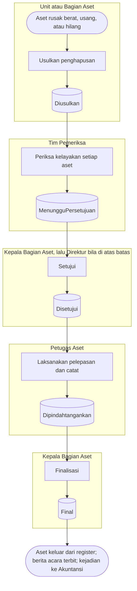

# Penghapusan & Pelepasan Aset — Alur Utama

| Langkah | Pelaku | Masukan | Keluaran | Bila gagal |
|---|---|---|---|---|
| Usulkan | Petugas Aset / Kepala Unit | Alasan, aset, uraian | `Diusulkan`, aset terkunci | Kondisi tidak sesuai alasan → tetapkan kondisi dulu |
| Periksa | Tim Pemeriksa | Hasil Layak/Tidak Layak per aset | `MenungguPersetujuan` | Semua Tidak Layak → `Ditolak` |
| Setujui | Kepala Bagian Aset → (Direktur) | Total nilai buku vs batas | `Disetujui` | Ditolak → aset kembali bebas |
| Catat pelepasan | Petugas Aset | Metode, pihak, nilai, bukti | `Dipindahtangankan` | Alasan Hilang melewati langkah ini |
| Finalisasi | Kepala Bagian Aset | Penyusutan bulan lalu sudah diproses | `Final` | Proses penyusutan dulu |
