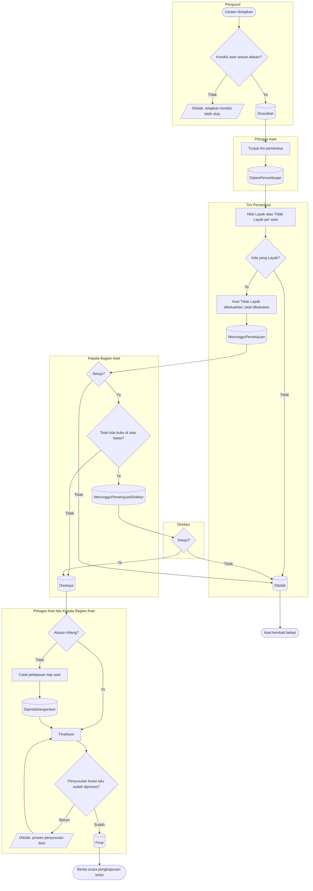

# Usulan Penghapusan sampai Final

**Tujuan:** aset keluar dari register hanya dengan pemeriksaan kelayakan dan persetujuan berjenjang
menurut total nilai buku. **Pemicu:** aset rusak berat, usang, atau hilang. **Prasyarat:** kondisi aset
sesuai alasan; aset tanpa proses aktif. **Hasil akhir:** aset `Dihapus`, laba/rugi pelepasan tercatat,
kejadian `AST-PENGHAPUSAN` per aset.

| Langkah | Pelaku | Masukan | Keluaran | Bila gagal |
|---|---|---|---|---|
| Usulkan | Pengusul | Alasan, 1–200 aset, uraian | Aset terkunci `Penghapusan` | Aset terkunci proses lain → selesaikan dulu |
| Tunjuk tim | Petugas Aset / Kepala Bagian Aset | Pegawai pemeriksa | `DalamPemeriksaan` | — |
| Periksa | Anggota tim | Hasil + catatan per aset, saran metode | Total nilai buku dan batas dibekukan | Butir tanpa catatan → lengkapi |
| Setujui | Kepala Bagian Aset bukan pengusul/pemeriksa | — | `Disetujui` atau ke Direktur | — |
| Catat pelepasan | Petugas Aset | Metode, tanggal, pihak, nilai, berita acara pelaksanaan | `Dipindahtangankan` | Nilai tidak sesuai metode → perbaiki |
| Finalisasi | Kepala Bagian Aset | — | `Final` | Penyusutan bulan lalu belum diproses → minta Petugas Aset memprosesnya |

**Contoh laba/rugi (`AST-RULE-051`).**

| Aset | Metode | Nilai buku saat final | Nilai pelepasan | Laba/rugi |
|---|---|---:|---:|---:|
| Ambulans `AST-KEND-000004` | Penjualan | Rp 20.000.000 | Rp 35.000.000 | Laba Rp 15.000.000 |
| Kursi roda `AST-ALKMED-000390` | Hibah keluar | Rp 1.200.000 | Rp 0 | Rugi Rp 1.200.000 |
| Laptop `AST-TI-000077` (hilang) | — | Rp 4.200.000 | Rp 0 | Rugi kehilangan Rp 4.200.000 |
| Printer `AST-TI-000020` | Tukar tambah | Rp 500.000 | Rp 750.000 (potongan harga) | Laba Rp 250.000 |
