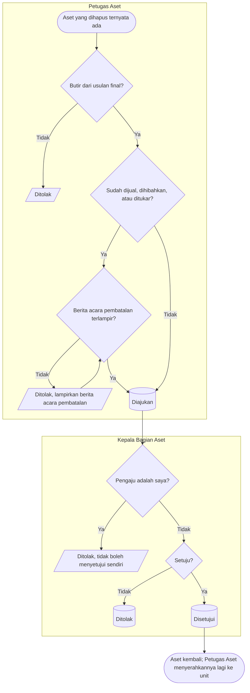

# Pemulihan Aset

**Tujuan:** aset yang sudah dihapus final tetapi ternyata ada (ditemukan kembali atau keliru dihapus)
kembali ke register tanpa membuka ulang usulan. **Pemicu:** aset hilang ditemukan; kesalahan penghapusan.
**Prasyarat:** butir dari usulan `Final`; untuk aset yang sudah dijual/dihibahkan/ditukar, berita acara
pembatalan pelepasan. **Hasil akhir:** aset `Terdaftar` kondisi `Aktif` dan `BelumDitempatkan`; buku nilai aktif
kembali; kejadian balik ke Akuntansi.

| Langkah | Pelaku | Masukan | Keluaran | Bila gagal |
|---|---|---|---|---|
| Ajukan | Petugas Aset | Butir final, alasan, bukti | `Diajukan` | Lampirkan berita acara pembatalan bila wajib |
| Putuskan | Kepala Bagian Aset bukan pengaju | — | Aset dan buku aktif; kejadian `AST-PEMULIHAN`; penyesuaian penyusutan bulan yang terlewat pada proses berikutnya | Ditolak dengan alasan |
| Tempatkan ulang | Petugas Aset | Penyerahan tujuan `PascaPemulihan` (`register`) | Aset ditempatkan | — |

**Contoh.** Laptop `AST-TI-000077` dihapus final 22 Agustus karena hilang (nilai buku Rp 4.200.000). Pada
10 Oktober laptop ditemukan. Pemulihan disetujui 11 Oktober: aset `Terdaftar`, buku aktif dengan nilai buku
Rp 4.200.000, kejadian `AST-PEMULIHAN` membalik rugi kehilangan. Proses penyusutan Oktober memuat
penyesuaian Agustus dan September ditambah Oktober.
