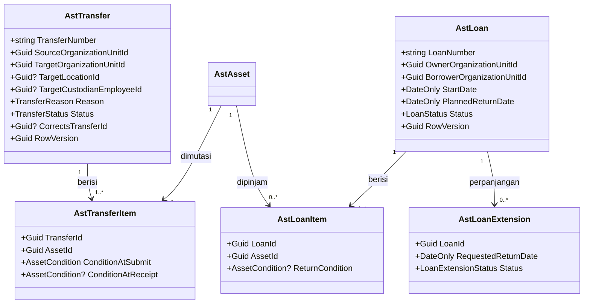
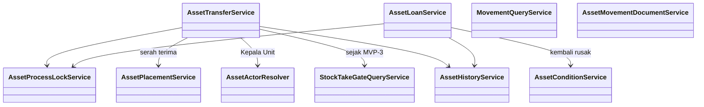

# Pergerakan Aset — Arsitektur Backend

| Field | Value |
|---|---|
| Sub-modul | `pergerakan` dari `AST-BP-001` revision `1` |
| Contract set | `AST-MOV-1.0.0` — `draft` |
| Owner | Rizki · `approved_by`: — · `approved_at`: — |
| Masukan | decision revision `4` (`AST-DEC-011`, `012`, `018`, `028`, `048`); `AST-RCG-001` (`G05..G09`, `G23`); `02-module-map.md` |
| `domain_architecture_readiness` | `DOMAIN_ARCHITECTURE_NOT_RUN` |
| Backend / Frontend SHA | `1f54a175` / `e49e8a81` |

Seluruh isi adalah **rencana**.

## 1. Bounded context dan ownership

**Konteks:** Pergerakan Aset — dokumen yang memindahkan aset **antar unit** secara tetap (mutasi) atau
sementara (peminjaman). Konteks ini tidak memiliki data aset; ia memegang dokumen dan memerintahkan
perubahan penempatan lewat `AssetPlacementService` milik `register`.

| Aggregate root | Isi | Invariant | Batas transaksi |
|---|---|---|---|
| `AstTransfer` | Butir mutasi | Dua persetujuan (unit asal, Bagian Aset); lokasi berpindah hanya saat serah terima dikonfirmasi unit tujuan; semua butir dari satu unit asal | Serah terima: seluruh butir + penempatan + linimasa + lepas kunci dalam satu transaksi |
| `AstLoan` | Butir pinjaman, perpanjangan | Wajib rencana tanggal kembali; aset tetap tercatat milik unit asal; hanya antar unit internal | Konfirmasi kembali: seluruh butir + laporan kondisi bila berbeda + lepas kunci satu transaksi |

## 2. Kelompok data milik sub-modul ini

`AstTransfer`, `AstTransferItem`, `AstLoan`, `AstLoanItem`, `AstLoanExtension` — lihat
[`../02-module-map.md`](../02-module-map.md) bagian 2.

## 3. Keputusan desain (`draft`)

| ID | Keputusan | Dasar |
|---|---|---|
| `AST-DES-021` | Pinjaman yang diajukan Kepala Unit pemilik sendiri mencatat persetujuan pemilik sekaligus (sejalan dengan `AST-DEC-048`) | Kepala Unit hanya satu |
| `AST-DES-022` | **Terlambat** adalah keadaan turunan: `Dipinjam` dan `PlannedReturnDate` < hari ini (WIB). Tidak disimpan sebagai status | Selalu benar tanpa pekerja terjadwal |
| `AST-DES-023` | Ruangan dan penanggung jawab tujuan mutasi boleh diisi pengaju, dan **wajib** dilengkapi/dikonfirmasi Kepala Unit tujuan saat menerima | Unit asal sering tidak tahu ruangan tujuan |
| `AST-DES-024` | Penolakan terima oleh unit tujuan mengakhiri mutasi sebagai `Ditolak` (kunci lepas); bila perlu, mutasi baru diajukan | `AST-RCG-G06` |
| `AST-DES-025` | Mutasi koreksi (`AST-RULE-060`) menyimpan rujukan `CorrectsTransferId`; mutasi hasil opname bertanda alasan `KoreksiOpname` dan rujukan hasil opname | `AST-DES-007` |
| `AST-DES-026` | Penahanan saat opname (`AST-RULE-023`) dijalankan lewat `StockTakeGateQueryService` milik `inventarisasi`. Sampai `inventarisasi` dibangun (`MVP-3`), pemeriksaan ini belum ada; task `inventarisasi` yang memasangnya ke service sub-modul ini | Urutan rilis `AST-DEC-024` |

## 4. Class diagram





Lima service di baris bawah milik `register` (`AssetPlacementService`, `AssetProcessLockService`,
`AssetConditionService`, `AssetActorResolver`, `AssetHistoryService`) dan `inventarisasi`
(`StockTakeGateQueryService`).

## 5. Penjelasan class

### 5.1 Model

| Class | Status | Lokasi | Tanggung jawab | Catatan |
|---|---|---|---|---|
| `AstTransfer` | Baru | `Areas/Corporate/AssetManagement/Movement/Models/AstTransfer.cs` | Satu mutasi antar unit | Nomor `AST-MUT-######`; kolom pelaku/waktu per langkah |
| `AstTransferItem` | Baru | `.../Movement/Models/AstTransferItem.cs` | Aset dalam mutasi | Kondisi saat diajukan dan saat diterima |
| `AstLoan` | Baru | `.../Movement/Models/AstLoan.cs` | Satu pinjaman sementara | Nomor `AST-PJM-######` |
| `AstLoanItem` | Baru | `.../Movement/Models/AstLoanItem.cs` | Aset dalam pinjaman | Kondisi saat kembali |
| `AstLoanExtension` | Baru | `.../Movement/Models/AstLoanExtension.cs` | Permohonan perpanjangan | Satu perpanjangan terbuka per pinjaman |

### 5.2 Service

| Service | Status | Lokasi | Fungsi | Dipanggil oleh | Transaksi |
|---|---|---|---|---|---|
| `AssetTransferService` | Baru | `.../Movement/Services/AssetTransferService.cs` | Ajukan (kunci aset; tahap 1 otomatis bila pengaju Kepala Unit asal), setujui unit, setujui Bagian Aset, terima, tolak, batalkan | Controller mutasi; `inventarisasi` (mutasi koreksi opname) | Ya |
| `AssetLoanService` | Baru | `.../Movement/Services/AssetLoanService.cs` | Ajukan, putuskan, serahkan ke peminjam, kembalikan, konfirmasi kembali, perpanjangan | Controller pinjaman | Ya |
| `MovementQueryService` | Baru | `.../Movement/Services/MovementQueryService.cs` | Daftar berbatas unit, ringkasan dashboard 1.4, laporan mutasi 11.2 | Controller | Tidak |
| `AssetMovementDocumentService` | Baru | `.../Movement/Services/AssetMovementDocumentService.cs` | PDF Berita Acara Serah Terima Mutasi dan Berita Acara Peminjaman/Pengembalian | Controller | Tidak |

### 5.3 Controller

| Controller | Status | Lokasi | Service | Endpoint |
|---|---|---|---|---|
| `AssetTransfersController` | Baru | `.../Movement/Controllers/AssetTransfersController.cs` | `AssetTransferService`, `MovementQueryService`, `AssetMovementDocumentService` | `contracts/api-contract.md` 2.1 |
| `AssetLoansController` | Baru | `.../Movement/Controllers/AssetLoansController.cs` | `AssetLoanService`, `MovementQueryService`, `AssetMovementDocumentService` | 2.2 |
| `AssetMovementDashboardController` | Baru | `.../Movement/Controllers/AssetMovementDashboardController.cs` | `MovementQueryService` | 2.3, 2.4 |

### 5.4 Enum

| Enum | Nilai | Bawaan |
|---|---|---|
| `TransferStatus` | `Diajukan=1`, `DisetujuiUnitAsal=2`, `DisetujuiBagianAset=3`, `Diserahterimakan=4`, `Ditolak=5`, `Dibatalkan=6` | `Diajukan` |
| `TransferReason` | `KebutuhanLayanan=1`, `KoreksiOpname=2`, `KoreksiMutasi=3`, `Lainnya=9` | — |
| `LoanStatus` | `Diajukan=1`, `Disetujui=2`, `Dipinjam=3`, `MenungguKonfirmasiKembali=4`, `Dikembalikan=5`, `Ditolak=6`, `Dibatalkan=7` | `Diajukan` |
| `LoanExtensionStatus` | `Diajukan=1`, `Disetujui=2`, `Ditolak=3` | `Diajukan` |

Semua di `.../Movement/Enums/`.

### 5.5 DTO — `.../Movement/DTOs/AssetMovementDtos.cs`

`AssetTransferCreateRequest` (Create: unit tujuan, ruangan/penanggung jawab opsional, alasan, daftar aset,
`CorrectsTransferId`), `AssetTransferDecisionRequest` (Status: setuju/tolak + alasan),
`AssetTransferReceiveRequest` (ruangan, penanggung jawab, kondisi per butir), `AssetTransferResponse`,
`AssetTransferPagedQuery`; `AssetLoanCreateRequest`, `AssetLoanDecisionRequest`, `AssetLoanReturnRequest`
(kondisi per butir), `AssetLoanExtensionRequest`, `AssetLoanResponse`, `AssetLoanPagedQuery`;
`AssetMovementSummaryResponse`.

### 5.6 Configuration

`Repositories/Configurations/Corporate/AssetManagement/Movement/<Entity>Configuration.cs` — lima berkas;
enum `HasConversion<int>()`; semua FK `Restrict`; `RowVersion` `IsConcurrencyToken()`.

## 6. Arsitektur folder

```text
Areas/Corporate/AssetManagement/Movement/            # Baru
├── Controllers/ 3 controller
├── DTOs/AssetMovementDtos.cs
├── Enums/ 4 enum
├── Models/ 5 model
└── Services/ 4 service
Repositories/Configurations/Corporate/AssetManagement/Movement/  # Baru, 5 configuration
Repositories/ApplicationDbContext.cs                 # Diperbarui: 5 DbSet
Program.cs                                           # Diperbarui: AddScoped 4 service
```

## 7. Status model dan dampak migration

| Status | Tabel | Dampak |
|---|---|---|
| Baru | 5 tabel di atas | `AddAssetMovement` (urutan 2) |
| Sudah ada (dibaca/dirujuk) | `AstAsset`, `MstAssetLocation` (`register`); `MstOrganizationUnit`, `MstEmployee` (HR) | FK `Restrict`; tidak berubah |

## 8. Rencana migration

`AddAssetMovement`: aditif, tanpa downtime, tanpa pengisian data lama; mundur dengan `Down()`.
Bergantung pada `AddAssetManagementFoundation`.

## 9. Rencana data master awal

Tidak ada master baru. Deret Number Series `AST_TRANSFER` (`AST-MUT`) dan `AST_LOAN` (`AST-PJM`) terbentuk
otomatis pada alokasi pertama.

## 10. Yang sengaja tidak dibuat

| Yang ditolak | Alasan |
|---|---|
| Mutasi di dalam unit yang sama | Itu penyerahan `PindahDalamUnit` (`AST-DES-006`) |
| Status tersimpan `Terlambat` | `AST-DES-022` |
| Peminjaman ke pihak luar | Itu pemanfaatan pinjam pakai (`AST-RCG-G09`) |
| Mesin workflow HR | `TS-14` |
| Kolom unit/lokasi pada `AstLoanItem` untuk menandai "aset berada di peminjam" | Lokasi peminjam diturunkan dari pinjaman aktif; `AstAsset` tetap menunjuk unit pemilik |
