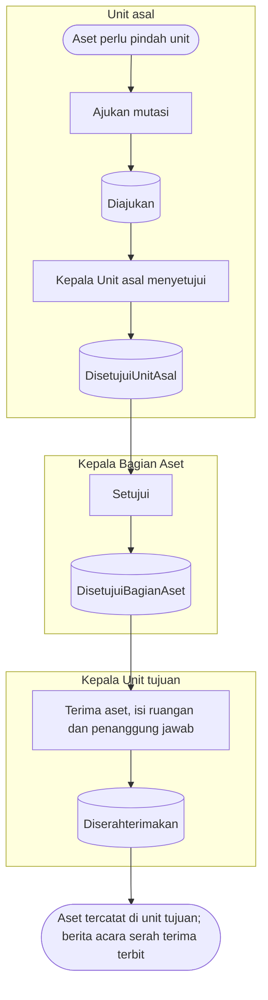

# Pergerakan Aset — Alur Utama

Jalur normal mutasi aset dari satu unit ke unit lain. Peminjaman ada di `02-peminjaman.md`.

| Langkah | Pelaku | Masukan | Keluaran | Bila gagal |
|---|---|---|---|---|
| Ajukan | Petugas Aset atau Kepala Unit asal | Aset dari satu unit, unit tujuan, alasan | `Diajukan` (atau langsung `DisetujuiUnitAsal` bila diajukan Kepala Unit asal); aset terkunci | Mengganti aset yang sedang dalam proses lain |
| Setujui unit | Kepala Unit asal (bukan pengaju) | — | `DisetujuiUnitAsal` | Menolak → `Ditolak` |
| Setujui Bagian Aset | Kepala Bagian Aset (bukan pengaju) | — | `DisetujuiBagianAset` | Menolak → `Ditolak` |
| Terima | Kepala Unit tujuan | Ruangan, penanggung jawab, kondisi per aset | `Diserahterimakan`; penempatan berpindah | Menolak terima → `Ditolak`, aset tetap di unit asal |
