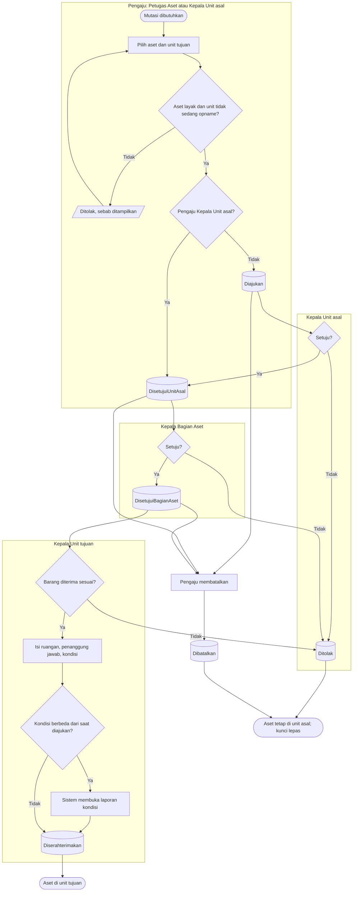

# Mutasi Antar Unit

**Tujuan:** memindahkan aset secara tetap ke unit lain dengan dua persetujuan dan bukti penerimaan.
**Pemicu:** kebutuhan layanan, koreksi hasil opname, atau koreksi mutasi yang salah.
**Prasyarat:** aset terdaftar, ditempatkan, tidak hilang/rusak berat, tidak dalam proses lain, unit tidak
sedang opname. **Hasil akhir:** penempatan baru di unit tujuan; pusat biaya penyusutan ikut berpindah mulai
bulan itu (`AST-RULE-046`).

| Langkah | Pelaku | Masukan | Keluaran | Bila gagal |
|---|---|---|---|---|
| Ajukan | Pengaju | Aset, unit tujuan, alasan; opsional ruangan/penanggung jawab | Aset terkunci `Mutasi` | Aset terkunci proses lain → selesaikan dulu; unit sedang opname → tunggu |
| Setujui unit | Kepala Unit asal | — | Lanjut ke Bagian Aset | Kepala Unit lain mendapat penolakan hak |
| Setujui Bagian Aset | Kepala Bagian Aset | — | Menunggu penerimaan | Pengaju yang juga Kepala Bagian Aset tidak boleh menyetujui; minta Kepala Bagian Aset lain atau delegasi |
| Terima | Kepala Unit tujuan | Ruangan milik unit tujuan, penanggung jawab, kondisi | Penempatan berpindah | Ruangan salah → pilih ruangan milik unit tujuan |
| Koreksi sesudah selesai | Pengaju | Mutasi baru dengan rujukan mutasi asal | Mutasi baru | — |

**Contoh.** Petugas Aset mengajukan mutasi monitor `AST-ALKMED-000123` dari IGD ke ICU pada 12 April.
Kepala IGD setuju 12 April, Kepala Bagian Aset setuju 13 April, Kepala Ruang ICU menerima 15 April di
ruang ICU-2 dengan penanggung jawab dirinya. Sampai 15 April pukul 10.12 monitor masih tercatat di IGD.
