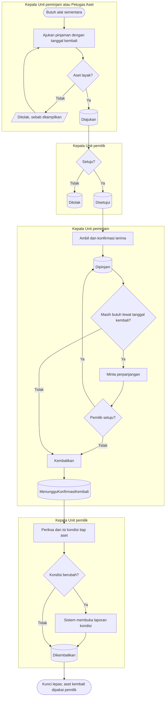

# Peminjaman dan Pengembalian

**Tujuan:** unit lain memakai aset sementara tanpa memindahkan kepemilikan unit, dengan batas waktu.
**Pemicu:** unit membutuhkan alat sementara. **Prasyarat:** sama dengan mutasi; unit peminjam ≠ pemilik.
**Hasil akhir:** aset kembali ke pemilik dengan kondisi tercatat; keterlambatan terlihat di dashboard.

| Langkah | Pelaku | Masukan | Keluaran | Bila gagal |
|---|---|---|---|---|
| Ajukan | Kepala Unit peminjam atau Petugas Aset | Aset, unit peminjam, tujuan, tanggal mulai dan kembali | `Diajukan` (langsung `Disetujui` bila diajukan Kepala Unit pemilik) | — |
| Setujui | Kepala Unit pemilik | — | `Disetujui` | Menolak dengan alasan |
| Ambil | Kepala Unit peminjam | — | `Dipinjam` | Pengguna lain mendapat penolakan hak |
| Terlambat | Sistem (dihitung saat dibaca) | Tanggal kembali lewat | Tanda Terlambat di daftar dan dashboard | Peminjam meminta perpanjangan atau mengembalikan |
| Kembalikan dan konfirmasi | Peminjam lalu pemilik | Kondisi per aset | `Dikembalikan`; laporan kondisi bila berubah | Kondisi kosong → lengkapi |

**Contoh.** ICU meminjam syringe pump `AST-ALKMED-000310` milik IGD 1–3 Juni. Pada 4 Juni pinjaman tampil
Terlambat. ICU meminta perpanjangan sampai 6 Juni, Kepala IGD setuju, tanda Terlambat hilang. Pada 6 Juni
pompa kembali dengan kabel putus; Kepala IGD mengisi kondisi Rusak Ringan dan sistem membuka laporan
kondisi yang kemudian ditetapkan Petugas Aset.
