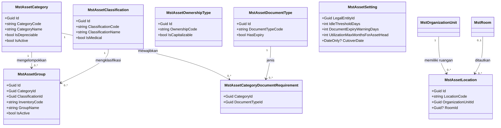
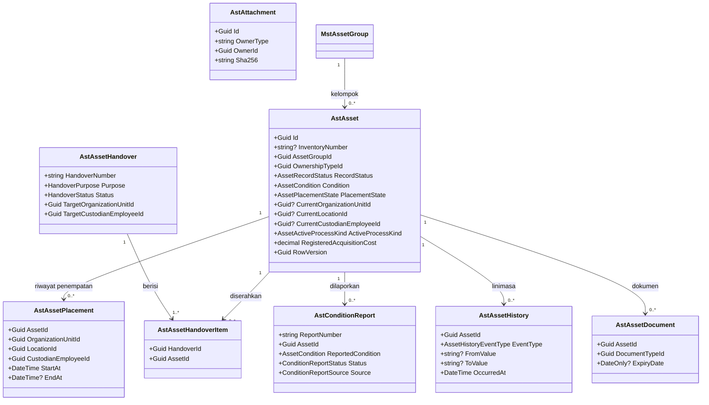
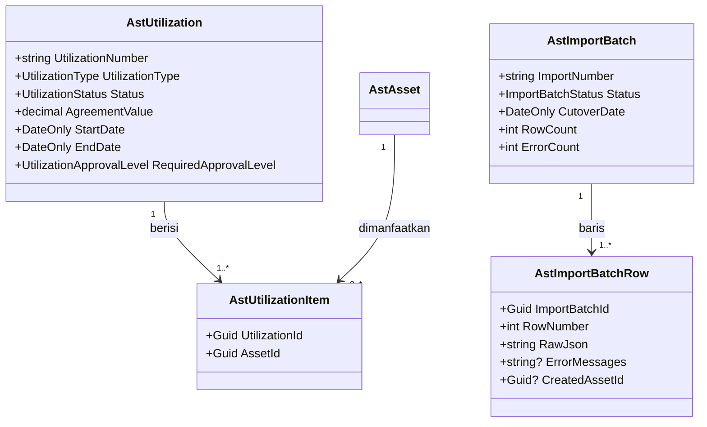
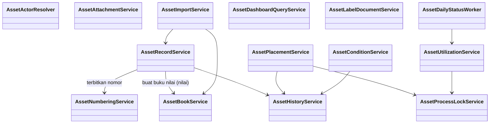

# Register Aset — Arsitektur Backend

| Field | Value |
|---|---|
| Sub-modul | `register` dari `AST-BP-001` revision `1` |
| Contract set | `AST-REG-1.0.0` — `draft` |
| Owner | Rizki (product/domain); API, security, frontend authority: Rizki |
| `approved_by` / `approved_at` | — / — |
| Masukan | decision revision `4`; capability map `1.0`; `AST-RCG-001`; `02-module-map.md` revision `1` |
| `domain_architecture_readiness` | `DOMAIN_ARCHITECTURE_NOT_RUN` (alasan: `AST-RCG-001` bagian 7) |
| Backend / Frontend SHA | `1f54a175` / `e49e8a81` |

Semua yang ditulis di sini adalah **rencana**. Belum ada satu berkas source pun.

---

## 1. Bounded context dan ownership

**Konteks:** Register Aset — sumber kebenaran tunggal tentang *aset apa yang dimiliki RS, di mana,
dipegang siapa, dan bagaimana kondisinya*. Nilai rupiah bukan milik konteks ini (milik `nilai`),
kecuali harga perolehan saat pencatatan yang dibekukan sebagai catatan dokumen (`AST-DES-002`).

| Aggregate root | Isi aggregate | Invariant utama | Batas transaksi |
|---|---|---|---|
| `AstAsset` | Riwayat penempatan, dokumen kepemilikan | Nomor inventaris unik dan permanen; nomor hanya terbit saat disetujui; satu aset hanya punya satu proses aktif (`AST-DES-005`); aset `Dihapus` tidak dapat diubah | Satu aset per transaksi, kecuali persetujuan massal: setiap aset tetap transaksi sendiri agar satu kegagalan tidak membatalkan yang lain |
| `AstAssetHandover` | Butir penyerahan | Lokasi dan penanggung jawab berpindah hanya saat dikonfirmasi penerima (`AST-DEC-044`) | Konfirmasi memperbarui seluruh butir dalam satu transaksi |
| `AstConditionReport` | — | Kondisi berlaku hanya setelah ditetapkan; Hilang wajib berita acara dan persetujuan Kepala Bagian Aset | Penetapan + perubahan kondisi aset + linimasa satu transaksi |
| `AstUtilization` | Butir pemanfaatan | Penyetuju sesuai batas nilai dan masa (`AST-RULE-013`); aset terkunci selama berjalan | Persetujuan + kunci aset satu transaksi |
| `AstImportBatch` | Baris impor | Semua atau tidak sama sekali (`AST-DEC-037`); dua persetujuan (`AST-DEC-050`) | Penerapan seluruh baris satu transaksi |

Master (`Mst*`) dikelola Kepala Bagian Aset dan tidak punya siklus status selain aktif/nonaktif.

## 2. Kelompok data milik sub-modul ini

Tabel kepemilikan data seluruh modul ada di [`../02-module-map.md`](../02-module-map.md) bagian 2.
Yang dimiliki sub-modul ini: 8 master dan 12 tabel transaksi — lihat bagian 6.

## 3. Keputusan desain sub-modul ini (`draft`, menunggu persetujuan)

| ID | Keputusan desain | Dasar |
|---|---|---|
| `AST-DES-001` | Folder `Areas/Corporate/AssetManagement/{MasterData,Register,Movement,PhysicalInventory,Valuation,Disposal}`; configuration di `Repositories/Configurations/Corporate/AssetManagement/<folder>/`; registry sebagai prasyarat | `AST-DEC-004`, `backend-structure-rules.md` |
| `AST-DES-002` | `AstAsset.RegisteredAcquisitionCost` adalah harga perolehan **saat pencatatan**, dibekukan setelah disetujui. Nilai berjalan (termasuk koreksi) milik `AstAssetBook` di `nilai`. Menutup `AST-OQ-010` | Satu pemilik per angka |
| `AST-DES-003` | Tabel parameter dan buku nilai milik `nilai` dibuat pada migration pertama karena persetujuan dan impor di sub-modul ini membutuhkannya | `02-module-map.md` 3.2 |
| `AST-DES-004` | Satu linimasa per aset, `AstAssetHistory`, ditulis seluruh sub-modul hanya lewat `AssetHistoryService`. Laporan History & Audit membacanya. Menutup `AST-OQ-011` | `AST-RCG-G29` |
| `AST-DES-005` | Kunci proses aktif: `AstAsset.ActiveProcessKind` + `ActiveProcessId`, diset dan dilepas hanya lewat `AssetProcessLockService` | `AST-RCG-G23` |
| `AST-DES-006` | Pindah ruangan atau ganti penanggung jawab di dalam unit yang sama memakai Penyerahan (`AstAssetHandover`, tujuan `PindahDalamUnit`), bukan mutasi | Mutasi = antar unit (glossary) |
| `AST-DES-014` | Kode kelompok tidak boleh salah satu dari `PNY`, `KND`, `PMF`, `IMP`, `MUT`, `PJM`, `OPN`, `NLI`, `HPS`, `PLH` agar nomor aset tidak menyerupai nomor dokumen | Format `AST-DEC-033` |
| `AST-DES-015` | Kode kelompok tidak dapat diubah setelah satu aset di kelompok itu bernomor | Nomor permanen |
| `AST-DES-016` | Hak lihat seluruh unit = penanda `AssetRegister : ReadAllUnits` (`[AccessExplicitPermission]`). Tanpa penanda itu, daftar dan detail dibatasi ke unit pengguna (`AssetActorResolver`). Rupiah hanya dari `GET /assets/{id}/amounts` (`AssetRegister : ViewAmount`) dan endpoint `nilai` | `AST-DEC-025`; pola `PayrollCompensationsController` |
| `AST-DES-017` | Aset menganggur adalah keadaan turunan (dihitung saat dibaca), bukan status tersimpan | `AST-RCG-G13` |
| `AST-DES-018` | Pemanfaatan `Disetujui` → `Berjalan` → `Berakhir` dijalankan pekerja harian `AssetDailyStatusWorker`; Kepala Bagian Aset boleh mengakhiri lebih awal | `AST-RCG-G15` |
| `AST-DES-020` | Lampiran disimpan `AssetAttachmentService` dengan ekstensi dan ukuran dari konfigurasi `AssetManagement:Attachment`, *fail-closed* bila belum diatur (pola `FinanceTransactionProofService`) | `TS-15` |

---

## 4. Class diagram

### 4.1 Master klasifikasi



### 4.2 Aset, penempatan, kondisi



### 4.3 Pemanfaatan dan impor



### 4.4 Service dan controller



`AssetBookService` milik `nilai`; dipanggil dari sini (lihat `../nilai/02-backend-architecture.md`).

---

## 5. Penjelasan class

### 5.1 Model

| Class | Status | Lokasi file | Tanggung jawab | Catatan desain |
|---|---|---|---|---|
| `MstAssetCategory` | Baru | `Areas/Corporate/AssetManagement/MasterData/Models/MstAssetCategory.cs` | Kategori besar (Alat Medis, Kendaraan, Gedung, Tanah, Mebel). `IsDepreciable=false` untuk Tanah (`AST-RCG-G27`) | Kode unik; nonaktif bila tidak dipakai lagi, tidak dihapus |
| `MstAssetClassification` | Baru | `.../MasterData/Models/MstAssetClassification.cs` | Klasifikasi medis/non-medis (menu 2.6). `IsMedical` menentukan atribut wajib `AST-RULE-006` | — |
| `MstAssetGroup` | Baru | `.../MasterData/Models/MstAssetGroup.cs` | Kelompok aset; `InventoryCode` (≤ 11 huruf/angka) masuk nomor inventaris; menu "Kode Inventaris" menampilkan kolom ini | `AST-DES-014`, `AST-DES-015`. Umur dan residu **tidak** di sini — milik `nilai` (`AstDepreciationPolicy`) karena bertanggal berlaku dan ditetapkan Akuntansi |
| `MstAssetOwnershipType` | Baru | `.../MasterData/Models/MstAssetOwnershipType.cs` | Jenis kepemilikan; `IsCapitalizable` (`AST-RCG-G25`) | — |
| `MstAssetDocumentType` | Baru | `.../MasterData/Models/MstAssetDocumentType.cs` | Jenis dokumen kepemilikan/pengamanan; `HasExpiry` | — |
| `MstAssetCategoryDocumentRequirement` | Baru | `.../MasterData/Models/MstAssetCategoryDocumentRequirement.cs` | Dokumen wajib per kategori (`AST-RCG-G14`) | Unik `(CategoryId, DocumentTypeId)` |
| `MstAssetLocation` | Baru | `.../MasterData/Models/MstAssetLocation.cs` | Ruangan tempat aset (gedung, lantai, ruangan) milik satu unit; `RoomId` opsional ke `MstRoom` (`AST-DEC-034`) | Tidak menyalin data `MstRoom`; hanya tautan |
| `MstAssetSetting` | Baru | `.../MasterData/Models/MstAssetSetting.cs` | Satu baris per badan hukum: batas hari menganggur (bawaan 90), peringatan dokumen (30 hari), masa maksimal pemanfaatan yang boleh disetujui Kepala Bagian Aset (12 bulan, `AST-DEC-029`), tanggal awal (`AST-OQ-006`) | Batas **rupiah** tidak di sini — milik `nilai` (`AST-DEC-027`) |
| `AstAsset` | Baru | `Areas/Corporate/AssetManagement/Register/Models/AstAsset.cs` | Akar data satu aset fisik | `RowVersion` sebagai token konkurensi (pola `FinGoodsReceipt`); kolom "saat ini" (unit, lokasi, penanggung jawab) hanya diubah `AssetPlacementService` |
| `AstAssetPlacement` | Baru | `.../Register/Models/AstAssetPlacement.cs` | Riwayat penempatan; baris dengan `EndAt = null` adalah penempatan berjalan | Unik parsial: satu baris berjalan per aset |
| `AstAssetHandover` | Baru | `.../Register/Models/AstAssetHandover.cs` | Penyerahan + Berita Acara Penyerahan (`AST-DEC-044`, `AST-DES-006`) | Nomor `AST-PNY-######` |
| `AstAssetHandoverItem` | Baru | `.../Register/Models/AstAssetHandoverItem.cs` | Butir aset dalam satu penyerahan | — |
| `AstConditionReport` | Baru | `.../Register/Models/AstConditionReport.cs` | Laporan dan penetapan kondisi (`AST-DEC-017`) | Nomor `AST-KND-######`; foto dan berita acara kehilangan lewat `AstAttachment` |
| `AstAssetHistory` | Baru | `.../Register/Models/AstAssetHistory.cs` | Linimasa aset lintas sub-modul (`AST-DES-004`) | Tidak pernah diubah atau dihapus |
| `AstAssetDocument` | Baru | `.../Register/Models/AstAssetDocument.cs` | Dokumen kepemilikan dan pengamanan (menu 3.5, 8.2, 8.3) | — |
| `AstAttachment` | Baru | `.../Register/Models/AstAttachment.cs` | Metadata berkas (nama, jenis, ukuran, SHA-256, jalur simpan) untuk seluruh sub-modul | `OwnerType` + `OwnerId` tanpa FK keras; dicek `AssetAttachmentService` |
| `AstUtilization` | Baru | `.../Register/Models/AstUtilization.cs` | Permohonan dan perjanjian pemanfaatan (`AST-DEC-021`, `029`) | Nomor `AST-PMF-######` |
| `AstUtilizationItem` | Baru | `.../Register/Models/AstUtilizationItem.cs` | Aset dalam satu pemanfaatan | — |
| `AstImportBatch` | Baru | `.../Register/Models/AstImportBatch.cs` | Satu berkas impor data awal | Nomor `AST-IMP-######` |
| `AstImportBatchRow` | Baru | `.../Register/Models/AstImportBatchRow.cs` | Satu baris berkas beserta galatnya | `RawJson` disimpan apa adanya untuk audit |

### 5.2 Service

| Service | Status | Lokasi | Fungsi utama | Dipanggil oleh | Membuka transaksi |
|---|---|---|---|---|---|
| `AssetMasterDataService` | Baru | `.../MasterData/Services/AssetMasterDataService.cs` | CRUD dan status aktif delapan master | Controller master | Ya, per perubahan |
| `AssetActorResolver` | Baru | `.../Register/Services/AssetActorResolver.cs` | Pengguna → profil → penugasan aktif (`WfpOrganizationAssignment`) → daftar unit; penugasan manajerial → Kepala Unit; penanda `ReadAllUnits` | Seluruh service modul | Tidak (baca) |
| `AssetRecordService` | Baru | `.../Register/Services/AssetRecordService.cs` | Draft, ajukan, setujui (terbitkan nomor, buat buku nilai, kejadian hibah), tolak, batalkan; status `Dihapus`/`Terdaftar` atas perintah `penghapusan` | Controller aset, `AssetImportService`, service `penghapusan` | Ya, per aset |
| `AssetNumberingService` | Baru | `.../Register/Services/AssetNumberingService.cs` | Membungkus `NumberSeriesAllocator`: `SequenceKey = AST_INV_<KODE>`, `Prefix = AST-<KODE>`, 6 digit, `NEVER`; serta deret dokumen `AST_HANDOVER`, `AST_CONDITION`, `AST_UTILIZATION`, `AST_IMPORT` | `AssetRecordService`, service dokumen | Tidak (alokator punya transaksi sendiri; nomor hangus bila pemanggil gagal) |
| `AssetPlacementService` | Baru | `.../Register/Services/AssetPlacementService.cs` | Penyerahan, konfirmasi, penolakan; `ApplyPlacement` untuk mutasi (`pergerakan`) dan koreksi opname | Controller penyerahan, `AssetTransferService` | Ya |
| `AssetConditionService` | Baru | `.../Register/Services/AssetConditionService.cs` | Laporan, penetapan, persetujuan Hilang; `OpenReport` untuk pengembalian pinjaman dan tindak lanjut opname | Controller kondisi, `pergerakan`, `inventarisasi` | Ya |
| `AssetHistoryService` | Baru | `.../Register/Services/AssetHistoryService.cs` | Satu-satunya penulis `AstAssetHistory`; ikut transaksi pemanggil | Semua service modul | Tidak (ikut pemanggil) |
| `AssetProcessLockService` | Baru | `.../Register/Services/AssetProcessLockService.cs` | Kunci/lepas proses aktif dengan pemeriksaan `RowVersion` | Penyerahan, mutasi, pinjaman, pemanfaatan, penghapusan | Tidak (ikut pemanggil) |
| `AssetAttachmentService` | Baru | `.../Register/Services/AssetAttachmentService.cs` | Simpan/ambil berkas, cek ekstensi dan ukuran | Semua controller yang menerima berkas | Tidak |
| `AssetDocumentService` | Baru | `.../Register/Services/AssetDocumentService.cs` | Dokumen kepemilikan, kelengkapan per kategori, dokumen hampir habis | Controller dokumen | Ya |
| `AssetUtilizationService` | Baru | `.../Register/Services/AssetUtilizationService.cs` | Pemanfaatan: ajukan, tentukan penyetuju (membaca batas rupiah dari `AssetValuationParameterQueryService` milik `nilai`), setujui, akhiri | Controller, `AssetDailyStatusWorker` | Ya |
| `AssetImportService` | Baru | `.../Register/Services/AssetImportService.cs` | Unggah (ClosedXML), validasi seluruh baris, dua persetujuan, terapkan semua-atau-tidak | Controller impor | Ya (penerapan satu transaksi) |
| `AssetDashboardQueryService` | Baru | `.../Register/Services/AssetDashboardQueryService.cs` | Kartu 1.1, 1.2, 1.3, 1.6 dan daftar aset menganggur | Controller dashboard | Tidak |
| `AssetReportQueryService` | Baru | `.../Register/Services/AssetReportQueryService.cs` | Laporan 11.1, 11.3, 11.7 dan ekspor Excel | Controller laporan | Tidak |
| `AssetLabelDocumentService` | Baru | `.../Register/Services/AssetLabelDocumentService.cs` | PDF label QR (QRCoder + QuestPDF) dan PDF berita acara penyerahan/kehilangan | Controller aset, penyerahan | Tidak |
| `AssetDailyStatusWorker` | Baru | `.../Register/Services/AssetDailyStatusWorker.cs` | `BackgroundService` harian: pemanfaatan mulai/berakhir (`AST-DES-018`). Bawaan mati lewat `AssetManagement:DailyStatusWorker:Enabled` | Host | Ya, per pemanfaatan |

### 5.3 Controller

Semua memakai `[ApiController]`, `[Authorize]`, `[AccessController(...)]`, dan `[AccessAction]` +
`[AccessPermission]` di setiap endpoint. Tidak ada controller yang mengakses `ApplicationDbContext`
langsung (`QBE-SVC-001`).

| Controller | Status | Lokasi | Service | Endpoint |
|---|---|---|---|---|
| `AssetCategoriesController`, `AssetClassificationsController`, `AssetGroupsController`, `AssetOwnershipTypesController`, `AssetDocumentTypesController`, `AssetLocationsController`, `AssetSettingsController` | Baru | `Areas/Corporate/AssetManagement/MasterData/Controllers/` | `AssetMasterDataService` | `contracts/api-contract.md` 2.1–2.7 |
| `AssetsController` | Baru | `Areas/Corporate/AssetManagement/Register/Controllers/AssetsController.cs` | `AssetRecordService`, `AssetLabelDocumentService` | 2.8 |
| `AssetHandoversController`, `AssetPlacementsController` | Baru | `.../Register/Controllers/` | `AssetPlacementService` | 2.9, 2.10 |
| `AssetConditionReportsController` | Baru | `.../Register/Controllers/` | `AssetConditionService` | 2.11 |
| `AssetDocumentsController` | Baru | `.../Register/Controllers/` | `AssetDocumentService` | 2.12 |
| `AssetAttachmentsController` | Baru | `.../Register/Controllers/` | `AssetAttachmentService` | 2.13 |
| `AssetUtilizationsController` | Baru | `.../Register/Controllers/` | `AssetUtilizationService` | 2.14 |
| `AssetImportsController` | Baru | `.../Register/Controllers/` | `AssetImportService` | 2.15 |
| `AssetDashboardController`, `AssetReportsController` | Baru | `.../Register/Controllers/` | Query service | 2.16, 2.17 |

### 5.4 Enum

| Enum | Lokasi | Nilai | Bawaan |
|---|---|---|---|
| `AssetRecordStatus` | `.../Register/Enums/` | `Draft=1`, `Diajukan=2`, `Terdaftar=3`, `Dibatalkan=4`, `Dihapus=5` | `Draft` |
| `AssetCondition` | `.../Register/Enums/` | `Aktif=1`, `RusakRingan=2`, `RusakBerat=3`, `TidakDigunakan=4`, `Hilang=5` | `Aktif` |
| `AssetPlacementState` | `.../Register/Enums/` | `BelumDitempatkan=1`, `Ditempatkan=2` | `BelumDitempatkan` |
| `AssetAcquisitionType` | `.../Register/Enums/` | `Pembelian=1`, `HibahMasuk=2`, `SaldoAwal=3` | — |
| `AssetActiveProcessKind` | `.../Register/Enums/` | `Tidak=0`, `Penyerahan=1`, `Mutasi=2`, `Peminjaman=3`, `Pemanfaatan=4`, `Penghapusan=5` | `Tidak` |
| `HandoverPurpose` | `.../Register/Enums/` | `PenempatanAwal=1`, `PindahDalamUnit=2`, `KoreksiOpname=3`, `PascaPemulihan=4` | — |
| `HandoverStatus` | `.../Register/Enums/` | `Diserahkan=1`, `Dikonfirmasi=2`, `Ditolak=3`, `Dibatalkan=4` | `Diserahkan` |
| `ConditionReportStatus` | `.../Register/Enums/` | `Dilaporkan=1`, `Ditetapkan=2`, `Ditolak=3` | `Dilaporkan` |
| `ConditionReportSource` | `.../Register/Enums/` | `LaporanUnit=1`, `PemeriksaanBagianAset=2`, `PengembalianPinjaman=3`, `TindakLanjutOpname=4` | — |
| `UtilizationType` | `.../Register/Enums/` | `Sewa=1`, `KerjaSamaOperasional=2`, `PinjamPakai=3` | — |
| `UtilizationStatus` | `.../Register/Enums/` | `Draft=1`, `Diajukan=2`, `MenungguDirektur=3`, `Disetujui=4`, `Berjalan=5`, `Berakhir=6`, `Ditolak=7`, `Dibatalkan=8` | `Draft` |
| `UtilizationApprovalLevel` | `.../Register/Enums/` | `KepalaBagianAset=1`, `Direktur=2` | — |
| `ImportBatchStatus` | `.../Register/Enums/` | `Diunggah=1`, `GagalValidasi=2`, `Tervalidasi=3`, `DisetujuiBagianAset=4`, `Diterapkan=5`, `Ditolak=6`, `Dibatalkan=7` | `Diunggah` |
| `AssetHistoryEventType` | `.../Register/Enums/` | `Didaftarkan=1`, `Ditempatkan=2`, `PindahDalamUnit=3`, `KondisiBerubah=4`, `Dimutasi=5`, `Dipinjam=6`, `Dikembalikan=7`, `Dimanfaatkan=8`, `PemanfaatanBerakhir=9`, `NilaiBerubah=10`, `Diopname=11`, `Dihapus=12`, `Dipulihkan=13`, `DiimporSaldoAwal=14` | — |

### 5.5 DTO

Satu berkas per kelompok di `.../Register/DTOs/` dan `.../MasterData/DTOs/`.

| Berkas | Class (jenis) |
|---|---|
| `AssetMasterDataDtos.cs` | `AssetCategoryUpsertRequest` (Create/Update), `AssetGroupUpsertRequest`, `AssetLocationUpsertRequest`, `AssetOwnershipTypeUpsertRequest`, `AssetClassificationUpsertRequest`, `AssetDocumentTypeUpsertRequest`, `AssetMasterStatusRequest` (Status), `AssetSettingUpdateRequest`, `*Response`, `AssetMasterPagedQuery` (PagedQuery), `AssetMasterOptionResponse` (Option), `AssetInventoryCodeResponse` |
| `AssetRecordDtos.cs` | `AssetDraftCreateRequest` (Create; `Quantity` 1–200), `AssetDraftUpdateRequest` (Update), `AssetDecisionRequest` (Status: alasan), `AssetBatchApproveRequest`, `AssetDecisionResultResponse` (hasil per aset pada persetujuan massal), `AssetListItemResponse`, `AssetDetailResponse`, `AssetAmountResponse`, `AssetPagedQuery`, `AssetHistoryItemResponse`, `AssetLabelRequest` |
| `AssetPlacementDtos.cs` | `AssetHandoverCreateRequest`, `AssetHandoverDecisionRequest`, `AssetHandoverResponse`, `AssetPlacementListItemResponse`, `AssetPlacementPagedQuery` |
| `AssetConditionDtos.cs` | `AssetConditionReportCreateRequest` (multipart), `AssetConditionDecideRequest`, `AssetConditionReportResponse`, `AssetConditionPagedQuery` |
| `AssetDocumentDtos.cs` | `AssetDocumentUpsertRequest` (multipart), `AssetDocumentResponse`, `AssetDocumentCompletenessResponse`, `AssetDocumentPagedQuery` |
| `AssetUtilizationDtos.cs` | `AssetUtilizationUpsertRequest`, `AssetUtilizationDecisionRequest`, `AssetUtilizationResponse`, `AssetUtilizationPagedQuery` |
| `AssetImportDtos.cs` | `AssetImportUploadRequest` (multipart), `AssetImportDecisionRequest`, `AssetImportBatchResponse`, `AssetImportRowResponse` |
| `AssetDashboardDtos.cs` | `AssetDashboardSummaryResponse`, `AssetUnitSummaryResponse`, `AssetIdleItemResponse`, `AssetReportQuery` |

### 5.6 Configuration

Semua di `Repositories/Configurations/Corporate/AssetManagement/{MasterData,Register}/<Entity>Configuration.cs`,
didaftarkan lewat `ApplyConfigurationsFromAssembly` seperti modul lain. Enum disimpan `HasConversion<int>()`.
Semua relasi `DeleteBehavior.Restrict`. Index dan unique ditulis per tabel di `data/data-dictionary.md`.

---

## 6. Arsitektur folder

```text
Areas/Corporate/AssetManagement/                         # Baru seluruhnya
├── MasterData/
│   ├── Controllers/  7 controller master                # Baru
│   ├── DTOs/AssetMasterDataDtos.cs                      # Baru
│   ├── Models/       8 model Mst*                       # Baru
│   └── Services/AssetMasterDataService.cs               # Baru
└── Register/
    ├── Controllers/  9 controller                       # Baru
    ├── DTOs/         7 berkas DTO                       # Baru
    ├── Enums/        14 enum                            # Baru
    ├── Models/       12 model Ast*                      # Baru
    └── Services/     16 service + 1 worker              # Baru
Repositories/Configurations/Corporate/AssetManagement/
├── MasterData/       8 configuration                    # Baru
└── Register/         12 configuration                   # Baru
Repositories/ApplicationDbContext.cs                     # Diperbarui: 20 DbSet
Program.cs                                               # Diperbarui: AddScoped service, AddHostedService worker, opsi konfigurasi
docs/engineering/MODULE_OWNERSHIP_PREFIX_REGISTRY.md     # Diperbarui: baris registry (task pertama)
```

Tidak ada penyimpangan pola standar yang ditiru.

## 7. Status model dan dampak migration

| Status | Jumlah | Tabel | Dampak migration |
|---|---:|---|---|
| Baru | 20 | 8 master + 12 transaksi di atas | Tabel baru pada `AddAssetManagementFoundation` |
| Diperbarui | 0 | — | — |
| Sudah ada (dibaca) | 9 | `MstOrganizationUnit`, `MstRoom`, `MstEmployee`, `MstWorkforceProfile`, `WfpOrganizationAssignment`, `MstLegalEntity`, `MstHospitalSite`, `FinPurchaseOrder`, `FinGoodsReceipt` | FK ke tabel ini, `Restrict`; kolom tidak berubah |

## 8. Rencana migration (di dalam sub-modul)

Satu migration, `AddAssetManagementFoundation` (urutan 1 pada `02-module-map.md` 3.2), berisi 20
tabel sub-modul ini ditambah lima tabel `nilai` (`AST-DES-003`). Aditif; tanpa downtime; tanpa
pengisian data lama. Mundur: `Down()` menghapus 25 tabel, aman selama belum ada data produksi.
Pembuatan berkas migration mengikuti preferensi pemilik 2026-10-05 (berkas disiapkan task; penerapan
ke database oleh pemilik).

## 9. Rencana data master awal

Diisi seeder yang menolak lingkungan produksi (preseden `RWI-DEC-048`) **atau** oleh Kepala Bagian Aset
lewat layar master. Isi minimum agar pencatatan aset pertama dapat disimpan:

| Master | Isi minimum | Sumber nilai |
|---|---|---|
| `MstAssetCategory` | Alat Medis, Alat Non-Medis, Kendaraan, Gedung dan Bangunan, Tanah (`IsDepreciable=false`), Mebel dan Peralatan Kantor, Peralatan TI | Usulan agent; dikonfirmasi Bagian Aset |
| `MstAssetClassification` | Medis (`IsMedical=true`), Non-Medis | `AST-DEC-026` |
| `MstAssetGroup` | Minimal satu kelompok per kategori, misalnya `ALKMED` Alat Kedokteran Umum, `MBL` Mebel, `KEND` Kendaraan Roda Empat, `TI` Peralatan TI | Bagian Aset; umur dan residu diisi Akuntansi di `nilai` (`AST-OQ-002`) |
| `MstAssetOwnershipType` | `MILIK` (dapat dikapitalisasi), `SEWA`, `KSO`, `PINJAM_PAKAI` (tidak) | `AST-RCG-G25` |
| `MstAssetDocumentType` | Sertifikat Tanah, PBG/IMB, BPKB, STNK (`HasExpiry`), Polis Asuransi (`HasExpiry`), Faktur Pembelian, Berita Acara Hibah | `AST-RCG-G14` |
| `MstAssetCategoryDocumentRequirement` | Tanah → Sertifikat; Gedung → PBG/IMB; Kendaraan → BPKB, STNK | `AST-RCG-G14` |
| `MstAssetLocation` | Minimal satu lokasi "Gudang Bagian Aset" pada unit Bagian Aset/Umum | Bagian Aset |
| `MstAssetSetting` | 90 hari, 30 hari, 12 bulan, tanggal awal kosong | `AST-RCG-G13`, `G14`, `AST-DEC-029`, `AST-OQ-006` |
| Deret Number Series | `AST_INV_<KODE>` dibuat otomatis oleh alokator saat nomor pertama terbit | `TS-06` |

## 10. Yang sengaja tidak dibuat

| Yang ditolak | Alasan |
|---|---|
| Tabel `MstInventoryCode` terpisah | Kode inventaris adalah satu kolom kelompok; tabel terpisah membuat dua sumber kode |
| Salinan unit/ruangan (`AstUnit`, `AstRoom`) | Unit milik HR dan ruangan klinis milik `MstRoom` (`AST-DEC-034`) |
| Kolom umur manfaat dan residu di `MstAssetGroup` | Bertanggal berlaku dan ditetapkan Akuntansi; milik `AstDepreciationPolicy` |
| Tabel riwayat status per dokumen | Kolom pelaku/waktu per langkah pada dokumen + `AstAssetHistory` sudah cukup; tabel ketiga menggandakan jejak |
| Mesin workflow HR (`TrxWorkflowInstance`) | Belum pernah dipakai di luar HR dan berpusat pada pengaju pegawai (`TS-14`) |
| Status tersimpan "Menganggur" | Keadaan turunan (`AST-DES-017`) |
| `SortOrder` pada master | Dilarang untuk kode baru (kontrak rekayasa backend) |
| Klaim `OrganizationUnitId` pada token login | Token tidak membawa unit (`TS-05`); memakai `AssetActorResolver` |
