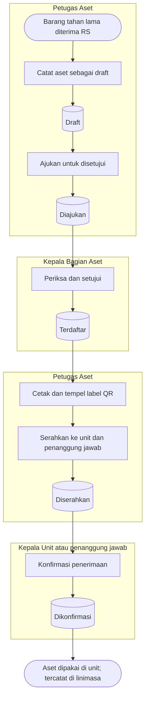

# Register Aset — Alur Utama

Jalur normal satu aset dari dicatat sampai dipakai di unit. Status pada node `[( )]` sama persis
dengan `../contracts/state-transition-matrix.md`.

| Langkah | Pelaku | Masukan | Keluaran | Bila gagal |
|---|---|---|---|---|
| Catat draft | Petugas Aset | Kelompok, jenis kepemilikan, data perolehan, atribut medis bila alat medis | Satu atau banyak aset `Draft` tanpa nomor | Melengkapi isian yang ditandai |
| Ajukan | Petugas Aset | Draft lengkap | Aset `Diajukan` | Melengkapi atribut wajib (misalnya nomor seri) |
| Setujui | Kepala Bagian Aset | Aset `Diajukan` | Nomor inventaris terbit, aset `Terdaftar`, buku nilai terbentuk | Menolak dengan alasan → aset kembali `Draft` |
| Cetak label | Petugas Aset | Aset `Terdaftar` | PDF label QR | Mencetak ulang |
| Serahkan | Petugas Aset | Unit, ruangan, penanggung jawab | Penyerahan `Diserahkan`, aset terkunci | Memilih ruangan milik unit tujuan |
| Konfirmasi | Kepala Unit / penanggung jawab | Penyerahan yang ditujukan kepadanya | Penempatan berlaku, Berita Acara Penyerahan terbit | Menolak terima dengan alasan → Petugas Aset menyerahkan ulang |
