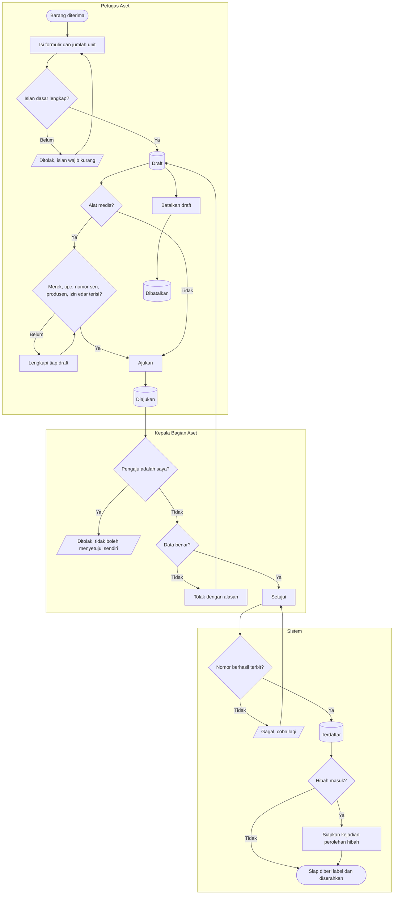

# Pencatatan dan Penomoran Aset

**Tujuan:** setiap barang tahan lama tercatat dengan satu nomor permanen.
**Pemicu:** barang diterima (pembelian atau hibah). **Prasyarat:** kelompok dan jenis kepemilikan aktif.
**Hasil akhir:** aset `Terdaftar`, nomor `AST-<KODE>-######`, buku nilai di `nilai`, dan untuk hibah satu
kejadian perolehan hibah di kotak keluar Akuntansi.

| Langkah | Pelaku | Masukan | Keluaran | Bila gagal |
|---|---|---|---|---|
| Isi formulir | Petugas Aset | Nama, kelompok, jenis kepemilikan, jenis perolehan, tanggal perolehan dan siap pakai, harga, GR atau BA hibah, jumlah 1–200 | N draft | Memperbaiki isian bertanda |
| Lengkapi atribut medis | Petugas Aset | Satu draft per unit fisik | Draft siap diajukan | Draft tetap tersimpan sampai lengkap |
| Ajukan | Petugas Aset | Draft lengkap | `Diajukan` | — |
| Setujui | Kepala Bagian Aset (bukan pengaju) | Satu atau banyak aset | Nomor terbit per aset | Aset yang gagal tetap `Diajukan`; yang lain tetap disetujui |
| Tolak | Kepala Bagian Aset | Alasan | Kembali `Draft`, tanpa memakan nomor | Petugas memperbaiki lalu mengajukan ulang |

**Contoh.** 40 kursi dicatat dengan "buat 40 unit". Kepala Bagian Aset menyetujui 38 sekaligus dan
menolak 2 karena salah kelompok. Nomor `AST-MBL-000201` s.d. `AST-MBL-000238` terbit; dua draft kembali
tanpa nomor. Bila nomor ke-239 sempat terbit lalu persetujuan gagal, nomor itu hangus dan aset
berikutnya mendapat `000240`.
