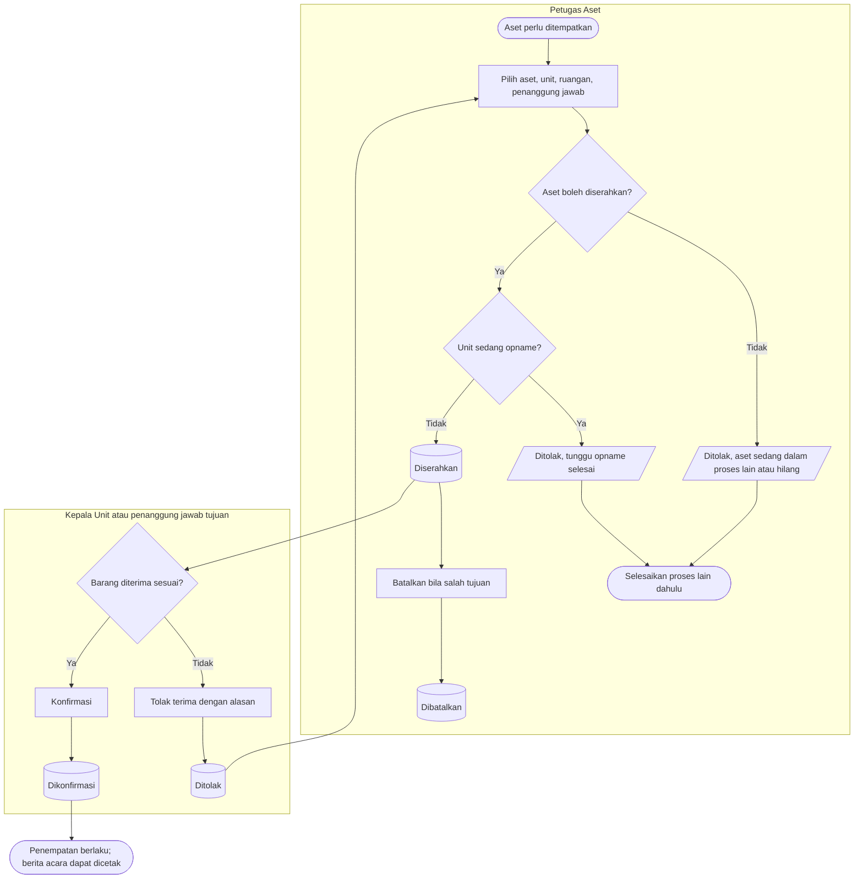

# Penempatan dan Penyerahan Aset

**Tujuan:** menetapkan unit, ruangan, dan penanggung jawab dengan bukti penerimaan.
**Pemicu:** aset baru terdaftar, pindah ruangan/penanggung jawab di unit yang sama, koreksi hasil opname
beda ruangan, atau aset dipulihkan. **Prasyarat:** aset `Terdaftar`, bukan `Hilang`, tanpa proses aktif,
unit tidak sedang opname. **Hasil akhir:** penempatan berjalan baru dan Berita Acara Penyerahan.
Perpindahan **antar unit** bukan di sini, melainkan mutasi (`pergerakan`).

| Langkah | Pelaku | Masukan | Keluaran | Bila gagal |
|---|---|---|---|---|
| Serahkan | Petugas Aset | Daftar aset, tujuan, keperluan (penempatan awal / pindah dalam unit / koreksi opname / pasca pemulihan) | Penyerahan `Diserahkan`, kunci `Penyerahan` | Bila aset terkunci: selesaikan proses pemegang kunci |
| Konfirmasi | Kepala Unit tujuan atau penanggung jawab yang dituju | — | Penempatan lama ditutup, baru dibuka, kunci lepas | Pengguna lain mendapat penolakan hak |
| Tolak terima | Penerima | Alasan | Penyerahan `Ditolak`, kunci lepas, penempatan tidak berubah | Petugas Aset membuat penyerahan baru |
| Batalkan | Petugas Aset | Alasan | `Dibatalkan`, kunci lepas | — |

**Contoh.** Lima kursi roda diserahkan ke unit Rawat Jalan, ruang tunggu Poli Anak, penanggung jawab
Kepala Ruang Poli Anak. Sampai konfirmasi, kelimanya masih `BelumDitempatkan` di gudang Bagian Aset.
