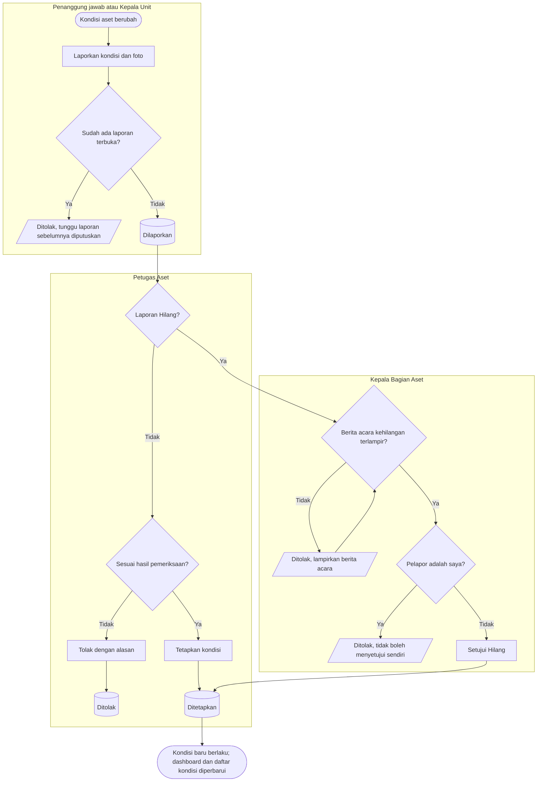

# Laporan dan Penetapan Kondisi Aset

**Tujuan:** kondisi aset di sistem sesuai kenyataan dan dapat dipertanggungjawabkan.
**Pemicu:** unit melihat kerusakan, Bagian Aset memeriksa, pinjaman kembali rusak, atau tindak lanjut opname.
**Prasyarat:** aset `Terdaftar`; tidak ada laporan lain yang masih terbuka.
**Hasil akhir:** kondisi baru berlaku dan tercatat di linimasa.

| Langkah | Pelaku | Masukan | Keluaran | Bila gagal |
|---|---|---|---|---|
| Laporkan | Penanggung jawab, Kepala Unit, Petugas Aset, atau sistem | Kondisi usulan, catatan, foto (wajib bila dari unit) | Laporan `Dilaporkan`; kondisi aset **belum** berubah | Menunggu laporan sebelumnya |
| Tetapkan | Petugas Aset | Hasil pemeriksaan | Kondisi aset berubah | — |
| Setujui Hilang | Kepala Bagian Aset (bukan pelapor) | Berita acara kehilangan | Kondisi `Hilang` | Melampirkan berita acara |
| Ditemukan kembali | Pelapor mana pun | Laporan bertanda "ditemukan" | Kondisi kembali sesuai pemeriksaan | — |

**Contoh.** Kepala Ruang IGD melaporkan monitor `AST-ALKMED-000123` "Rusak Ringan" dengan foto layar
retak pada 3 Juni. Sampai Petugas Aset menetapkannya pada 4 Juni, monitor tetap tercatat `Aktif`.
