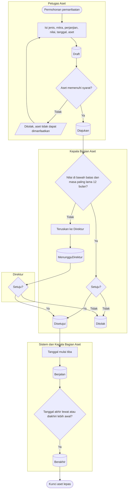

# Pemanfaatan Aset oleh Pihak Ketiga

**Tujuan:** aset dipakai pihak lain (sewa, kerja sama operasional, pinjam pakai) hanya dengan perjanjian
dan penyetuju yang berwenang. **Pemicu:** permohonan pihak ketiga. **Prasyarat:** aset milik RS,
`Terdaftar`, bukan `Hilang`/`RusakBerat`, tanpa proses aktif. **Hasil akhir:** pemanfaatan `Berjalan`
sampai `Berakhir`; aset terkunci selama itu. Penagihan sewa adalah urusan Finance.

| Langkah | Pelaku | Masukan | Keluaran | Bila gagal |
|---|---|---|---|---|
| Ajukan | Petugas Aset | Draft lengkap | `Diajukan`, tingkat penyetuju dan batas yang dipakai dikunci, aset terkunci | Mengganti aset yang tidak memenuhi syarat |
| Setujui / teruskan | Kepala Bagian Aset (bukan pengaju) | — | `Disetujui` atau `MenungguDirektur` | Penolakan hak bila mencoba menyetujui yang wajib ke Direktur |
| Setujui | Direktur | — | `Disetujui` | — |
| Mulai / berakhir | Pekerja harian | Tanggal | `Berjalan` / `Berakhir` | Bila pekerja mati, Kepala Bagian Aset dapat mengakhiri manual; status mulai menunggu pekerja dinyalakan |
| Akhiri lebih awal | Kepala Bagian Aset | Alasan | `Berakhir` | — |

**Contoh.** Batas Direktur Rp 50.000.000 (ilustrasi). Sewa lahan ATM Rp 12.000.000 untuk 12 bulan →
cukup Kepala Bagian Aset. KSO alat hemodialisa senilai Rp 30.000.000 selama 60 bulan → wajib Direktur
karena masanya melebihi 12 bulan.
