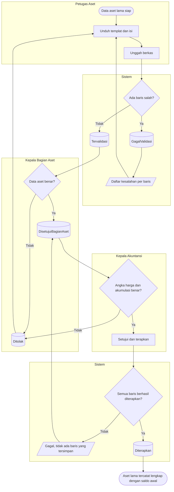

# Impor Data Awal Aset

**Tujuan:** aset yang sudah ada sebelum sistem berjalan masuk sekaligus beserta saldo awal nilainya.
**Pemicu:** persiapan go-live. **Prasyarat:** tanggal awal diisi di Pengaturan Aset; master kelompok,
lokasi, dan kebijakan penyusutan sudah ada. **Hasil akhir:** aset `Terdaftar` dan `Ditempatkan`, buku
nilai dengan akumulasi per tanggal awal, tanpa kejadian ke Akuntansi.

| Langkah | Pelaku | Masukan | Keluaran | Bila gagal |
|---|---|---|---|---|
| Unggah | Petugas Aset | Berkas templat, maks 5.000 baris | `Tervalidasi` atau `GagalValidasi` | Memperbaiki baris yang disebut lalu mengunggah berkas baru |
| Setujui data aset | Kepala Bagian Aset (bukan pengunggah) | Ringkasan per unit dan kelompok | `DisetujuiBagianAset` | Menolak dengan alasan |
| Setujui angka | Kepala Akuntansi (bukan pengunggah) | Total harga perolehan dan akumulasi per kelompok | Seluruh baris diterapkan dalam satu transaksi | Bila gagal di tengah, tidak ada yang tersimpan; batch tetap menunggu persetujuan Akuntansi |

**Contoh.** Berkas 2.400 baris berisi 37 baris dengan kode kelompok tak dikenal → seluruh berkas
`GagalValidasi`, nol aset tersimpan. Setelah diperbaiki: 2.400 baris `Tervalidasi`; total harga
Rp 48.250.000.000 dan akumulasi Rp 21.730.000.000 diperiksa Kepala Akuntansi sebelum diterapkan.
