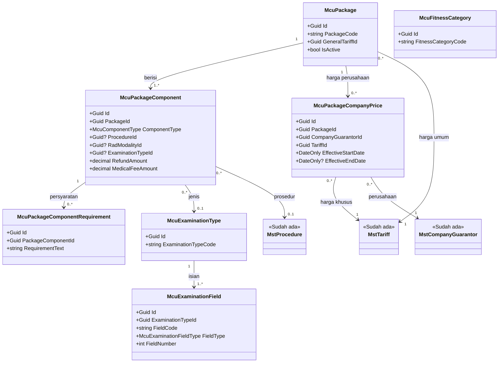
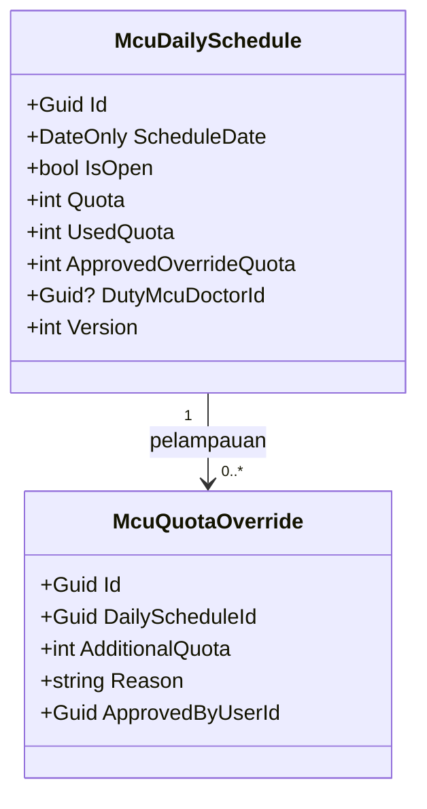
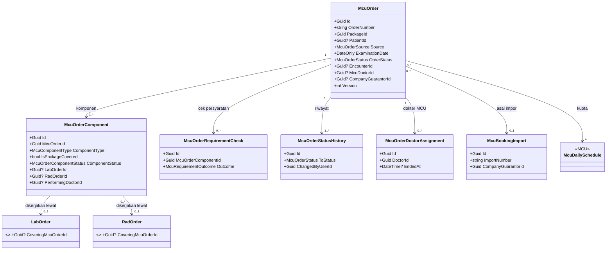
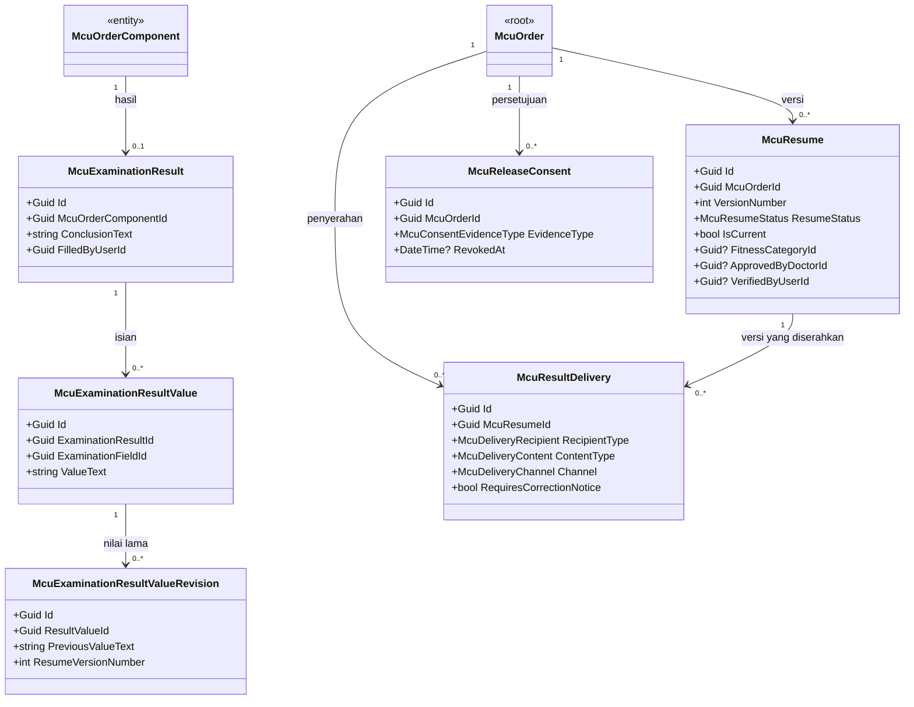
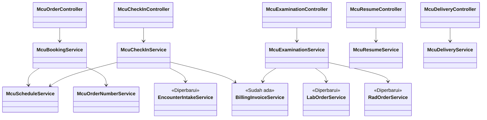

# MCU (Medical Check-Up) — Arsitektur Backend

| Field | Nilai |
| --- | --- |
| Blueprint ID | `MCU-BP-001` |
| Dokumen | `02-backend-architecture.md` |
| Revision | `1` |
| Status | `approved` — Yoga Aji Pratama, 2026-10-21 |
| Pemilik | Yoga Aji Pratama (Product/Domain Owner MCU, `MCU-DEC-002`) |
| Masukan | Decision log r5 (`MCU-DEC-001`..`043`); capability map r1; penilaian kelengkapan r2 (`MCU-RCG-001`); arsitektur domain r1 (`MCU-HDA-001`, `DOMAIN_ARCHITECTURE_READY`); `MCU-EVD-002` |
| Scope | Slice `MCU-S1`..`MCU-S8`. Laporan (`MCU-S9`) di luar — `DEC-MCU-005` |
| Source SHA | Backend `4d3e4f98`, frontend `7fb1e1d3e` |
| Kontrak yang mengikat | `docs/engineering/BACKEND_ENGINEERING_CONTRACT.md` (QBE), `docs/engineering/MODULE_OWNERSHIP_PREFIX_REGISTRY.md` |

> **Prasyarat registry terpenuhi 2026-10-21.** Prefix `Mcu` dan folder `MedicalCheckupManagement`
> **sudah terdaftar** di registry — disetujui Muhammad Hamzah (`MCU-GOV-001`, `MCU-EVD-002` bagian 1);
> checker terbukti tidak lagi melaporkan QBE-MOD-002 untuk model `Mcu*`. Baris yang tercatat:
>
> | Area | Module/pemilik | Category | Prefix | Lifecycle |
> |---|---|---|---|---|
> | HealthServices | MedicalCheckupManagement / Medical Check-Up | BUSINESS DOMAIN / MODULE | Mcu | ACTIVE |
>
> Kepanjangan: `Mcu` = *Medical Check-Up*. Mengikuti preseden `Hmd`, data induk yang hanya bermakna
> di unit MCU memakai prefix `Mcu`, bukan `Mst`.

---

## 1. Ringkasan untuk pembaca umum

Backend MCU menambah **satu modul baru** berisi 21 tabel, dan **menyentuh empat modul lain** tanpa
menyalin datanya:

| Yang dibangun MCU sendiri | Yang dipinjam/diperluas di modul lain |
| --- | --- |
| Paket dan isinya, harga khusus perusahaan, jenis Pemeriksaan MCU, kategori kelayakan | **Laboratorium** dan **Radiologi**: satu kolom baru penanda *dicakup paket*, dan penerbitan tagihan dilewati untuk pesanan bertanda |
| Jadwal kuota harian | **Registrasi**: jalur pembuatan kunjungan untuk modul lain diperluas agar bisa membuat kunjungan *Medical Check-Up* yang memakai antrean skrining |
| Order paket beserta komponen, hasil Pemeriksaan MCU, resume berversi, persetujuan pelepasan, penyerahan | **Billing**: dipakai apa adanya — tambah baris tarif, status lunas, refund |
| Impor booking rombongan, riwayat status, riwayat dokter MCU | **Medical Fee**: membaca sumber jasa medis dari MCU (`MCU-COORD-010`) |

---

## 2. Bounded context, aggregate, dan batas transaksi

Diturunkan dari `MCU-HDA-001` bagian C–E tanpa perubahan makna.

| Context | Aggregate root | Invariant yang dijaga dalam satu transaksi | Batas transaksi |
| --- | --- | --- | --- |
| Katalog MCU | `McuPackage` | Minimal satu komponen; Σ nilai pengembalian ≤ harga umum; harga perusahaan tidak tumpang tindih; tarif yang dirujuk bertanda paket | Satu simpan paket = satu transaksi |
| Jadwal MCU | `McuDailySchedule` | Terpakai ≤ kuota + pelampauan disetujui | Pemakaian kuota **selalu** satu transaksi dengan pembuatan/perpindahan order yang memakainya |
| Layanan MCU | `McuOrder` | Lihat `MCU-HDA-001` `AGG-MCU-03` (tujuh invariant) | Setiap tindakan pada order = satu transaksi lokal. Pemanggilan ke modul lain (Registrasi, Billing, Lab, Rad) berada **di dalam** transaksi yang sama bila modul itu menulis ke `ApplicationDbContext` yang sama; lihat bagian 2.1 |

### 2.1 Transaksi lintas modul

Seluruh modul berbagi satu `ApplicationDbContext` dan satu basis data. Karena itu tindakan MCU yang
menyentuh modul lain dijalankan sebagai **satu transaksi basis data**, dan gagal seluruhnya bila salah
satu langkah gagal.

| Tindakan | Langkah dalam satu transaksi | Bila gagal |
| --- | --- | --- |
| Check-in | Kunci jadwal → tautkan pasien → `EncounterIntakeService.RegisterAsync` (kunjungan) → `BillingInvoiceService.AddCatalogChargeAsync` (baris paket) → simpan order *Hadir* + riwayat | Seluruhnya dibatalkan; order tetap *Terjadwal*; tidak ada kunjungan maupun baris tagihan yatim |
| Mulai pemeriksaan | Baca status lunas → buat pesanan Lab per disiplin dan pesanan Rad per komponen (bertanda `CoveringMcuOrderId`) → simpan komponen *Dipesan* + order *Dalam Pemeriksaan* | Seluruhnya dibatalkan; order tetap *Hadir*; petugas dapat mencoba lagi |
| Batal penuh | Batalkan pesanan turunan → ajukan refund utuh → batalkan kunjungan → order *Dibatalkan* | Seluruhnya dibatalkan |

**Contoh kegagalan:** saat check-in Budi, kunjungan berhasil dibuat tetapi baris paket gagal karena
tarif paket sudah dinonaktifkan. Transaksi dibatalkan: kunjungan tidak tersimpan, order Budi tetap
*Terjadwal*, dan petugas melihat pesan *"Tarif paket tidak aktif. Hubungi admin MCU."*

---

## 3. Tabel kepemilikan data

| Kelompok data | Modul pemilik | Dipakai MCU | Dibuat ulang di MCU |
| --- | --- | :---: | --- |
| Pasien (`MstPatient`) | Patient Management | Ya | **Tidak.** Order menyimpan `PatientId`; identitas sementara hanya untuk peserta belum terdaftar (`MCU-DEC-033`) |
| Kunjungan (`RegPatientEncounter`) | Registrasi | Ya | **Tidak.** Dibuat lewat `EncounterIntakeService` |
| Penjamin perusahaan (`MstCompanyGuarantor`, `MstPatientCompanyGuarantor`, `RegPatientEncounterGuarantor`) | Administrator Master Data / Patient Management / Registrasi | Ya | Tidak |
| Tarif (`MstTariff`) | Master Data | Ya | **Tidak.** Harga paket = baris tarif bertanda `IsPackageTariff` (`MCU-DEC-025`) |
| Prosedur (`MstProcedure`), modalitas (`MstRadModality`) | Master Data / Radiologi | Ya | Tidak |
| Dokter (`MstDoctor`) | Master tenaga kerja | Ya | Tidak |
| Pesanan & hasil Lab (`LabOrder`, `LabOrderedProcedure`, `LabExamination`) | Laboratorium | Ya | **Tidak.** `LabOrder` **diperbarui**: satu kolom `CoveringMcuOrderId` |
| Pesanan & hasil Rad (`RadOrder`, `RadStudy`, `RadReport`) | Radiologi | Ya | **Tidak.** `RadOrder` **diperbarui**: satu kolom `CoveringMcuOrderId` |
| Tagihan, pembayaran, refund (`BilInvoice`, `BilInvoiceItem`, `BilRefundCase`) | Billing | Ya | Tidak |
| Antrean & skrining perawat (`RegQueue`, `TrxPatientAssessment`) | Registrasi / Clinical | Ya (baca status) | Tidak |
| Jasa medis | Medical Fee | Ya (sebagai sumber) | Tidak. MCU menyediakan sumber, Medical Fee menghitung |
| Paket MCU, komponen, harga perusahaan, persyaratan | **MCU** | — | **Ya, baru** — tidak ada pemilik lain (`MCU-CAP-14`) |
| Jenis Pemeriksaan MCU & isiannya, kategori kelayakan | **MCU** | — | **Ya, baru** — hanya bermakna di MCU |
| Jadwal & kuota harian MCU | **MCU** | — | **Ya, baru** — perjanjian rawat jalan tidak cocok (`MCU-CONFLICT-005`) |
| Order paket, komponen order, hasil Pemeriksaan MCU, resume, persetujuan, penyerahan | **MCU** | — | **Ya, baru** |

---

## 4. Class diagram

Dipecah per context agar terbaca dalam satu layar. Hanya field kunci, status, dan field aturan bisnis
yang digambar; field lengkap ada di [erd/data-dictionary.md](erd/data-dictionary.md).

### 4.1 Katalog MCU



### 4.2 Jadwal MCU



### 4.3 Layanan MCU — order dan komponen



### 4.4 Layanan MCU — hasil, resume, penyerahan



### 4.5 Service dan controller



---

## 5. Penjelasan setiap class

Lokasi memakai akar `Areas/HealthServices/MedicalCheckupManagement/` (disingkat `MCU/`) dan
`Repositories/Configurations/HealthServices/MedicalCheckupManagement/` (disingkat `CFG/`). Setiap model
punya file configuration bernama `<Model>Configuration.cs` di `CFG/`.

### 5.1 Model — Katalog

| Aspek | `McuPackage` |
| --- | --- |
| **Status** | `Baru` |
| **Lokasi file** | `MCU/Models/McuPackage.cs` |
| Kategori | Master modul |
| Tanggung jawab utama | Satu paket MCU yang dijual: nama, kode, dan rujukan baris tarif harga umum. Paket tidak dihapus; ia dinonaktifkan agar order lama tetap terbaca |
| Field penting | `PackageCode` (string 30), `PackageName` (150), `GeneralTariffId` (Guid), `Description` (1000), `IsActive` |
| Relasi | Banyak `McuPackageComponent`, banyak `McuPackageCompanyPrice`; menunjuk `MstTariff` |
| Pemakaian dalam alur | Admin MCU membuat paket; admisi memilih paket saat booking |
| Catatan desain | `GeneralTariffId` wajib menunjuk tarif ber-`IsPackageTariff = true`. Harga **tidak** disalin ke paket |
| Ekuivalen model lama | — (v1 tidak mengenal paket, `MCU-CAP-35`) |

| Aspek | `McuPackageComponent` |
| --- | --- |
| **Status** | `Baru` |
| **Lokasi file** | `MCU/Models/McuPackageComponent.cs` |
| Kategori | Master modul |
| Tanggung jawab utama | Satu pemeriksaan di dalam paket, berjenis Lab, Rad, atau Pemeriksaan MCU, beserta nilai pengembalian dan nilai jasa medis |
| Field penting | `PackageId`, `ComponentType`, `ProcedureId?`, `RadModalityId?`, `ExaminationTypeId?`, `RefundAmount`, `MedicalFeeAmount` |
| Relasi | Milik `McuPackage`; menunjuk `MstProcedure` (Lab/Rad), `MstRadModality` (Rad), atau `McuExaminationType` |
| Pemakaian dalam alur | Disalin menjadi `McuOrderComponent` saat order dibuat |
| Catatan desain | Lab/Rad wajib `ProcedureId`; Rad juga wajib `RadModalityId`; Pemeriksaan MCU wajib `ExaminationTypeId`. Tidak ada kolom urutan tampilan (QBE larangan `SortOrder` generik) |
| Ekuivalen model lama | — |

| Aspek | `McuPackageComponentRequirement` |
| --- | --- |
| **Status** | `Baru` |
| **Lokasi file** | `MCU/Models/McuPackageComponentRequirement.cs` |
| Kategori | Master modul |
| Tanggung jawab utama | Satu persyaratan pemeriksaan pada komponen, misalnya *Puasa 10–12 jam* (`MCU-DEC-013`) |
| Field penting | `PackageComponentId`, `RequirementText` (300), `IsConfirmationRequired` |
| Pemakaian dalam alur | Ditampilkan saat booking, wajib ditandai petugas saat check-in |
| Ekuivalen model lama | — |

| Aspek | `McuPackageCompanyPrice` |
| --- | --- |
| **Status** | `Baru` |
| **Lokasi file** | `MCU/Models/McuPackageCompanyPrice.cs` |
| Kategori | Master modul |
| Tanggung jawab utama | Pemetaan *paket × perusahaan × masa berlaku → baris tarif khusus* (`MCU-DEC-025`) |
| Field penting | `PackageId`, `CompanyGuarantorId`, `TariffId`, `EffectiveStartDate`, `EffectiveEndDate?` |
| Catatan desain | Tumpang tindih masa berlaku untuk paket+perusahaan yang sama ditolak service (`VAL-MCU-05`). Tidak menyimpan nominal |
| Ekuivalen model lama | — |

| Aspek | `McuExaminationType` / `McuExaminationField` |
| --- | --- |
| **Status** | `Baru` |
| **Lokasi file** | `MCU/Models/McuExaminationType.cs`, `MCU/Models/McuExaminationField.cs` |
| Kategori | Master modul |
| Tanggung jawab utama | Jenis Pemeriksaan MCU (Pemeriksaan Fisik, Visus, EKG, …) dan isian formulirnya (`MCU-DEC-007`, `MCU-OQ-002`) |
| Field penting | Jenis: `ExaminationTypeCode`, `ExaminationTypeName`, `IsActive`. Isian: `FieldCode`, `FieldLabel`, `FieldType` (`Text`/`Number`/`Option`/`YesNo`), `UnitName?`, `OptionValues?`, `IsRequired`, `FieldNumber` |
| Catatan desain | `FieldNumber` adalah **nomor butir pada formulir**, bukan urutan tampilan generik. Isi master menunggu contoh formulir dari dokter MCU |
| Ekuivalen model lama | — |

| Aspek | `McuFitnessCategory` |
| --- | --- |
| **Status** | `Baru` |
| **Lokasi file** | `MCU/Models/McuFitnessCategory.cs` |
| Kategori | Master modul |
| Tanggung jawab utama | Daftar kategori kelayakan (`MCU-OQ-003`) |
| Field penting | `FitnessCategoryCode`, `FitnessCategoryName`, `Description?`, `IsActive` |
| Ekuivalen model lama | — |

### 5.2 Model — Jadwal

| Aspek | `McuDailySchedule` |
| --- | --- |
| **Status** | `Baru` |
| **Lokasi file** | `MCU/Models/McuDailySchedule.cs` |
| Kategori | Transaksi modul (aggregate root) |
| Tanggung jawab utama | Satu tanggal: buka/tutup, kuota, jumlah terpakai, tambahan dari pelampauan, dokter MCU jaga (`MCU-DEC-042`) |
| Field penting | `ScheduleDate` (unik), `IsOpen`, `Quota`, `UsedQuota`, `ApprovedOverrideQuota`, `DutyMcuDoctorId` (boleh kosong, FK `MstDoctor`), `Version` |
| Pemakaian dalam alur | Dikunci dan diperbarui setiap kali order memakai atau melepas kuota |
| Catatan desain | `Version` adalah token konkurensi: dua petugas yang mengambil kuota terakhir bersamaan → satu ditolak `409`. Tanggal tanpa baris jadwal = **tutup** |
| Ekuivalen model lama | — |

| Aspek | `McuQuotaOverride` |
| --- | --- |
| **Status** | `Baru` |
| **Lokasi file** | `MCU/Models/McuQuotaOverride.cs` |
| Tanggung jawab utama | Satu persetujuan pelampauan kuota oleh kepala unit (`MCU-DEC-029`) |
| Field penting | `DailyScheduleId`, `AdditionalQuota`, `Reason` (500), `ApprovedByUserId`, `ApprovedAt` |
| Ekuivalen model lama | — |

### 5.3 Model — Layanan

| Aspek | `McuOrder` |
| --- | --- |
| **Status** | `Baru` |
| **Lokasi file** | `MCU/Models/McuOrder.cs` |
| Kategori | Transaksi modul (aggregate root) |
| Tanggung jawab utama | Satu peserta × satu paket × satu tanggal. Seluruh perjalanan peserta adalah perubahan `OrderStatus` pada baris ini |
| Field penting | `OrderNumber`, `PackageId` + potret paket, `PatientId?`, identitas sementara (`ParticipantName`, `ParticipantNik`, `ParticipantBirthDate`, `ParticipantPhone`), `Source`, `SourceEncounterId?`, `RecommendingDoctorId?`, `CompanyGuarantorId?`, `BookingImportId?`, `ExaminationDate`, `DailyScheduleId`, `OrderStatus`, `EncounterId?`, `McuDoctorId?`, `PatientMatchMethod?`, `AppliedTariffId?`, `PackageInvoiceItemId?`, `ClearanceBasis?`, `ArrivalConfirmedAt?`, `CancelReason?`, `Version` |
| Relasi | Lihat 4.3/4.4 |
| Pemakaian dalam alur | Lahir saat booking/rekomendasi/*walk-in*; berubah status sampai *Diserahkan*, *Dibatalkan*, atau *Tidak Hadir* |
| Catatan desain | Identitas sementara **sensitif**. Sesudah tertaut ke pasien, identitas sementara tetap disimpan sebagai jejak, tetapi tampilan memakai data pasien. `EncounterId` unik bila terisi |
| Ekuivalen model lama | Booking MCU v1 di backend lama (`/LabBooking/pagedLabMCU`) — tidak dipindahkan |

| Aspek | `McuOrderComponent` |
| --- | --- |
| **Status** | `Baru` |
| **Lokasi file** | `MCU/Models/McuOrderComponent.cs` |
| Kategori | Transaksi modul |
| Tanggung jawab utama | Satu komponen di dalam order: potret komponen paket, atau pemeriksaan tambahan di luar paket (`MCU-DEC-036`) |
| Field penting | `McuOrderId`, `PackageComponentId?`, `ComponentType`, `ProcedureId?`, `RadModalityId?`, `ExaminationTypeId?`, `ComponentNameSnapshot`, `IsPackageCovered`, `RefundAmountSnapshot`, `MedicalFeeAmountSnapshot`, `ComponentStatus`, `ScheduledDate`, `LabOrderId?`, `RadOrderId?`, `PerformingDoctorId?`, `CompletedAt?`, `CancelReason?`, `CancelledByDoctorId?`, `RefundCaseId?`, `MedicalFeeReleasedAt?`, `AddedByDoctorId?` |
| Catatan desain | Komponen di luar paket: `IsPackageCovered = false`, `PackageComponentId = null`, nilai pengembalian dan jasa nol karena ditagih biasa. Beberapa komponen Lab satu disiplin boleh menunjuk `LabOrderId` yang sama |
| Ekuivalen model lama | — |

| Aspek | `McuOrderRequirementCheck` |
| --- | --- |
| **Status** | `Baru` |
| **Lokasi file** | `MCU/Models/McuOrderRequirementCheck.cs` |
| Tanggung jawab utama | Hasil penandaan satu persyaratan saat check-in: terpenuhi, lanjut dengan catatan, atau komponen dijadwal ulang |
| Field penting | `McuOrderId`, `McuOrderComponentId`, `RequirementTextSnapshot`, `Outcome`, `Note?`, `CheckedByUserId`, `CheckedAt` |
| Ekuivalen model lama | — |

| Aspek | `McuExaminationResult` / `McuExaminationResultValue` / `McuExaminationResultValueRevision` |
| --- | --- |
| **Status** | `Baru` |
| **Lokasi file** | `MCU/Models/McuExaminationResult.cs`, `McuExaminationResultValue.cs`, `McuExaminationResultValueRevision.cs` |
| Tanggung jawab utama | Hasil satu komponen Pemeriksaan MCU: kesimpulan, nilai per isian, dan nilai lama bila diubah sesudah resume pernah disetujui |
| Field penting | Hasil: `McuOrderComponentId` (unik), `ConclusionText`, `FilledByUserId`, `FilledAt`. Nilai: `ExaminationResultId`, `ExaminationFieldId`, `ValueText`. Revisi: `ResultValueId`, `PreviousValueText`, `ResumeVersionNumber`, `ChangedByUserId`, `ChangedAt` |
| Catatan desain | Isian **terkunci** setelah resume disetujui. Perubahan sesudah buka ulang menulis revisi lebih dulu — log aplikasi tidak boleh menyimpan nilai ini (sensitif) |
| Ekuivalen model lama | — |

| Aspek | `McuResume` |
| --- | --- |
| **Status** | `Baru` |
| **Lokasi file** | `MCU/Models/McuResume.cs` |
| Tanggung jawab utama | Satu versi resume. Hanya satu versi `IsCurrent` per order; versi lama bertanda *Dikoreksi* dan tetap terbaca (`MCU-DEC-011`) |
| Field penting | `McuOrderId`, `VersionNumber`, `ResumeStatus`, `IsCurrent`, `GeneralConditionText`, `ImportantFindingsText`, `RecommendationText`, `FitnessCategoryId?`, `WorkRecommendationText?`, `AuthorDoctorId?`, `ApprovedByDoctorId?`, `ApprovedAt?`, `ReturnReason?`, `VerifiedByUserId?`, `VerifiedAt?`, `ReopenReason?`, `ReopenedByDoctorId?`, `ReopenedAt?` |
| Catatan desain | `WorkRecommendationText` adalah satu-satunya isi klinis yang boleh masuk ringkasan perusahaan bersama kategori kelayakan (`MCU-DEC-010`) |
| Ekuivalen model lama | — |

| Aspek | `McuReleaseConsent` |
| --- | --- |
| **Status** | `Baru` |
| **Lokasi file** | `MCU/Models/McuReleaseConsent.cs` |
| Tanggung jawab utama | Persetujuan peserta melepas hasil lengkap kepada perusahaan penjaminnya |
| Field penting | `McuOrderId`, `CompanyGuarantorId`, `ConsentGivenAt`, `RecordedByUserId`, `EvidenceType`, `EvidenceReference?`, `RevokedAt?`, `RevokedByUserId?`, `RevokeReason?` |
| Catatan desain | Bentuk bukti menunggu `MCU-OQ-003`; rilis pertama tidak menyimpan berkas (`MCU-DEC-035`), cukup jenis bukti dan nomor rujukan formulir kertas |
| Ekuivalen model lama | — |

| Aspek | `McuResultDelivery` |
| --- | --- |
| **Status** | `Baru` |
| **Lokasi file** | `MCU/Models/McuResultDelivery.cs` |
| Tanggung jawab utama | Satu kejadian penyerahan hasil (`MCU-DEC-019`, `027`) |
| Field penting | `McuOrderId`, `McuResumeId`, `RecipientType`, `ContentType`, `Channel`, `DestinationText?`, `DeliveredAt`, `DeliveredByUserId`, `Note?`, `RequiresCorrectionNotice`, `CorrectionNoticeRecordedAt?` |
| Catatan desain | Penerima perusahaan + isi lengkap ditolak tanpa persetujuan aktif (`VAL-MCU-31`). Buka ulang resume menandai seluruh penyerahan versi lama `RequiresCorrectionNotice = true` |
| Ekuivalen model lama | — |

| Aspek | `McuOrderStatusHistory`, `McuOrderDoctorAssignment`, `McuBookingImport` |
| --- | --- |
| **Status** | `Baru` |
| **Lokasi file** | `MCU/Models/McuOrderStatusHistory.cs`, `McuOrderDoctorAssignment.cs`, `McuBookingImport.cs` |
| Tanggung jawab utama | Riwayat status order; riwayat dokter MCU yang ditetapkan dan penggantinya (`MCU-DEC-032`, `040`); jejak unggahan daftar rombongan (`MCU-DEC-033`, `ARC-OPEN-04`) |
| Field penting | Riwayat: `FromStatus?`, `ToStatus`, `ChangedAt`, `ChangedByUserId`, `Reason?`. Dokter: `DoctorId`, `AssignedAt`, `AssignedByUserId`, `Reason?`, `EndedAt?`. Impor: `ImportNumber`, `CompanyGuarantorId`, `PackageId`, `ExaminationDate`, `FileName`, `TotalRows`, `CreatedRows`, `FailedRows`, `FailureSummary?` |
| Catatan desain | Berkas Excel **tidak disimpan**; hanya dibaca saat diunggah. `FailureSummary` sensitif karena dapat memuat nama dan NIK |
| Ekuivalen model lama | — |

### 5.4 Model yang diperbarui di modul lain

| Aspek | `LabOrder` |
| --- | --- |
| **Status** | `Diperbarui` — pemilik `laboratorium` (`MCU-COORD-002`) |
| **Lokasi file** | `Areas/HealthServices/LaboratoryManagement/Models/LabOrder.cs`; configuration `Repositories/Configurations/HealthServices/LabOrderConfiguration.cs` |
| Kolom berubah | **Tambah** `CoveringMcuOrderId` (`uuid`, boleh kosong, FK ke `McuOrder`, `Restrict`, index) |
| Tanggung jawab tambahan | Bila terisi, pesanan ini dibayar lewat paket MCU: `LabSpecimenService` **tidak** menerbitkan fakta `LaboratoryCharge` (`MCU-DEC-022`) |
| Catatan desain | `InstructingDoctorId` yang sudah ada diisi dokter MCU (`MCU-DEC-032`). Kolom diisi hanya oleh MCU saat pesanan dibuat; tidak dapat diubah lewat API Lab |

| Aspek | `RadOrder` |
| --- | --- |
| **Status** | `Diperbarui` — pemilik `radiologi` |
| **Lokasi file** | `Areas/HealthServices/RadiologyManagement/Models/RadOrder.cs`; configuration di `Repositories/Configurations/HealthServices/RadiologyManagement/` |
| Kolom berubah | **Tambah** `CoveringMcuOrderId` (`uuid`, boleh kosong, FK ke `McuOrder`, `Restrict`, index) |
| Tanggung jawab tambahan | Bila terisi, `RadStudyService` tidak menerbitkan `RadiologyCharge` |

### 5.5 Service

| Service | Status | Lokasi | Fungsi utama | Dipanggil oleh | Transaksi DB |
| --- | --- | --- | --- | --- | :---: |
| `McuPackageService` | Baru | `MCU/Services/McuPackageService.cs` | CRUD paket, komponen, persyaratan, harga perusahaan; validasi invariant paket | `McuPackageController` | Ya |
| `McuReferenceDataService` | Baru | `MCU/Services/McuReferenceDataService.cs` | Jenis Pemeriksaan MCU + isian, kategori kelayakan | `McuReferenceDataController` | Ya |
| `McuScheduleService` | Baru | `MCU/Services/McuScheduleService.cs` | Atur hari buka/kuota; **pakai/lepas kuota dengan kunci konkurensi**; pelampauan | Controller jadwal, service booking & check-in | Ya (ikut transaksi pemanggil) |
| `McuOrderNumberService` | Baru | `MCU/Services/McuOrderNumberService.cs` | Nomor `MCU-RSMMC-000001` dan nomor impor lewat `NumberSeriesAllocator` (QBE-CODE-001..006) | Service booking, impor | Ikut pemanggil |
| `McuBookingService` | Baru | `MCU/Services/McuBookingService.cs` | Booking, rekomendasi, *walk-in*, impor rombongan, jadwal ulang, batal sebelum datang, konfirmasi datang | `McuOrderController`, `McuBookingImportController`, `McuKioskController` | Ya |
| `McuCheckInService` | Baru | `MCU/Services/McuCheckInService.cs` | Pencocokan NIK + tanggal lahir; check-in (kunjungan, dokter MCU, persyaratan, baris paket); ganti dokter MCU | `McuCheckInController`, `McuKioskController` | Ya |
| `McuExaminationService` | Baru | `MCU/Services/McuExaminationService.cs` | Mulai pemeriksaan (cek lunas, buat pesanan Lab/Rad bertanda), tambah komponen di luar paket, batalkan komponen (+refund), isi hasil Pemeriksaan MCU, sinkron status Lab/Rad, batal penuh | `McuExaminationController`, `McuOrderController` | Ya |
| `McuResumeService` | Baru | `MCU/Services/McuResumeService.cs` | Draf, approve, kembalikan, verifikasi, buka ulang | `McuResumeController` | Ya |
| `McuDeliveryService` | Baru | `MCU/Services/McuDeliveryService.cs` | Persetujuan pelepasan, catat penyerahan, susun data cetak lengkap/ringkasan | `McuDeliveryController` | Ya |
| `McuOrderQueryService` | Baru | `MCU/Services/McuOrderQueryService.cs` | Daftar Pasien MCU, ringkasan, detail, metadata penyaring | `McuOrderController` | Tidak (baca saja, `AsNoTracking`) |
| `McuMedicalFeeSourceService` | Baru | `MCU/Services/McuMedicalFeeSourceService.cs` | Menyajikan komponen selesai bernilai jasa (komponen, dokter, nilai) bagi Medical Fee | `McuMedicalFeeSourceController`; kelak service Medical Fee | Tidak |
| `McuNoShowHostedService` | Baru | `MCU/Services/McuNoShowHostedService.cs` | Tutup hari: *Terjadwal* yang lewat tanggal → *Tidak Hadir*, lepas kuota | Host aplikasi (`AddHostedService`) | Ya, per order |
| `EncounterIntakeService` | **Diperbarui** — pemilik Registrasi | `Areas/HealthServices/RegistrationManagement/Services/EncounterIntakeService.cs` | **Tambah** dukungan `EncounterType = MedicalCheckup` dengan antrean & skrining berdasarkan klinik MCU (`IsQueueRequired`/`IsScreeningRequired` dari master klinik), alih-alih selalu `Outpatient` tanpa antrean | `McuCheckInService` | Ikut pemanggil |
| `LabOrderService` | **Diperbarui** — pemilik Lab | `Areas/HealthServices/LaboratoryManagement/Services/LabOrderService.cs` | **Tambah** jalur pembuatan pesanan untuk MCU: `CoveringMcuOrderId` + `InstructingDoctorId`; ganti dokter penanggung jawab pesanan terbuka | `McuExaminationService`, `McuCheckInService` | Ikut pemanggil |
| `LabExaminationService` | Sudah ada — pemilik Lab | `.../LaboratoryManagement/Services/LabExaminationService.cs` | `CancelAsync` membatalkan satu pemeriksaan tanpa menyentuh pemeriksaan lain, wadah, maupun pesanan (`ARC-TECH-01`, terbukti `MCU-EVD-002` 2.1). Penjaganya `ReleasedAt`; penjaga *sudah divalidasi* dipegang MCU sebelum memanggil | `McuExaminationService` | Ikut pemanggil |
| `LabSpecimenService` | **Diperbarui** — pemilik Lab | `.../LaboratoryManagement/Services/LabSpecimenService.cs` | Lewati penerbitan `LaboratoryCharge` bila pesanan ber-`CoveringMcuOrderId` | Alur Lab | — |
| `RadOrderService`, `RadStudyService` | **Diperbarui** — pemilik Rad | `.../RadiologyManagement/Services/` | Sama dengan Lab | `McuExaminationService` | Ikut pemanggil |
| `BillingInvoiceService` | Sudah ada | `.../BillingManagement/Billing/Services/BillingInvoiceService.cs` | `AddCatalogChargeAsync` untuk baris paket | `McuCheckInService` | Ikut pemanggil |
| `BillingRefundService` | **Diperbarui** — pemilik Billing (`MCU-DEC-043`; disetujui Yasmina 2026-10-21, `MCU-COORD-003`) | `.../BillingManagement/Billing/Services/BillingRefundService.cs` | **Ubah** `CreateAsync` agar memakai `RequestedAmount` ≤ sisa refundable per baris, mencatat akumulasi refund per baris, dan menolak refund melebihi nilai baris. Hari ini nominal selalu baris penuh dan baris yang sama dapat direfund dua kali (`MCU-EVD-002` 2.2) | `McuExaminationService` | Ikut pemanggil |
| `LabPaymentClearanceRules` | Sudah ada | `.../LaboratoryManagement/Services/LabPaymentClearanceRules.cs` | Aturan lunas/terjamin per kunjungan, dipakai juga oleh Radiologi | `McuExaminationService` | Tidak |

### 5.6 Controller

Seluruh controller baru: `[AccessController]`, `[Tags(...)]`, route `api/v1/health-services/medical-checkup-management/<resource>`, tanpa akses `ApplicationDbContext` langsung (QBE-SVC-001), respons `ApiResponse<T>`.

| Controller | Status | Lokasi | Service | Endpoint |
| --- | --- | --- | --- | --- |
| `McuPackageController` | Baru | `MCU/Controllers/McuPackageController.cs` | `McuPackageService` | `/packages` |
| `McuReferenceDataController` | Baru | `MCU/Controllers/McuReferenceDataController.cs` | `McuReferenceDataService` | `/examination-types`, `/fitness-categories` |
| `McuScheduleController` | Baru | `MCU/Controllers/McuScheduleController.cs` | `McuScheduleService` | `/daily-schedules` |
| `McuOrderController` | Baru | `MCU/Controllers/McuOrderController.cs` | `McuBookingService`, `McuOrderQueryService`, `McuExaminationService` (batal penuh) | `/orders` |
| `McuBookingImportController` | Baru | `MCU/Controllers/McuBookingImportController.cs` | `McuBookingService` | `/booking-imports` |
| `McuCheckInController` | Baru | `MCU/Controllers/McuCheckInController.cs` | `McuCheckInService` | `/orders/{id}/check-in`, `/orders/{id}/patient-matches`, `/orders/{id}/mcu-doctor` |
| `McuKioskController` | Baru | `MCU/Controllers/McuKioskController.cs` | `McuBookingService`, `McuCheckInService` | `/kiosk/...` dengan kebijakan kiosk yang sama dengan `PatientEncounterController` |
| `McuExaminationController` | Baru | `MCU/Controllers/McuExaminationController.cs` | `McuExaminationService` | `/orders/{id}/start-examination`, `/orders/{id}/components` |
| `McuResumeController` | Baru | `MCU/Controllers/McuResumeController.cs` | `McuResumeService` | `/orders/{id}/resumes` |
| `McuDeliveryController` | Baru | `MCU/Controllers/McuDeliveryController.cs` | `McuDeliveryService` | `/orders/{id}/deliveries`, `/orders/{id}/release-consents`, `/orders/{id}/result-document` |
| `McuMedicalFeeSourceController` | Baru — **menunggu** `MCU-COORD-010` | `MCU/Controllers/McuMedicalFeeSourceController.cs` | `McuMedicalFeeSourceService` | `/medical-fee-sources` |

Rincian endpoint: [contracts/api-contract.md](contracts/api-contract.md).

---

## 6. Arsitektur folder

```text
Areas/HealthServices/MedicalCheckupManagement/          # Baru — terdaftar di registry 2026-10-21 (MCU-GOV-001)
├── Constants/
│   └── MedicalCheckupPermissions.cs                     # Baru — string resource/action
├── Controllers/                                         # Baru — jamak, bukan "Controller"
│   ├── McuPackageController.cs
│   ├── McuReferenceDataController.cs
│   ├── McuScheduleController.cs
│   ├── McuOrderController.cs
│   ├── McuBookingImportController.cs
│   ├── McuCheckInController.cs
│   ├── McuKioskController.cs
│   ├── McuExaminationController.cs
│   ├── McuResumeController.cs
│   ├── McuDeliveryController.cs
│   └── McuMedicalFeeSourceController.cs
├── DTOs/
│   ├── McuPackageDtos.cs
│   ├── McuReferenceDataDtos.cs
│   ├── McuScheduleDtos.cs
│   ├── McuOrderDtos.cs
│   ├── McuBookingImportDtos.cs
│   ├── McuCheckInDtos.cs
│   ├── McuExaminationDtos.cs
│   ├── McuResumeDtos.cs
│   ├── McuDeliveryDtos.cs
│   └── McuMedicalFeeSourceDtos.cs
├── Enums/
│   └── MedicalCheckupEnums.cs
├── Models/                                              # 21 model, semua Baru
│   ├── McuPackage.cs  McuPackageComponent.cs  McuPackageComponentRequirement.cs
│   ├── McuPackageCompanyPrice.cs  McuExaminationType.cs  McuExaminationField.cs
│   ├── McuFitnessCategory.cs  McuDailySchedule.cs  McuQuotaOverride.cs
│   ├── McuOrder.cs  McuOrderComponent.cs  McuOrderRequirementCheck.cs
│   ├── McuOrderStatusHistory.cs  McuOrderDoctorAssignment.cs  McuBookingImport.cs
│   ├── McuExaminationResult.cs  McuExaminationResultValue.cs
│   ├── McuExaminationResultValueRevision.cs  McuResume.cs
│   └── McuReleaseConsent.cs  McuResultDelivery.cs
├── Seeders/
│   └── McuReferenceDataSeeder.cs                        # Baru — lihat bagian 9
└── Services/                                            # 12 service, semua Baru

Repositories/Configurations/HealthServices/MedicalCheckupManagement/   # Baru — 21 configuration
Repositories/ApplicationDbContext.cs                     # Diperbarui — 21 DbSet jamak (McuPackages, …)
Repositories/Configurations/HealthServices/LabOrderConfiguration.cs     # Diperbarui — CoveringMcuOrderId
Repositories/Configurations/HealthServices/RadiologyManagement/RadOrderConfiguration.cs  # Diperbarui
Areas/HealthServices/LaboratoryManagement/Models/LabOrder.cs            # Diperbarui
Areas/HealthServices/RadiologyManagement/Models/RadOrder.cs             # Diperbarui
Areas/HealthServices/RegistrationManagement/Services/EncounterIntakeService.cs   # Diperbarui
Areas/HealthServices/RegistrationManagement/DTOS/EncounterIntakeDtos.cs          # Diperbarui — folder "DTOS" utang teknis lama, jangan ditiru
Program.cs                                               # Diperbarui — AddScoped service MCU + AddHostedService
Migrations/<timestamp>_AddMedicalCheckupManagement.cs    # Baru
Migrations/<timestamp>_AddCoveringMcuOrderToLabRadOrders.cs  # Baru
```

**Utang teknis yang terlihat dan tidak ditiru:** `RegistrationManagement/DTOS/` (huruf besar semua);
`LabOrderConfiguration.cs` berada langsung di `Configurations/HealthServices/` dan tidak di subfolder
Laboratorium. Keduanya **tidak** dirapikan oleh pekerjaan MCU.

---

## 7. Status model dan dampak migration

| Model | Status | Dampak migration |
| --- | --- | --- |
| 21 model `Mcu*` | Baru | 21 tabel baru di migration `AddMedicalCheckupManagement` |
| `LabOrder` | Diperbarui | **Tambah 1 kolom:** `CoveringMcuOrderId uuid NULL` + index + FK `Restrict` ke `McuOrder` |
| `RadOrder` | Diperbarui | **Tambah 1 kolom:** `CoveringMcuOrderId uuid NULL` + index + FK `Restrict` ke `McuOrder` |
| `RegPatientEncounter`, `BilInvoiceItem`, `MstTariff`, `MstProcedure`, `MstCompanyGuarantor`, `MstPatient`, `MstDoctor` | Sudah ada | Tidak ada perubahan skema |

Enum disimpan sebagai `int` (`HasConversion<int>()`). Daftar nilai ada di
[erd/data-dictionary.md](erd/data-dictionary.md) bagian Enum.

---

## 8. Rencana migration

| Urutan | Migration | Isi | Tanpa mematikan layanan? | Data lama | Langkah mundur |
| ---: | --- | --- | :---: | --- | --- |
| 1 | `AddMedicalCheckupManagement` | 21 tabel MCU beserta index, unique filtered index, dan FK ke tabel yang sudah ada | Ya — hanya tabel baru | Tidak ada | `Down()` menghapus 21 tabel; aman selama belum ada data operasional |
| 2 | `AddCoveringMcuOrderToLabRadOrders` | Kolom `CoveringMcuOrderId` pada `LabOrder` dan `RadOrder` | Ya — kolom boleh kosong, tanpa nilai bawaan, tanpa penulisan ulang tabel | Seluruh baris lama `NULL` = bukan dari paket; perilaku tagih tidak berubah | `Down()` menghapus kolom dan index; jalankan **sebelum** migration 1 dibalik |

**Syarat sebelum migration ditulis:** `MCU-GOV-001` disetujui; persetujuan pemilik Lab dan Rad atas
kolom pada tabelnya (`MCU-COORD-002`). **Keduanya terpenuhi 2026-10-21** (`MCU-EVD-002`). Pembuatan
migration tetap memerlukan wewenang task backend; penerapan ke basis data di luar dev pemilik dan
deployment merupakan wewenang terpisah.

**Bila ada migration lain yang tertunda di basis data tujuan:** ikuti prosedur skrip idempotent yang
sudah dipakai proyek, bukan `database update` buta.

---

## 9. Rencana data master awal

Tanpa isi berikut modul tidak dapat dipakai.

| Master | Isi minimum | Sumber nilai | Status nilai |
| --- | --- | --- | --- |
| Klinik / unit layanan MCU (`MstClinic`, `MstServiceUnit`) | Satu klinik bertipe `MedicalCheckup` dengan `IsQueueRequired = true` (agar skrining perawat berjalan) | Master Data rumah sakit (`MCU-UNK-06`) | **Diperiksa dulu** — kemungkinan sudah ada ("Klinik Medical Check Up" di kiosk) |
| Tarif paket (`MstTariff`) | Satu baris ber-`IsPackageTariff` per paket dijual (+ satu per harga perusahaan) | Keuangan / admin tarif | Diisi pemilik tarif |
| `McuPackage` + komponen | Sekurang-kurangnya satu paket untuk uji, misalnya *Paket Basic* (Darah Lengkap, Gula Darah Puasa, Thorax, Pemeriksaan Fisik) | Admin MCU | Data uji ditandai CONTOH |
| `McuExaminationType` + `McuExaminationField` | Minimal *Pemeriksaan Fisik* dan *Tanda Vital & Antropometri* (tekanan darah, nadi, tinggi, berat) | Contoh formulir dokter MCU (`MCU-OQ-002`) | **Usulan** — wajib diratifikasi dokter MCU sebelum go-live |
| `McuFitnessCategory` | *Fit*, *Fit dengan catatan*, *Unfit sementara*, *Unfit* | `MCU-OQ-003` | **Usulan** — wajib diratifikasi dokter MCU |
| `McuDailySchedule` | Hari buka dan kuota untuk 30 hari ke depan | Kepala unit MCU | Diisi lewat layar jadwal |
| Seri nomor (`NumNumberSeries`) | Kunci seri `MCU-ORDER` (format `MCU-RSMMC-######`, tanpa reset) dan `MCU-IMPORT` | Pola Lab `LAB-RSMMC-` | Usulan format, mengikuti preseden Lab/Rad |
| Kebijakan akses (`SysAccessPolicies`) | Peran Admin MCU, Petugas admisi MCU, Dokter MCU, Petugas MCU, Kepala unit MCU dipetakan ke departemen/posisi | Pemilik modul (`MCU-GAP-02`) | Diisi lewat layar Role Access |

`McuReferenceDataSeeder` hanya mengisi master usulan yang **belum ada** (idempotent) dan tidak menimpa
isian yang sudah diubah admin.

---

## 10. Yang sengaja tidak dibuat

| Yang ditolak | Alasan |
| --- | --- |
| `McuBooking` terpisah dari `McuOrder` | Booking adalah order berstatus *Terjadwal* (`MCU-DEC-003`); dua tabel = dua catatan untuk satu peserta |
| `McuParticipant` / salinan pasien | Duplikasi master pasien; identitas sementara cukup sebagai kolom order (`MCU-DEC-033`) |
| `McuPackagePrice` berisi nominal | Harga bersumber tunggal di `MstTariff` (`MCU-DEC-025`) |
| `McuInvoice` / `McuPayment` | Tagihan dan pembayaran milik Billing |
| `McuLabOrder` / `McuRadOrder` | Pesanan tetap milik Lab/Rad (`LAB-DEC-164`); MCU hanya menautkan |
| Resume di `TrxPatientClinicalDocument` | Izin tunggal dan verifikasi-sendiri bertentangan dengan `MCU-DEC-008` (`MCU-CAP-30`) |
| Memakai `OutpatientAppointmentService` untuk booking | Membuat kunjungan saat booking (`MCU-CONFLICT-005`) |
| Kolom `SortOrder` pada komponen/isian | Dilarang QBE untuk kode baru; isian memakai `FieldNumber` bermakna nomor butir formulir |
| Tabel lampiran berkas | Ditunda (`MCU-DEC-035`); Health Services belum punya penyimpanan berkas |
| Tabel laporan/rekap | `MCU-S9` tertahan `DEC-MCU-005`; laporan membaca tabel di atas |
| Tabel antrean kirim WhatsApp/email | Milik platform notifikasi (`MCU-COORD-005`) |
| Penyimpanan berkas Excel impor | Hanya dibaca saat unggah; ringkasan hasil disimpan di `McuBookingImport` |

---

## 11. Keamanan, privasi, dan logging

| Hal | Ketentuan |
| --- | --- |
| Kolom sensitif | Identitas sementara, isian hasil, kesimpulan, resume, tujuan penyerahan, ringkasan kegagalan impor — **tidak** masuk log aplikasi (`LoggerService.AuditAsync` hanya menulis teks pesan; isi wajib di teks, tanpa data sensitif) |
| Isi log | Nomor order, jenis tindakan, status lama/baru, pelaku |
| GET | Tidak dicatat logger, mengikuti konvensi |
| Pemisahan tugas | Penyusun resume (dokter) ≠ pemverifikasi (petugas): service menolak verifikasi oleh pengguna yang menjadi `ApprovedByDoctorId` versi itu |
| Identitas dokter pelaku | Tindakan dokter (approve, batalkan komponen, buka ulang) mensyaratkan pengguna = dokter MCU yang ditetapkan, dibaca lewat penautan akun ke `MstDoctor` seperti `LabOrderService.VerifyInstructionAsync` |
| Ringkasan perusahaan | Disusun server; DTO ringkasan tidak memuat kolom nilai/diagnosis sama sekali, bukan disembunyikan di frontend |
| Kiosk | Endpoint kiosk tidak menampilkan NIK utuh maupun data hasil |

---

## 12. Strategi uji

| Lapisan | Cakupan |
| --- | --- |
| Unit service | Invariant paket, kuota & konkurensi, perpindahan status sah/terlarang, kunci approve, pemisahan tugas, ringkasan perusahaan tanpa nilai |
| Integrasi (harness InMemory/SQLite seperti modul lain) | Check-in satu transaksi (kunjungan + baris paket), mulai pemeriksaan membuat pesanan bertanda, Lab/Rad tidak menerbitkan tagihan untuk pesanan bertanda, refund komponen |
| Uji berjalan devYoga | `MCU-UNK-01` dan `MCU-UNK-05` pada task backend pertama (`MCU-DEC-028`) |
| Rincian | [testing/acceptance-test-matrix.md](testing/acceptance-test-matrix.md) |

## 13. Konfigurasi dan deployment

| Hal | Ketentuan |
| --- | --- |
| Registrasi DI | `AddScoped<T>()` untuk 12 service baru; `AddHostedService<McuNoShowHostedService>()` |
| Konfigurasi | `MedicalCheckup:NoShowCutoffLocalTime` (bawaan `23:59`, zona WIB) — jam tutup hari `MCU-DEC-014` |
| Rollback | Fitur MCU mati dengan mencabut izin menu; migration 2 tidak mengubah perilaku baris lama |
