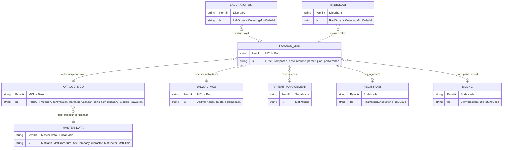

# MCU — Context ERD

| Field | Nilai |
| --- | --- |
| Blueprint ID | `MCU-BP-001` revision 1, `approved` 2026-10-21 |
| Sumber | `02-backend-architecture.md` r1; `03-domain-architecture.md` r1 (`MCU-HDA-001`) |

Peta ini menunjukkan **arah ketergantungan** antar bounded context. Panah dibaca "menunjuk ke".
Rincian kolom ada di ERD per context.

| Context | Status | Pemilik | ERD rinci |
| --- | --- | --- | --- |
| Katalog MCU | Baru | MCU | [katalog-mcu.md](katalog-mcu.md) |
| Jadwal MCU | Baru | MCU | [jadwal-mcu.md](jadwal-mcu.md) |
| Layanan MCU | Baru | MCU | [layanan-mcu.md](layanan-mcu.md) |
| Master Data, Patient Management, Registrasi, Billing | Sudah ada | Modul masing-masing | Dirujuk, tidak disalin |
| Laboratorium, Radiologi | Diperbarui (satu kolom) | Modul masing-masing | [layanan-mcu.md](layanan-mcu.md) bagian Lab/Rad |

**Arah ketergantungan yang sengaja dibalik:** Lab dan Rad menunjuk ke MCU (`CoveringMcuOrderId`),
bukan sebaliknya saja, karena keputusan *jangan menagih* harus diambil Lab/Rad tanpa bertanya ke MCU
(`MCU-HDA-001` `REL-MCU-12`).
