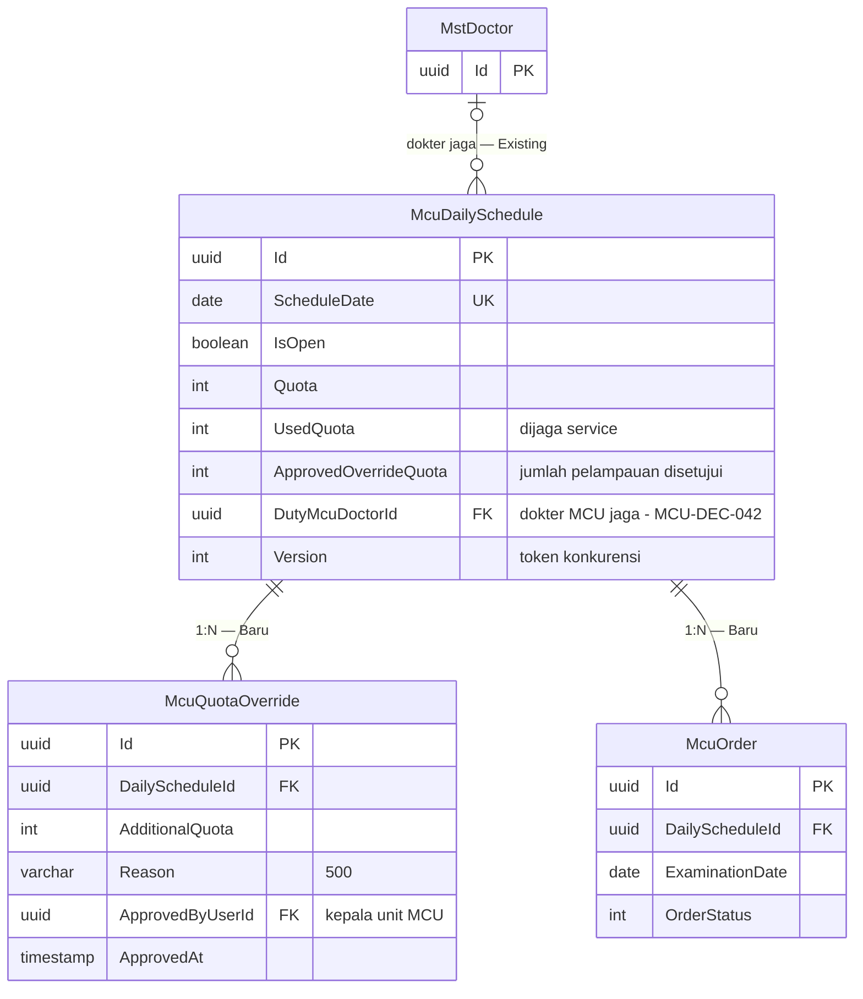

# MCU — ERD Jadwal MCU

| Field | Nilai |
| --- | --- |
| Blueprint ID | `MCU-BP-001` revision 1, `approved` 2026-10-21 |
| Context | Jadwal MCU (`BC-MCU-02`) |
| Keputusan | `MCU-DEC-012`, `014`, `029`, `037`, `038`, `042` |

| Entity | Status | Owner | Catatan |
| --- | --- | --- | --- |
| `McuDailySchedule` | Baru | MCU | Tanggal tanpa baris = tutup. `DutyMcuDoctorId` = dokter MCU jaga (`MCU-DEC-042`) |
| `MstDoctor` | Existing | Master Data | Hanya direferensikan |
| `McuQuotaOverride` | Baru | MCU | Hanya kepala unit MCU |

**Aturan hitung kuota.** `UsedQuota` naik saat order *Terjadwal* dibuat (booking, rekomendasi,
impor) atau *walk-in* dibuat, dan turun saat order menjadi *Tidak Hadir* atau *Dibatalkan*, atau
dijadwal ulang ke tanggal lain. Komponen susulan tidak memengaruhi kuota (`MCU-DEC-029`).

**Contoh.** Senin: `Quota = 30`, `ApprovedOverrideQuota = 5` (rombongan PT Contoh), `UsedQuota = 34`.
Booking ke-35 masih diterima (34 < 35); booking ke-36 ditolak.
