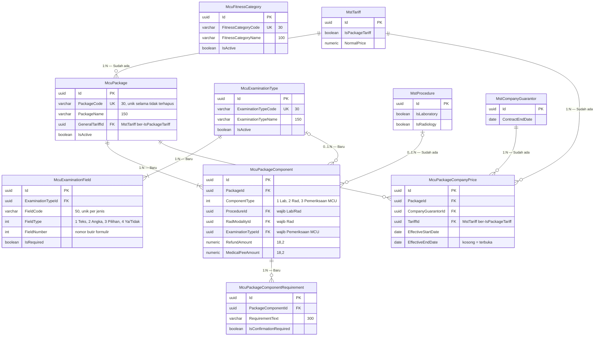

# MCU — ERD Katalog MCU

| Field | Nilai |
| --- | --- |
| Blueprint ID | `MCU-BP-001` revision 1, `approved` 2026-10-21 |
| Context | Katalog MCU (`BC-MCU-01`) |
| Keputusan | `MCU-DEC-005`, `007`, `013`, `015`, `020`, `025`, `034` |

| Entity | Status | Owner | Catatan |
| --- | --- | --- | --- |
| `McuPackage` | Baru | MCU | Dinonaktifkan, tidak dihapus |
| `McuPackageComponent` | Baru | MCU | Potretnya disalin ke order |
| `McuPackageComponentRequirement` | Baru | MCU | — |
| `McuPackageCompanyPrice` | Baru | MCU | Tanpa nominal; menunjuk tarif |
| `McuExaminationType`, `McuExaminationField` | Baru | MCU | Isi menunggu `MCU-OQ-002` |
| `McuFitnessCategory` | Baru | MCU | Isi menunggu `MCU-OQ-003` |
| `MstTariff`, `MstProcedure`, `MstCompanyGuarantor`, `MstRadModality` | Sudah ada | Master Data / Radiologi | Dirujuk, **tidak** disalin |
