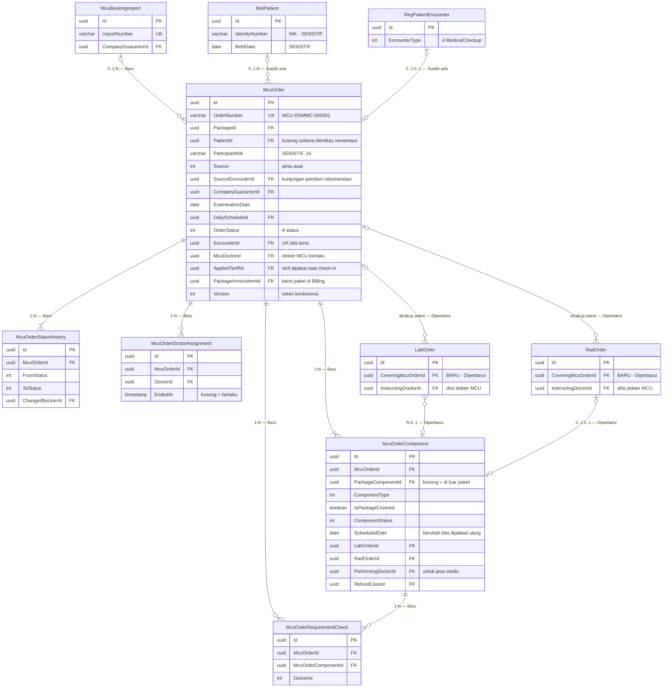
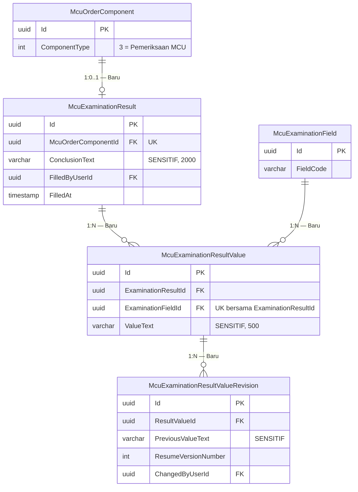
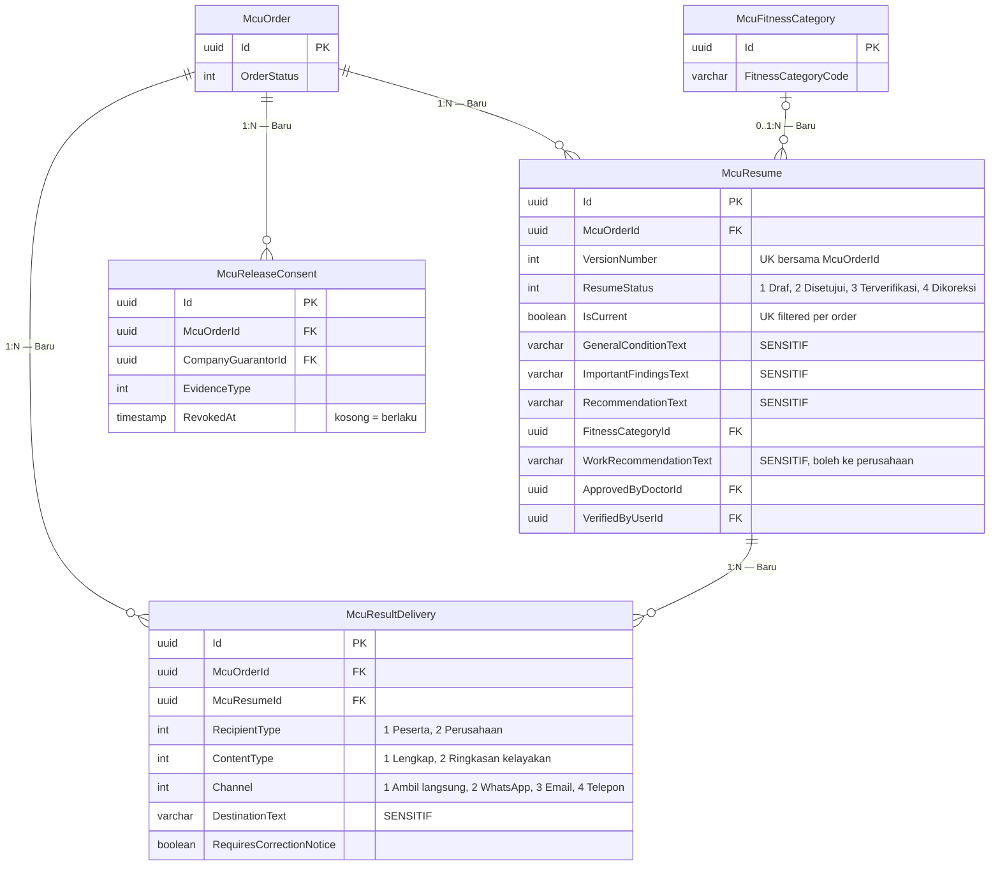

# MCU — ERD Layanan MCU

| Field | Nilai |
| --- | --- |
| Blueprint ID | `MCU-BP-001` revision 1, `approved` 2026-10-21 |
| Context | Layanan MCU (`BC-MCU-03`) |
| Keputusan | `MCU-DEC-003`..`011`, `013`..`019`, `021`..`024`, `030`..`040` |

Dipecah tiga diagram agar terbaca dalam satu layar.

## 1. Order, komponen, dan rujukan ke modul lain

Pencocokan peserta (`MCU-DEC-039`) memakai `MstPatient.IdentityNumber` dan `MstPatient.BirthDate`
(`Areas/HealthServices/PatientManagement/MasterData/Models/MstPatient.cs`).

## 2. Hasil Pemeriksaan MCU

## 3. Resume, persetujuan, penyerahan

## 4. Tabel status entity

| Entity | Status | Owner | Catatan |
| --- | --- | --- | --- |
| `McuOrder` | Baru | MCU | Aggregate root |
| `McuOrderComponent` | Baru | MCU | Termasuk komponen di luar paket |
| `McuOrderRequirementCheck` | Baru | MCU | — |
| `McuOrderStatusHistory` | Baru | MCU | Ditulis setiap perpindahan status |
| `McuOrderDoctorAssignment` | Baru | MCU | Penetapan + penggantian dokter MCU |
| `McuBookingImport` | Baru | MCU | Berkas tidak disimpan |
| `McuExaminationResult`, `McuExaminationResultValue`, `McuExaminationResultValueRevision` | Baru | MCU | — |
| `McuResume` | Baru | MCU | Berversi |
| `McuReleaseConsent` | Baru | MCU | — |
| `McuResultDelivery` | Baru | MCU | — |
| `LabOrder` | **Diperbarui** | Laboratorium | Tambah `CoveringMcuOrderId` |
| `RadOrder` | **Diperbarui** | Radiologi | Tambah `CoveringMcuOrderId` |
| `RegPatientEncounter`, `MstPatient`, `BilInvoiceItem`, `BilRefundCase`, `MstDoctor` | Sudah ada | Modul masing-masing | Dirujuk, **tidak** disalin |
