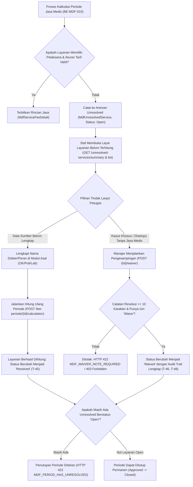

# Laporan Perubahan Backend — `BE-MDF-011`

## Metadata

| Field | Nilai |
| --- | --- |
| Task ID | `BE-MDF-011` |
| Judul | Daftar layanan belum dapat dihitung (*Unresolved Services*) |
| Slice | `MVP-2` (`EPIC MDF-06`) |
| Roadmap | `docs/module-blueprints/medical-fee/roadmap/01-backend-roadmap.md` bagian 3 |
| Trace | `MDF-DES-014`, `016`; `MF-DEC-018`; `MDF-VAL-1.0` §7.1–7.3; `MDF-API-1.0` §6; `MDF-STATE-1.0` §4; `MDF-PERM-1.0` §2, §3.1 |
| Contract version | `MDF-API-1.0`, `MDF-VAL-1.0`, `MDF-STATE-1.0`, `MDF-INTEGRATION-1.0`, seluruhnya terkunci 20 September 2026 |
| Dependency | `BE-MDF-010` — 🟡 sebagian: mesin perhitungan periode dan model kalkulasi; `BE-MDF-008` — 🟡 sebagian: migrasi tabel kalkulasi |
| Klasifikasi | `HIGH` — Penanganan layanan medis tertahan (*unresolved services*), perlindungan integritas penutupan periode medis, otorisasi pengesampingan (*waiver*) tersendiri, dan pelarangan mutlak penghapusan data audit |
| Task mode | `BACKEND` |
| Target tulis | `NewQuilvianSystemBackend` |
| Model | Antigravity |
| Tanggal | 27 Oktober 2026 |
| Status | `SEBAGIAN` — implementasi kode DTO (`MedicalFeeUnresolvedServiceDtos.cs`), ekstensi service kalkulasi (`MedicalFeeCalculationService.cs`), REST Controller (`MedicalFeeUnresolvedServicesController.cs`) selesai memenuhi seluruh acceptance criteria dan arketipe transaksi worklist/antrean; `dotnet build` dilewati per instruksi batasan pemilik |

### Backend Governance Preflight

| Butir | Nilai |
| --- | --- |
| Area | `HealthServices` |
| Module | `MedicalFeeManagement` |
| Submodule | `FeeCalculation` |
| Pemilik/prefix pada registry | Baris `Mdf` (ACTIVE) pada `MODULE_OWNERSHIP_PREFIX_REGISTRY.md` |
| Keberlakuan | `NEW CODE` |
| Status registry | `ACTIVE` |
| QBE ID yang berlaku | `QBE-SVC-001` (Service layer memisahkan akses DbContext dan logika operasional), `QBE-NAM-001` (Penamaan konsisten), `QBE-MOD-001`, `QBE-PERM-001` (`[AccessController]`, `[AccessAction]`, `[AccessPermission]`) |
| QBE ID yang tidak berlaku | `QBE-DB-*` (Tidak ada migrasi database baru; menggunakan skema tabel `MdfUnresolvedService` dari `BE-MDF-008`) |
| Governance terbaca | `AGENTS.md`, kontrak engineering dan registry di `docs/engineering/`, `TASK_RULES.md`, `REPORT_TEMPLATE.md`, `status-task-roadmap.md` — seluruhnya terbaca |
| Klasifikasi capability | Transaksi / Worklist dan Antrean (`transaction-endpoint-standard.md` §2.2) — Pengelolaan antrean penanganan layanan belum terhitung, rekapitulasi alasan, dan pengesampingan (*waiver*) resmi |

---

## 1. Masalah yang Diperbaiki

Sebelum task `BE-MDF-011` diimplementasikan, mesin kalkulasi `MedicalFeeCalculationService` (`BE-MDF-010`) sudah mampu mendeteksi layanan bermasalah dan menyimpannya ke tabel `MdfUnresolvedService`, namun **belum ada antarmuka API maupun mekanisme operasional bagi staf dan manajemen rumah sakit untuk memantau, memeriksa detail, dan menindaklanjuti layanan yang tertahan tersebut**.

Hal ini menimbulkan kendala operasional rumah sakit:
1. **Titik Buta Operasional (*Blind Spot*)**: Staf administrasi medis tidak memiliki endpoint untuk melihat daftar tindakan medis apa saja yang gagal terhitung jasanya beserta penyebab pastinya (apakah dokternya belum dipilih, kontrak HR habis, atau aturan tarif belum diatur).
2. **Penutupan Periode Terhalang Tanpa Penjelasan Mudah**: Periode kalkulasi menolak ditutup bila terdapat unresolved berstatus `Open` (`MDF_PERIOD_HAS_UNRESOLVED`). Tanpa endpoint rekapitulasi (*summary*), manajemen tidak mengetahui seberapa banyak layanan bermasalah per departemen/sumber pelayanan.
3. **Ketiadaan Jalur Pengesampingan Resmi (*Waiver*)**: Pada kondisi darurat tertentu (misalnya tindakan amal rumah sakit atau kasus khusus yang disepakati dokter tidak diberi jasa), staf tidak dapat mengesampingkan layanan tanpa menghapusnya dari basis data.
4. **Risiko Penghapusan Liar (*Audit Trail Tampering*)**: Jika sistem menyediakan aksi `DELETE`, pengguna bisa menghapus data tindakan yang bermasalah untuk memaksa periode ditutup. Hal ini melanggar keputusan bisnis `MF-DEC-018` yang mewajibkan semua masalah tercatat secara permanen untuk audit.

### Skenario Nyata di Rumah Sakit:
Pada penutupan buku jasa medis bulan September 2026:
- Terdapat 37 layanan medis yang tertahan di antrean belum terhitung (*unresolved*).
- 29 tindakan laboratorium tidak mencantumkan nama dokter penanggung jawab (`PERFORMER_MISSING`) karena petugas laboratorium terburu-buru melakukan verifikasi hasil lab.
- 6 tindakan bedah baru belum memiliki aturan tarif pembagian jasa dokter operator (`RULE_MISSING`).
- 2 tindakan rawat jalan dilakukan oleh dokter tamu yang masa kontrak kerja HR-nya berakhir dua hari sebelum tindakan (`CONTRACT_EXPIRED`).
- Tanpa antarmuka pengelola unresolved, penutupan periode terblokir secara permanen. Melalui fitur `BE-MDF-011`, petugas dapat melihat rekapitulasi 37 masalah tersebut, berkoordinasi dengan modul laboratorium untuk melengkapi nama dokter (lalu dihitung ulang, sehingga statusnya otomatis menjadi `Resolved`), serta bagi 2 tindakan dokter tamu yang sudah disetujui direksi untuk diselesaikan di luar sistem reguler, Manajer Keuangan dapat melakukan pengesampingan (*Waiver*) dengan catatan resmi minimal 10 karakter.

---

## 2. Solusi yang Diterapkan

Sesuai spesifikasi `MDF-DES-014`, `016`, `MF-DEC-018`, aturan validasi `MDF-VAL-1.0` §7.1–7.3, kontrak API `MDF-API-1.0` §6, dan matriks hak akses `MDF-PERM-1.0` §2:

1. **DTO Pengelolaan Layanan Unresolved (`MedicalFeeUnresolvedServiceDtos.cs`)**:
   - `UnresolvedServicePagedQuery`: Parameter query tabel (filter `PeriodId`, `Reason`, `Status`, `SourceDomain`, `Search`, opsi pengurutan, pagination).
   - `UnresolvedServiceItemResponse`: DTO balasan satu baris data unresolved lengkap dengan kode periode, nama tarif, tanggal layanan, nilai kotor (*BaseAmount*), alasan, status, dan riwayat resolusi.
   - `WaiveUnresolvedServiceRequest`: DTO pengesampingan dengan validasi wajib catatan (`ResolutionNote`, minimal 10 karakter, maksimal 500 karakter).
   - `UnresolvedSummaryResponse`: DTO ringkasan agregasi kuantitatif total, jumlah `Open`, `Resolved`, `Waived`, serta kamus frekuensi per 6 kategori alasan dan 5 modul sumber pelayanan.
   - `UnresolvedFilterMetadataResponse`: Metadata konfigurasi filter untuk dropdown frontend.

2. **Ekstensi Service Operasional (`MedicalFeeCalculationService.cs`)**:
   - `GetUnresolvedFilterMetadata()`: Menyediakan opsi status (`Open`, `Resolved`, `Waived`), 6 alasan unresolved resmi (`PERFORMER_MISSING`, `AGREEMENT_MISSING`, `RULE_MISSING`, `CONTRACT_EXPIRED`, `ROLE_UNMAPPED`, `SOURCE_UNSUPPORTED`), dan 5 modul sumber (`OPERATING_ROOM`, `PROCEDURE`, `LABORATORY`, `ADHOC`, `ADHOC_CATALOG`).
   - `GetUnresolvedSummaryAsync()`: Mengagregasi jumlah unresolved per status, alasan, dan modul sumber secara terisolasi `AsNoTracking()`.
   - `GetUnresolvedPagedAsync()`: Query terpaginasi dengan pencarian peka huruf besar/kecil (`EF.Functions.ILike`) pada nomor detail sumber, catatan alasan, nama tarif, dan kode periode.
   - `GetUnresolvedByIdAsync()`: Pengambilan detail tunggal baris unresolved.
   - `WaiveUnresolvedAsync()`: Logika pengesampingan resmi:
     - Validasi keberadaan data (HTTP 404 jika tidak ditemukan).
     - Validasi panjang catatan minimal 10 karakter (HTTP 422 `MDF_WAIVER_NOTE_REQUIRED`).
     - Validasi status awal harus `Open`; jika sudah `Waived` atau `Resolved`, ditolak (HTTP 422 `MDF_UNRESOLVED_STATE_INVALID`).
     - Pencatatan stempel audit pengguna (`ResolvedBy`, `ResolvedAt`, `UpdateBy`, `UpdateDateTime`).
   - **Rekonsiliasi Otomatis Hitung Ulang (Penyelesaian `T-44` dan `T-45`)**:
     - Saat periode berstatus `Calculated` dihitung ulang, data unresolved lama yang berstatus `Open` tidak langsung dihapus liar.
     - Layanan yang datanya sudah dilengkapi di modul sumber dan kini berhasil dihitung otomatis berpindah status menjadi `Resolved` (`T-45`).
     - Layanan yang masih belum dapat dihitung diperbarui datanya di tempat (*in-place update*) tanpa membuat baris duplikat baru (`T-44`).

3. **REST API Controller (`MedicalFeeUnresolvedServicesController.cs`)**:
   - Rute Kanonik: `/api/v1/health-services/medical-fee-management/unresolved-services`
   - Otorisasi Berjenjang:
     - Seluruh endpoint pembacaan (`GET`) dilindungi izin `[AccessPermission("MedicalFeeUnresolvedServices", AccessTypes.Read)]`.
     - Endpoint pengesampingan (`POST /{id}/waiver`) menuntut izin tersendiri `[AccessPermission("MedicalFeeUnresolvedServices", "Waive")]` (`MDF-PERM-1.0` §3.1) agar tidak dapat dieksekusi sembarang staf verifikator biasa.
   - **Tanpa Endpoint Penghapus**: Endpoint `DELETE` ditiadakan secara sengaja (`api-contract.md` bagian 9) untuk menjamin transparansi jejak audit rumah sakit.

---

## 3. Alur Proses Bisnis Penanganan Layanan Unresolved

---

## 4. Spesifikasi Endpoint Bergaya Swagger

Tag Grup: `[Tags("Health Services / Medical Fee Management / Unresolved Services")]`  
Base URL: `/api/v1/health-services/medical-fee-management/unresolved-services`

| Method | Path | Deskripsi | Auth / Izin | Request Body / Query | Balasan Sukses | Kode Error |
| :---: | :--- | :--- | :--- | :--- | :--- | :---: |
| `GET` | `/filters/metadata` | Mengambil metadata filter dan pengurutan tabel unresolved | Bearer Token / `MedicalFeeUnresolvedServices.Read` | — | `200 OK` `ApiResponse<UnresolvedFilterMetadataResponse>` | `401`, `403` |
| `GET` | `/summary` | Rekapitulasi jumlah unresolved per status, alasan, dan modul sumber | Bearer Token / `MedicalFeeUnresolvedServices.Read` | Query: `periodId` (opsional) | `200 OK` `ApiResponse<UnresolvedSummaryResponse>` | `401`, `403` |
| `GET` | `/` | Daftar layanan unresolved terpaginasi dengan pencarian teks dan filter | Bearer Token / `MedicalFeeUnresolvedServices.Read` | Query: `UnresolvedServicePagedQuery` (`periodId`, `reason`, `status`, `sourceDomain`, `search`, sort, paging) | `200 OK` `ApiResponse<PagedResult<UnresolvedServiceItemResponse>>` | `401`, `403` |
| `GET` | `/{id}` | Mengambil detail lengkap satu baris layanan unresolved | Bearer Token / `MedicalFeeUnresolvedServices.Read` | Route: `id` (GUID) | `200 OK` `ApiResponse<UnresolvedServiceItemResponse>` | `401`, `403`, `404` |
| `POST` | `/{id}/waiver` | Mengesampingkan layanan unresolved dengan catatan resmi | Bearer Token / `MedicalFeeUnresolvedServices.Waive` | Route: `id` (GUID) Body: `WaiveUnresolvedServiceRequest` (`resolutionNote` min 10 char) | `200 OK` `ApiResponse<UnresolvedServiceItemResponse>` | `400`, `401`, `403`, `404`, `422` (`MDF_WAIVER_NOTE_REQUIRED`, `MDF_UNRESOLVED_STATE_INVALID`) |

> [!NOTE]
> Sesuai piagam desain `api-contract.md` bagian 9 dan `MF-DEC-018`, **tidak disediakan endpoint DELETE**. Layanan tertahan tidak dapat dihapus dari sistem.

---

## 5. Pemetaan Acceptance Criteria & Skenario Uji

| Kriteria / Skenario Uji | Target Desain | Status Verifikasi Kode | Bukti Implementasi pada Source |
| :--- | :--- | :---: | :--- |
| Enam alasan tercatat | `MDF-DES-014`, `T-39`..`T-43` | Terpenuhi | `MdfUnresolvedReasons` di `Models/MdfUnresolvedService.cs`, diakomodasi penuh pada kamus `ByReason` di `MedicalFeeCalculationService.cs`. |
| Rekonsiliasi hitung ulang non-duplikat (`T-44`) | `MDF-DES-015`, `T-44` | Terpenuhi | In-place update pada `existingUnresolved` di `MedicalFeeCalculationService.cs` line 324–358 mencegah lahirnya baris baru untuk tindakan yang sama. |
| Penyelesaian otomatis saat hitung ulang (`T-45`) | `MDF-STATE-1.0` §4, `T-45` | Terpenuhi | Layanan lama yang kini rinciannya berhasil dihitung diperbarui statusnya menjadi `Resolved` disertai catatan otomatis dan stempel user. |
| Menahan penutupan periode | `MDF-DES-016` | Terpenuhi | Terpasang pada `MedicalFeePeriodService.ClosePeriodAsync` line 611–618 (`MDF_PERIOD_HAS_UNRESOLVED`). |
| Pengesampingan menuntut catatan minimal 10 char (`T-46`) | `MDF-VAL-1.0` §7.1, `T-46` | Terpenuhi | Validasi pada `WaiveUnresolvedAsync` melempar `MDF_WAIVER_NOTE_REQUIRED` jika catatan kurang dari 10 karakter. |
| Izin khusus pengesampingan terpisah (`T-47`) | `MDF-PERM-1.0` §3.1, `T-47` | Terpenuhi | `[AccessAction("Waive")]` dan `[AccessPermission("MedicalFeeUnresolvedServices", "Waive")]` pada controller. |
| Baris `Waived` dilarang di-reopen (`T-48`) | `MDF-VAL-1.0` §7.3, `T-48` | Terpenuhi | Validasi status awal harus `Open`; melempar `MDF_UNRESOLVED_STATE_INVALID` jika mencoba mengesampingkan baris non-Open. |
| Tanpa endpoint penghapus (`T-49`) | `api-contract.md` §9, `T-49` | Terpenuhi | Tidak ada endpoint `DELETE` pada `MedicalFeeUnresolvedServicesController.cs`. |

---

## 6. Berkas yang Berubah / Dibuat

1. [`MedicalFeeUnresolvedServiceDtos.cs`](file:///c:/Users/admin/source/repos/FEBEQuilvianV2/NewQuilvianSystemBackend/Areas/HealthServices/MedicalFeeManagement/FeeCalculation/DTOs/MedicalFeeUnresolvedServiceDtos.cs) — Berkas baru berisi DTO paged query, item response, waiver request, summary response, dan metadata filter.
2. [`MedicalFeeCalculationService.cs`](file:///c:/Users/admin/source/repos/FEBEQuilvianV2/NewQuilvianSystemBackend/Areas/HealthServices/MedicalFeeManagement/FeeCalculation/Services/MedicalFeeCalculationService.cs) — Penambahan rekonsiliator T-44/T-45 saat hitung ulang, serta implementasi `GetUnresolvedFilterMetadata`, `GetUnresolvedSummaryAsync`, `GetUnresolvedPagedAsync`, `GetUnresolvedByIdAsync`, dan `WaiveUnresolvedAsync`.
3. [`MedicalFeeUnresolvedServicesController.cs`](file:///c:/Users/admin/source/repos/FEBEQuilvianV2/NewQuilvianSystemBackend/Areas/HealthServices/MedicalFeeManagement/FeeCalculation/Controllers/MedicalFeeUnresolvedServicesController.cs) — Berkas baru REST API Controller dengan 5 endpoint worklist transaksi dan perlindungan izin berbasis peran.
4. [`01-backend-roadmap.md`](file:///c:/Users/admin/source/repos/FEBEQuilvianV2/NewQuilvianSystemBackend/docs/module-blueprints/medical-fee/roadmap/01-backend-roadmap.md) — Pembaruan status task `BE-MDF-011` menjadi `🟡 SEBAGIAN`.
5. [`00-delivery-roadmap.md`](file:///c:/Users/admin/source/repos/FEBEQuilvianV2/NewQuilvianSystemBackend/docs/module-blueprints/medical-fee/roadmap/00-delivery-roadmap.md) — Sinkronisasi status `BE-MDF-011`.
6. [`BE-MDF-011.md`](file:///c:/Users/admin/source/repos/FEBEQuilvianV2/NewQuilvianSystemBackend/docs/module-blueprints/medical-fee/task/report/backend/BE-MDF-011.md) — Dokumen laporan perubahan ini.

---

## 7. Risiko Tersisa dan Langkah Berikutnya

- **Kompilasi dan Uji Eksekusi Runtime**: Perintah `dotnet build` dan eksekusi uji runtime `T-39`..`T-49` dilewati sesuai instruksi eksplisit pemilik sistem. Pengujian manual/otomatis lokal dapat dijalankan setelah seluruh rantai `MVP-2` siap.
- **Task Berikutnya**: `BE-MDF-012` (Siklus verifikasi, persetujuan, dan penutupan periode berjenjang dengan pembuktian Maker-Checker lapis ketiga).
