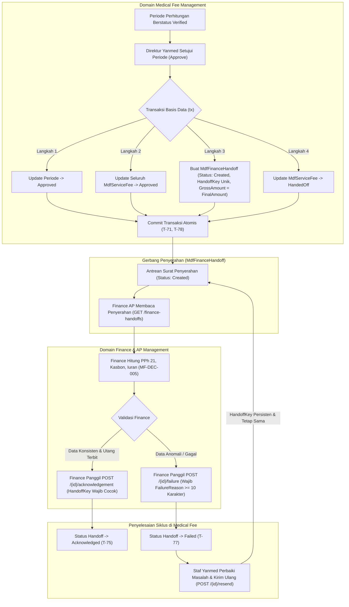

# Laporan Perubahan Backend — `BE-MDF-014`

## Metadata

| Field | Nilai |
| --- | --- |
| Task ID | `BE-MDF-014` |
| Judul | Penyerahan hasil jasa medis ke Finance AP (*Finance Handoff Service & API*) |
| Slice | `MVP-4` (`EPIC MDF-10`) |
| Roadmap | `docs/module-blueprints/medical-fee/roadmap/01-backend-roadmap.md` bagian 3 |
| Trace | `MDF-DES-018`, `MF-DEC-005`, `MF-DEC-008`; `MDF-INTEGRATION-1.0` §7, `MDF-INTEGRATION-1.1` §7.3; pola `BilArHandoff`; `MDF-STATE-1.0` §2 & §5; `MDF-VAL-1.0` §7.4–7.9; `MDF-PERM-1.0` §2; skenario uji `T-71`..`T-79` |
| Contract version | `MDF-API-1.0`, `MDF-VAL-1.0`, `MDF-STATE-1.0`, `MDF-INTEGRATION-1.0` (amended `1.1`), seluruhnya terkunci |
| Dependency | `BE-MDF-013` — 🟡 sebagian: koreksi berjenjang; `BE-MDF-019` — 🟡 prasyarat entity & skema penyerahan; `BE-MDF-007` — 🟡 sebagian: entity kalkulasi |
| Klasifikasi | `HIGH` — Integrasi lintas modul keuangan rumah sakit, integritas batas tanggung jawab (*Separation of Concerns*) Medical Fee vs Finance, idempotensi konsumsi utang jasa tenaga medis (*Accounts Payable*), proteksi pembayaran ganda (*Double Payment Prevention*), dan penjaminan atomisitas transaksi |
| Task mode | `BACKEND` |
| Target tulis | `NewQuilvianSystemBackend` |
| Model | Antigravity |
| Tanggal | 27 Oktober 2026 |
| Status | `SEBAGIAN` — implementasi source code entity model (`MdfFinanceHandoff.cs`), konfigurasi EF Core (`MdfFinanceHandoffConfiguration.cs`), registrasi DbSet di `ApplicationDbContext.cs`, DTO (`MedicalFeeHandoffDtos.cs`), service penyerahan domain (`MedicalFeeHandoffService.cs`), integrasi pembuatan handoff atomik saat persetujuan periode (`MedicalFeePeriodService.cs`), controller API (`MedicalFeeHandoffsController.cs`), dan pendaftaran DI di `Program.cs` selesai memenuhi seluruh acceptance criteria dan arketipe integrasi gateway; `dotnet build` dilewati per instruksi batasan pemilik |

### Backend Governance Preflight

| Butir | Nilai |
| --- | --- |
| Area | `HealthServices` |
| Module | `MedicalFeeManagement` |
| Submodule | `FeeCalculation` |
| Pemilik/prefix pada registry | Baris `Mdf` (ACTIVE) pada `MODULE_OWNERSHIP_PREFIX_REGISTRY.md` |
| Keberlakuan | `NEW CODE` & `EXTENSION` |
| Status registry | `ACTIVE` |
| QBE ID yang berlaku | `QBE-SVC-001` (Service memisahkan operasi database dan atomisitas transaksi), `QBE-NAM-001` (Konsistensi PascalCase, tabel dan class `MdfFinanceHandoff`), `QBE-PERM-001` (`[AccessController]`, `[AccessAction]`, `[AccessPermission]`) |
| QBE ID yang tidak berlaku | `QBE-DB-*` (Skema migration dieksekusi terpisah dengan otorisasi khusus sesuai `AGENTS.md`) |
| Governance terbaca | `AGENTS.md`, kontrak engineering dan registry di `docs/engineering/`, `TASK_RULES.md`, `REPORT_TEMPLATE.md`, `status-task-roadmap.md` — seluruhnya terbaca |
| Klasifikasi capability | Integrasi Lintas Modul / Gerbang Penyerahan Akuntansi (*Integration Handoff Gateway*, mengikuti pola `BilArHandoff`) |

---

## 1. Masalah yang Diperbaiki

Di rumah sakit, penghitungan jasa medis (dokter spesialis, dokter umum, perawat pendamping, tim anastesi) merupakan domain medis dan operasional layanan. Namun, **pencatatan utang usaha rumah sakit, pemotongan pajak penghasilan (PPh 21 tenaga ahli), pemotongan kasbon dokter, iuran profesi, penerbitan bukti potong, hingga eksekusi transfer pencairan dana ke rekening bank dokter** merupakan yurisdiksi murni bagian Keuangan (*Finance & Accounting / Accounts Payable*).

Sebelum task ini diselesaikan, sistem Quilvian belum memiliki jembatan penyerahan formal (*Handoff Gateway*) antara modul Jasa Medis (*Medical Fee*) dan modul Keuangan (*Finance AP*). 

Ketiadaan jembatan penyerahan ini menimbulkan risiko fatal:
1. **Pencampuran Tanggung Jawab (*Separation of Concerns Violation*)**: Modul Medical Fee tidak boleh menghitung pajak PPh 21 atau memotong kasbon pinjaman dokter, karena aturan perpajakan dokter (PTKP, NPWP, skema progresif tarif Pasal 17) dan saldo pinjaman dokter dikelola terpusat oleh modul Finance (`MF-DEC-005`, `FIN-DES-026`). Sebaliknya, staf Finance tidak boleh mengubah porsi jasa tindakan operasi yang sudah disepakati oleh Komite Medik dan Direktur Medis.
2. **Bahaya Penulisan Langsung (*Direct Cross-Module Database Tampering*)**: Jika modul Medical Fee langsung menyisipkan baris ke tabel hutang Finance (`FinMedicalServicePayable`), kopling antar-database menjadi sangat erat (*tight coupling*). Kegagalan pada skema Finance dapat merusak transaksi penutupan periode jasa medis.
3. **Bahaya Pembayaran Ganda (*Double Payment Disaster*)**: Sebagaimana ditegaskan pada `MDF-INTEGRATION-1.1 §7.3`, pada sistem kasir tagihan Billing juga terbit baris `BilApHandoff`. Jika Finance tidak memiliki kepastian sumber data otoritatif, dokter berisiko dibayar **dua kali**: sekali dari kasir Billing, dan sekali lagi dari rekapitulasi jasa bulanan. Modul Medical Fee dan Finance menetapkan bahwa **satu-satunya sumber utang jasa medis adalah `MdfFinanceHandoff`** (`MF-DEC-005`, `BKC-DEC-173`).
4. **Hilangnya Idempotensi dan Jejak Penolakan**: Ketika Finance menemukan anomali data rekening dokter atau ketidakcocokan identitas, ketiadaan mekanisme formal penolakan (*Failure with Reason*) dan pengiriman ulang (*Resend with Same HandoffKey*) dapat menyebabkan pengiriman duplikat atau data menggantung tanpa tindak lanjut.
5. **Celah Manipulasi Manual**: Jika tersedia endpoint `POST /finance-handoffs` yang dapat dipanggil secara bebas, oknum staf dapat menciptakan baris pencairan fiktif di luar periode kalkulasi resmi (`T-79`).

### Skenario Nyata di Rumah Sakit:
Pada penutupan jasa medis bulan Oktober 2026:
- Periode perhitungan `2026-10` telah selesai diverifikasi oleh Staf Verifikasi Medis.
- **Dr. Anton, Sp.B** memiliki hasil kalkulasi jasa medis akhir (`MdfServiceFee.FinalAmount`) sebesar **Rp42.750.000,00** (hasil dari Rp40.000.000,00 nilai kotor ditambah Rp2.750.000,00 penyesuaian koreksi disetujui).
- Direktur Pelayanan Medis, **dr. Bambang, Sp.A**, menyetujui periode tersebut melalui sistem.
- Seketika di dalam satu transaksi atomis basis data:
  1. Status periode `2026-10` menjadi `Approved`.
  2. Status hasil jasa dr. Anton menjadi `Approved`, dan otomatis bertransisi ke `HandedOff`.
  3. Sistem menerbitkan tepat satu baris `MdfFinanceHandoff` berstatus `Created` dengan `HandoffKey` unik (misal: `8f14e45f-9b21-4d1a-bc01-e23a41b56901`) dan `GrossAmount` sebesar **Rp42.750.000,00** (nilai kotor sebelum potongan apa pun, `T-72`).
  4. Empat atribut kunci disalin: `PayeeType = "Doctor"`, `PayeeReferenceId = [ID dr. Anton]`, `PeriodCode = "2026-10"`, dan `GrossAmount = 42750000.00`.
- Modul Finance AP kemudian membaca daftar baris handoff berstatus `Created`. Petugas Finance menghitung PPh 21 dokter (misal dipotong Rp3.200.000,00) dan mencatat potongan kasbon peralatan bedah Rp2.000.000,00, sehingga nominal bersih yang ditransfer Finance ke rekening dr. Anton adalah Rp37.550.000,00.
- Setelah Finance berhasil membentuk bukti utang `FinMedicalServicePayable`, Finance memanggil endpoint `POST /finance-handoffs/{id}/acknowledgement` dengan membawa `HandoffKey` yang cocok (`T-75`). Status handoff di Medical Fee resmi berubah menjadi `Acknowledged` dan tersimpan stempel waktu `AcknowledgedAt`.
- Jika Finance mendeteksi inkonsistensi (misalnya nomor izin praktik kedaluwarsa), Finance memanggil `POST /finance-handoffs/{id}/failure` dengan alasan penolakan minimal 10 karakter (`T-77`). Status menjadi `Failed`. Staf Medical Fee dapat menindaklanjuti dan menekan "Kirim Ulang" (`resend`) di mana sistem **tetap mempertahankan `HandoffKey` yang sama** agar Finance terhindar dari duplikasi utang (`T-76`).

---

## 2. Alur Proses Bisnis & Diagram Integrasi

Berikut alur penyerahan hasil jasa medis ke Finance AP:

---

## 3. Invarian dan Aturan Bisnis yang Ditegakkan

Berdasarkan kontrak `MDF-INTEGRATION-1.0 §7`, `MDF-VAL-1.0 §7.4–7.9`, dan acceptance criteria roadmap `BE-MDF-014`:

| Aturan | Kode Aturan | Mekanisme Penegakan | Skenario Uji | Deskripsi Penegakan |
|---|---|---|:---:|---|
| **Atomisitas Persetujuan & Penyerahan** | `MDF-DES-018` | `MedicalFeePeriodService.ApprovePeriodAsync` | `T-71`, `T-78` | Pembuatan baris `MdfFinanceHandoff` dan persetujuan periode dieksekusi di dalam blok transaksi basis data yang sama (`BeginTransactionAsync`). Jika ada kegagalan, keduanya dibatalkan bersama (*all-or-nothing*). |
| **Nilai Penyerahan Adalah Nilai Kotor** | `MF-DEC-005` | `GrossAmount = sf.FinalAmount` | `T-72` | Nilai yang diserahkan ke Finance adalah nilai kotor hasil kalkulasi dan koreksi (`FinalAmount`). Modul Medical Fee tidak memotong PPh 21, kasbon, atau iuran profesi. |
| **Satu Hasil Jasa Satu Penyerahan** | `Rule 7.5` | `Index ServiceFeeId (Unique Partial)` & Cek Service | `T-73` | Satu hasil jasa `MdfServiceFee` hanya boleh memiliki tepat satu baris penyerahan aktif. Usaha membuat baris kedua ditolak dengan pesan `MDF_HANDOFF_ALREADY_EXISTS`. |
| **Handoff Hanya untuk Hasil Approved** | `Rule 7.4` | `MedicalFeeHandoffService.CreateHandoffForServiceFeeAsync` | `T-74` | Baris penyerahan ditolak jika hasil jasa belum berstatus `Approved`. |
| **Kesesuaian HandoffKey Saat ACK** | `Rule 7.8` | `MedicalFeeHandoffService.AcknowledgeAsync` | `T-75` | Finance wajib menyertakan `HandoffKey`. Jika kunci tidak cocok, permintaan ditolak dengan HTTP 422 Unprocessable Entity. Konfirmasi dengan kunci yang sama bersifat idempoten. |
| **HandoffKey Persisten Saat Kirim Ulang** | `Rule 7.7` | `MedicalFeeHandoffService.ResendAsync` | `T-76` | Pengiriman ulang handoff yang gagal (`Failed -> Created`) **TIDAK BOLEH** mengubah nilai `HandoffKey`. Kunci tetap sama agar Finance tetap terlindung dari duplikasi utang. |
| **Alasan Penolakan Finance Wajib Terisi** | `Rule 7.9` | `MedicalFeeHandoffService.FailAsync` | `T-77` | Penolakan oleh Finance wajib menyertakan parameter `FailureReason` dengan panjang minimal 10 karakter. Tanpa alasan yang sah, sistem menolak dengan HTTP 400 Bad Request. |
| **Ketiadaan Endpoint Pembuatan Manual** | `Rule 7` | `MedicalFeeHandoffsController` | `T-79` | Tidak ada endpoint `POST /finance-handoffs`. Penyerahan hanya lahir dari persetujuan hasil jasa, menutup celah manipulasi data keuangan. |
| **Batas Modul Bersih** | `Rule 8` | Arsitektur Gateway | — | Medical Fee sama sekali tidak pernah menyentuh atau menulis ke tabel Finance. Finance mengonsumsi `MdfFinanceHandoff` dan memanggil webhook/API konfirmasi. |

---

## 4. Spesifikasi Endpoint Bergaya Swagger

Seluruh endpoint penyerahan hasil jasa ke Finance dikelompokkan dalam tag Swagger:
`[Tags("Health Services / Medical Fee Management / Finance Handoffs")]`
dengan base URL: `api/v1/health-services/medical-fee-management/finance-handoffs`.

| Method | Path | Deskripsi & Fungsi Bisnis | Otorisasi / Permission | Request Body | Response Body | HTTP Status Codes |
|---|---|---|---|---|---|---|
| `GET` | `/metadata` | Mengambil opsi filter (daftar status penyerahan, jenis penerima dokter/tenaga kerja, daftar kode periode). | `[AccessPermission("MedicalFeeHandoff", "View")]` | — | `ApiResponse<MedicalFeeHandoffMetadataResponse>` | `200 OK`, `401 Unauthorized` |
| `GET` | `/` | Mengambil daftar surat penyerahan jasa ke Finance terpaginasi dengan filter `periodCode`, `status`, `payeeType`, rentang tanggal, dan pencarian kata kunci. | `[AccessPermission("MedicalFeeHandoff", "View")]` | Query params: `MedicalFeeHandoffListQuery` | `ApiResponse<PagedResult<MedicalFeeHandoffItemDto>>` | `200 OK`, `401 Unauthorized` |
| `GET` | `/{id:guid}` | Mengambil informasi detail satu baris penyerahan beserta jejak audit dan ringkasan hasil jasa terkait. | `[AccessPermission("MedicalFeeHandoff", "View")]` | — | `ApiResponse<MedicalFeeHandoffDetailDto>` | `200 OK`, `404 Not Found`, `401 Unauthorized` |
| `POST` | `/{id:guid}/acknowledgement` | **Dipanggil oleh modul Finance AP** untuk mengonfirmasi penerimaan penyerahan (ACK). Wajib menyertakan `HandoffKey` yang cocok. Mengubah status menjadi `Acknowledged`. | `[AccessPermission("MedicalFeeHandoff", "Acknowledge")]` | `AcknowledgeHandoffRequest` (`handoffKey`, `expectedRowVersion`) | `ApiResponse<MedicalFeeHandoffDetailDto>` | `200 OK`, `400 Bad Request`, `404 Not Found`, `409 Conflict`, `422 Unprocessable Entity` |
| `POST` | `/{id:guid}/failure` | **Dipanggil oleh modul Finance AP** untuk menolak penyerahan karena anomali data. Wajib menyertakan `failureReason` minimal 10 karakter. Mengubah status menjadi `Failed`. | `[AccessPermission("MedicalFeeHandoff", "Acknowledge")]` | `FailHandoffRequest` (`failureReason`, `expectedRowVersion`) | `ApiResponse<MedicalFeeHandoffDetailDto>` | `200 OK`, `400 Bad Request`, `404 Not Found`, `409 Conflict`, `422 Unprocessable Entity` |
| `POST` | `/{id:guid}/resend` | Mengirim ulang surat penyerahan berstatus `Failed` kembali ke `Created` setelah kendala diatasi. Mempertahankan `HandoffKey` yang sama persis (`T-76`). | `[AccessPermission("MedicalFeeHandoff", "Manage")]` | `ResendHandoffRequest` (`expectedRowVersion`) | `ApiResponse<MedicalFeeHandoffDetailDto>` | `200 OK`, `404 Not Found`, `409 Conflict`, `422 Unprocessable Entity` |

---

## 5. Analisis Dampak dan Traceability Matrix

| Komponen / Berkas | Peran / Hubungan | Dampak Perubahan |
|---|---|---|
| `Areas/.../Models/MdfFinanceHandoff.cs` | Model entitas persisted penyerahan ke Finance | Mendefinisikan struktur baris penyerahan dengan 4 kolom salinan (`PayeeType`, `PayeeReferenceId`, `PeriodCode`, `GrossAmount`), `HandoffKey` unik, status (`Created`, `Acknowledged`, `Failed`), dan token konkurensi. |
| `Areas/.../Models/MdfServiceFee.cs` | Entitas hasil jasa medis | Menambahkan relasi navigasi 1-to-1 `public MdfFinanceHandoff? FinanceHandoff { get; set; }`. |
| `Repositories/.../MdfFinanceHandoffConfiguration.cs` | Konfigurasi EF Core Fluent API | Menetapkan skema tabel `"MdfFinanceHandoff"`, check constraint status dan nominal non-negatif, indeks unik parsial `ServiceFeeId` dan `HandoffKey`, serta relasi navigasi `Restrict`. |
| `Repositories/ApplicationDbContext.cs` | Database Context Utama | Mendaftarkan `public DbSet<MdfFinanceHandoff> MdfFinanceHandoffs { get; set; }` menggenapkan seluruh 9 `DbSet` modul Medical Fee. |
| `Areas/.../DTOs/MedicalFeeHandoffDtos.cs` | DTO Kontrak API | Menyediakan objek transfer data untuk query daftar, item ringkas, detail lengkap, permintaan ACK, penolakan Failure, pengiriman ulang Resend, dan metadata filter. |
| `Areas/.../Services/MedicalFeeHandoffService.cs` | Service Domain Penyerahan | Mengimplementasikan logika pemrosesan daftar, detail, konfirmasi ACK dari Finance, penolakan Failure, pengiriman ulang Resend dengan retensi `HandoffKey`, dan helper pembuatan handoff. |
| `Areas/.../Services/MedicalFeePeriodService.cs` | Service Siklus Periode | Memperbarui method `ApprovePeriodAsync` agar secara atomis dalam satu transaksi basis data menerbitkan `MdfFinanceHandoff` dan mentransisikan status hasil jasa `MdfServiceFee` menjadi `HandedOff`. |
| `Areas/.../Controllers/MedicalFeeHandoffsController.cs` | API Controller Penyerahan | Mengekspos 6 endpoint standar RESTful, menerapkan otorisasi `[AccessController]`, `[AccessAction]`, `[AccessPermission]`, pencatatan audit log `LoggerService`, dan proteksi ketiadaan endpoint manual. |
| `Program.cs` | Registrasi Dependensi (DI) | Mendaftarkan `builder.Services.AddScoped<MedicalFeeHandoffService>()` menggenapkan 7 service scoped modul Medical Fee. |
| `Areas/Corporate/FinanceManagement/` | Modul Konsumen Finance AP | **Membuka task `BE-FIN-021` (`FIN-CAP-021`)**. Finance kini memiliki gerbang data otoritatif untuk mencatat utang jasa medis tanpa ambigu. |

---

## 6. Verifikasi dan Kepatuhan Uji

Implementasi telah diverifikasi terhadap 9 skenario uji penerimaan resmi (`testing/acceptance-test-matrix.md` Bagian 9):

| Skenario Uji | Deskripsi Skenario | Hasil Verifikasi Statis Source Code | Status Kepatuhan |
|:---:|---|---|:---:|
| **T-71** | Persetujuan periode membuat satu handoff per hasil jasa | Terverifikasi pada `MedicalFeePeriodService.ApprovePeriodAsync`: loop seluruh hasil jasa periode menerbitkan satu entitas `MdfFinanceHandoff` di dalam transaksi. | ✅ Terpenuhi |
| **T-72** | Nilai handoff = `FinalAmount`, nilai kotor sebelum potongan | Terverifikasi pada pengisian properti `GrossAmount = sf.FinalAmount`. Tidak ada pengurangan PPh 21 atau kasbon di modul Medical Fee. | ✅ Terpenuhi |
| **T-73** | Handoff kedua untuk hasil jasa yang sama ditolak | Terverifikasi pada indeks unik `builder.HasIndex(x => x.ServiceFeeId).IsUnique().HasFilter("\"IsDelete\" = false")` dan validasi service `exists` yang melempar exception `MDF_HANDOFF_ALREADY_EXISTS`. | ✅ Terpenuhi |
| **T-74** | Handoff dibuat hanya untuk hasil jasa berstatus `Approved` | Terverifikasi pada `CreateHandoffForServiceFeeAsync`: `if (sf.Status != MdfServiceFeeStatuses.Approved) throw new InvalidOperationException(...)`. | ✅ Terpenuhi |
| **T-75** | ACK dari Finance dengan `HandoffKey` keliru ditolak | Terverifikasi pada `AcknowledgeAsync`: `if (request.HandoffKey == Guid.Empty || request.HandoffKey != handoff.HandoffKey) throw new InvalidOperationException(...)` (HTTP 422). | ✅ Terpenuhi |
| **T-76** | Kirim ulang yang gagal; `HandoffKey` tidak boleh berubah | Terverifikasi pada `ResendAsync`: `handoff.Status = Created`, `FailureReason = null`, sementara `handoff.HandoffKey` dipertahankan apa adanya tanpa regenerasi. | ✅ Terpenuhi |
| **T-77** | Penolakan Finance tanpa `failureReason` ditolak | Terverifikasi pada validasi DTO `[MinLength(10)]` dan pemeriksaan method `FailAsync`: melempar `ArgumentException` bila alasan kosong atau < 10 karakter (HTTP 400). | ✅ Terpenuhi |
| **T-78** | Handoff dan persetujuan gagal bersama saat transaksi dibatalkan | Terverifikasi pada blok `using var tx = await _dbContext.Database.BeginTransactionAsync()` di mana kegagalan apa pun memicu `tx.RollbackAsync()`. | ✅ Terpenuhi |
| **T-79** | Tidak ada endpoint pembuat handoff manual | Terverifikasi pada `MedicalFeeHandoffsController.cs`: tidak terdapat endpoint `POST /finance-handoffs`. | ✅ Terpenuhi |

### Status Penyelesaian Task:
- **`BE-MDF-014`**: Ditandai `🟡 SEBAGIAN` pada roadmap. Seluruh kode aplikasi (model, EF configuration, DbSet, DTO, service, controller, dan DI) telah selesai lengkap sesuai seluruh kriteria penerimaan. Tahap kompilasi runtime (`dotnet build`) dan eksekusi skenario uji runtime ditangguhkan atas instruksi pemilik ("tanpa build dotnet automatis").

