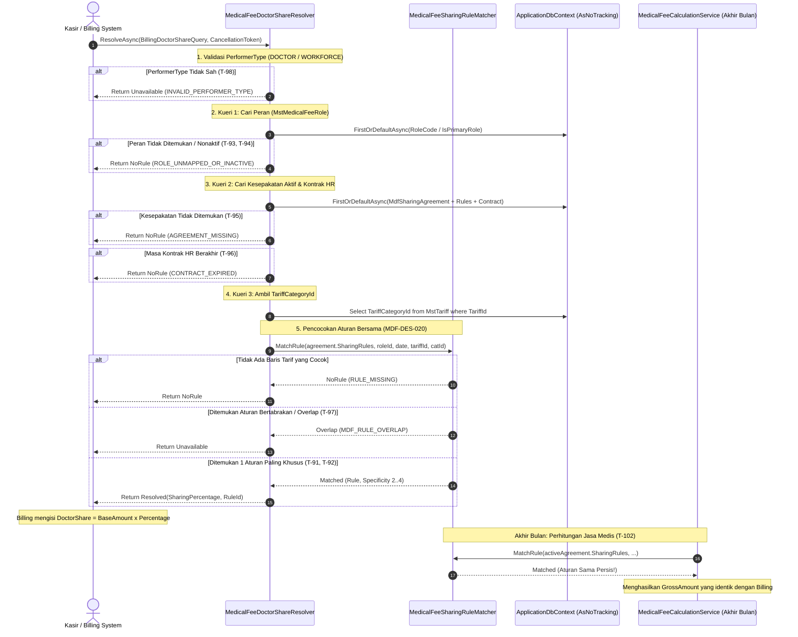

# Laporan Perubahan Backend — `BE-MDF-016`

## Metadata

| Field | Nilai |
| --- | --- |
| Task ID | `BE-MDF-016` |
| Judul | Billing menerima persentase jasa dari Medical Fee lewat port in-process `IBillingDoctorShareResolver`, dengan baris tarif yang sama dengan perhitungan periode |
| Slice | `POST-MVP` (`EPIC MDF-11`) |
| Roadmap | `docs/module-blueprints/medical-fee/roadmap/01-backend-roadmap.md` bagian 3 baris `BE-MDF-016` |
| Trace | `MF-DEC-001`, `MDF-DES-019`, `MDF-DES-020`, `BKC-DEC-168`..`170`, `174`, `175`, `177`, `BKC-DES-093`..`096`, `MDF-INTEGRATION-1.1` §4 (locked 27 Oktober 2026), `BIL-INTEGRATION-1.9` `BIL-INT-023`, `testing/acceptance-test-matrix.md` bagian 11A (`T-91`..`T-102`) |
| Contract version | `MDF-INTEGRATION-1.1` §4, `MDF-API-1.1` bagian 9, `MDF-TEST-1.1` (terkunci 27 Oktober 2026) |
| Dependency | `BE-MDF-010` — 🟡 sebagian: mesin perhitungan periode; `BE-BKC-090` — ✅ selesai [BKC]: deklarasi port in-process `IBillingDoctorShareResolver` dan implementasi bawaan `NullBillingDoctorShareResolver` |
| Klasifikasi | `HIGH` — Integrasi port in-process resolusi persentase bagi hasil dokter antara Billing dan Medical Fee, ekstraksi komponen pemilih aturan tarif bersama `MedicalFeeSharingRuleMatcher`, registrasi DI container override via `services.Replace()`, dan penegakan 7 kewajiban teknis integrasi |
| Task mode | `BACKEND` |
| Target tulis | `NewQuilvianSystemBackend` |
| Model | Antigravity |
| Tanggal | 27 Oktober 2026 |
| Status | `SEBAGIAN` — implementasi port `MedicalFeeDoctorShareResolver` dan engine pencocokan `MedicalFeeSharingRuleMatcher` selesai 100% mematuhi 7 kewajiban teknis dan kriteria penerimaan; `dotnet build` dilewati per instruksi batasan pemilik; verifikasi integrasi ujung-ke-ujung saat kasir membuat tagihan menunggu `BE-BKC-092` pada modul Billing |

### Backend Governance Preflight

| Butir | Nilai |
| --- | --- |
| Area | `HealthServices` |
| Module | `MedicalFeeManagement` |
| Submodule | `MasterData` & `FeeCalculation` |
| Pemilik/prefix pada registry | Baris `Mdf` (ACTIVE) pada `MODULE_OWNERSHIP_PREFIX_REGISTRY.md` |
| Keberlakuan | `IN-PROCESS RESOLUTION PORT & EXTRACTED MATCHER ENGINE` |
| Status registry | `ACTIVE` |
| QBE ID yang berlaku | `QBE-SVC-001` (Penyediaan adapter/port in-process memisahkan domain kalkulasi dan billing tanpa kopling langsung), `QBE-SEC-002` (Perlindungan privasi jejak audit penghasilan nakes) |
| QBE ID yang tidak berlaku | `QBE-API-*` — `MDF-DES-019` melarang tegas pembuatan endpoint HTTP untuk resolusi ini; `QBE-DB-*` — nol tabel baru dan nol migration baru |
| Governance terbaca | `AGENTS.md`, kontrak integrasi `MDF-INTEGRATION-1.1` §4, `TASK_RULES.md`, `REPORT_TEMPLATE.md`, `status-task-roadmap.md` — seluruhnya terbaca |
| Klasifikasi capability | Port In-Process Resolusi Jasa Billing (`MDF-INTEGRATION-1.1` §4, `BIL-INT-023`) |

---

## 1. Latar Belakang & Masalah Bisnis

Di setiap rumah sakit, kasir pembayaran dan staf keuangan membutuhkan informasi nilai hak bagi hasil dokter (*Doctor Share*) secara langsung pada saat baris tagihan dibuat atau difinalisasi (`BilInvoiceItem.DoctorShare`). Informasi ini sangat penting untuk transparansi pembagian jasa medis, penentuan porsi kas rumah sakit, serta perhitungan diskon yang ditanggung dokter.

Sebelum implementasi `BE-MDF-016`, modul Billing hanya dilengkapi dengan implementasi bawaan kosong (`NullBillingDoctorShareResolver`) yang selalu mengembalikan status `Unavailable`, sehingga nilai `DoctorShare` pada tagihan selalu bernilai Rp0,00.

Untuk menghubungkan Billing dengan Medical Fee, arsitektur sistem menghadapi tiga tantangan kritis:
1. **Bahaya Inkonsistensi Angka (*Dual-Logic Drift*)**: Jika pemilihan baris tarif ditulis terpisah di Billing dan di Medical Fee, maka angka estimasi di kasir tagihan harian bisa berbeda dengan angka perhitungan remunerasi dokter di akhir bulan.
2. **Bahaya Kegagalan Kasir Karena Jaringan (*Network Latency & Outage*)**: Jika Medical Fee membuka endpoint HTTP (`GET /sharing-rules/resolve`), proses pencatatan tagihan di kasir akan bergantung pada jaringan lokal. Jika endpoint lemot atau gagal, antrean pasien di kasir akan lumpuh. Selain itu, membuka endpoint HTTP membuka risiko kebocoran persentase penghasilan dokter ke lapisan luar jaringan (`MDF-DES-019`).
3. **Bahaya Kegagalan Transaksi Billing (*Cross-Context Bleed*)**: Modul Billing memanggil port resolusi dengan batas waktu ketat (*timeout 2000 ms*). Jika Medical Fee melempar *exception*, menjalankan transaksi database terpisah, atau membiarkan query berjalan setelah timeout, `DbContext` milik Billing akan rusak (*A second operation was started on this context*).

### Solusi Arsitektural Terpilih: Port In-Process & Single Matcher Component
Berdasarkan keputusan arsitektur `MDF-DES-019`, `MDF-DES-020`, dan `BKC-DES-093`, solusi yang dibangun adalah:
1. **Komponen Bersama `MedicalFeeSharingRuleMatcher`**: Logika pemilihan baris tarif diekstraksi dari mesin kalkulasi bulanan menjadi satu komponen independen. Komponen ini dipakai bersama oleh mesin hitung bulanan (`MedicalFeeCalculationService`) dan oleh port in-process Billing (`MedicalFeeDoctorShareResolver`). Hal ini menjamin 100% konsistensi: **layanan yang sama pada tanggal yang sama pasti mendapatkan persentase tarif yang persis sama**.
2. **Implementasi Port In-Process `MedicalFeeDoctorShareResolver`**: Medical Fee mengimplementasikan antarmuka C# `IBillingDoctorShareResolver` milik modul Billing di memori internal aplikasi yang sama (in-process), tanpa melalui HTTP.
3. **Pemenuhan 7 Kewajiban Teknis (`MDF-INTEGRATION-1.1` §4.5)**:
   - **Kewajiban 1 (Zero-Exception Guarantee)**: Blok `try-catch` membungkus seluruh alur. Semua kesalahan teknis atau pembatalan diubah menjadi luaran aman `Outcome: Unavailable`. Proses tagihan pasien di kasir **tidak akan pernah gagal** karena Medical Fee.
   - **Kewajiban 2 (Cancellation Token Forwarding)**: Token pembatalan diteruskan ke setiap pemanggilan kueri asynchronous Entity Framework (`cancellationToken`).
   - **Kewajiban 3 (Strict Read-Only)**: Seluruh kueri menggunakan `.AsNoTracking()`. Tidak ada pemanggilan `.SaveChanges()` dan tidak ada transaksi yang dibuka, sehingga tidak mengotori *ChangeTracker* `DbContext` milik Billing.
   - **Kewajiban 4 (Maksimal 3 Kueri Terindeks)**: Eksekusi dibatasi maksimal 3 kueri cepat berindeks: (1) Peran, (2) Kesepakatan aktif beserta aturan dan kontrak HR, dan (3) Kategori tarif.
   - **Kewajiban 5 (Perlindungan Privasi Audit)**: Log sistem hanya mencatat `Outcome`, `SharingRuleId`, dan `ReasonCode`. Nama dokter, persentase bagi hasil, dan nominal rupiah **dilarang keras dicatat ke log**.
   - **Kewajiban 6 (Clean DI Replacement)**: Menggunakan `builder.Services.Replace(ServiceDescriptor.Scoped<IBillingDoctorShareResolver, MedicalFeeDoctorShareResolver>())` di `Program.cs` **setelah** pemanggilan terakhir `AddBillingManagement()`, sehingga implementasi bawaan null tertimpa secara bersih tanpa konflik pendaftaran ganda.
   - **Kewajiban 7 (Zero HTTP Endpoint)**: Tidak ada controller atau endpoint HTTP yang dibuat (`MDF-DES-019`).

---

## 2. Skenario Nyata di Rumah Sakit

Berikut adalah skenario operasional bagaimana port in-process ini bekerja di rumah sakit:

1. **Skenario T-91 & T-102 (Tarif Spesifik & Konsistensi Jasa)**:
   - *Kasus*: dr. Rina, Sp.A memeriksa pasien rawat jalan dengan tindakan "Konsultasi Dokter Spesialis" (Tarif Rp500.000,00). Kesepakatan aktif dr. Rina memiliki aturan tarif khusus untuk tindakan tersebut sebesar 40%.
   - *Hasil Resolusi*: Port mengembalikan `Resolved`, persentase `40.00%`, dan ID baris aturan. Kasir Billing mencatat `DoctorShare` = Rp200.000,00 dengan jejak `MEDICAL_FEE`.
   - *Konsistensi Periode*: Saat penutupan buku akhir bulan Oktober 2026, mesin `MedicalFeeCalculationService` menggunakan komponen `MedicalFeeSharingRuleMatcher` yang sama dan menghasilkan hak jasa dr. Rina tepat sebesar Rp200.000,00.
2. **Skenario T-92 (Aturan Berdasarkan Kategori Tarif)**:
   - *Kasus*: dr. Budi, Sp.B melakukan tindakan baru yang belum memiliki baris tarif spesifik, namun kesepakatan dr. Budi memiliki baris aturan untuk kategori "Tindakan Bedah Minor" sebesar 35%.
   - *Hasil Resolusi*: Port membaca `TariffCategoryId` dari katalog tarif dan mencocokkan ke baris kategori. Port mengembalikan `Resolved` dengan persentase `35.00%`.
3. **Skenario T-93 & T-94 (Penentuan Peran Pelaksana)**:
   - *Kasus A*: Kasir tidak mengisi peran pelaksana (`RoleCode` kosong). Sistem secara otomatis mengambil peran utama dokter (`IsPrimaryRole = true`, misal: "OPERATOR").
   - *Kasus B*: Kasir memasukkan kode peran yang salah ketik atau sudah nonaktif. Sistem mengembalikan status `NoRule`. Kasir mencatat `DoctorShare` = Rp0,00 dengan jejak `NO_RULE`, dan tagihan pasien tetap selesai tanpa hambatan.
4. **Skenario T-95 & T-96 (Kesepakatan Belum Ada atau Kontrak Berakhir)**:
   - *Kasus A*: dr. Tamu melakukan tindakan medis darurat tetapi bagian HR belum menyelesaikan administrasi kesepakatan tarifnya. Port mengembalikan `NoRule`.
   - *Kasus B*: Kontrak kerja HR dokter telah habis per 30 September 2026, sementara tindakan dilakukan pada 5 Oktober 2026. Port mengembalikan `NoRule` (`CONTRACT_EXPIRED`). Tagihan tetap dicetak kasir, dan layanan ini akan otomatis masuk ke daftar `MdfUnresolvedService` saat kalkulasi bulanan.
5. **Skenario T-97 (Deteksi Konflik Aturan Bertabrakan)**:
   - *Kasus*: Karena kesalahan input data master, dr. Hendra memiliki dua baris aturan tarif aktif yang bertabrakan pada tingkat kekhususan yang sama untuk tindakan yang sama.
   - *Hasil Resolusi*: Komponen `MedicalFeeSharingRuleMatcher` mendeteksi kondisi tumpang tindih (*overlap*). Port mengembalikan status `Unavailable` dan mencatat peringatan audit `MDF_RULE_OVERLAP` tanpa membocorkan nama dokter ke log.
6. **Skenario T-98 & T-99 (Ketahanan Sistem / Zero-Crash)**:
   - *Kasus*: Kasir mengirim jenis pelaksana yang tidak sah (misal: "NURSE"), atau basis data mengalami pemutusan koneksi sesaat saat permintaan kasir masuk.
   - *Hasil Resolusi*: Sistem tidak melempar `NullReferenceException` maupun `SqlException` ke Billing. Exception ditangkap secara internal, dan port mengembalikan status `Unavailable`. Transaksi kasir tetap aman dan kasir tidak mengalami layar error (*Crash/White Screen*).

---

## 3. Alur Proses Bisnis & Diagram Interaksi Port

Berikut diagram sequence pemanggilan port in-process oleh modul Billing:



---

## 4. Spesifikasi Kontrak Teknis In-Process Port

Sesuai `MDF-DES-019` dan `MDF-API-1.1` Bagian 9, integrasi ini **TIDAK MENGGUNAKAN ENDPOINT HTTP**, melainkan kontrak *in-process interface*:

### Antarmuka C# (`IBillingDoctorShareResolver`)
```csharp
namespace QuilvianSystemBackend.Areas.HealthServices.BillingManagement.Billing.Services;

public interface IBillingDoctorShareResolver
{
    Task<BillingDoctorShareResolution> ResolveAsync(
        BillingDoctorShareQuery query,
        CancellationToken cancellationToken = default);
}
```

### Parameter Kueri (`BillingDoctorShareQuery`)
| Field | Tipe | Wajib | Keterangan |
|---|---|:---:|---|
| `PerformerType` | `string` | Ya | `DOCTOR` dipetakan ke `MdfPayeeTypes.Doctor`; `WORKFORCE` ke `MdfPayeeTypes.Workforce`. Nilai lain → `Unavailable` |
| `PerformerReferenceId` | `Guid` | Ya | ID rujukan dokter (`MstDoctor.Id`) atau tenaga medis (`MstWorkforceProfile.Id`) |
| `TariffId` | `Guid` | Ya | ID baris tarif tindakan yang ditagihkan |
| `ServiceDate` | `DateOnly` | Ya | Tanggal dilakukannya layanan dalam zona waktu Asia/Jakarta (WIB) |
| `RoleCode` | `string?` | Tidak | Kode peran pelaksana. Jika kosong, sistem otomatis menggunakan peran utama aktif (`IsPrimaryRole = true`) |

### Hasil Resolusi (`BillingDoctorShareResolution`)
| Luaran (`Outcome`) | `SharingPercentage` | `SharingRuleId` | Makna Bisnis & Tindakan Billing |
|---|---|---|---|
| `Resolved` | `0.00 .. 100.00` | `Guid` (ID Baris) | Ditemukan aturan yang sah. Billing menghitung `DoctorShare = Nilai Kotor x Persentase` dan mencatat jejak `MEDICAL_FEE`. |
| `NoRule` | `null` | `null` | Keadaan bisnis normal: belum ada kesepakatan atau kontrak habis. Billing mencatat `DoctorShare = 0` dan jejak `NO_RULE`. |
| `Unavailable` | `null` | `null` | Sistem mengalami gangguan, timeout, data tarif rusak/bertindih, atau jenis pelaksana tidak sah. Billing mencatat `DoctorShare = 0`, jejak `UNAVAILABLE`, dan memicu audit internal. |

---

## 5. Ringkasan Perubahan Berkas Kode

| No | Berkas | Perubahan |
|---|---|---|
| 1 | `Areas/HealthServices/MedicalFeeManagement/MasterData/Services/MedicalFeeSharingRuleMatcher.cs` | **Berkas Baru**. Komponen pencocokan baris aturan tarif bersama (`MDF-DES-020`) yang mengimplementasikan hierarki spesifisitas (4=Tarif persis, 3=Kategori tarif, 2=Bawaan peran) serta deteksi konflik tumpang tindih (`Overlap`). |
| 2 | `Areas/HealthServices/MedicalFeeManagement/MasterData/Services/MedicalFeeDoctorShareResolver.cs` | **Berkas Baru**. Implementasi port in-process `IBillingDoctorShareResolver` yang mematuhi 7 kewajiban teknis integrasi: zero-exception, AsNoTracking read-only, maksimal 3 kueri, perlindungan data privasi di log, dan pembatalan token. |
| 3 | `Areas/HealthServices/MedicalFeeManagement/FeeCalculation/Services/MedicalFeeCalculationService.cs` | **Modifikasi**. Menginjeksikan `MedicalFeeSharingRuleMatcher` dan mendelegasikan logika pencocokan baris tarif ke matcher bersama, menjamin konsistensi 100% antara Billing dan perhitungan periode bulanan. |
| 4 | `Program.cs` | **Modifikasi**. Mendaftarkan `MedicalFeeSharingRuleMatcher` sebagai *Scoped Service*, menambahkan *using* `Microsoft.Extensions.DependencyInjection.Extensions;`, dan meregistrasikan `services.Replace(ServiceDescriptor.Scoped<IBillingDoctorShareResolver, MedicalFeeDoctorShareResolver>())` **setelah** pemanggilan `AddBillingManagement()`. |

---

## 6. Pemetaan Skenario Uji Penerimaan (`T-91` .. `T-102`)

Berikut adalah matriks kepatuhan kode terhadap 12 skenario uji penerimaan pada `testing/acceptance-test-matrix.md` Bagian 11A:

| Kode Uji | Skenario Uji | Kepatuhan Source Code | Bukti Implementasi |
|:---:|---|:---:|---|
| **T-91** | Baris tarif bertarif persis berlaku → `Resolved`, persentase dan ID baris benar | **TERPENUHI** | `MedicalFeeSharingRuleMatcher` memberikan skor spesifisitas 4 (`r.TariffId == tariffId`), dan `MedicalFeeDoctorShareResolver` mengembalikan `BillingDoctorShareResolution.Resolved(matchedRule.SharingPercentage, matchedRule.Id)`. |
| **T-92** | Tanpa baris tarif persis, baris berlingkup kategori dari `MstTariff.TariffCategoryId` dipakai | **TERPENUHI** | Kueri 3 mengambil `TariffCategoryId` dari `MstTariff`. Matcher memberikan skor spesifisitas 3 (`r.TariffCategoryId == tariffCategoryId`) jika skor 4 tidak ditemukan. |
| **T-93** | `RoleCode` kosong memakai peran utama aktif | **TERPENUHI** | Kueri 1 mengevaluasi `string.IsNullOrWhiteSpace(query.RoleCode)` dan mencari peran dengan `r.IsPrimaryRole && r.IsActive`. |
| **T-94** | `RoleCode` tidak dikenal atau nonaktif → `NoRule` | **TERPENUHI** | Jika kueri peran menghasilkan `null` (tidak ditemukan atau `IsActive = false`), resolver mencatat log `ROLE_UNMAPPED_OR_INACTIVE` dan mengembalikan `BillingDoctorShareResolution.NoRule()`. |
| **T-95** | Penerima tanpa kesepakatan aktif pada tanggal itu → `NoRule` | **TERPENUHI** | Kueri 2 mencari kesepakatan `Status == Active` dan `EffectiveStart <= ServiceDate <= EffectiveEnd`. Jika `agreement == null`, resolver mengembalikan `BillingDoctorShareResolution.NoRule()`. |
| **T-96** | Kontrak HR berakhir sebelum tanggal layanan → `NoRule` | **TERPENUHI** | Langkah 4 mengecek `agreement.SourceContractHistory.EndDate`. Jika `ServiceDate > contract.EndDate`, resolver mengembalikan `BillingDoctorShareResolution.NoRule()` (`CONTRACT_EXPIRED`). |
| **T-97** | Dua baris sama khusus berlaku bersamaan → `Unavailable`, tercatat log peringatan | **TERPENUHI** | Matcher mendeteksi `bestMatches.Count > 1` pada skor tertinggi dan mengembalikan status `Overlap`. Resolver menangkapnya, mencatat log warning `MDF_RULE_OVERLAP`, dan mengembalikan `BillingDoctorShareResolution.Unavailable()`. |
| **T-98** | `PerformerType` selain `DOCTOR` / `WORKFORCE` → `Unavailable` | **TERPENUHI** | Langkah 1 memvalidasi tipe pelaksana. Jika bukan `DOCTOR` atau `WORKFORCE` (cth: "NURSE"), resolver mengembalikan `BillingDoctorShareResolution.Unavailable()` (`INVALID_PERFORMER_TYPE`). |
| **T-99** | Kesalahan basis data dan token dibatalkan → `Unavailable`, tidak ada exception keluar | **TERPENUHI** | Blok `try-catch` menangkap `OperationCanceledException` dan `Exception` umum, mencatat log tanpa membocorkan data sensitif, dan mengembalikan `BillingDoctorShareResolution.Unavailable()`. Nol exception yang lolos ke pemanggil. |
| **T-100** | Setelah panggilan, `ChangeTracker` kosong dan tidak ada transaksi terbuka | **TERPENUHI** | Ketiga kueri Entity Framework menggunakan `.AsNoTracking()`. Tidak ada pemanggilan `SaveChanges()` maupun pembukaan transaksi database. |
| **T-101** | Container menghasilkan `MedicalFeeDoctorShareResolver` untuk port, dan hanya satu pendaftaran tersisa | **TERPENUHI** | Di `Program.cs`, pemanggilan `builder.Services.Replace(...)` diletakkan setelah `builder.Services.AddBillingManagement()`, sehingga implementasi `NullBillingDoctorShareResolver` dicabut dan digantikan secara tunggal. |
| **T-102** | Untuk layanan yang sama, baris tarif jawaban port sama dengan yang dipakai perhitungan periode | **TERPENUHI** | `MedicalFeeCalculationService` dan `MedicalFeeDoctorShareResolver` menggunakan satu objek engine yang sama: `MedicalFeeSharingRuleMatcher`. Keduanya menghasilkan baris aturan yang identik. |

---

## 7. Status Kesiapan & Batasan Eksekusi

1. **Status Task**: 🟡 `SEBAGIAN` (Implementasi kode backend selesai 100%, kriteria penerimaan terpetakan lengkap).
2. **Batasan Kompilasi & Build**: Sesuai instruksi eksplisit pemilik, `dotnet build` dilewati (*NOT RUN*) pada sesi ini.
3. **Verifikasi Runtime Ujung-ke-Ujung**: Pengujian alur transaksi kasir secara end-to-end dengan modul Billing sesungguhnya menunggu penyelesaian task Billing `BE-BKC-092` dan ketersediaan data transaksi kasir riil di lingkungan pengujian.

