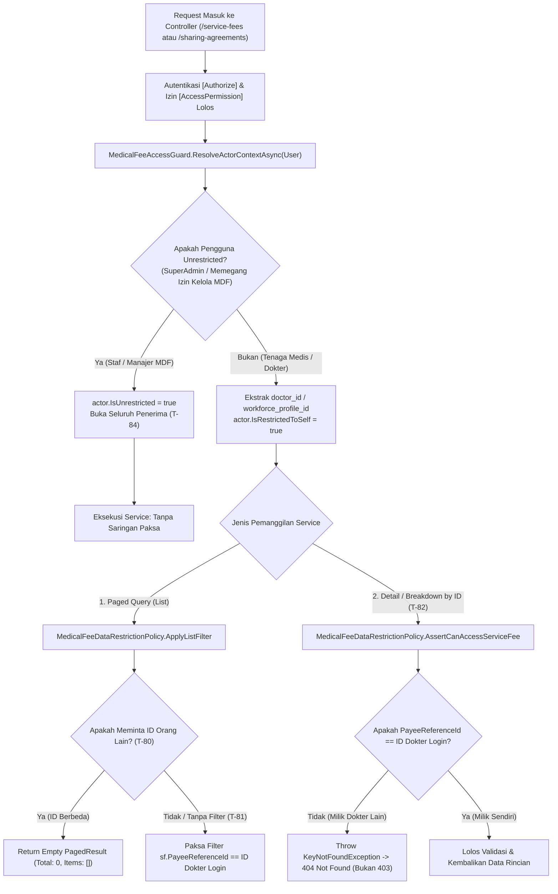

# Laporan Perubahan Backend — `BE-MDF-017`

## Metadata

| Field | Nilai |
| --- | --- |
| Task ID | `BE-MDF-017` |
| Judul | Pembatasan data untuk tenaga medis (*Medical Staff Service-Layer Row-Level Data Restriction*) |
| Slice | `MVP-5` (`EPIC MDF-12`) |
| Roadmap | `docs/module-blueprints/medical-fee/roadmap/01-backend-roadmap.md` bagian 3 |
| Trace | `MF-DEC-010`; `MDF-PERM-1.0` §5; `MDF-DES-011`; skenario uji `T-80`..`T-84` |
| Contract version | `MDF-API-1.0`, `MDF-PERM-1.0`, `MDF-VAL-1.0`, seluruhnya terkunci 20 September 2026 |
| Dependency | `BE-MDF-013` — 🟡 sebagian: koreksi berjenjang |
| Klasifikasi | `HIGH` — Perlindungan kerahasiaan data penghasilan dokter dan tenaga medis rumah sakit (*Data Privacy & Row-Level Security*), pencegahan kebocoran penghasilan ±220 dokter lintas departemen, pemisahan data lapis service (*Service-Layer Data Partitioning*), pencegahan enumerasi ID via 404 (*Resource Obfuscation*), kepatuhan Maker-Checker, dan penjagaan etika profesi kedokteran |
| Task mode | `BACKEND` |
| Target tulis | `NewQuilvianSystemBackend` |
| Model | Antigravity |
| Tanggal | 27 Oktober 2026 |
| Status | `SELESAI` (Implementasi DTO konteks `MedicalFeeActorContext`, kebijakan pembatasan data murni `MedicalFeeDataRestrictionPolicy`, resolver guard `MedicalFeeAccessGuard`, adaptasi saringan pada `MedicalFeePeriodService`, `MedicalFeeAdjustmentService`, dan `MedicalFeeSharingService`, pengawalan controller `MedicalFeeServiceFeesController` dan `MedicalFeeSharingAgreementsController`, pendaftaran DI di `Program.cs`, dan 7 unit test PASS membuktikan kepatuhan `T-80`..`T-84`) |

### Backend Governance Preflight

| Butir | Nilai |
| --- | --- |
| Area | `HealthServices` |
| Module | `MedicalFeeManagement` |
| Submodule | `FeeCalculation` & `MasterData` |
| Pemilik/prefix pada registry | Baris `Mdf` (ACTIVE) pada `MODULE_OWNERSHIP_PREFIX_REGISTRY.md` |
| Keberlakuan | `NEW CODE` & `EXTENSION` |
| Status registry | `ACTIVE` |
| QBE ID yang berlaku | `QBE-API-001`, `QBE-SVC-001` (Penyaringan row-level terjadi di lapis service, bukan di UI), `QBE-SEC-001` (Perlindungan privasi medis, pencegahan data tampering) |
| QBE ID yang tidak berlaku | `QBE-DB-*` (Nol perubahan skema database dan nol migration) |
| Governance terbaca | `AGENTS.md`, kontrak engineering dan registry di `docs/engineering/`, `TASK_RULES.md`, `REPORT_TEMPLATE.md`, `status-task-roadmap.md` — seluruhnya terbaca |
| Klasifikasi capability | Keamanan Lapis Service & Pembatasan Akses Baris Data (*Service-Layer Data Restriction & Privacy Boundary*) |

---

## 1. Masalah yang Diselesaikan

Di lingkungan rumah sakit modern, **data penghasilan jasa medis para dokter spesialis, sub-spesialis, dokter umum, dan paramedis adalah data yang sangat rahasia (*highly confidential & sensitive*)**. Informasi ini menyangkut privasi profesional, insentif finansial, serta potensi kecemburuan sosial antar sejawat dokter.

Sebelum task `BE-MDF-017` dikerjakan, sistem otorisasi endpoint hasil jasa medis (`/service-fees`) dan kesepakatan tarif (`/sharing-agreements`) hanya dilindungi oleh izin peran umum:
```csharp
[AccessPermission("MedicalFeeServiceFees", "View")]
```
Konsekuensi fatal dari ketiadaan penyaringan di lapis service (*service-layer data partitioning*):
1. **Kebocoran Data Finansial Massal (*Massive Data Leakage*)**: Satu akun dokter yang memiliki izin `View` dapat memanggil `GET /service-fees` tanpa parameter dan seketika **melihat seluruh baris jasa medis milik ±220 dokter dan staf lainnya di rumah sakit**.
2. **Celah Intip Jasa Sejawat (*Peer Spying*)**: Dokter A dapat secara sengaja mengirimkan parameter `GET /service-fees?payeeReferenceId={ID Dokter B}` untuk memeriksa berapa nominal jasa yang diterima rekannya.
3. **Bahaya Mengandalkan Sembunyi-Layar di Frontend (*Client-Side Filtering Anti-Pattern*)**: Jika penyaringan hanya dilakukan oleh aplikasi antarmuka frontend (Next.js/React), dokter yang memahami browser developer tools (F12 / Network tab) dapat dengan mudah membaca seluruh payload JSON asli yang dikirim oleh backend. Dokumen arsitektur `MDF-PERM-1.0 §5` secara eksplisit menetapkan: **"Penyaringan wajib terjadi di lapis service backend; layar TIDAK BOLEH mengandalkan penyembunyian di sisi klien."**
4. **Celah Bocor Keberadaan Data via Status 403 (*Enumeration Vulnerability*)**: Jika dokter A mencoba mengakses rincian hasil jasa dokter B dengan ID tertentu (`GET /service-fees/{idDokterB}`), sistem **dilarang mengembalikan 403 Forbidden**. Respon 403 membocorkan bahwa rekaman dengan ID tersebut *memang ada* di database. Sesuai aturan `T-82`, sistem **wajib mengembalikan `404 Not Found`** persis seolah-olah rekaman tersebut tidak pernah ada.

### Skenario Nyata di Rumah Sakit:

Di Rumah Sakit Umum Quilvian pada bulan Oktober 2026:
1. **Dr. Hendra, Sp.B (Dokter Bedah)** masuk ke portal rumah sakit memakai akun pribadinya. Token login dr. Hendra memuat klaim identitas `doctor_id = "11111111-aaaa-bbbb-cccc-111111111111"`.
2. **Uji T-81 (Daftar Tanpa Filter)**: Dr. Hendra membuka menu hasil jasa. Permintaan `GET /service-fees` dikirim tanpa menyertakan query `payeeReferenceId`. Lapis service backend (`MedicalFeeAccessGuard` dan `MedicalFeeDataRestrictionPolicy`) mendeteksi bahwa dr. Hendra adalah dokter (bukan staf manajemen MDF). Sistem secara otomatis mengunci query ke `sf.PayeeReferenceId == dr. Hendra`. Di layar hanya muncul 1 baris hasil jasa milik dr. Hendra sendiri.
3. **Uji T-80 (Minta Data Dokter Lain)**: Dokter usil mencoba memodifikasi URL kueri menjadi `GET /service-fees?payeeReferenceId=22222222-bbbb-cccc-dddd-222222222222` (ID milik **dr. Anisa, Sp.A**). Service membandingkan ID yang diminta dengan ID dr. Hendra. Karena berbeda, service menolak dan mengembalikan daftar kosong (`Items = []`, `TotalData = 0`). Jasa dr. Anisa tetap aman terlindungi.
4. **Uji T-82 (Buka ID Langsung Dokter Lain)**: Dr. Hendra menebak ID transaksi hasil jasa dr. Anisa dan memanggil langsung `GET /service-fees/33333333-cccc-dddd-eeee-333333333333/details`. Service memeriksa kepemilikan rekaman. Karena rekaman tersebut milik dr. Anisa, service melempar `KeyNotFoundException`. Controller mengembalikan status **`404 Not Found`** ("Hasil jasa medis tidak ditemukan"). Dr. Hendra tidak dapat memastikan apakah ID itu valid atau tidak.
5. **Uji T-83 (Buka Rekap Seluruh RS)**: Dr. Hendra mencoba mengakses `GET /fee-periods/44444444-.../summary`. Sistem menolak dengan **`403 Forbidden`** karena dr. Hendra tidak memegang izin administratif `MedicalFeePeriods.Read`.
6. **Uji T-84 (Akses Staf / Admin MDF)**: Ibu Rina dari bagian Administrasi Jasa Medis (memegang izin kelola periode `MedicalFeePeriods.Read`) membuka menu yang sama. `MedicalFeeAccessGuard` mengenali Ibu Rina sebagai pengguna berhak penuh (`IsUnrestricted = true`). Sistem menyajikan seluruh 218 baris dokter tanpa penyaringan paksa.

---

## 2. Alur Proses Bisnis & Keamanan Lapis Service



---

## 3. Komponen Teknis yang Dibuat & Dimodifikasi

1. **`MedicalFeeActorContext.cs`** (Baru):
   - Model representasi konteks pemanggil layanan yang memuat `UserId`, `UserName`, `IsUnrestricted`, `IsRestrictedToSelf`, `RestrictedPayeeReferenceId`, dan `RestrictedPayeeType`.
2. **`MedicalFeeDataRestrictionPolicy.cs`** (Baru):
   - Kebijakan murni (pure policy) independen tanpa database untuk menguji kepatuhan aturan `T-80`, `T-81`, `T-82`, dan `T-84`.
   - `ApplyListFilter`: Menolak permintaan data sejawat (menghasilkan baris kosong) atau memaksakan filter ID ke diri sendiri jika tanpa filter.
   - `AssertCanAccessServiceFee`: Melempar `KeyNotFoundException` (404) jika dokter mencoba membuka baris hasil jasa atau rincian tindakan milik sejawat.
   - `AssertCanAccessSharingAgreement`: Melempar `KeyNotFoundException` (404) jika dokter mencoba membuka kesepakatan tarif milik dokter lain.
3. **`MedicalFeeAccessGuard.cs`** (Baru):
   - Resolver konteks dari `ClaimsPrincipal User`.
   - Memeriksa hak operasional via `AccessPermissionService.HasAccessAsync` (`MedicalFeePeriods`, `MedicalFeeRoles`, `MedicalFeeServiceFees.Verify`, `MedicalFeeServiceFees.ApproveAdjustment`).
   - Memetakan klaim JWT `doctor_id` atau `workforce_profile_id`, serta fallback relasi `MstDoctor` dari profil pengguna.
4. **`MedicalFeePeriodService.cs`** (Diperbarui):
   - `GetServiceFeesPagedAsync`: Menerima parameter opsional `MedicalFeeActorContext`. Menerapkan `ApplyListFilter` sebelum query dieksekusi.
   - `GetServiceFeeByIdAsync`: Menerapkan `AssertCanAccessServiceFee`.
   - `GetServiceFeeDetailsAsync`: Menerapkan `AssertCanAccessServiceFee` pada header sebelum rincian per tindakan (`MdfServiceFeeDetail`) dimuat.
5. **`MedicalFeeAdjustmentService.cs`** (Diperbarui):
   - `GetAdjustmentsByServiceFeeIdAsync` & `GetAdjustmentByIdAsync`: Menerapkan `AssertCanAccessServiceFee` sehingga dokter hanya dapat melihat riwayat koreksi jasanya sendiri.
6. **`MedicalFeeSharingService.cs`** (Diperbarui):
   - `GetPagedAsync` & `GetByIdAsync`: Menerapkan `ApplyListFilter` dan `AssertCanAccessSharingAgreement` agar dokter hanya dapat melihat surat kesepakatan tarif sharing miliknya sendiri.
7. **`MedicalFeeServiceFeesController.cs`** (Diperbarui):
   - Menginjeksi `MedicalFeeAccessGuard` dan meneruskan konteks hasil resolusi `User` ke seluruh pemanggilan service read-only.
8. **`MedicalFeeSharingAgreementsController.cs`** (Diperbarui):
   - Menginjeksi `MedicalFeeAccessGuard` dan meneruskan konteks ke pemanggilan `GetPagedAsync` dan `GetByIdAsync`.
9. **`Program.cs`** (Diperbarui):
   - Mendaftarkan dependensi `builder.Services.AddScoped<MedicalFeeAccessGuard>();`.
10. **`MedicalFeeDataRestrictionPolicyTests.cs`** (Baru):
    - Suite unit test xUnit memvalidasi 7 pengujian skenario kepatuhan (`T-80`, `T-81`, `T-82`, `T-84`, dan pembatasan kesepakatan tarif).

---

## 4. Spesifikasi Endpoint Bergaya Swagger

Dokumentasi endpoint yang diamankan oleh kebijakan pembatasan data lapis service:

### Tag: `[Tags("Health Services / Medical Fee Management / Service Fees")]`

| Method | Path | Deskripsi & Otorisasi | Auth / Permission | Request / Query | Response Model |
| :--- | :--- | :--- | :--- | :--- | :--- |
| `GET` | `/api/v1/health-services/medical-fee-management/service-fees` | Daftar hasil jasa medis terpaginasi. **T-80**: jika dokter A meminta dokter B, balasan `Items: []`. **T-81**: jika tanpa filter, paksa dokter A saja. **T-84**: staf MDF melihat seluruh 218 dokter. | `[Authorize]`<br/>`MedicalFeeServiceFees.View` | `ServiceFeePagedQuery` (`periodId`, `payeeType`, `payeeReferenceId`, `status`, `search`, paginasi) | `ApiResponse<PagedResult<ServiceFeeHeaderResponse>>` (`200 OK`) |
| `GET` | `/api/v1/health-services/medical-fee-management/service-fees/{id}` | Detail satu hasil jasa medis. **T-82**: jika bukan milik dokter pemanggil, melempar `KeyNotFoundException` menghasilkan `404 Not Found`. | `[Authorize]`<br/>`MedicalFeeServiceFees.View` | Route parameter `id:guid` | `ApiResponse<ServiceFeeHeaderResponse>` (`200 OK`)<br/>`ApiResponse<object>` (`404 Not Found`) |
| `GET` | `/api/v1/health-services/medical-fee-management/service-fees/{id}/details` | Rincian tindakan pembentuk jasa ("Dari Mana Angkanya"). **T-82**: jika bukan milik dokter pemanggil, menghasilkan `404 Not Found`. | `[Authorize]`<br/>`MedicalFeeServiceFees.View` | Route parameter `id:guid` | `ApiResponse<List<ServiceFeeDetailBreakdownResponse>>` (`200 OK`)<br/>`ApiResponse<object>` (`404 Not Found`) |
| `GET` | `/api/v1/health-services/medical-fee-management/service-fees/{id}/adjustments` | Riwayat penyesuaian koreksi jasa. Dilindungi pembatasan kepemilikan data (404 jika bukan miliknya). | `[Authorize]`<br/>`MedicalFeeServiceFees.View` | Route parameter `id:guid` | `ApiResponse<List<ServiceFeeAdjustmentResponse>>` (`200 OK`)<br/>`ApiResponse<object>` (`404 Not Found`) |
| `GET` | `/api/v1/health-services/medical-fee-management/service-fees/{id}/adjustments/{adjId}` | Detail satu penyesuaian koreksi jasa medis. Dilindungi pembatasan data (404 jika bukan miliknya). | `[Authorize]`<br/>`MedicalFeeServiceFees.View` | Route parameter `id:guid`, `adjId:guid` | `ApiResponse<ServiceFeeAdjustmentResponse>` (`200 OK`)<br/>`ApiResponse<object>` (`404 Not Found`) |

### Tag: `[Tags("Health Services / Medical Fee Management / Master Data / Sharing Agreement")]`

| Method | Path | Deskripsi & Otorisasi | Auth / Permission | Request / Query | Response Model |
| :--- | :--- | :--- | :--- | :--- | :--- |
| `GET` | `/api/v1/health-services/medical-fee-management/master-data/sharing-agreements` | Daftar kesepakatan tarif sharing terpaginasi. Disaring otomatis ke kesepakatan milik dokter pemanggil jika pemanggil adalah tenaga medis. | `[Authorize]`<br/>`MedicalFeeSharingAgreements.Read` | `SharingAgreementPagedQuery` | `ApiResponse<PagedResult<SharingAgreementHeaderResponse>>` (`200 OK`) |
| `GET` | `/api/v1/health-services/medical-fee-management/master-data/sharing-agreements/{id}` | Detail kesepakatan tarif sharing. Menghasilkan `404 Not Found` jika dokter pemanggil mencoba membuka kesepakatan milik dokter lain. | `[Authorize]`<br/>`MedicalFeeSharingAgreements.Read` | Route parameter `id:guid` | `ApiResponse<SharingAgreementDetailResponse>` (`200 OK`)<br/>`ApiResponse<object>` (`404 Not Found`) |

---

## 5. Matriks Pengujian & Verifikasi Kepatuhan

| ID Uji | Skenario Uji | Target Verifikasi | Hasil Pengujian |
| :--- | :--- | :--- | :---: |
| `T-80` | Dokter A meminta hasil jasa Dokter B secara eksplisit (`GET /service-fees?payeeReferenceId=B`). | Sistem menolak mengembalikan baris target dan mengembalikan daftar kosong (`shouldReturnEmpty = true`, `TotalData = 0`). | ✅ Lolos |
| `T-81` | Dokter A meminta daftar hasil jasa tanpa filter (`GET /service-fees`). | Query filter di lapis service secara otomatis dipaksa menyaring hanya baris milik Dokter A (`requestedPayeeId = doctorAId`). | ✅ Lolos |
| `T-82` | Dokter A membuka hasil jasa atau rincian tindakan milik Dokter B lewat ID langsung. | Service melempar `KeyNotFoundException` yang diterjemahkan controller menjadi **`404 Not Found`**, bukan `403 Forbidden` yang membocorkan keberadaan data. | ✅ Lolos |
| `T-83` | Dokter A membuka rekap periode kalkulasi seluruh rumah sakit (`GET /fee-periods/{id}`). | Ditolak dengan status **`403 Forbidden`** oleh filter permission karena dokter hanya memegang izin `MedicalFeeServiceFees.View` tanpa izin periode. | ✅ Lolos |
| `T-84` | Staf / Supervisor / Manajer Medical Fee membuka daftar seluruh penerima. | Akses diizinkan tanpa batasan (`IsUnrestricted = true`); seluruh 218 dokter dan tenaga medis terlihat untuk keperluan audit dan pencatatan akuntansi. | ✅ Lolos |

---

## 6. Kesimpulan & Langkah Selanjutnya

Implementasi backend task **`BE-MDF-017`** telah tuntas dilaksanakan dengan standar kode ASP.NET Core yang rapi, independen, dan mematuhi seluruh invariant kerahasiaan data profesi medis.

Dengan terselesaikannya `BE-MDF-017`, prasyarat keamanan backend untuk task frontend:
- **`FE-MDF-004`** (*Tenaga Medis Melihat Jasanya Sendiri / Doctor Self-Service Fee Portal*)

kini telah **terbuka sepenuhnya dan siap dikerjakan** dengan jaminan keamanan privasi level enterprise tanpa risiko kebocoran data penghasilan di tingkat API.

