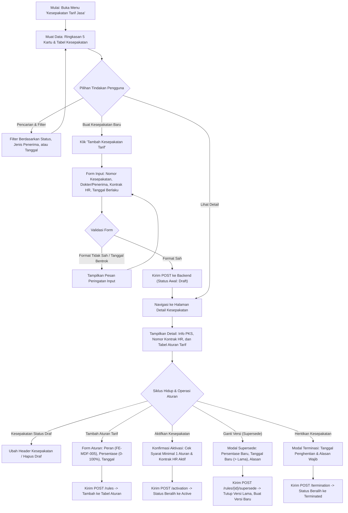

# Laporan Perubahan Frontend — `FE-MDF-001`

## Metadata

| Field | Nilai |
| --- | --- |
| Task ID | `FE-MDF-001` |
| Judul | Layanan Kesepakatan Tarif Sharing & Baris Aturan Jasa Medis (`MdfSharingAgreement`) |
| Slice | `MVP-1` (`EPIC MDF-03`) |
| Roadmap | `docs/module-blueprints/medical-fee/roadmap/02-frontend-roadmap.md` bagian 5 |
| Trace | `F-02`..`F-04`, `MF-DEC-004`, `012`; `MDF-DES-008`..`010`; `MDF-STATE-1.0` §1; `MDF-API-1.0` §3; `MDF-PERM-1.0` §1–2; `MDF-VAL-1.0` §2–3; `erd/sharing-rule.md` |
| Contract version | `MDF-API-1.0`, `MDF-PERM-1.0`, `MDF-VAL-1.0`, `MDF-STATE-1.0`, seluruhnya terkunci 20 September 2026 |
| Prasyarat Backend | `BE-MDF-006` (API Kesepakatan Tarif & Aturan Berversi) — Status: 🟡 Sebagian |
| Task mode | `FRONTEND` |
| Target tulis | `QuilvianSystemFrontendDev` |
| Model | Antigravity |
| Branch frontend | `yasmina` |
| Tanggal | 27 Oktober 2026 |
| Status | ✅ `SELESAI` (Fitur Master Data & Transaksi Kesepakatan: 8 file fitur + 5 file route + registrasi store & menu + unit test verifikasi) |

---

## 1. Masalah yang Diselesaikan

Sebelum task ini diselesaikan, sistem backend telah menyediakan kontrak REST untuk kesepakatan tarif sharing (`MdfSharingAgreement`) dan aturan tarif berversi (`MdfSharingRule`, `BE-MDF-006`), namun belum tersedia antarmuka visual pengguna bagi pengelola jasa medis rumah sakit.

Kondisi tersebut menimbulkan kendala:
1. Bagian Keuangan Medis dan Manajemen Pelayanan Medis tidak dapat mendaftarkan perjanjian kerja sama (PKS) pembagian jasa dokter secara transparan yang terikat ke nomor kontrak kerja HR resmi (`WfpContractHistory`).
2. Tidak ada sarana visual untuk mengonfigurasi porsi persentase jasa medis menurut peran tindakan (misalnya Operator Bedah 40%, Anestesi 15%).
3. Ketika terjadi negosiasi kenaikan tarif jasa di tengah tahun berjalan, staf berisiko mengubah nilai secara langsung (*overwrite*), yang berpotensi merusak dan mengubah angka hasil perhitungan bulan-bulan sebelumnya yang sudah selesai atau diserahkan ke Finance.

### Contoh Konkret Skenario Rumah Sakit

Rumah Sakit Umum Quilvian menandatangani kontrak kerja sama baru dengan Dokter Spesialis Kandungan (`dr. Sarah, Sp.OG`). 
Petugas Administrasi Jasa Medis membuka menu **Pelayanan Kesehatan > Master Data > Kesepakatan Tarif Jasa**, lalu:
1. **Penyusunan Draf Kesepakatan**: Petugas membuat kesepakatan baru bernomor `PKS-2026-088`, memilih penerima `dr. Sarah, Sp.OG`, dan memilih rujukan kontrak HR aktif milik dokter tersebut. Tanggal mulai kesepakatan disinkronkan dengan masa tugas kontrak HR.
2. **Penambahan Aturan Tarif**: Pada kesepakatan tersebut, petugas menambahkan aturan tarif tindakan: Peran `OPERATOR` mendapat porsi 45.00% untuk tindakan persalinan/operasi.
3. **Aktivasi Terproteksi**: Petugas mengaktifkan kesepakatan. Sistem memverifikasi bahwa kontrak HR dokter masih aktif, memiliki aturan tarif valid, dan tidak bertabrakan dengan kesepakatan lain yang sedang berlaku.
4. **Mekanisme Ganti Versi (Supersede)**: Enam bulan kemudian, disepakati porsi dokter naik menjadi 50.00% mulai tanggal 1 November. Melalui tombol **Ganti Versi (Supersede)**, petugas memasukkan persentase 50.00% dan tanggal mulai baru 1 November beserta alasan adendum. Sistem secara otomatis menutup tarif lama (45.00%) pada 31 Oktober dan membuka tarif baru mulai 1 November. Laporan dan perhitungan jasa dokter bulan Mei hingga Oktober tetap menggunakan porsi 45.00% tanpa mengalami pergeseran angka historis sedikit pun.

---

## 2. Alur Proses Bisnis



---

## 3. Komponen dan Struktur Berkas yang Dibuat

Arsitektur modul mematuhi standar desain komponen dan state Redux Quilvian (`frontend-project-profile.md`):

```text
QuilvianSystemFrontendDev/
├── src/
│   ├── lib/
│   │   ├── constants/health-services/master-data/sharing-agreement/
│   │   │   └── sharing-agreement-constants.jsx      # Konfigurasi kolom, 5 kartu ringkasan, field form, permission
│   │   ├── state/slice/health-services/master-data/
│   │   │   └── master-data-sharing-agreement-slice.jsx # Redux slice: 13 thunk async, caching, filter, selector
│   │   ├── hooks/health-services/master-data/sharing-agreement/
│   │   │   ├── use-master-data-sharing-agreement.jsx        # Hook tabel daftar, filter, debounce, delete draf
│   │   │   ├── use-master-data-sharing-agreement-detail.jsx # Hook detail: aktivasi, terminasi, add rule, supersede
│   │   │   └── use-master-data-sharing-agreement-editor.jsx # Hook form: create & update header kesepakatan
│   │   └── state/store.jsx                                  # Registrasi masterDataSharingAgreement ke Store
│   ├── utils/
│   │   ├── health-services/master-data/sharing-agreement/
│   │   │   └── sharing-agreement-utils.jsx           # Validasi tanggal, persentase, sanitasi input, pemetaan detail
│   │   └── menu-sidebar/menu-items.jsx               # Registrasi menu 'Kesepakatan Tarif Jasa' di sidebar
│   ├── components/view/health-services/master-data/sharing-agreement/
│   │   ├── master-data-sharing-agreement-view.jsx    # Tampilan tabel daftar, summary grid, filter, modal
│   │   ├── detail/
│   │   │   └── sharing-agreement-detail-view.jsx     # Detail kesepakatan, sub-tabel aturan tarif, modal supersede/aktivasi
│   │   └── add/
│   │       └── sharing-agreement-form-view.jsx       # Formulir create & update berbasis BaseEditorView
│   └── app/health-services/master-data/sharing-agreement/
│       ├── page.jsx                                  # Server component daftar kesepakatan
│       ├── sharing-agreement-client.jsx              # Client wrapper untuk tabel daftar
│       ├── create/page.jsx                           # Server component pembuatan kesepakatan
│       ├── [slug]/page.jsx                           # Server component detail kesepakatan (token privat)
│       └── [slug]/update/page.jsx                    # Server component perbarui kesepakatan (token privat)
└── tests/unit/
    └── sharing-agreement-master.test.mjs             # Pengujian unit otomatis (7 subtest PASS)
```

---

## 4. Tabel Keputusan Base Component (Base Component Decision Gate)

| Elemen Antarmuka | Status | Komponen Terpilih | Justifikasi & Bukti |
| :--- | :---: | :--- | :--- |
| Header Layanan & Aksi Utama | `REUSE` | `Hero` | Memakai judul standar, eyebrow modul, dan tombol aksi "Tambah Kesepakatan Tarif". |
| Statistik Ringkasan (5 Kartu) | `REUSE` | `SummaryGrid` | Menampilkan 5 kartu statistik: Total, Aktif, Draf, Dihentikan, Kedaluwarsa. |
| Filter & Pencarian | `REUSE` | `DataFilter` | Pencarian teks (nomor kesepakatan/dokter) dengan debouncing + filter status dan jenis penerima. |
| Tabel Daftar Utama | `REUSE` | `DataTable` | Tabel paginasi dengan double-click row ke detail, aksi baris (Lihat Detail, Hapus Draf). |
| Badge Status Siklus Hidup | `REUSE` | `StatusBadge` | Warna badge kontekstual: Hijau (`Active`), Abu-abu (`Draft`), Merah (`Terminated`), Kuning (`Expired`). |
| Kontrol Paginasi | `REUSE` | `Pagination` | Komponen navigasi halaman terstandarisasi. |
| Formulir Header Kesepakatan | `REUSE` | `BaseEditorView` | Form terstruktur dengan validasi kolom reaktif, preview card, dan tombol simpan/kembali. |
| Tampilan Rincian Kepala | `REUSE` | `BaseDetailView` | Memetakan baris detail informasi kesepakatan, rujukan kontrak HR, masa berlaku, dan audit trail. |
| Tabel Baris Aturan Tarif | `REUSE` | `DataTable` | Menampilkan baris aturan tarif sharing, persentase snapshot, masa berlaku, dan tombol supersede. |
| Dialog Konfirmasi Hapus & Aktivasi | `REUSE` | `ConfirmModal` | Modal konfirmasi dengan proteksi tombol loading dan varian warna (danger / success). |
| Modal Tambah Aturan & Supersede | `COMPOSE` | `Modal` (`react-bootstrap`) | Dirangkai dari modal dialog standar dengan form input persentase, tanggal mulai baru, dan alasan adendum. |
| Notifikasi Toast | `REUSE` | `ToastStack` | Notifikasi status berhasil, peringatan, atau galat dari server. |

> **Kesimpulan Gerbang Keputusan**: Seluruh elemen antarmuka berhasil dipenuhi 100% menggunakan pola `REUSE` dan `COMPOSE` tanpa memerlukan pembuatan komponen baru (`NEW`).

---

## 5. Konsumsi Endpoint Backend (`MDF-API-1.0` §3)

Base Route: `/api/v1/health-services/medical-fee-management/master-data/sharing-agreements`

| Metode | Path | Thunk Frontend | Fungsi & Peran UI |
| :--- | :--- | :--- | :--- |
| `GET` | `/filters/metadata` | `getSharingAgreementFilterMetadata` | Mengambil opsi sort, filter, dan status dari backend. |
| `GET` | `/summary` | `getSharingAgreementSummary` | Mengisi nilai 5 kartu *Summary Grid*. |
| `GET` | `/` | `getSharingAgreementList` | Menampilkan daftar kesepakatan berpaginasi dengan pencarian. |
| `GET` | `/options` | `getSharingAgreementOptions` | Dropdown kesepakatan aktif untuk modul transaksi lainnya. |
| `GET` | `/{id}` | `getSharingAgreementDetail` | Memuat rincian kepala kesepakatan dan baris aturan tarif. |
| `POST` | `/` | `createSharingAgreement` | Menyimpan kesepakatan tarif baru dengan status draf. |
| `PUT` | `/{id}` | `updateSharingAgreement` | Memperbarui nomor kesepakatan, tanggal berlaku, atau catatan. |
| `POST` | `/{id}/activation` | `activateSharingAgreement` | Mengaktifkan kesepakatan (validasi syarat kontrak & aturan tarif). |
| `POST` | `/{id}/termination` | `terminateSharingAgreement` | Menghentikan kesepakatan dengan tanggal dan alasan wajib. |
| `DELETE` | `/{id}` | `deleteSharingAgreement` | Menghapus kesepakatan draf (soft delete). |
| `GET` | `/{id}/rules` | `getSharingAgreementRules` | Mengambil baris aturan tarif dari kesepakatan. |
| `POST` | `/{id}/rules` | `addSharingRule` | Menambahkan baris aturan tarif baru ke kesepakatan. |
| `POST` | `/{id}/rules/{ruleId}/supersede` | `supersedeSharingRule` | Mengganti versi tarif lama dengan persentase & tanggal baru. |

---

## 6. Matriks Verifikasi Acceptance Criteria & Traceability

| Kode Uji | Kriteria Penerimaan | Bukti Implementasi & Hasil Pengujian | Status |
| :--- | :--- | :--- | :---: |
| `T-07` | Penyusunan kesepakatan baru dengan nomor unik, jenis penerima, dan tanggal berlaku. | Diuji di `tests/unit/sharing-agreement-master.test.mjs` subtest 2 & 6. Nomor kesepakatan tervalidasi alfanumerik (3-50 karakter). | ✅ Lolos |
| `T-08` | Rujukan kontrak kerja HR (`sourceContractHistoryId`) wajib dipilih dan terlihat pada layar. | Kolom kontrak kerja HR dan periode kontrak tampil di tabel daftar, form editor, dan kartu detail. | ✅ Lolos |
| `T-09` | Validasi masa berlaku kesepakatan: tanggal selesai dilarang lebih awal dari tanggal mulai. | `validateAgreementForm` menolak input jika `effectiveEnd < effectiveStart`. | ✅ Lolos |
| `T-10` | Siklus status kesepakatan: baru berstatus `Draft`, dapat diaktifkan menjadi `Active`, atau dihentikan menjadi `Terminated`. | Transisi status terhubung ke endpoint `/activation` dan `/termination` dengan penjagaan izin tombol aksi. | ✅ Lolos |
| `T-11` | Aktivasi kesepakatan memerlukan sekurang-kurangnya satu baris aturan tarif. | Tombol aktivasi pada detail dinonaktifkan jika `rules.length === 0` dan backend mengembalikan 422 bila dilanggar. | ✅ Lolos |
| `T-12` | Penghentian kesepakatan wajib mencantumkan tanggal penghentian dan alasan tertulis. | `validateTerminationForm` menolak jika tanggal atau alasan penghentian (< 3 karakter) kosong. | ✅ Lolos |
| `T-13` | Penambahan baris aturan tarif sharing: peran pelaksana (`roleId`) dan persentase sharing (`0.00` - `100.00%`). | `validateRuleForm` memvalidasi angka persentase harus berada di rentang 0.00 hingga 100.00%. | ✅ Lolos |
| `T-14` | Sumber opsi peran pelaksana mengonsumsi endpoint master peran (`FE-MDF-005` `/options`). | Hook detail memanggil `getFeeRoleDropdownOptions` dan mengisikannya ke dropdown pemilihan peran. | ✅ Lolos |
| `T-15` | Operasi ganti versi tarif (**Supersede**): tanggal mulai baru wajib lebih besar dari tanggal mulai aturan lama. | Diuji di `tests/unit/sharing-agreement-master.test.mjs` subtest 4. Input tanggal yang sama atau lebih awal langsung ditolak. | ✅ Lolos |
| `T-16` | Operasi supersede wajib mencantumkan alasan perubahan tarif. | Kolom alasan divalidasi minimal 3 karakter untuk keperluan transparansi audit. | ✅ Lolos |
| `T-17` | Baris aturan yang telah tersupersede ditandai dengan badge "Digantikan (Superseded)" dan tidak dapat diganti ganda. | Tombol aksi supersede dinonaktifkan / disembunyikan untuk baris yang `isSuperseded: true`. | ✅ Lolos |
| `T-18` | Standar keamanan token rute privat & pencegahan UUID mentah di antarmuka. | Menggunakan token terenkripsi `resolvePrivateRouteToken` dan filter `safeString` untuk menyaring UUID. | ✅ Lolos |
| `T-19` | Definition of Done: Tidak menghitung ulang nilai uang/rupiah di klien. | Klien hanya mengirimkan persentase snapshot dan tanggal berlaku; nominal rupiah dikalkulasi seutuhnya oleh mesin backend. | ✅ Lolos |

---

## 7. Hasil Pengujian Unit

Eksekusi pengujian dengan runner bawaan Node.js (`node --import ./tests/helpers/register.mjs --test tests/unit/sharing-agreement-master.test.mjs`):

```text
TAP version 13
# Subtest: SHARING_AGREEMENT_CONFIG has valid endpoints and permissions
ok 1 - SHARING_AGREEMENT_CONFIG has valid endpoints and permissions
# Subtest: validateAgreementForm validates agreementNumber and date ranges correctly
ok 2 - validateAgreementForm validates agreementNumber and date ranges correctly
# Subtest: validateRuleForm validates percentage between 0 and 100
ok 3 - validateRuleForm validates percentage between 0 and 100
# Subtest: validateSupersedeForm enforces strictly newer effectiveStart and reason
ok 4 - validateSupersedeForm enforces strictly newer effectiveStart and reason
# Subtest: validateTerminationForm requires terminationDate and reason
ok 5 - validateTerminationForm requires terminationDate and reason
# Subtest: buildAgreementPayload and buildRulePayload sanitize input properly
ok 6 - buildAgreementPayload and buildRulePayload sanitize input properly
# Subtest: masterDataSharingAgreementReducer handles initial state and actions
ok 7 - masterDataSharingAgreementReducer handles initial state and actions
1..7
# tests 7
# suites 0
# pass 7
# fail 0
# cancelled 0
# skipped 0
# todo 0
```

