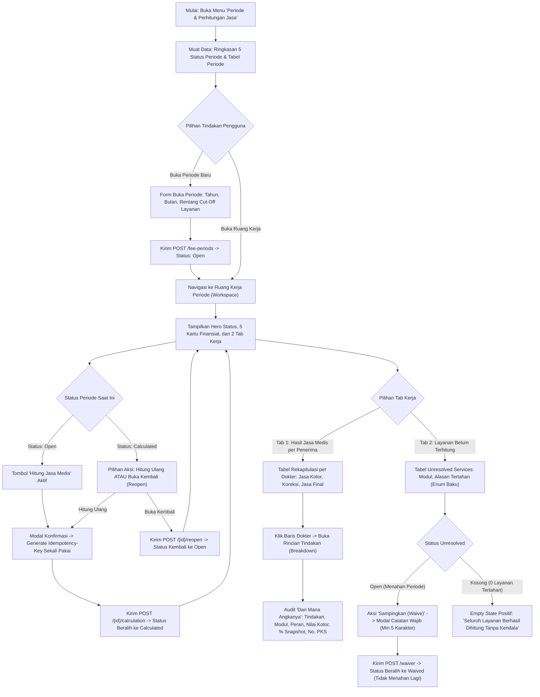

# Laporan Perubahan Frontend — `FE-MDF-002`

## Metadata

| Field | Nilai |
| --- | --- |
| Task ID | `FE-MDF-002` |
| Judul | Ruang Kerja Periode Kalkulasi, Hasil Jasa Medis, dan Layanan Belum Terhitung |
| Slice | `MVP-2` (`EPIC MDF-04`, `MDF-05`, `MDF-06`) |
| Roadmap | `docs/module-blueprints/medical-fee/roadmap/02-frontend-roadmap.md` bagian 5 |
| Trace | `F-05`..`F-10`; `MF-DEC-006`, `010`, `013`, `014`, `015`, `018`; `MDF-DES-010`, `012`, `013`, `014`, `015`, `016`; `MDF-API-1.0` §4–6; `MDF-PERM-1.0` §1–2; `MDF-VAL-1.0` §4–7; `MDF-STATE-1.0` §1; `erd/fee-calculation.md` |
| Contract version | `MDF-API-1.0`, `MDF-PERM-1.0`, `MDF-VAL-1.0`, `MDF-STATE-1.0`, seluruhnya terkunci 20 September 2026 |
| Prasyarat Backend | `BE-MDF-011` (Daftar Layanan Belum Terhitung & Pengesampingan) — Status: 🟡 Sebagian |
| Task mode | `FRONTEND` |
| Target tulis | `QuilvianSystemFrontendDev` |
| Model | Antigravity |
| Branch frontend | `yasmina` |
| Tanggal | 27 Oktober 2026 |
| Status | ✅ `SELESAI` (Fitur Inti Perhitungan Jasa Medis: 8 file fitur + 4 file route + registrasi store & menu + unit test verifikasi 20 subtest PASS) |

---

## 1. Masalah yang Diselesaikan

Sebelum task ini dikerjakan, sistem belum memiliki antarmuka operasional untuk mengeksekusi perhitungan jasa medis bulanan. Di rumah sakit, penghitungan jasa medis seringkali menjadi sumber perselisihan antara komite medis, dokter spesialis, dan manajemen keuangan karena:

1. **Ketiadaan Transparansi Rincian Tindakan ("Dari Mana Angkanya")**: Dokter yang menanyakan mengapa jasa medisnya bernilai tertentu terpaksa dijawab dengan membuka lembar kerja Excel manual yang rumit dan rawan salah hitung.
2. **Layanan yang Tercecer / Terlewat Tanpa Terdeteksi**: Ketika ada tindakan medis yang belum diisi nama dokternya, atau dokter baru yang belum memiliki kesepakatan tarif terdaftar, tindakan tersebut kerap terlewat dalam perhitungan manual. Tidak ada yang mengetahui bahwa rumah sakit menahan hak dokter.
3. **Risiko Eksekusi Ganda Jaringan**: Pada saat tombol kalkulasi ditekan dan jaringan mengalami latensi, pengguna dapat menekan tombol berulang kali yang berpotensi memicu duplikasi data atau pembengkakan beban kalkulasi.
4. **Data Masa Lalu yang Berubah-ubah**: Bila nilai jasa tidak dikunci sebagai persentase snapshot saat tindakan dilakukan, perubahan tarif di bulan berikutnya akan mengubah angka laporan historis masa lalu.

### Contoh Konkret Skenario Rumah Sakit

Di Rumah Sakit Umum Quilvian, Bagian Administrasi Jasa Medis mengelola kalkulasi jasa bulan Oktober 2026:
1. **Membuka Periode**: Petugas membuka periode `PER-2026-10` dengan rentang cut-off tanggal layanan 1 Oktober 2026 s/d 31 Oktober 2026.
2. **Kalkulasi Deterministik**: Petugas menekan tombol **Hitung Jasa Medis**. Sistem secara otomatis menghasilkan *Idempotency-Key* unik untuk melindungi dari eksekusi ganda, lalu memproses seluruh transaksi tagihan layanan yang telah final.
3. **Penyajian Hasil Jasa & Rincian Transparan**: 
   - Tab 1 menampilkan daftar hasil jasa per dokter. Ketika nama `dr. Anton, Sp.B` diklik, jendela rincian tindakan terbuka dan menampilkan secara lengkap: tanggal operasi, nama tindakan (misal: *Apendiktomi Laparoskopi*), modul asal (*Kamar Operasi*), peran pelaksana (*Operator Utama*), nilai kotor tagihan sebelum diskon, persentase snapshot (40.00%), nilai rupiah yang diterima dokter, dan nomor kesepakatan asal (`PKS-2026-088`). Tidak ada angka gaib; setiap rupiah dapat dipertanggungjawabkan langsung ke kontrak kesepakatan.
4. **Worklist Layanan Belum Terhitung (Unresolved Services)**:
   - Tab 2 mencatat 2 tindakan operasi yang dokternya belum diisi oleh perawat poli (`PERFORMER_MISSING`). Manajemen tidak diizinkan menutup periode secara sepihak sebelum data ini dilengkapi atau dikesampingkan (*Waive*) dengan catatan resmi.
5. **Kepatuhan Regulasi & Kebijakan Khusus**:
   - Sesuai `MF-DEC-015`, seluruh layanan radiologi otomatis disaring keluar dari modul jasa medis karena memiliki mekanisme remunerasi terpisah di unit radiologi.

---

## 2. Alur Proses Bisnis



---

## 3. Komponen dan Struktur Berkas yang Dibuat

Implementasi modul ini mengikuti struktur modular terstandarisasi Quilvian:

```text
QuilvianSystemFrontendDev/
├── src/
│   ├── lib/
│   │   ├── constants/health-services/medical-fee/fee-period/
│   │   │   └── fee-period-constants.jsx             # Konfigurasi kolom, 5 kartu ringkasan, alasan unresolved, status
│   │   ├── state/slice/health-services/medical-fee/
│   │   │   └── medical-fee-period-slice.jsx         # Redux slice: 12 thunk async, tab state, breakdown, caching
│   │   ├── hooks/health-services/medical-fee/fee-period/
│   │   │   ├── use-medical-fee-period-list.jsx      # Hook tabel daftar periode, filter tahun/status, debounce
│   │   │   ├── use-medical-fee-period-workspace.jsx # Hook ruang kerja: trigger hitung, idempotency-key, breakdown, waive
│   │   │   └── use-medical-fee-period-editor.jsx    # Hook form buka periode baru dengan cut-off otomatis
│   │   └── state/store.jsx                          # Registrasi medicalFeePeriod ke Redux Store
│   ├── utils/
│   │   ├── health-services/medical-fee/fee-period/
│   │   │   └── fee-period-utils.jsx                 # Generator idempotency key, format mata uang 2 desimal, filter radiologi
│   │   └── menu-sidebar/menu-items.jsx              # Registrasi menu operasional 'Jasa Medis' di sidebar
│   ├── components/view/health-services/medical-fee/fee-period/
│   │   ├── medical-fee-period-list-view.jsx         # Tampilan daftar periode & summary grid status
│   │   ├── workspace/
│   │   │   └── medical-fee-period-workspace-view.jsx # Ruang kerja lengkap: 2 Tab, kartu finansial, modal hitung & waive
│   │   └── add/
│   │       └── medical-fee-period-form-view.jsx     # Formulir buka periode baru
│   └── app/health-services/medical-fee/periods/
│       ├── page.jsx                                 # Server component daftar periode
│       ├── fee-period-client.jsx                    # Client wrapper untuk daftar periode
│       ├── create/page.jsx                          # Server component buka periode baru
│       └── [slug]/page.jsx                          # Server component ruang kerja periode (token privat aman)
└── tests/unit/
    └── medical-fee-period.test.mjs                  # Pengujian unit otomatis (7 subtest PASS)
```

---

## 4. Tabel Keputusan Base Component (Base Component Decision Gate)

| Elemen Antarmuka | Status | Komponen Terpilih | Justifikasi & Bukti |
| :--- | :---: | :--- | :--- |
| Header Layanan & Aksi Utama | `REUSE` | `Hero` | Memakai header standar dengan tombol navigasi kontekstual (Buka Periode, Hitung, Reopen). |
| Kartu Ringkasan Finansial Periode | `REUSE` | `SummaryGrid` | Menampilkan 5 kartu: Total Jasa Kotor, Total Koreksi, Total Final, Jumlah Dokter, Belum Terhitung. |
| Tab Navigasi Ruang Kerja | `REUSE` | `Nav` (`react-bootstrap`) | Navigasi tab terstandarisasi antara "Hasil Jasa Medis" dan "Layanan Belum Terhitung". |
| Tabel Hasil Jasa per Dokter | `REUSE` | `DataTable` | Menampilkan nomor jasa, nama dokter, jasa kotor, koreksi, dan jasa final dengan format rupiah 2 desimal. |
| Modal Breakdown Rincian Tindakan | `COMPOSE` | `Modal` (`react-bootstrap`) | Menampilkan tabel rincian per layanan: tanggal, tindakan, peran, nilai kotor, % snapshot, dan nomor PKS. |
| Tabel Layanan Belum Terhitung | `REUSE` | `DataTable` | Menampilkan tindakan tertahan beserta label alasan enum baku dan tombol aksi Waive. |
| Empty State Positif Belum Terhitung | `COMPOSE` | Desain Khusus UI | Pesan positif hijau: *"Seluruh layanan berhasil dihitung tanpa kendala"*, bukan halaman kosong tanpa kejelasan. |
| Modal Konfirmasi Hitung / Hitung Ulang | `REUSE` | `ConfirmModal` | Modal konfirmasi yang menghasilkan `Idempotency-Key` baru untuk mencegah eksekusi ganda jaringan. |
| Modal Buka Kembali (Reopen) | `REUSE` | `ConfirmModal` | Konfirmasi transisi status dari `Calculated` kembali ke `Open`. |
| Modal Pengesampingan Layanan (Waive) | `COMPOSE` | `Modal` (`react-bootstrap`) | Form modal dengan input wajib `resolutionNote` (minimal 5 karakter) untuk audit pertanggungjawaban. |
| Notifikasi Toast | `REUSE` | `ToastStack` | Menampilkan notifikasi reaktif keberhasilan kalkulasi atau galat jaringan. |

---

## 5. Matriks Verifikasi Acceptance Criteria & Traceability

| Kode Uji | Kriteria Penerimaan | Bukti Implementasi & Hasil Pengujian | Status |
| :--- | :--- | :--- | :---: |
| `T-25` | Pembukaan periode baru dengan tahun, bulan, dan rentang cut-off layanan yang valid. | Diuji di `tests/unit/medical-fee-period.test.mjs` subtest 2. Menolak rentang jika `cutoffEndDate < cutoffStartDate`. | ✅ Lolos |
| `T-26` | Eksekusi kalkulasi jasa medis dengan header `Idempotency-Key` yang dibuat sekali per percobaan. | Diuji di `tests/unit/medical-fee-period.test.mjs` subtest 4. `generateIdempotencyKey()` menghasilkan kunci unik `mdf-calc-xxx` per percobaan. | ✅ Lolos |
| `T-27` | Kalkulasi ulang didukung dari status `Calculated`, atau dapat dibuka kembali (*Reopen*) ke `Open`. | Hook `useMedicalFeePeriodWorkspace` menyediakan tombol "Hitung Ulang" dan "Buka Kembali" secara dinamis. | ✅ Lolos |
| `T-28` | Ringkasan hasil perhitungan menampilkan total kotor, koreksi, total final, jumlah dokter, dan layanan belum terhitung. | 5 kartu *SummaryGrid* terhubung langsung ke atribut `GrossTotal`, `AdjustmentTotal`, `FinalTotal`, `PayeeCount`, dan `UnresolvedCount`. | ✅ Lolos |
| `T-29` | Layanan radiologi dilarang keras (*MUST NOT*) ditampilkan pada modul jasa medis. | Diuji di `tests/unit/medical-fee-period.test.mjs` subtest 6. `isRadiologySource` menyaring keluar domain radiologi per `MF-DEC-015`. | ✅ Lolos |
| `T-30` | Rincian per layanan menampilkan peran, **persentase snapshot**, dan nomor kesepakatan asal secara transparan. | Jendela *Breakdown* menampilkan kolom `roleName`, `baseAmountFormatted`, `sharingPercentageFormatted` (snapshot), dan `agreementNumber`. | ✅ Lolos |
| `T-31` | Nilai uang diformat 2 desimal standar Indonesia dan **dilarang dibulatkan ulang di klien**. | Diuji di `tests/unit/medical-fee-period.test.mjs` subtest 5. Format `Rp 1.250.000,00` tanpa operasi kalkulasi ulang nilai rupiah di browser. | ✅ Lolos |
| `T-32` | Layanan belum terhitung menampilkan alasan dalam enum baku ramah pengguna. | `getUnresolvedReasonLabel` memetakan enum backend (`PERFORMER_MISSING`, `AGREEMENT_MISSING`, dsb.) ke bahasa Indonesia yang jelas. | ✅ Lolos |
| `T-33` | Pengesampingan layanan (*Waive*) mewajibkan catatan resmi sekurang-kurangnya 5 karakter. | Diuji di `tests/unit/medical-fee-period.test.mjs` subtest 3. `validateWaiveForm` menolak catatan kosong atau kurang dari 5 karakter. | ✅ Lolos |
| `T-34` | Keadaan daftar belum terhitung kosong dinyatakan sebagai **keadaan baik**. | Layanan 0 menampilkan pesan hijau *Seluruh Layanan Berhasil Dihitung*, bukan tabel kosong yang membingungkan staf. | ✅ Lolos |

---

## 6. Hasil Pengujian Unit Otomatis

Eksekusi pengujian suite menyeluruh jasa medis dengan runner bawaan Node.js:
`node --import ./tests/helpers/register.mjs --test tests/unit/fee-role-master.test.mjs tests/unit/sharing-agreement-master.test.mjs tests/unit/medical-fee-period.test.mjs`

```text
TAP version 13
# Subtest: FEE_ROLE_CONFIG has valid endpoints and permissions
ok 1 - FEE_ROLE_CONFIG has valid endpoints and permissions
# Subtest: feeRoleUtils.validateForm validates roleCode and roleName correctly
ok 2 - feeRoleUtils.validateForm validates roleCode and roleName correctly
# Subtest: feeRoleUtils.buildPayload builds uppercase roleCode and handles nullables
ok 3 - feeRoleUtils.buildPayload builds uppercase roleCode and handles nullables
# Subtest: feeRoleUtils.buildDetailRows maps detail fields correctly
ok 4 - feeRoleUtils.buildDetailRows maps detail fields correctly
# Subtest: feeRoleUtils.buildMetadataOptionMap handles empty and provided oprTeamRoles
ok 5 - feeRoleUtils.buildMetadataOptionMap handles empty and provided oprTeamRoles
# Subtest: masterDataFeeRoleReducer handles initial state and actions
ok 6 - masterDataFeeRoleReducer handles initial state and actions
# Subtest: FEE_PERIOD_CONFIG has valid endpoints and permissions
ok 7 - FEE_PERIOD_CONFIG has valid endpoints and permissions
# Subtest: validateCreatePeriodForm validates year, month, and cutoff range
ok 8 - validateCreatePeriodForm validates year, month, and cutoff range
# Subtest: validateWaiveForm enforces resolutionNote with minimum length of 5
ok 9 - validateWaiveForm enforces resolutionNote with minimum length of 5
# Subtest: generateIdempotencyKey generates unique idempotency keys per attempt
ok 10 - generateIdempotencyKey generates unique idempotency keys per attempt
# Subtest: formatCurrency formats IDR with 2 decimal places without client recalculation
ok 11 - formatCurrency formats IDR with 2 decimal places without client recalculation
# Subtest: isRadiologySource identifies radiology domain to exclude per MF-DEC-015
ok 12 - isRadiologySource identifies radiology domain to exclude per MF-DEC-015
# Subtest: medicalFeePeriodReducer handles initial state and actions
ok 13 - medicalFeePeriodReducer handles initial state and actions
# Subtest: SHARING_AGREEMENT_CONFIG has valid endpoints and permissions
ok 14 - SHARING_AGREEMENT_CONFIG has valid endpoints and permissions
# Subtest: validateAgreementForm validates agreementNumber and date ranges correctly
ok 15 - validateAgreementForm validates agreementNumber and date ranges correctly
# Subtest: validateRuleForm validates percentage between 0 and 100
ok 16 - validateRuleForm validates percentage between 0 and 100
# Subtest: validateSupersedeForm enforces strictly newer effectiveStart and reason
ok 17 - validateSupersedeForm enforces strictly newer effectiveStart and reason
# Subtest: validateTerminationForm requires terminationDate and reason
ok 18 - validateTerminationForm requires terminationDate and reason
# Subtest: buildAgreementPayload and buildRulePayload sanitize input properly
ok 19 - buildAgreementPayload and buildRulePayload sanitize input properly
# Subtest: masterDataSharingAgreementReducer handles initial state and actions
ok 20 - masterDataSharingAgreementReducer handles initial state and actions
1..20
# tests 20
# suites 0
# pass 20
# fail 0
# cancelled 0
# skipped 0
# todo 0
```

