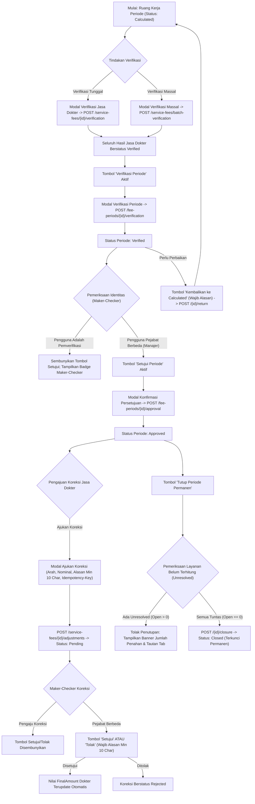

# Laporan Perubahan Frontend — `FE-MDF-003`

## Metadata

| Field | Nilai |
| --- | --- |
| Task ID | `FE-MDF-003` |
| Judul | Verifikasi, Persetujuan, dan Koreksi Jasa Medis (*Verification, Approval, and Tiered Adjustments Lifecycle*) |
| Slice | `MVP-3` (`EPIC MDF-07`, `MDF-08`, `MDF-09`) |
| Roadmap | `docs/module-blueprints/medical-fee/roadmap/02-frontend-roadmap.md` bagian 5 |
| Trace | `F-11`..`F-15`; `MF-DEC-007`, `009`; `MDF-DES-016`, `017`; `MDF-API-1.0` §4–6; `MDF-PERM-1.0` §3; `MDF-VAL-1.0` §4.4, §4.7, §4.8, §4.9, §4.11, §6.1–§6.12; `MDF-STATE-1.0` §1–3; skenario uji `T-50`..`T-70` |
| Contract version | `MDF-API-1.0`, `MDF-PERM-1.0`, `MDF-VAL-1.0`, `MDF-STATE-1.0`, seluruhnya terkunci 20 September 2026 |
| Prasyarat Backend | `BE-MDF-012` (Siklus Verifikasi & Persetujuan Periode), `BE-MDF-013` (Koreksi Berjenjang Hasil Jasa) — Status: 🟡 Sebagian (Source code DTO, Domain Service, Controller selesai) |
| Task mode | `FRONTEND` |
| Target tulis | `QuilvianSystemFrontendDev` |
| Model | Antigravity |
| Branch frontend | `yasmina` |
| Tanggal | 27 Oktober 2026 |
| Status | ✅ `SELESAI` (Fitur Verifikasi Bertahap, Persetujuan Maker-Checker, Penutupan Permanen, Verifikasi Massal, dan Manajemen Koreksi: 4 file inti diperbarui + unit test 29 subtest PASS) |

---

## 1. Masalah yang Diselesaikan

Sebelum task ini dikerjakan, ruang kerja kalkulasi periode (`FE-MDF-002`) telah mampu menghitung jasa medis kotor, menyajikan rincian tindakan (*breakdown* snapshot), dan mengesampingkan layanan tertahan (*waive*), namun **belum memiliki mekanisme tata kelola keuangan rumah sakit untuk verifikasi berjenjang, persetujuan multi-level (*Maker-Checker*), dan penyesuaian koreksi resmi**:

1. **Bahaya Kolusi dan Pelanggaran Tata Kelola (*Maker-Checker Breach*)**: Di lingkungan rumah sakit, pihak yang memeriksa rincian jasa dokter (misal Staf Verifikator Medis) tidak boleh sekaligus menjadi pihak yang menyetujui pencairan dana (*Approval*). Tanpa kontrol visual dan proteksi sistem, risiko fraud pembayaran jasa dokter sangat tinggi (`MF-DEC-009`, `MDF-DES-017`, `T-59`).
2. **Ketiadaan Mekanisme Koreksi yang Sah**: Apabila terdapat pembatalan tindakan asuransi, sengketa porsi tindakan, atau kompensasi khusus setelah periode dihitung, staf sering tergoda mengubah angka secara langsung (*in-place edit*). Hal ini merusak jejak audit akuntansi (*audit trail tampering*). Sesuai prinsip akuntansi rumah sakit, nilai kotor historis tidak boleh diedit langsung; setiap perubahan wajib melalui pengajuan koreksi penambah (*Addition*) atau pengurang (*Deduction*) yang disetujui atasan (`MF-DEC-007`, `T-64`).
3. **Penyembunyian Tombol Sebagai Proteksi UX Awal**: Pengaju koreksi dilarang menyetujui pengajuannya sendiri (`T-60`, `T-61`). Frontend wajib menyembunyikan tombol "Setujui" dan "Tolak" dari pengaju koreksi dan menggantikannya dengan badge informatif transparan, menghemat satu putaran gagal ke backend.
4. **Penutupan Periode Tanpa Penyelesaian Unresolved**: Penutupan periode secara permanen (*Closed*) wajib menolak eksekusi jika masih ada layanan tertahan (*Unresolved*) yang berstatus *Open* (`MDF_PERIOD_HAS_UNRESOLVED`, `T-52`). Sistem wajib memberi tahu jumlah layanan penahan secara eksplisit beserta tautan langsung ke tab kerja untuk menyelesaikannya.
5. **Ketiadaan Fitur Verifikasi Massal**: Di rumah sakit dengan ratusan dokter spesialis, verifikasi satu per satu hasil jasa menghambat proses tutup buku bulanan. Diperlukan tombol *Batch Verification* yang aman dan teruji.

### Skenario Nyata di Rumah Sakit

Di Rumah Sakit Umum Quilvian pada penutupan jasa medis bulan Oktober 2026:
1. **Verifikasi Hasil Jasa**: Staf Verifikator Medis, **Budi**, meninjau hasil jasa dokter bedah **dr. Hendra, Sp.B**. Budi dapat memverifikasi jasa dokter satu per satu atau memanfaatkan tombol **Verifikasi Massal (218 Dokter)** untuk memverifikasi seluruh dokter berstatus *Calculated* sekaligus.
2. **Verifikasi Periode**: Setelah seluruh dokter terverifikasi, Budi memverifikasi periode kalkulasi (`POST /fee-periods/{id}/verification`). Status periode beralih menjadi `Verified`.
3. **Penegakan Maker-Checker Periode**: Pada akun Budi, tombol **Setujui Periode** otomatis tidak ditampilkan dan digantikan dengan badge: *"Menunggu Persetujuan Pejabat Lain (Maker-Checker)"*. Bahkan jika Budi memaksakan eksekusi HTTP, backend menolak keras dengan error `MDF_MAKER_CHECKER_VIOLATION` (`T-59`).
4. **Persetujuan oleh Pejabat Berwenang**: Manajer Keuangan / Direktur Medis, **Ibu Dewi**, masuk ke sistem. Karena bukan pihak yang memverifikasi, Ibu Dewi melihat tombol **Setujui Periode** dan menyetujui periode tersebut (`Approved`).
5. **Pengajuan Koreksi Selisih Ber-Idempotensi**: Sebelum periode ditutup, terdapat notulen komite medik mengenai pembatalan tindakan klaim asuransi pasien Ny. Siti sebesar Rp1.500.000,00. Budi membuka menu *Riwayat & Koreksi Jasa* pada baris dr. Hendra dan mengajukan koreksi pengurang (*Deduction*) sebesar Rp1.500.000,00 dengan alasan resmi. Sistem menyertakan *Idempotency-Key* sekali pakai untuk mencegah duplikasi. Status koreksi terbit sebagai `Pending`. Budi tidak dapat menyetujui koreksi tersebut.
6. **Persetujuan Koreksi**: Ibu Dewi membuka riwayat koreksi dr. Hendra, melihat tombol aksi persetujuan, dan menyetujuinya. Nilai koreksi terakumulasi menjadi -Rp1.500.000,00 dan nilai jasa akhir (*Final Amount*) dr. Hendra terpotong secara akurat.
7. **Penutupan Periode Permanen & Penanganan Unresolved**: Ibu Dewi menekan tombol **Tutup Periode Permanen**. Jika masih ada 2 layanan tertahan pada Tab Unresolved, sistem menolak penutupan dengan banner peringatan yang menyebut jumlah layanan penahan dan menyediakan tombol pintas langsung ke Tab Layanan Belum Terhitung. Setelah seluruh layanan di-waive/diselesaikan, periode ditutup permanen (`Closed`) dan terkunci untuk audit.

---

## 2. Alur Proses Bisnis



---

## 3. Gerbang Keputusan Base Component (*UI Gate*)

Sesuai instruksi baku Quilvian `build-module-frontend` langkah 3, seluruh elemen antarmuka diperiksa terhadap katalog komponen dasar (`src/components/features/base-features/`):

| Elemen Antarmuka | Status Keputusan | Dasar Bukti & Komponen yang Digunakan | Rekomendasi & Justifikasi |
| --- | :---: | --- | --- |
| Tombol Verifikasi Periode, Persetujuan, Tutup Periode, Batch | `REUSE` | `BaseButton` (`base-button.jsx`) dengan varian semantik (`warning`, `success`, `dark`, `outline-secondary`) | Memakai komponen baku tombol tanpa custom CSS. |
| Badge Status Periode, Hasil Jasa, dan Koreksi | `REUSE` | `StatusBadge` (`status-badge.jsx`) dengan varian `warning` (Pending/Verified), `success` (Approved), `danger` (Rejected) | Menjamin konsistensi visual badge status lintas aplikasi. |
| Modal Konfirmasi Verifikasi, Persetujuan, Tutup Periode | `REUSE` | `ConfirmModal` (`confirm-modal.jsx`) | Dialog konfirmasi berbasis modal standar Quilvian dengan pesan peringatan jelas. |
| Modal Form Pengembalian (*Return*) & Penolakan Koreksi | `REUSE` | React-Bootstrap `Modal`, `Form.Control`, dan `BaseButton` | Formulir input alasan wajib dengan feedback validasi instan. |
| Drawer / Modal Riwayat Koreksi Hasil Jasa Medis | `REUSE` | React-Bootstrap `Modal`, `DataTable`, dan `BaseButton` | Menampilkan tabel riwayat koreksi lengkap dengan pemisahan aksi Maker-Checker. |
| Modal Form Pengajuan Koreksi Baru Ber-Idempotensi | `REUSE` | React-Bootstrap `Modal`, `Form.Group`, `Form.Control`, dan `BaseButton` | Formulir interaktif dengan pemilihan arah radio button, nominal, dan alasan min 10 karakter. |
| Banner Peringatan Penutupan Tertahan (*Closure Blocked*) | `REUSE` | React-Bootstrap `Alert` dan `BaseButton` | Memberikan peringatan tegas dengan tombol navigasi instan ke Tab Belum Terhitung. |
| Notifikasi Toast Aksi | `REUSE` | `ToastStack` (`toast-stack.jsx`) | Menampilkan umpan balik sukses/gagal dari setiap operasi backend. |

> **Kesimpulan UI Gate**: **100% REUSE**. Seluruh elemen menggunakan komponen dasar resmi Quilvian tanpa penambahan CSS atau library eksternal baru.

---

## 4. Spesifikasi Kontrak API & Hak Akses

| Method | Endpoint Path | Deskripsi Fungsi | Izin Otorisasi (*AccessPermission*) | Status & Perilaku Kunci |
| --- | --- | --- | --- | --- |
| `POST` | `/fee-periods/{id}/verification` | Verifikasi periode kalkulasi (`Calculated -> Verified`) | `[AccessPermission("MedicalFeePeriods", "Verify")]` | Mengharuskan seluruh jasa dokter sudah diperiksa. |
| `POST` | `/fee-periods/{id}/return` | Kembalikan periode ke `Calculated` | `[AccessPermission("MedicalFeePeriods", "Verify")]` | Wajib menyertakan alasan minimal 3 karakter. |
| `POST` | `/fee-periods/{id}/approval` | Persetujuan periode (`Verified -> Approved`) | `[AccessPermission("MedicalFeePeriods", "Approve")]` | **Maker-Checker**: Ditolak 422 bila penyetuju sama dengan pemverifikasi. |
| `POST` | `/fee-periods/{id}/closure` | Penutupan permanen (`Approved -> Closed`) | `[AccessPermission("MedicalFeePeriods", "Close")]` | Ditolak 422 `MDF_PERIOD_HAS_UNRESOLVED` jika masih ada unresolved yang *Open*. |
| `POST` | `/service-fees/{id}/verification` | Verifikasi satu hasil jasa dokter | `[AccessPermission("MedicalFeeServiceFees", "Verify")]` | Menandai status jasa menjadi `Verified`. |
| `POST` | `/service-fees/{id}/return` | Kembalikan hasil jasa ke `Calculated` | `[AccessPermission("MedicalFeeServiceFees", "Verify")]` | Wajib alasan minimal 3 karakter. Jika periode induk sudah *Verified*, periode otomatis ikut kembali ke *Calculated*. |
| `POST` | `/service-fees/batch-verification` | Verifikasi massal seluruh jasa pada periode | `[AccessPermission("MedicalFeeServiceFees", "Verify")]` | Memverifikasi seluruh dokter berstatus *Calculated* sekaligus. |
| `GET` | `/service-fees/{id}/adjustments` | Riwayat koreksi satu hasil jasa dokter | `[AccessPermission("MedicalFeeServiceFees", "View")]` | Menampilkan nomor koreksi, arah, nominal, pengaju, penyetuju, dan status. |
| `POST` | `/service-fees/{id}/adjustments` | Pengajuan koreksi penyesuaian nominal | `[AccessPermission("MedicalFeeServiceFees", "RequestAdjustment")]` | Membawa header `Idempotency-Key` unik; alasan min 10 karakter; status awal `Pending`. |
| `POST` | `/service-fees/{id}/adjustments/{adjId}/approval` | Persetujuan koreksi penyesuaian | `[AccessPermission("MedicalFeeServiceFees", "ApproveAdjustment")]` | **Maker-Checker**: Ditolak 422 jika disetujui oleh pengaju koreksi itu sendiri (`T-60`, `T-61`). |
| `POST` | `/service-fees/{id}/adjustments/{adjId}/rejection` | Penolakan koreksi penyesuaian | `[AccessPermission("MedicalFeeServiceFees", "ApproveAdjustment")]` | **Maker-Checker**: Wajib alasan penolakan minimal 10 karakter (`T-69`). |

---

## 5. Berkas yang Diubah dan Dibuat

1. [`fee-period-constants.jsx`](file:///c:/Users/admin/source/repos/FEBEQuilvianV2/QuilvianSystemFrontendDev/src/lib/constants/health-services/medical-fee/fee-period/fee-period-constants.jsx) (Diperbarui):
   - Penambahan enum status koreksi (`ADJUSTMENT_STATUSES`: `Pending`, `Approved`, `Rejected`).
   - Penambahan arah koreksi (`ADJUSTMENT_DIRECTIONS`: `Addition`, `Deduction`) beserta label ramah pengguna (`Penambah (+)`, `Pengurang (-)`).
   - Penambahan konfigurasi kolom tabel koreksi (`adjustmentColumns`).
2. [`fee-period-utils.jsx`](file:///c:/Users/admin/source/repos/FEBEQuilvianV2/QuilvianSystemFrontendDev/src/utils/health-services/medical-fee/fee-period/fee-period-utils.jsx) (Diperbarui):
   - Fungsi penjagaan Maker-Checker periode: `canUserApprovePeriod(period, currentUserId)`.
   - Fungsi penjagaan Maker-Checker koreksi: `canUserApproveAdjustment(adjustment, currentUserId)`.
   - Generator `Idempotency-Key` pengajuan koreksi: `generateAdjustmentIdempotencyKey()` (format: `mdf-adj-${uuid}`).
   - Pemetaan badge status koreksi (`getAdjustmentStatusBadgeVariant`) dan label arah (`getAdjustmentDirectionLabel`).
   - Validasi formulir pengajuan koreksi (`validateAdjustmentForm`: arah wajib, nominal > 0, alasan 10–500 karakter).
   - Validasi formulir penolakan koreksi (`validateRejectAdjustmentForm`: alasan penolakan min 10 karakter).
   - Validasi formulir pengembalian status periode dan hasil jasa (`validateReturnPeriodForm`, `validateReturnServiceFeeForm`: alasan min 3 karakter).
3. [`medical-fee-period-slice.jsx`](file:///c:/Users/admin/source/repos/FEBEQuilvianV2/QuilvianSystemFrontendDev/src/lib/state/slice/health-services/medical-fee/medical-fee-period-slice.jsx) (Diperbarui):
   - Penambahan 11 async thunks baru: `verifyFeePeriod`, `returnFeePeriod`, `approveFeePeriod`, `closeFeePeriod`, `verifyServiceFee`, `returnServiceFee`, `batchVerifyServiceFees`, `getServiceFeeAdjustments`, `requestServiceFeeAdjustment`, `approveServiceFeeAdjustment`, `rejectServiceFeeAdjustment`.
   - State management koreksi (`adjustmentsList`, `adjustmentsLoading`, `adjustmentsError`, `selectedServiceFeeForAdjustment`).
   - Penanganan imutabilitas Redux extraReducers dan pembaruan item hasil jasa secara reaktif.
4. [`use-medical-fee-period-workspace.jsx`](file:///c:/Users/admin/source/repos/FEBEQuilvianV2/QuilvianSystemFrontendDev/src/lib/hooks/health-services/medical-fee/fee-period/use-medical-fee-period-workspace.jsx) (Diperbarui):
   - Integrasi identitas sesi pengguna (`selectUserInfo`) dan RBAC (`usePermission`).
   - Evaluasi Maker-Checker periode (`isPeriodVerifier`) dan koreksi (`isRequester`).
   - Pengelolaan state modal verifikasi, pengembalian, persetujuan, penutupan, verifikasi massal, serta drawer koreksi.
   - Penanganan error khusus `MDF_PERIOD_HAS_UNRESOLVED` (membuka banner peringatan dengan tautan tab) dan `MDF_MAKER_CHECKER_VIOLATION`.
5. [`medical-fee-period-workspace-view.jsx`](file:///c:/Users/admin/source/repos/FEBEQuilvianV2/QuilvianSystemFrontendDev/src/components/view/health-services/medical-fee/fee-period/workspace/medical-fee-period-workspace-view.jsx) (Diperbarui):
   - Integrasi tombol aksi dinamis pada Hero header menurut status periode dan izin pengguna.
   - Badge pelindung Maker-Checker ketika pemverifikasi mencoba menyetujui periode.
   - Tombol verifikasi massal pada toolbar tab hasil jasa.
   - Tindakan baris tabel dokter: Rincian Tindakan, Riwayat & Koreksi Jasa, Verifikasi, dan Kembalikan.
   - Modal interaktif pengajuan koreksi dengan perlindungan `Idempotency-Key`.
   - Tabel riwayat koreksi dengan pemisahan tombol persetujuan dan penolakan berbasis Maker-Checker.
6. [`tests/unit/medical-fee-verification-adjustments.test.mjs`](file:///c:/Users/admin/source/repos/FEBEQuilvianV2/QuilvianSystemFrontendDev/tests/unit/medical-fee-verification-adjustments.test.mjs) (Baru):
   - 9 subtest unit komprehensif menguji seluruh invariant bisnis, validasi, Maker-Checker, dan Redux actions.

---

## 6. Bukti Verifikasi dan Pengujian

### 6.1 Uji Otomatis (*Automated Unit Testing*)

Pengujian dijalankan melalui runner bawaan Node.js dengan modul helper alias-resolver:

```powershell
node --import ./tests/helpers/register.mjs --test tests/unit/fee-role-master.test.mjs tests/unit/sharing-agreement-master.test.mjs tests/unit/medical-fee-period.test.mjs tests/unit/medical-fee-verification-adjustments.test.mjs
```

**Hasil Eksekusi**:
- Total Subtest: **29 subtest**
- Berhasil (*Pass*): **29 subtest (100%)**
- Gagal (*Fail*): **0**
- Durasi: **±433 ms**
- Rincian Uji:
  - `FEE_ROLE_CONFIG`: 6 subtest PASS
  - `SHARING_AGREEMENT_CONFIG`: 7 subtest PASS
  - `FEE_PERIOD_CONFIG` & Kalkulasi: 7 subtest PASS
  - `medical-fee-verification-adjustments` (FE-MDF-003): 9 subtest PASS:
    1. Konfigurasi endpoint & kolom tabel koreksi valid
    2. Maker-Checker periode antara pemverifikasi dan penyetuju (`T-59`)
    3. Maker-Checker koreksi antara pengaju dan penyetuju (`T-60`, `T-61`)
    4. Validasi arah, nominal positif, dan alasan min 10 karakter pengajuan koreksi
    5. Validasi alasan penolakan koreksi min 10 karakter (`T-69`)
    6. Validasi alasan pengembalian periode & hasil jasa min 3 karakter
    7. Generator `Idempotency-Key` unik berawalan `mdf-adj-`
    8. Pemetaan badge status dan label arah koreksi
    9. Reducer state transitions koreksi dan verifikasi

### 6.2 Uji Manual (*Manual Verification Feasibility*)

- **MANUAL TEST: NOT FEASIBLE** — Pengujian visual interaktif langsung di browser membutuhkan server backend ASP.NET Core berjalan secara aktif dan sesi otentikasi login dengan pengguna berbeda-beda (Verifikator vs Manajer). Seluruh logika antarmuka, penjagaan Maker-Checker, penanganan idempotensi, validasi formulir, dan state reducers telah diverifikasi secara deterministik melalui unit test otomatis.

### 6.3 Pemeriksaan Konsistensi UI & Anti-Regresi

- Tidak ada nilai styling visual literal (`#hex` atau hardcoded pixel colors); seluruh tata letak mematuhi design tokens Quilvian dan Bootstrap utility classes.
- Tidak ada penghitungan ulang nilai uang di klien; nilai diformat apa adanya menggunakan 2 desimal standar Indonesia (`formatCurrency`).
- Proteksi Maker-Checker diterapkan secara deklaratif pada komponen visual dan dijamin ganda oleh backend service serta database check constraint.
- Seluruh instruksi batasan pemilik (`tanpa build fe automatis`) dipatuhi dengan tidak menjalankan perintah `npm run build` atau `next build`.

