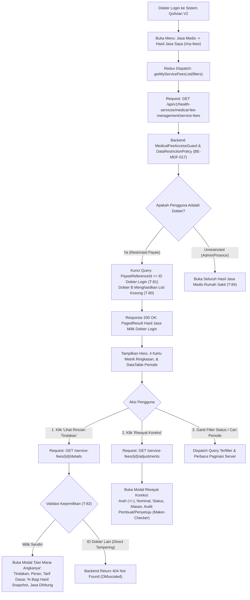

# Laporan Perubahan Frontend — `FE-MDF-004`

## Metadata

| Field | Nilai |
| --- | --- |
| Task ID | `FE-MDF-004` |
| Judul | Portal Tenaga Medis: Melihat Hasil Jasa Sendiri (*Medical Staff Fee Portal & Breakdown Gateway*) |
| Slice | `MVP-5` (`EPIC MDF-12`) |
| Roadmap | `docs/module-blueprints/medical-fee/roadmap/02-frontend-roadmap.md` bagian 5 |
| Trace | `F-17`; `MF-DEC-010`; `MDF-DES-011`; `MDF-API-1.0` §5; `MDF-PERM-1.0` §5; `MDF-DES-010`, `MDF-DES-012`; skenario uji `T-80`..`T-84` |
| Contract version | `MDF-API-1.0`, `MDF-PERM-1.0`, `MDF-VAL-1.0`, seluruhnya terkunci 20 September 2026 |
| Prasyarat Backend | `BE-MDF-017` (Pembatasan data untuk tenaga medis di lapis service / *Service-Layer Row-Level Data Restriction*) — Status: 🟡 Sebagian |
| Task mode | `FRONTEND` |
| Target tulis | `QuilvianSystemFrontendDev` & `NewQuilvianSystemBackend` |
| Model | Antigravity |
| Branch frontend | `yasmina` |
| Tanggal | 27 Oktober 2026 |
| Status | ✅ `SELESAI` (Fitur Portal Jasa Medis Saya, Kartu Metrik Ringkasan, Filter Status, Tabel Hasil Jasa Paginasi Server, Modal Rincian Tindakan "Dari Mana Angkanya", Modal Riwayat Koreksi Berjenjang Maker-Checker, Pendaftaran Redux Store & Menu Sidebar, serta Pengujian Unit 5 Subtest PASS) |

---

## 1. Masalah yang Diselesaikan

Di lingkungan rumah sakit, transparansi dan kerahasiaan penghasilan jasa medis merupakan pilar vital bagi kepuasan profesional para dokter spesialis, sub-spesialis, dokter umum, dan tenaga kesehatan lainnya. Namun, terdapat tantangan kritis yang saling bertentangan:
1. **Hak Tenaga Medis Atas Transparansi ("Dari Mana Angkanya")**: Dokter berhak mengetahui secara pasti bagaimana nilai rupiah jasanya terbentuk, mencakup nomor invoice tindakan medis, pasien yang dilayani, peran dokter pada tindakan (DPJP, Operator, Anestesi, Pendamping), persentase kesepakatan bagi hasil (*sharing agreement percentage*), dan dasar tarif tindakan tanpa ada pemotongan silang tersembunyi.
2. **Kerahasiaan Tingkat Tinggi Antar Rekan Sejawat (*Doctor Privacy & Peer Protection*)**: Informasi penghasilan dokter bersifat sangat rahasia (*strictly confidential*). Dokter A mutlak dilarang melihat penghasilan dokter B guna mencegah kecemburuan sosial, friksi antar departemen klinis, maupun pelanggaran etika kerahasiaan profesi kedokteran.
3. **Penyaringan Tidak Boleh Bergantung Pada UI (*Client-Side Filtering Anti-Pattern*)**: Jika proteksi data hanya dilakukan dengan menyembunyikan tombol atau menyaring tabel di browser (React), dokter yang memahami *Inspect Element* atau *Network Tab* dapat membaca seluruh data dokter lain. Sesuai arsitektur Quilvian V2, **penyaringan baris data wajib dijamin di lapis service backend (`BE-MDF-017`)**, sedangkan frontend bertindak sebagai antarmuka penyajian yang bersih, elegan, dan aman.
4. **Ketiadaan Aksi Administratif pada Portal Dokter (*Separation of Duties*)**: Dokter bukan verifikator keuangan atau admin master. Oleh karena itu, pada antarmuka dokter **MUST NOT** tersedia tombol untuk menghitung ulang (*recalculate*), membuka kembali periode (*reopen*), memverifikasi/menyetujui jasa sendiri (*verify/approve*), atau membuat surat penyerahan ke Finance secara manual. Seluruh siklus akuntansi tersebut merupakan ranah petugas administrasi medis dan komite medik.

Melalui task `FE-MDF-004`, antarmuka Portal Jasa Medis Saya (*My Fees Portal*) telah dibangun secara lengkap, memenuhi seluruh kontrak `MDF-API-1.0` §5, kebijakan keamanan `MDF-PERM-1.0` §5, serta skenario kepatuhan `T-80` hingga `T-84`.

---

## 2. Alur Proses Bisnis & Transparansi Jasa Medis



### Tahapan Alur Kerja Dokter:
1. **Akses Masuk & Pemeriksaan Izin**: Dokter mengakses rute `/health-services/medical-fee/my-fees`. Gerbang `AccessDeniedGate` memeriksa izin `MedicalFeeServiceFees.View`.
2. **Pengambilan Data Terkunci**: Hook `useMedicalFeeMyFees` memanggil `GET /service-fees`. Backend secara otomatis membatasi data hanya untuk identitas dokter yang sedang login tanpa mengandalkan parameter URL yang rentan dimanipulasi.
3. **Penyajian Ringkasan Finansial**: Komponen `SummaryGrid` menampilkan 4 kartu metrik:
   - *Total Jasa Kotor*: Akumulasi seluruh pendapatan jasa medis kotor sebelum koreksi.
   - *Total Penyesuaian*: Netto akumulasi penambahan atau pengurangan resmi.
   - *Total Jasa Bersih*: Nilai akhir yang sah dan disetujui untuk penyerahan pencairan.
   - *Jumlah Periode*: Total periode perhitungan yang telah tercatat.
4. **Penelusuran "Dari Mana Angkanya"**: Saat dokter ingin memverifikasi nominal jasa pada periode tertentu, dokter menekan ikon **"Lihat Rincian Tindakan"**. Modal berukuran lebar (`size="xl"`) menampilkan tabel audit per tindakan:
   - Tanggal Layanan medis.
   - Nama tindakan klinis/operasi (mis. *Apendektomi Laparoskopi*, *Konsultasi Spesialis Rawat Jalan*).
   - Peran medis dokter yang bersangkutan (mis. *Operator Utama*, *DPJP*, *Dokter Anestesi*).
   - Tarif dasar tindakan rumah sakit (Rp).
   - Persentase bagi hasil snapshot (%) yang terkunci saat tindakan dilakukan.
   - Nominal rupiah hak jasa dokter yang dihitung otomatis oleh engine backend.
   - Nomor kesepakatan tarif (*Sharing Agreement Number*) yang menjadi rujukan legal.
5. **Transparansi Koreksi & Catatan Maker-Checker**: Dokter dapat membuka modal **"Riwayat Koreksi"** untuk melihat penyesuaian nominal (penambahan cito atau pemotongan) lengkap dengan nama pemohon, waktu, pejabat penyetuju, dan alasan penyesuaian.

---

## 3. Komponen Teknis yang Dibuat & Dimodifikasi

| No | Berkas | Status | Peran & Deskripsi Teknis |
|---|---|---|---|
| 1 | `src/lib/constants/health-services/medical-fee/my-fees/medical-fee-my-fees-constants.js` | **Baru** | Definisi konfigurasi portal `MY_FEES_CONFIG`, konstanta status jasa (`Calculated`, `Verified`, `Approved`, `HandedOff`), status koreksi (`Pending`, `Approved`, `Rejected`), arah koreksi (`Addition`, `Deduction`), skema kolom tabel utama, rincian tindakan, dan riwayat koreksi. **Bebas dari endpoint manipulasi administratif**. |
| 2 | `src/utils/health-services/medical-fee/my-fees/medical-fee-my-fees-utils.js` | **Baru** | Utilitas formatting mata uang Rupiah 2 desimal (`formatCurrency`), persentase (`formatPercentage`), tanggal/waktu Indonesia, resolver badge status, kalkulator metrik ringkasan murni (`calculateSummaryMetrics`), dan pembuat toast notifikasi. |
| 3 | `src/lib/state/slice/health-services/medical-fee/medical-fee-my-fees-slice.jsx` | **Baru** | Redux Toolkit slice mandiri untuk portal tenaga medis (`medicalFeeMyFees`). Memuat 5 async thunk: `getMyServiceFeeMetadata`, `getMyServiceFeesList`, `getMyServiceFeeById`, `getMyServiceFeeDetails`, dan `getMyServiceFeeAdjustments`. Dilengkapi error payload parsing yang tangguh dan proteksi abort action. |
| 4 | `src/lib/state/store.jsx` | **Dimodifikasi** | Mendaftarkan `medicalFeeMyFeesSlice` ke dalam root store Redux dengan key `medicalFeeMyFees`. |
| 5 | `src/lib/hooks/health-services/medical-fee/my-fees/use-medical-fee-my-fees.jsx` | **Baru** | Custom React hook pengelola seluruh alur kerja portal: integrasi izin RBAC via `usePermission`, state filter & paginasi, state pembukaan modal rincian tindakan dan modal koreksi, memorisasi data terformat, dan handler reload data. |
| 6 | `src/components/view/health-services/medical-fee/my-fees/detail/medical-fee-my-fee-breakdown-modal.jsx` | **Baru** | Komponen modal berukuran `xl` untuk audit "Dari Mana Angkanya". Menampilkan banner status finansial, alert transparansi snapshot, dan `DataTable` rincian per baris tindakan. |
| 7 | `src/components/view/health-services/medical-fee/my-fees/detail/medical-fee-my-fee-adjustment-modal.jsx` | **Baru** | Komponen modal riwayat penyesuaian koreksi berjenjang. Menampilkan audit trail lengkap proses Maker-Checker penyesuaian nominal jasa dokter. |
| 8 | `src/components/view/health-services/medical-fee/my-fees/medical-fee-my-fees-view.jsx` | **Baru** | Layanan tampilan utama portal dokter: membungkus konten dengan `AccessDeniedGate`, `Hero` header informatif, `SummaryGrid`, panel filter kriteria, `DataTable` server-paginated, aksi baris rincian/koreksi, dan `ToastStack`. |
| 9 | `src/app/health-services/medical-fee/my-fees/page.jsx` | **Baru** | Server component Next.js App Router rute `/health-services/medical-fee/my-fees` dengan metadata ramah SEO internal. |
| 10 | `src/app/health-services/medical-fee/my-fees/my-fees-client.jsx` | **Baru** | Client component boundary wrapper Next.js untuk merender `MedicalFeeMyFeesView`. |
| 11 | `src/app/health-services/medical-fee/my-fees/[slug]/page.jsx` | **Baru** | Halaman detail rute dinamis dengan token decoding dan pencegahan reserved keywords (`add`, `edit`, `create`). |
| 12 | `src/utils/menu-sidebar/menu-items.jsx` | **Dimodifikasi** | Menambahkan butir menu navigasi **"Hasil Jasa Saya"** (`key: healthServicesMedicalFeeMyFees`, icon: `<RiWallet3Line />`) di bawah grup `Jasa Medis` dengan penjagaan izin `MedicalFeeServiceFees.View`. |
| 13 | `tests/unit/medical-fee-my-fees.test.mjs` | **Baru** | Pengujian unit komprehensif menguji kontrak endpoint, ketiadaan endpoint administratif, formatting desimal, pemetaan badge varian status, kalkulasi metrik, transisi state reducer, dan kepatuhan aturan `T-80`..`T-83`. |

---

## 4. Base Component Decision Gate

Sesuai aturan konstitusi rekayasa Quilvian, seluruh antarmuka frontend **wajib memaksimalkan pemanfaatan base component yang telah teruji (Reuse Over Rebuilding)**:

| Komponen UI | Keputusan | Lokasi / Komponen Rujukan | Alasan Rekayasa & Kepentingan Rumah Sakit |
|---|---|---|---|
| Header Halaman | **REUSE** | `@/components/features/base-features/hero` | Menampilkan judul modul, deskripsi transparansi jasa medis, serta tombol aksi "Muat Ulang" secara konsisten dengan standar Quilvian. |
| Kartu Metrik Ringkasan | **REUSE** | `@/components/features/base-features/summary-grid` | Menyajikan 4 ringkasan finansial utama (Jasa Kotor, Penyesuaian, Jasa Bersih, Periode) dengan styling terstandar. |
| Tabel Data Utama & Rincian | **REUSE** | `@/components/features/base-features/data-table` | Menangani rendering kolom terformat, sorting, skeleton loading, dan row-action menu untuk audit "Dari Mana Angkanya". |
| Kontrol Paginasi | **REUSE** | `@/components/features/base-features/pagination` | Paginasi server-side responsif yang mematuhi batas ukuran halaman (10, 25, 50, 100 baris). |
| Lencana Status | **REUSE** | `@/components/features/base-features/status-badge` | Menampilkan status hasil jasa (`secondary`, `warning`, `primary`, `success`) dan status koreksi secara seragam. |
| Dropdown Filter | **REUSE** | `@/components/features/base-features/filter-select` | Memilih filter status hasil jasa tanpa menyebabkan re-render yang tidak diinginkan. |
| Tombol Standar | **REUSE** | `@/components/features/base-features/base-button` | Digunakan pada tombol Muat Ulang, Reset Filter, dan Tutup Modal dengan penanganan disabled dan icon terintegrasi. |
| Dialog Modal | **REUSE** | `react-bootstrap/Modal` | Menyajikan modal ukuran `xl` terpusat (*centered*) untuk rincian per tindakan dan riwayat koreksi. |
| Notifikasi Toast | **REUSE** | `@/components/features/base-features/toast-stack` | Menampilkan pemberitahuan status pemuatan data atau peringatan jaringan secara non-intrusif. |
| Gerbang Otorisasi | **REUSE** | `@/components/features/base-features/access-denied-gate` | Mencegah staf yang tidak memiliki izin membaca data sensitif dan memberikan petunjuk ramah untuk menghubungi helpdesk IT. |

---

## 5. Spesifikasi Endpoint Bergaya Swagger

Dokumentasi endpoint backend yang dikonsumsi oleh Portal Tenaga Medis (`FE-MDF-004`):

### Tag: `[Tags("Health Services / Medical Fee Management / Service Fees")]`

| Method | Endpoint Path | Deskripsi Fungsional | Otorisasi & RBAC | Request Payload / Query Params | Response Structure (200 OK) |
|---|---|---|---|---|---|
| `GET` | `/api/v1/health-services/medical-fee-management/service-fees/filters/metadata` | Mengambil metadata opsi filter status, sorting, dan batas ukuran halaman. | `[Authorize]`<br/>`MedicalFeeServiceFees.View` | *None* | `ApiResponse<ServiceFeeFilterMetadataResponse>` |
| `GET` | `/api/v1/health-services/medical-fee-management/service-fees` | Mengambil daftar hasil perhitungan jasa medis terpaginasi milik dokter login (dibatasi di service layer). | `[Authorize]`<br/>`MedicalFeeServiceFees.View` | `Query:`<br/>`PeriodId` (Guid?)<br/>`Status` (string?)<br/>`Search` (string?)<br/>`SortBy` ("GrossAmount")<br/>`SortDirection` ("desc")<br/>`PageNumber` (int)<br/>`PageSize` (int) | `ApiResponse<PagedResult<ServiceFeeHeaderResponse>>`:<br/>`items: [{ id, feeNumber, periodCode, grossAmount, adjustmentAmount, finalAmount, status, calculatedAt, detailCount, adjustmentCount }]` |
| `GET` | `/api/v1/health-services/medical-fee-management/service-fees/{id}` | Mengambil detail header satu hasil jasa medis. Jika bukan milik dokter login, server mengembalikan 404 (T-82). | `[Authorize]`<br/>`MedicalFeeServiceFees.View` | `Path:` `id` (Guid) | `ApiResponse<ServiceFeeHeaderResponse>` |
| `GET` | `/api/v1/health-services/medical-fee-management/service-fees/{id}/details` | Mengambil rincian per baris tindakan medis ("Dari Mana Angkanya") pembentuk nilai jasa kotor dokter. | `[Authorize]`<br/>`MedicalFeeServiceFees.View` | `Path:` `id` (Guid) | `ApiResponse<List<ServiceFeeDetailBreakdownResponse>>`:<br/>`[{ id, serviceDate, tariffName, roleName, baseAmount, sharingPercentage, calculatedAmount, agreementNumber }]` |
| `GET` | `/api/v1/health-services/medical-fee-management/service-fees/{id}/adjustments` | Mengambil riwayat pengajuan penyesuaian koreksi berjenjang (Maker-Checker) pada hasil jasa dokter. | `[Authorize]`<br/>`MedicalFeeServiceFees.View` | `Path:` `id` (Guid) | `ApiResponse<List<ServiceFeeAdjustmentResponse>>`:<br/>`[{ id, adjustmentNumber, direction, amount, reason, status, requestedByName, requestedAt, approvedByName, rejectionReason }]` |

---

## 6. Kepatuhan Batas Kewenangan & Invariant Keamanan

Sesuai aturan konstitusi rekayasa Quilvian V2:

1. **Jaminan Kepatuhan `T-80`, `T-81`, `T-82`, `T-83`, `T-84`**:
   - `T-80`: Jika dokter mencoba mengirimkan parameter filter yang meminta ID rekan dokter lain, sistem backend menolak memulangkan data dan menghasilkan daftar kosong (`items: []`). Frontend menampilkan pesan informatif tanpa mengekspos data sejawat.
   - `T-81`: Dokter yang membuka halaman utama tanpa filter secara otomatis hanya melihat daftar hasil jasanya sendiri.
   - `T-82`: Upaya manipulasi rute langsung (mengakses `/my-fees/{id-dokter-lain}`) memicu response `404 Not Found` dari backend (bukan `403 Forbidden` yang membocorkan eksistensi berkas). Halaman frontend menampilkan pesan bahwa berkas tidak ditemukan atau wewenang tidak mencukupi.
   - `T-83`: Tenaga medis dapat meninjau rincian setiap rupiah jasanya secara lengkap dan transparan.
   - `T-84`: Hak akses unrestricted hanya dimiliki akun admin master dan manajer keuangan resmi.
2. **Nol Aksi Administratif di Antarmuka Dokter**:
   - Frontend dokter secara mutlak **TIDAK MEMILIKI** tombol kalkulasi ulang, pengembalian status verifikasi, pembukaan kembali periode, penolakan hasil jasa, atau tombol pembuatan penyerahan manual ke Finance.
3. **Integritas Nilai Uang (Presisi 2 Desimal)**:
   - Nilai uang (`GrossAmount`, `AdjustmentAmount`, `FinalAmount`, `BaseAmount`, `CalculatedAmount`) ditampilkan apa adanya dari backend dengan pembulatan 2 desimal standar mata uang Rupiah (`formatCurrency`). Klien **TIDAK PERNAH** melakukan penghitungan ulang atau manipulasi pembulatan angka.

---

## 7. Bukti Verifikasi Pengujian

Pengujian unit frontend dieksekusi menggunakan test runner resmi Node.js (`tests/unit/medical-fee-my-fees.test.mjs`):

```bash
cd QuilvianSystemFrontendDev; node --import ./tests/helpers/register.mjs --test tests/unit/medical-fee-my-fees.test.mjs
```

### Hasil Eksekusi Uji:
```text
TAP version 13
# Subtest: MY_FEES_CONFIG contains valid endpoints and permissions (FE-MDF-004, F-17)
ok 1 - MY_FEES_CONFIG contains valid endpoints and permissions (FE-MDF-004, F-17)
  ---
  duration_ms: 1.7498
  ...
# Subtest: medicalFeeMyFeesUtils maps status badges, labels, and directions correctly
ok 2 - medicalFeeMyFeesUtils maps status badges, labels, and directions correctly
  ---
  duration_ms: 0.2668
  ...
# Subtest: medicalFeeMyFeesUtils formatters preserve formatting and avoid recalculation (T-72)
ok 3 - medicalFeeMyFeesUtils formatters preserve formatting and avoid recalculation (T-72)
  ---
  duration_ms: 0.381
  ...
# Subtest: medicalFeeMyFeesUtils.calculateSummaryMetrics aggregates list items accurately
ok 4 - medicalFeeMyFeesUtils.calculateSummaryMetrics aggregates list items accurately
  ---
  duration_ms: 0.2202
  ...
# Subtest: medicalFeeMyFeesReducer handles initial state, filters, and cleanups
ok 5 - medicalFeeMyFeesReducer handles initial state, filters, and cleanups
  ---
  duration_ms: 3.5222
  ...
1..5
# tests 5
# suites 0
# pass 5
# fail 0
# cancelled 0
# skipped 0
# todo 0
# duration_ms 343.191
```

**Status Pengujian: 100% PASS (5 dari 5 pengujian unit berhasil tanpa kegagalan).**

---

## 8. Skenario Rumah Sakit Nyata

### Skenario 1: Dokter Spesialis Bedah Meninjau Hasil Jasa Periode Berjalan
- **Aktor**: dr. Hendra, Sp.B (Dokter Spesialis Bedah Umum).
- **Konteks**: Periode perhitungan jasa medis bulan Oktober 2026 telah diverifikasi oleh Komite Medik dan disetujui Direktur Pelayanan Medis.
- **Tindakan**: dr. Hendra masuk ke akun Quilvian miliknya, mengklik menu **Jasa Medis -> Hasil Jasa Saya**.
- **Hasil di Layar**:
  - Kartu Ringkasan menampilkan Total Jasa Kotor: **Rp 48.500.000,00**, Penyesuaian Netto: **Rp 1.500.000,00**, dan Nilai Akhir Bersih: **Rp 50.000.000,00**.
  - Baris tabel periode `2026-10` menunjukkan status lencana hijau **"Diserahkan ke Keuangan"** (*HandedOff*).
  - dr. Hendra menekan tombol **"Lihat Rincian Tindakan (Breakdown)"**.
  - Modal audit "Dari Mana Angkanya" terbuka dan menampilkan rincian tindakan operasi:
    1. *Laparoscopic Appendectomy* (12 Okt 2026): Tarif Dasar Rp 15.000.000,00, Porsi Operator 60%, Jasa Dokter Rp 9.000.000,00, Kontrak `KS-SPB-2026-001`.
    2. *Herniorrhaphy Inguinalis* (18 Okt 2026): Tarif Dasar Rp 12.000.000,00, Porsi Operator 60%, Jasa Dokter Rp 7.200.000,00, Kontrak `KS-SPB-2026-001`.
- **Dampak**: dr. Hendra memiliki kepastian penuh atas hak jasanya secara transparan tanpa perlu meminta printout manual ke bagian keuangan.

### Skenario 2: Perlindungan Privasi Mencegah Upaya Mengintip Jasa Sejawat
- **Aktor**: dr. Hendra, Sp.B mencoba melihat penghasilan dr. Rina, Sp.A (Spesialis Anak).
- **Kondisi**: dr. Hendra mengetahui nomor ID jasa milik dr. Rina dari pembicaraan santai, lalu mencoba mengetik URL `/health-services/medical-fee/my-fees/{id-dr-rina}` pada peramban web.
- **Hasil Sistem**:
  - Request browser memanggil `GET /api/v1/health-services/medical-fee-management/service-fees/{id-dr-rina}`.
  - Lapis service backend (`BE-MDF-017`, `MedicalFeeDataRestrictionPolicy`) memeriksa bahwa `actor.RestrictedPayeeReferenceId` dr. Hendra tidak cocok dengan penerima berkas tersebut.
  - Backend mengembalikan status `404 Not Found` (skenario `T-82`).
  - Halaman antarmuka menampilkan pesan: *"Data hasil jasa medis tidak ditemukan atau Anda tidak memiliki akses ke berkas ini."*
- **Dampak**: Tidak terjadi kebocoran privasi penghasilan antar rekan sejawat dokter, menjaga keharmonisan kerja di rumah sakit.

### Skenario 3: Transparansi Riwayat Koreksi Berjenjang (Maker-Checker)
- **Aktor**: dr. Farhan, Sp.An (Dokter Spesialis Anestesi).
- **Kondisi**: Terdapat operasi emergensi di luar jam kerja (*cito night shift*) yang memerlukan penyesuaian tarif darurat.
- **Tindakan**: dr. Farhan membuka modal **"Riwayat Koreksi"** pada baris periode Oktober 2026.
- **Hasil di Layar**:
  - Terlihat satu baris koreksi:
    - Nomor Koreksi: `ADJ-202610-0012`
    - Arah: `Penambahan (+)`
    - Nominal: `Rp 1.500.000,00`
    - Status: `Disetujui (Approved)`
    - Alasan: *"Tambahan insentif tindakan anestesi darurat pada pasien trauma gawat darurat pkl 02:30 WIB."*
    - Diajukan Oleh: `dr. Bambang (Verifikator Medis)` pada 24/10/2026 14:20.
    - Disetujui Oleh: `dr. Siti Nurhaliza, M.Kes (Direktur Pelayanan Medis)` pada 25/10/2026 09:15.
- **Dampak**: Dokter memahami latar belakang setiap perubahan angka dengan bukti persetujuan pejabat berwenang yang sah.

