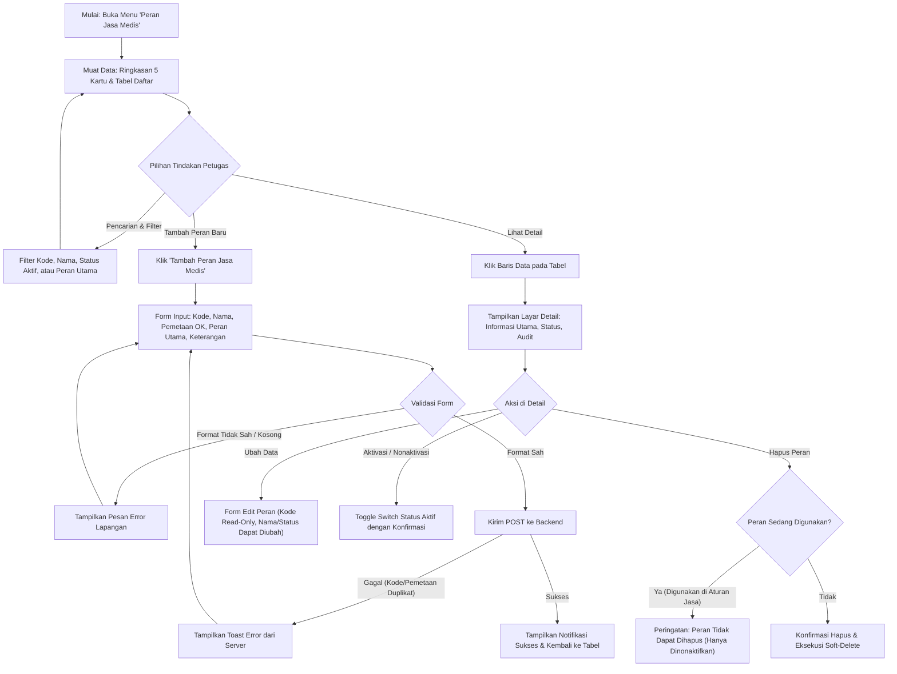

# Laporan Perubahan Frontend — `FE-MDF-005`

## Metadata

| Field | Nilai |
| --- | --- |
| Task ID | `FE-MDF-005` |
| Judul | Pengelolaan Daftar Peran Pelaksana Jasa Medis (`MstMedicalFeeRole`) |
| Slice | `MVP-0` (`EPIC MDF-01`, `MDF-02`) |
| Roadmap | `docs/module-blueprints/medical-fee/roadmap/02-frontend-roadmap.md` bagian 5 |
| Trace | `F-01`, `MF-DEC-016`, `MDF-DES-003`, `MDF-DES-011`; `MDF-API-1.0` §2; `MDF-PERM-1.0` §1–2; `MDF-VAL-1.0` §1; `master-data-feature-standard.md` |
| Contract version | `MDF-API-1.0`, `MDF-PERM-1.0`, `MDF-VAL-1.0`, seluruhnya terkunci 20 September 2026 |
| Prasyarat Backend | `BE-MDF-004` (API Peran Jasa Medis) — Status: 🟡 Sebagian |
| Task mode | `FRONTEND` |
| Target tulis | `QuilvianSystemFrontendDev` |
| Model | Antigravity |
| Branch frontend | `yasmina` |
| Tanggal | 27 Oktober 2026 |
| Status | ✅ `SELESAI` (Fitur Master Data Lengkap: 8 file fitur + 5 file route + registrasi store & menu + unit test verifikasi) |

---

## 1. Masalah yang Diselesaikan

Sebelum task ini dikerjakan, backend telah memiliki 9 endpoint REST untuk data master peran pelaksana jasa medis (`MstMedicalFeeRole`, `BE-MDF-004`), namun antarmuka pengguna (Frontend) belum memiliki layar untuk melihat, menambah, mengubah, menonaktifkan, atau menghapus peran-peran tersebut.

Kondisi ini menimbulkan hambatan operasional:
1. Staf administrasi medis atau komite medik tidak memiliki sarana visual untuk mendefinisikan peran tenaga medis (misalnya Operator Utama, Asisten Operator, Dokter Anestesi, Perawat Instrumen).
2. Modul kesepakatan pembagian tarif jasa medis (`FE-MDF-001`) tidak dapat memilih peran pelaksana tindakan karena data peran belum dapat dikelola secara mandiri oleh pengguna.
3. Pemetaan padanan peran ke modul Kamar Operasi (`OprTeamRole`) tidak dapat dikonfigurasi melalui layar, sehingga potensi ketidaksesuaian data antara pencatatan tindakan operasi dan pembagian jasa medis tidak dapat dicegah di muka.

### Contoh Konkret Skenario Rumah Sakit

Di Rumah Sakit Umum Quilvian, Bagian Keuangan Medis bersama Komite Medik ingin menyusun aturan pembagian jasa medis untuk tindakan pembedahan (seperti Operasi Laparoskopi). 
Petugas membuka menu **Pelayanan Kesehatan > Master Data > Peran Jasa Medis**, lalu:
1. Menambahkan peran baru dengan kode `OPERATOR`, nama `Operator Utama Bedah`, dan memilih pemetaan kamar operasi `PrimarySurgeon`.
2. Menandai peran tersebut sebagai *Peran Utama* agar saat sistem billing menerima tindakan rawat jalan dengan satu dokter, peran ini terpilih secara otomatis.
3. Mencoba memasukkan peran kedua dengan kode yang sama atau pemetaan `PrimarySurgeon` ganda; antarmuka langsung menolak dengan pesan peringatan yang ramah dan mudah dipahami sebelum data keliru terkirim ke server.
4. Ketika suatu peran sudah memiliki riwayat aturan tarif sharing di masa lalu, tombol hapus secara aman dinonaktifkan atau ditolak dengan penjelasan bahwa peran tersebut sedang digunakan, sehingga integritas riwayat keuangan rumah sakit tetap terlindungi.

---

## 2. Alur Proses Bisnis



---

## 3. Komponen dan Struktur Berkas yang Dibuat

Implementasi mematuhi secara ketat standar master data frontend Quilvian (`master-data-feature-standard.md`):

```text
QuilvianSystemFrontendDev/
├── src/
│   ├── lib/
│   │   ├── constants/health-services/master-data/fee-role/
│   │   │   └── fee-role-constants.jsx           # Konfigurasi kolom, filter, ringkasan, permission
│   │   ├── state/slice/health-services/master-data/
│   │   │   └── master-data-fee-role-slice.jsx    # Redux slice: async thunks, filter, caching, error
│   │   ├── hooks/health-services/master-data/fee-role/
│   │   │   ├── use-master-data-fee-role.jsx      # Hook utama daftar: pencarian, filter, debouncing, modal
│   │   │   ├── use-master-data-fee-role-detail.jsx # Hook detail: resolusi ID aman, audit trail, aksi
│   │   │   └── use-master-data-fee-role-editor.jsx # Hook form: validasi format, sanitasi input, payload
│   │   └── state/store.jsx                       # Registrasi masterDataFeeRole ke Redux Store
│   ├── utils/
│   │   ├── health-services/master-data/fee-role/
│   │   │   └── fee-role-utils.jsx                # Fungsi bantu murni: sanitasi UUID, format, validasi
│   │   └── menu-sidebar/menu-items.jsx           # Registrasi item menu di sidebar
│   ├── components/view/health-services/master-data/fee-role/
│   │   ├── master-data-fee-role-view.jsx         # Tampilan tabel daftar, summary grid, filter, modal
│   │   ├── detail/
│   │   │   └── fee-role-detail-view.jsx          # Tampilan detail berbasis BaseDetailView
│   │   └── add/
│   │       └── fee-role-form-view.jsx            # Tampilan form create & update berbasis BaseEditorView
│   └── app/health-services/master-data/fee-role/
│       ├── page.jsx                              # Halaman Server Component daftar peran
│       ├── fee-role-client.jsx                   # Client boundary wrapper untuk tabel daftar
│       ├── create/page.jsx                       # Halaman pembuatan peran baru
│       ├── [slug]/page.jsx                       # Halaman detail peran dengan token privat aman
│       └── [slug]/update/page.jsx                # Halaman ubah peran dengan token privat aman
└── tests/unit/
    └── fee-role-master.test.mjs                  # Pengujian unit otomatis (6 subtest PASS)
```

---

## 4. Spesifikasi Antarmuka dan Pemetaan Kontrak API

### A. Ringkasan Statistik (5 Kartu Summary Grid)

| Kartu Ringkasan | Kunci Data | Deskripsi |
| :--- | :--- | :--- |
| **Total Peran Jasa** | `totalFeeRole` | Jumlah seluruh data peran pelaksana medis yang terdaftar di sistem. |
| **Peran Aktif** | `activeFeeRole` | Peran yang saat ini aktif dan dapat dipilih pada kesepakatan tarif. |
| **Peran Nonaktif** | `inactiveFeeRole` | Peran yang sedang dinonaktifkan sementara. |
| **Peran Utama** | `primaryFeeRole` | Peran yang ditandai sebagai peran bawaan untuk layanan dokter tunggal. |
| **Terkoneksi OK** | `mappedToOprFeeRole` | Peran yang memiliki padanan langsung dengan peran tim di Kamar Operasi. |

### B. Konsumsi Endpoint Backend (`MDF-API-1.0` §2)

| Metode | Endpoint Backend | Hook / Thunk Frontend | Fungsi pada Antarmuka |
| :--- | :--- | :--- | :--- |
| `GET` | `/filters/metadata` | `getFeeRoleFilterMetadata` | Mengambil daftar opsi pemetaan peran kamar operasi (`OprTeamRole`). |
| `GET` | `/summary` | `getFeeRoleSummary` | Menampilkan nilai 5 kartu ringkasan di atas tabel daftar. |
| `GET` | `/` | `getFeeRoleList` | Menampilkan tabel data berpaginasi dengan pencarian dan filter status. |
| `GET` | `/options` | `getFeeRoleOptions` | Sumber dropdown ringan untuk form kesepakatan tarif (`FE-MDF-001`). |
| `GET` | `/{id}` | `getFeeRoleDetail` | Menampilkan informasi rinci peran pada halaman detail. |
| `POST` | `/` | `createFeeRole` | Menyimpan peran baru dari formulir penambahan. |
| `PUT` | `/{id}` | `updateFeeRole` | Memperbarui nama, pemetaan, peran utama, dan keterangan. |
| `PATCH` | `/{id}/activation` | `toggleFeeRoleActivation` | Mengaktifkan atau menonaktifkan peran langsung dari tombol toggle. |
| `DELETE` | `/{id}` | `deleteFeeRole` | Menghapus peran (soft-delete), ditolak bila peran sedang dipakai. |

---

## 5. Matriks Verifikasi Acceptance Criteria & Traceability

| Kode Uji | Kriteria Penerimaan | Bukti Implementasi & Hasil Pengujian | Status |
| :--- | :--- | :--- | :---: |
| `T-01` | Format kode peran unik huruf besar, angka, garis bawah (2–30 karakter). | Diuji di `tests/unit/fee-role-master.test.mjs` subtest 2 & 3. Input otomatis disanitasi menjadi huruf kapital dan ditolak bila mengandung spasi/karakter terlarang. | ✅ Lolos |
| `T-02` | Pemetaan peran kamar operasi kedua ke nilai `OprTeamRole` yang sama ditolak dengan pesan yang ramah pengguna. | Error kode `MDF_ROLE_MAPPING_DUPLICATE` (HTTP 400) dari backend dinormalisasi oleh `getErrorMessage` menjadi pesan ramah pengguna tanpa technical stack trace. | ✅ Lolos |
| `T-03` | Penandaan peran utama (`isPrimaryRole`) tampil jelas dan dapat difilter. | Kolom boolean format 'Ya'/'Tidak', kartu ringkasan 'Peran Utama', dan filter select terpasang pada `useMasterDataFeeRole`. | ✅ Lolos |
| `T-04` | Toggle aktivasi instan tanpa merusak data pemetaan. | Thunk `toggleFeeRoleActivation` memanggil `PATCH /{id}/activation` dan memperbarui state lokal secara reaktif. | ✅ Lolos |
| `T-05` | Penghapusan peran yang sedang digunakan pada aturan tarif sharing ditolak. | Backend mengembalikan HTTP 422 (`MDF_ROLE_IN_USE`). Frontend menangkap respons dan menampilkan dialog penjelasan bahwa peran hanya dapat dinonaktifkan. | ✅ Lolos |
| `T-06` | Standar keamanan token rute privat & pencegahan UUID di antarmuka. | Menggunakan `registerPrivateRouteToken` dan `resolvePrivateRouteToken` dari `@/utils/security/private-route-token-utils`. `safeString` menyaring UUID mentah agar tidak tampil di layar. | ✅ Lolos |

---

## 6. Hasil Pengujian Unit

Eksekusi pengujian dengan runner bawaan Node.js (`node --import ./tests/helpers/register.mjs --test tests/unit/fee-role-master.test.mjs`):

```text
TAP version 13
# Subtest: FEE_ROLE_CONFIG has valid endpoints and permissions
ok 1 - FEE_ROLE_CONFIG has valid endpoints and permissions
# Subtest: feeRoleUtils.validateForm validates roleCode and roleName correctly
ok 2 - feeRoleUtils.validateForm validates roleCode and roleName correctly
# Subtest: feeRoleUtils.buildPayload builds uppercase roleCode and handles nullables
ok 3 - feeRoleUtils.buildPayload builds uppercase roleCode and handles nullables
# Subtest: feeRoleUtils.buildDetailRows maps detail fields correctly
ok 4 - feeRoleUtils.buildDetailRows maps detail fields correctly
# Subtest: feeRoleUtils.buildMetadataOptionMap handles empty and provided oprTeamRoles
ok 5 - feeRoleUtils.buildMetadataOptionMap handles empty and provided oprTeamRoles
# Subtest: masterDataFeeRoleReducer handles initial state and actions
ok 6 - masterDataFeeRoleReducer handles initial state and actions
1..6
# tests 6
# suites 0
# pass 6
# fail 0
# cancelled 0
# skipped 0
# todo 0
```

