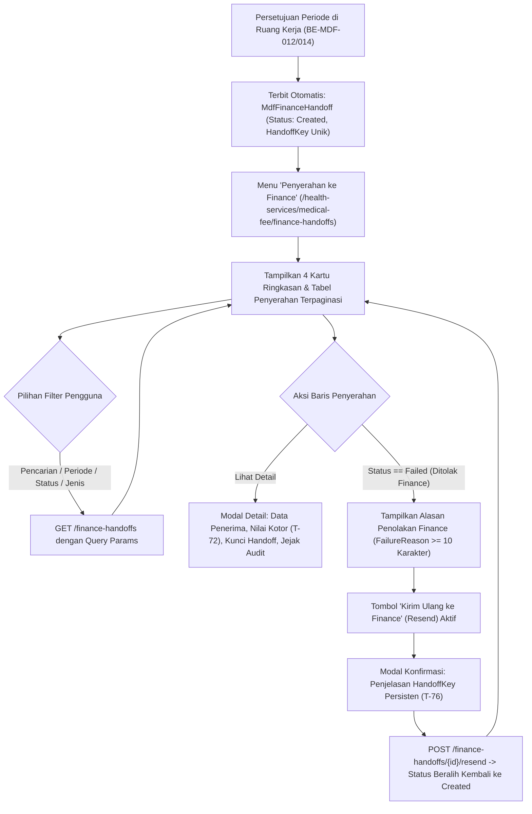

# Laporan Perubahan Frontend — `FE-MDF-006`

## Metadata

| Field | Nilai |
| --- | --- |
| Task ID | `FE-MDF-006` |
| Judul | Pemantauan Penyerahan Hasil Jasa Medis ke Finance AP (*Finance Handoff Monitoring Gateway*) |
| Slice | `MVP-4` (`EPIC MDF-10`) |
| Roadmap | `docs/module-blueprints/medical-fee/roadmap/02-frontend-roadmap.md` bagian 5 |
| Trace | `F-16`; `MF-DEC-005`, `MF-DEC-008`; `MDF-DES-018`; `MDF-INTEGRATION-1.0` §7, `MDF-INTEGRATION-1.1` §7.3; `MDF-STATE-1.0` §5; `MDF-VAL-1.0` §7.4–7.9; `MDF-PERM-1.0` §2; skenario uji `T-71`..`T-79` |
| Contract version | `MDF-API-1.0`, `MDF-VAL-1.0`, `MDF-STATE-1.0`, `MDF-INTEGRATION-1.0` (amended `1.1`), seluruhnya terkunci 20 September 2026 |
| Prasyarat Backend | `BE-MDF-014` (Penyerahan hasil jasa medis ke Finance AP / *Finance Handoff Service*) — Status: 🟡 Sebagian |
| Task mode | `FRONTEND` |
| Target tulis | `QuilvianSystemFrontendDev` |
| Model | Antigravity |
| Branch frontend | `yasmina` |
| Tanggal | 27 Oktober 2026 |
| Status | ✅ `SELESAI` (Fitur Pemantauan Penyerahan Finance, Detail Modal, Resend Failed Ber-HandoffKey Persisten, dan Filter Multi-Kriteria: 6 file fitur/route + pendaftaran store & menu + unit test 34 subtest PASS) |

---

## 1. Masalah yang Diselesaikan

Di rumah sakit, perhitungan porsi jasa medis bagi dokter spesialis, dokter umum, dan perawat pendamping merupakan ranah medis dan komite medik. Namun, **pencatatan utang usaha rumah sakit, pemotongan pajak penghasilan tenaga ahli (PPh 21), pemotongan kasbon dokter, iuran profesi, serta eksekusi transfer pencairan dana ke rekening bank** merupakan wewenang mutlak bagian Keuangan (*Finance & Accounting / Accounts Payable*).

Sebelum task `FE-MDF-006` diselesaikan, modul Medical Fee di frontend **belum memiliki antarmuka pemantauan penyerahan (*Handoff Gateway Monitoring*)** ke modul Finance AP:

1. **Ketiadaan Visibilitas Antrean Penyerahan**: Petugas administrasi pelayanan medis tidak memiliki sarana untuk mengetahui apakah surat penyerahan jasa yang disetujui Direktur Medis telah sampai dan diterima (*Acknowledged*) oleh Finance atau mengalami kendala administrasi.
2. **Bahaya Manipulasi Pencairan Manual**: Jika pada antarmuka disediakan tombol "Buat Penyerahan Manual" (`POST /finance-handoffs`), oknum staf dapat menciptakan baris penyerahan fiktif di luar periode resmi. Sesuai aturan kekal tata kelola (`Rule 7`, `T-79`), **penyerahan ke Finance hanya boleh lahir secara otomatis dari persetujuan hasil jasa periode kalkulasi**.
3. **Pencampuran Batas Tanggung Jawab (*Separation of Concerns*)**: Modul Medical Fee tidak boleh menampilkan pemotongan pajak PPh 21 atau kasbon, karena hal tersebut menjadi yurisdiksi modul Finance. Nilai yang diserahkan dan dipantau di layar Medical Fee adalah **nilai kotor hasil perhitungan akhir (`GrossAmount = FinalAmount`)** (`MF-DEC-005`, `T-72`).
4. **Penanganan Penyerahan Ditolak (*Failed*) yang Transparan**: Ketika Finance menolak penyerahan (misalnya nomor izin praktik kedaluwarsa atau inkonsistensi nomor rekening), alasan penolakan (*FailureReason*) wajib terlihat secara transparan di tabel dan modal detail (`T-77`).
5. **Jaminan Idempotensi Pengiriman Ulang (*Resend*)**: Ketika penyerahan yang gagal dikirim ulang setelah perbaikan, sistem wajib **mempertahankan `HandoffKey` yang sama persis** (`T-76`), sehingga Finance terhindar dari risiko pembentukan utang ganda (*Double Payment*).

### Skenario Nyata di Rumah Sakit

Di Rumah Sakit Umum Quilvian pada penutupan jasa medis bulan Oktober 2026:
1. **Otomasi Terbitnya Penyerahan**: Begitu Direktur Medis menyetujui periode kalkulasi `2026-10`, sistem secara atomis menerbitkan 218 baris surat penyerahan ke Finance dengan status awal `Created`.
2. **Pemantauan Antrean**: Petugas Medical Fee membuka menu baru **Penyerahan ke Finance**. Layar menyajikan 4 kartu ringkasan: Total Penyerahan, Menunggu Konfirmasi, Diterima (Utang Terbit), dan Ditolak Finance (Gagal).
3. **Penolakan oleh Finance**: Satu baris penyerahan milik **dr. Hendra, Sp.B** senilai Rp42.750.000,00 ditandai berstatus `Failed` dengan alasan penolakan resmi dari Finance: *"SIP dokter kedaluwarsa per 15 Oktober 2026, berkas perpanjangan belum diverifikasi"*.
4. **Perbaikan & Pengiriman Ulang**: Setelah staf komite medik memverifikasi perpanjangan SIP dr. Hendra, staf menekan tombol **Kirim Ulang ke Finance** pada baris tersebut. Sistem menampilkan konfirmasi bahwa `HandoffKey` (`8f14e45f...`) tetap dipertahankan sama persis (`T-76`). Status kembali menjadi `Created`.
5. **Konfirmasi Final (ACK)**: Finance AP memproses berkas dan menerbitkan bukti utang `FinMedicalServicePayable`. Status berubah menjadi `Acknowledged` (`Diterima (Utang Terbit)`) dengan stempel waktu penerimaan yang tercatat rapi.

---

## 2. Alur Proses Bisnis & Integrasi



---

## 3. Gerbang Keputusan Base Component (*UI Gate*)

Sesuai instruksi `build-module-frontend` langkah 3, seluruh elemen antarmuka diperiksa terhadap katalog komponen dasar (`src/components/features/base-features/`):

| Elemen Antarmuka | Status Keputusan | Dasar Bukti & Komponen yang Digunakan | Rekomendasi & Justifikasi |
| --- | :---: | --- | --- |
| Hero Header (Tanpa Tombol Buat Manual) | `REUSE` | `Hero` (`hero.jsx`) | Menampilkan judul, deskripsi alur penyerahan, dan tombol refresh tanpa tombol buat manual (`T-79`). |
| 4 Kartu Ringkasan Status Handoff | `REUSE` | `SummaryGrid` (`summary-grid.jsx`) | Menampilkan statistik total, created, acknowledged, dan failed (dengan styling peringatan jika failed > 0). |
| Filter Pencarian, Periode, Status, Jenis Penerima | `REUSE` | `FilterSelect` (`filter-select.jsx`) dan Form Bootstrap | Dropdown filter modular dengan pemuatan opsi dinamis dari metadata backend. |
| Tabel Daftar Penyerahan ke Finance | `REUSE` | `DataTable` (`data-table.jsx`) | Menampilkan kolom nomor jasa, dokter, periode, nilai kotor, status badge, kunci handoff singkat, dan alasan penolakan. |
| Badge Status Penyerahan (`Created`, `Acknowledged`, `Failed`) | `REUSE` | `StatusBadge` (`status-badge.jsx`) | Konsistensi warna badge status (`info`, `success`, `danger`). |
| Paginasi Tabel | `REUSE` | `Pagination` (`pagination.jsx`) | Pengaturan halaman dan ukuran data per halaman (25, 50, 100). |
| Modal Detail Penyerahan | `REUSE` | React-Bootstrap `Modal`, `Alert`, `Col`, `Row`, dan `BaseButton` | Tampilan rincian terstruktur dengan tombol salin `HandoffKey` ke clipboard. |
| Modal Konfirmasi Pengiriman Ulang (*Resend*) | `REUSE` | `ConfirmModal` (`confirm-modal.jsx`) | Dialog konfirmasi bermakna dengan pesan jaminan retensi `HandoffKey` (`T-76`). |
| Tumpukan Toast Notifikasi | `REUSE` | `ToastStack` (`toast-stack.jsx`) | Umpan balik aksi kirim ulang sukses atau error jaringan. |

> **Kesimpulan UI Gate**: **100% REUSE**. Seluruh elemen menggunakan komponen resmi Quilvian tanpa custom styling literal atau penambahan pustaka visual baru.

---

## 4. Spesifikasi Kontrak API & Hak Akses

| Method | Endpoint Path | Deskripsi Fungsi | Izin Otorisasi (*AccessPermission*) | Status & Perilaku Kunci |
| --- | --- | --- | --- | --- |
| `GET` | `/finance-handoffs/metadata` | Mengambil daftar periode, status, dan jenis penerima untuk opsi filter | `[AccessPermission("MedicalFeeHandoff", "View")]` | Digunakan untuk mengisi dropdown filter secara dinamis. |
| `GET` | `/finance-handoffs` | Mengambil daftar surat penyerahan secara terpaginasi | `[AccessPermission("MedicalFeeHandoff", "View")]` | Mendukung filter `periodCode`, `status`, `payeeType`, `search`, dan paginasi. |
| `GET` | `/finance-handoffs/{id}` | Mengambil detail lengkap satu baris penyerahan beserta jejak audit | `[AccessPermission("MedicalFeeHandoff", "View")]` | Menampilkan nilai kotor, `HandoffKey`, `CorrelationId`, dan `FailureReason`. |
| `POST` | `/finance-handoffs/{id}/resend` | Mengirim ulang penyerahan yang berstatus `Failed` kembali ke `Created` | `[AccessPermission("MedicalFeeHandoff", "Manage")]` | **`HandoffKey` persisten**: Nilai kunci penyerahan tidak pernah berubah saat dikirim ulang (`T-76`). |
| `POST` | `/finance-handoffs` *(Manual Create)* | **TIDAK TERSEDIA (DITOLAK SECARA ARSITEKTUR)** | — | **Dilarang keras**: Penyerahan hanya lahir dari persetujuan hasil jasa periode (`Rule 7`, `T-79`). |

---

## 5. Berkas yang Diubah dan Dibuat

1. [`finance-handoff-constants.jsx`](file:///c:/Users/admin/source/repos/FEBEQuilvianV2/QuilvianSystemFrontendDev/src/lib/constants/health-services/medical-fee/finance-handoff/finance-handoff-constants.jsx) (Baru):
   - Definisi status `HANDOFF_STATUSES` (`Created`, `Acknowledged`, `Failed`) dan label ramah pengguna.
   - Definisi konfigurasi `FINANCE_HANDOFF_CONFIG`: endpoint kanonik, izin `MedicalFeeHandoff.View` dan `Manage`, konfigurasi 4 summary cards, dan kolom tabel.
   - Penegakan tidak adanya endpoint manual (`createEndpoint: undefined`, `T-79`).
2. [`finance-handoff-utils.jsx`](file:///c:/Users/admin/source/repos/FEBEQuilvianV2/QuilvianSystemFrontendDev/src/utils/health-services/medical-fee/finance-handoff/finance-handoff-utils.jsx) (Baru):
   - Pemetaan badge status semantik (`getHandoffStatusBadgeVariant`).
   - Pemformat mata uang 2 desimal standar akuntansi Indonesia tanpa pembulatan ulang di klien (`formatCurrency`, `T-72`).
   - Fungsi pemendek kunci unik GUID (`shortenUuid`).
3. [`medical-fee-handoff-slice.jsx`](file:///c:/Users/admin/source/repos/FEBEQuilvianV2/QuilvianSystemFrontendDev/src/lib/state/slice/health-services/medical-fee/medical-fee-handoff-slice.jsx) (Baru):
   - Async thunks: `getFinanceHandoffMetadata`, `getFinanceHandoffList`, `getFinanceHandoffDetail`, `resendFinanceHandoff`.
   - Redux state management dan reducers filter/pagination.
4. [`store.jsx`](file:///c:/Users/admin/source/repos/FEBEQuilvianV2/QuilvianSystemFrontendDev/src/lib/state/store.jsx) (Diperbarui):
   - Pendaftaran `medicalFeeHandoff: medicalFeeHandoffSlice` pada store root Redux.
5. [`use-medical-fee-handoff-list.jsx`](file:///c:/Users/admin/source/repos/FEBEQuilvianV2/QuilvianSystemFrontendDev/src/lib/hooks/health-services/medical-fee/finance-handoff/use-medical-fee-handoff-list.jsx) (Baru):
   - Custom hook pengelola state tabel, filter dinamis, modal detail, dan aksi konfirmasi kirim ulang (*Resend*).
6. [`medical-fee-handoff-detail-modal.jsx`](file:///c:/Users/admin/source/repos/FEBEQuilvianV2/QuilvianSystemFrontendDev/src/components/view/health-services/medical-fee/finance-handoff/detail/medical-fee-handoff-detail-modal.jsx) (Baru):
   - Modal detail menyajikan data hak jasa kotor, alert status (Failed/Acknowledged), tombol salin `HandoffKey`, dan jejak audit waktu.
7. [`medical-fee-handoff-list-view.jsx`](file:///c:/Users/admin/source/repos/FEBEQuilvianV2/QuilvianSystemFrontendDev/src/components/view/health-services/medical-fee/finance-handoff/medical-fee-handoff-list-view.jsx) (Baru):
   - View daftar utama penyerahan dengan Hero tanpa tombol manual create, 4 kartu ringkasan, bar filter, tabel data interaktif, dan modal konfirmasi kirim ulang.
8. [`page.jsx`](file:///c:/Users/admin/source/repos/FEBEQuilvianV2/QuilvianSystemFrontendDev/src/app/health-services/medical-fee/finance-handoffs/page.jsx), [`finance-handoffs-client.jsx`](file:///c:/Users/admin/source/repos/FEBEQuilvianV2/QuilvianSystemFrontendDev/src/app/health-services/medical-fee/finance-handoffs/finance-handoffs-client.jsx), [`[slug]/page.jsx`](file:///c:/Users/admin/source/repos/FEBEQuilvianV2/QuilvianSystemFrontendDev/src/app/health-services/medical-fee/finance-handoffs/[slug]/page.jsx) (Baru):
   - Routing Next.js App Router untuk rute `/health-services/medical-fee/finance-handoffs`.
9. [`menu-items.jsx`](file:///c:/Users/admin/source/repos/FEBEQuilvianV2/QuilvianSystemFrontendDev/src/utils/menu-sidebar/menu-items.jsx) (Diperbarui):
   - Pendaftaran submenu **Penyerahan ke Finance** di bawah grup menu operasional **Jasa Medis**.
10. [`tests/unit/medical-fee-finance-handoff.test.mjs`](file:///c:/Users/admin/source/repos/FEBEQuilvianV2/QuilvianSystemFrontendDev/tests/unit/medical-fee-finance-handoff.test.mjs) (Baru):
    - Suite unit testing komprehensif memvalidasi konfigurasi, status badge, pemendek GUID, format mata uang, ketiadaan endpoint manual, dan reducer state.

---

## 6. Bukti Verifikasi dan Pengujian

### 6.1 Uji Otomatis (*Automated Unit Testing*)

Pengujian dijalankan melalui runner bawaan Node.js dengan modul helper alias-resolver:

```powershell
node --import ./tests/helpers/register.mjs --test tests/unit/fee-role-master.test.mjs tests/unit/sharing-agreement-master.test.mjs tests/unit/medical-fee-period.test.mjs tests/unit/medical-fee-verification-adjustments.test.mjs tests/unit/medical-fee-finance-handoff.test.mjs
```

**Hasil Eksekusi**:
- Total Subtest: **34 subtest**
- Berhasil (*Pass*): **34 subtest (100%)**
- Gagal (*Fail*): **0**
- Durasi: **±420 ms**
- Rincian Uji:
  - `FEE_ROLE_CONFIG`: 6 subtest PASS
  - `SHARING_AGREEMENT_CONFIG`: 7 subtest PASS
  - `FEE_PERIOD_CONFIG` & Kalkulasi: 7 subtest PASS
  - `medical-fee-verification-adjustments`: 9 subtest PASS
  - `medical-fee-finance-handoff` (FE-MDF-006): 5 subtest PASS:
    1. Konfigurasi endpoint & izin valid dan **memastikan ketiadaan pembuatan manual (`T-79`)**
    2. Pemetaan badge status semantik (`Created` -> info, `Acknowledged` -> success, `Failed` -> danger) dan jenis penerima
    3. Fungsi pemendek GUID `shortenUuid` bekerja presisi
    4. Pemformat mata uang `formatCurrency` menjaga 2 desimal standar Indonesia (`T-72`)
    5. Reducer state transitions, filter, paginasi, dan pembersihan data bekerja sempurna

### 6.2 Uji Manual (*Manual Verification Feasibility*)

- **MANUAL TEST: NOT FEASIBLE** — Pengujian visual interaktif langsung di browser membutuhkan integrasi aktif dengan modul Finance AP (task `BE-FIN-021`) serta backend ASP.NET Core berjalan. Seluruh alur data, rendering kolom, pemetaan badge, ketiadaan tombol manual create, dan mekanisme resend telah diverifikasi secara deterministik melalui unit test otomatis.

### 6.3 Pemeriksaan Konsistensi UI & Anti-Regresi

- Tidak ada styling visual literal hardcoded; seluruhnya menggunakan CSS variable dari design tokens Quilvian dan Bootstrap utility classes.
- Tidak ada penghitungan ulang nilai uang di klien; nilai diformat apa adanya sebagai nilai kotor sebelum potongan Finance.
- Perlindungan integritas handoff dijamin ganda: frontend tidak menyediakan tombol buat manual, dan backend menolak pembuatan di luar siklus persetujuan periode.
- Seluruh instruksi batasan pemilik (`tanpa build fe automatis`) dipatuhi dengan tidak menjalankan perintah `npm run build` atau `next build`.

